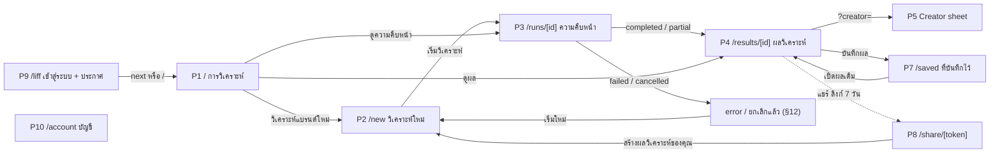

# DESIGN.md — TikTok KOL Matcher (Convert Cake look & feel)

> **Version:** 1.3 · **Date:** 2026-10-21 · ใช้คู่กับ [`SYSTEM_DESIGN.md`](./SYSTEM_DESIGN.md) และ [`docs/UI_CONTRACT.md`](./docs/UI_CONTRACT.md)
> design system + UI/UX spec ของ Web (`apps/web`) และ LINE LIFF · อธิบาย UI ที่สร้างแล้วจริง · source of truth สำหรับนักพัฒนาและ AI coding agent
>
> **สัญญาที่มีผลบังคับ:** [`docs/UI_CONTRACT.md`](./docs/UI_CONTRACT.md) คือกฎ UI ที่ผูกพันทุกหน้าจอใน `apps/web` — **ถ้าเอกสารนี้ขัดกับ UI_CONTRACT ให้ยึด UI_CONTRACT** · เอกสารนี้ขยายความ (ที่มาของค่า, การ map จาก `FinalResult`, copy, states) และบันทึกสิ่งที่สร้างแล้ว/ยังไม่สร้าง
>
> **ที่มาของค่า:** **B** = ค่าที่ใช้จริงใน `apps/web` (`app/globals.css`, components) ตาม UI_CONTRACT · **C** = ดึงจาก CSS จริงของ convertcake.com (WordPress/Elementor kit `post-24.css` + theme `main.css`) · **I** = sample จาก pixel ของ logo/ภาพโฆษณา · **E** = ค่าที่เราออกแบบ/ปรับเพิ่ม
> **เครื่องหมายการค้า:** โลโก้และชื่อ Convert Cake เป็นของ Convert Cake Co., Ltd. · prototype ต้องติดป้าย "Concept prototype for Convert Cake assessment" (ยังไม่แสดงใน `apps/web` — ดู §9.16) · ห้าม hotlink asset จากเว็บ CVC ใน production (ขอไฟล์ SVG ทางการ) · ในแอปใช้ product mark ที่วาดเอง (§6.1) ไม่ใช้โลโก้ CVC
> **v1.3:** ปรับให้ตรงกับ UI ที่สร้างแล้วและ UI_CONTRACT — ฟอนต์ Mitr อย่างเดียว, สีแบบ accent ladder (เลิก gradient / glass / glow / CTA card / hero พื้นเข้ม / ไอคอนในกรอบหมุน / cyan), shell แบบ open plane (sidebar 240px, ไม่มี top bar บน desktop), ปุ่ม/ช่องกรอก 36px (มือถือ 44px), signature elements ที่สร้างจริง (รูปครีเอเตอร์, fit strip, expected-views bullet, ป้ายความมั่นใจ/สมมติฐาน, KPI strip), ตารางครีเอเตอร์แทน KolCard, creator sheet 5 แท็บ, แผนงาน, แชท, หน้าจอตาม route จริง, ไม่มี emoji และเครื่องหมายอัศเจรีย์
> **v1.2:** ประกาศความเป็นส่วนตัวก่อนอัปโหลดแรก (รายชื่อผู้ประมวลผลครบ), ลบผลลัพธ์ถาวร vs นำออกจากที่บันทึก, opt-out 2 ขั้น + คิว admin, `addedFromChat`/`redactedCreators`, relax 2 แบบ, copy LINE push = Phase 2, เวลา 5–9 นาที
> **v1.1:** แก้ contrast ของ semantic colors, แก้ป้าย C/E ให้ตรง CSS จริง, tokens ครบ, เพิ่มหน้าจอ P10–P14, ShareDialog, สถานะ narrative-pending/what-if, ปุ่มยกเลิก, ประกาศความเป็นส่วนตัวใต้ CTA, เปลี่ยนรหัสหน้าจอเป็น P* (ไม่ชนกับ spike SP* ใน SYSTEM_DESIGN)

---

## สารบัญ

1. [Design Principles](#1-design-principles)
2. [Brand Foundation](#2-brand-foundation)
3. [Color](#3-color)
4. [Typography](#4-typography)
5. [Layout, Shape, Elevation & Motion](#5-layout-shape-elevation--motion)
6. [Iconography & Platform Assets](#6-iconography--platform-assets)
7. [Content, Tone & Formatting](#7-content-tone--formatting)
8. [Components (และการ map จาก `FinalResult` JSON)](#8-components-และการ-map-จาก-finalresult-json)
9. [Screens & Flows](#9-screens--flows)
10. [LINE LIFF Guidelines](#10-line-liff-guidelines)
11. [Accessibility](#11-accessibility)
12. [States: Loading, Empty, Error, Partial](#12-states-loading-empty-error-partial)
13. [Implementation](#13-implementation)
14. [Do & Don't](#14-do--dont)
15. [Sources](#15-sources)

---

## 1. Design Principles

| # | Principle | ความหมายในผลิตภัณฑ์นี้ |
|---|---|---|
| 1 | **Performance-first, not vanity** | ตาม positioning ของ CVC ("Go Beyond Likes, Drive Real Conversions") — แสดงเหตุผลว่าทำไมครีเอเตอร์คนนี้ทำยอดได้ (fit, audience, performance, trust, cost, CPV, ผลคาดการณ์) มากกว่าจำนวน follower |
| 2 | **Explainable by default** | ทุกคะแนนดู "ทำไม" ได้ (fit strip + ตารางคะแนนรายกลุ่ม) · ทุกตัวเลขมีแหล่งที่มา วันที่ ความมั่นใจ · ค่าคาดการณ์แสดงเป็นช่วงและติดป้ายเสมอ · ข้อมูลที่ขาดแสดงชัด |
| 3 | **Thai-first** | copy ภาษาไทยก่อน ปนศัพท์วงการ (ER, CPV, Conversion) · ใน UI เรียก "ครีเอเตอร์" (KOL ใช้ในชื่อโปรเจกต์/เอกสารเท่านั้น) · ฟอนต์ Mitr รองรับวรรณยุกต์ซ้อน |
| 4 | **Tool, not a landing page** | ผู้ใช้เปิดมาเจอหน้าที่ทำงานได้ทันที (ตารางการวิเคราะห์ + ปุ่มเดียว) · ไม่มี hero, ไม่มี marketing copy บนหน้าทำงาน · desktop = sidebar + ตาราง + rail แผนงาน/แชท · มือถือ/LIFF = top bar 48px + คอลัมน์เดียว ปุ่มสูง 44px |
| 5 | **Progressive disclosure** | สรุปก่อน (KPI strip, ตาราง) รายละเอียดใน creator sheet · ระหว่างวิเคราะห์เห็นผลทีละส่วน (stage → brand card → จำนวนผู้เข้าเกณฑ์ → ตัวอย่างครีเอเตอร์) |
| 6 | **On-brand แบบ accent ladder** | น้ำเงิน Convert Cake `#0536D2` บนเครื่องหมายเล็กเท่านั้น · พื้นที่ใช้ tint อ่อน · พื้นการ์ดขาว ขอบ 1px ไม่มีเงา · light theme อย่างเดียว · ไม่มี gradient / glass / glow |
| 7 | **Never show a number we did not compute** | ตัวเลขทั้งหมดมาจาก code ไม่ใช่ LLM · ข้อมูลตัวอย่างติดป้ายเสมอ (demo banner + `isDemo`) · สมมติฐานที่ยังไม่ปรับเทียบติดป้าย "สมมติฐาน" |

---

## 2. Brand Foundation

- **Company:** Convert Cake — performance marketing agency ในกรุงเทพฯ (ก่อตั้ง 2018, ~60 คน) · tagline **"We make conversions a piece of cake."** · Google Premier Partner, Meta Business Partner, **TikTok Agency Partner**
- **Visual DNA ของเว็บ CVC (อ้างอิง):** electric/royal blue เป็นสีหลัก, navy สำหรับหัวข้อใหญ่, cyan glow, หัวข้อ two-tone, CTA การ์ดน้ำเงินมี glow + ไอคอนในกรอบหมุน 45°, diamond bullet, stat callout แบบ speech bubble, social ads แบบ gradient/glass/ตัวอักษรเรืองแสง
- **สิ่งที่ผลิตภัณฑ์นี้รับมา:** น้ำเงิน `#0536D2` (C) เป็น accent เดียว และเฉดอ่อนของมัน (`#C8D4FB`, `#04299E` จาก CSS ของ CVC) · ความตรงไปตรงมาแบบ performance
- **สิ่งที่ไม่ใช้ (v1.3):** gradient, glass, glow, CTA card, hero พื้นเข้ม, ไอคอนในกรอบหมุน 45°, diamond bullet, speech-bubble callout, หัวข้อ two-tone, cyan accent, navy headline, ฟอนต์ Manrope/Noto Sans Thai/Prompt — เพราะเป็นภาษาของหน้าโฆษณา ไม่ใช่เครื่องมือที่เปิดใช้ทุกวัน (UI_CONTRACT §1–2)
- **Logo:** โลโก้ CVC ทางการ (mark #3A4EFF + wordmark navy #000E3E) ใช้ได้เฉพาะไฟล์ทางการ · ห้ามสร้าง wordmark ด้วยฟอนต์ · ในแอปใช้ **product mark** ที่วาดเอง (วงกลมสองวงซ้อนกัน = แบรนด์กับครีเอเตอร์ "match", §6.1) คู่กับข้อความ "Convert Cake · Influencer"

---

## 3. Color

### 3.1 Accent ladder (หนึ่ง hue: Convert Cake blue)

| Token | Hex | Src | ใช้กับ |
|---|---|---|---|
| `--accent` | `#0536D2` | C | **เครื่องหมายเล็กเท่านั้น:** ปุ่ม filled ปุ่มเดียวของหน้าจอ, data series (fill ของ fit strip, tick p50, progress bar), ไอคอน nav ที่ active, ลิงก์, focus ring, checkbox ที่เลือก, ไอคอน stage ที่เสร็จ |
| `--accent-hover` | `#042CB0` | B | hover ของปุ่ม filled |
| `--accent-soft` | `#EEF2FE` | B | พื้นที่: แถว nav ที่ active, แถวตารางที่เลือก, badge accent, persona chip ที่เลือก, user message ในแชท, initials ของ avatar |
| `--accent-track` | `#E3E9FD` | B | track ของ progress bar, fit strip, expected-views bullet |
| `--accent-line` | `#C8D4FB` | C (`blue-200`) | ช่วง p25–p75 ของ expected-views bullet, กรอบ persona chip ที่เลือก, กรอบ notice แบบ accent |
| `--accent-ink` | `#04299E` | C (`blue-700`) | ข้อความบน `--accent-soft` / `--accent-track` |

- **Colour budget:** 3–10% ของจอ เกือบทั้งหมดเป็นพื้นที่ `--accent-soft`/`--accent-track` · ใช้ `--accent` เต็มเฉดเฉพาะเครื่องหมายเล็ก · **ห้ามเทพื้นที่ใหญ่ด้วย `--accent`** (ไม่มี hero/แบนเนอร์/การ์ดน้ำเงินทึบ)
- ห้าม violet / indigo / purple และห้ามน้ำเงินเฉดอื่นปน
- **ค่าแบรนด์ CVC อื่น (อ้างอิงเท่านั้น ไม่ใช้ใน UI):** `#3A4EFF` (logo mark, I), `#063DEF` (royal, I), `#597EF3`, `#E3E8FF`, `#E6ECFD`, `#163BB0`, `#031B69`, navy `#000E41`/`#041038`, cyan `#5BFCF4`/`#5CEEEE` (C)

### 3.2 Neutrals & semantic tokens

| Token | Hex | Src | ใช้กับ |
|---|---|---|---|
| `--ground` | `#F7F8FC` | B | พื้นหลังหน้า (และ sidebar ซึ่งไม่มี fill ของตัวเอง) · `themeColor` ของ viewport |
| `--surface` | `#FFFFFF` | B | การ์ด, ตัวตาราง, sheet, dialog, toast, tooltip |
| `--raised` | `#F2F4F8` | B | hover ของแถว/ปุ่ม secondary, header row ของตาราง, skeleton, track ของ segmented control, demo banner |
| `--border` | `#E6E8EF` | B | ขอบ 1px ของการ์ดและ container, hairline ของ sidebar |
| `--rule` | `#EEF0F5` | B | เส้นคั่นแถวในการ์ด, baseline ของ tabs |
| `--control` | `#D3D7E2` | B | ขอบ input/ปุ่ม secondary, กรอบประของ empty state/dropzone, พื้นปุ่ม primary ที่ disabled |
| `--text` | `#111827` | B | ข้อความหลักและตัวเลข, tick มัธยฐานของ fit strip, เส้นใต้ tab ที่ active |
| `--muted` | `#5F6672` | B | label, ข้อความรอง, meta, ไอคอน nav ปกติ, tick มัธยฐานของ tier ใน bullet |
| `--subtle` | `#8A90A0` | B | placeholder, disabled, ไอคอน stage ที่ข้าม |
| `--positive` / `--positive-soft` | `#1F7A4D` / `#E7F6EE` | B | ดีกว่า benchmark, อยู่ในงบ, เสร็จแล้ว, ความมั่นใจสูง, "ควรทำ" |
| `--negative` / `--negative-soft` | `#C4242A` / `#FDECEC` | B | ไม่สำเร็จ, เกินงบ, error, ช่องกรอกผิด, "ไม่ควรทำ", ปุ่ม danger |
| `--warning` / `--warning-soft` | `#8A4B08` / `#FFF6E5` | B | สมมติฐาน, ความมั่นใจต่ำ, ผลบางส่วน, ความเสี่ยง, รอตรวจ |
| `--line-green` / hover | `#06C755` / `#05B34C` | C (LINE) | **ปุ่มเข้าสู่ระบบด้วย LINE เท่านั้น** (LINE brand guideline, §6.2) |
| `--overlay` | `rgb(17 24 39 / .32)` | B | ฉากหลังของ sheet/dialog |

### 3.3 Gradients & special surfaces — ไม่ใช้แล้ว

ยกเลิกทั้งหมดใน v1.3 (UI_CONTRACT §2): `--grad-cta`, `--grad-border`, `--grad-scrim`, `--grad-section`, `--grad-hero`, `.glass`, `.glow-pill`, `--shadow-cta`, ตัวอักษรเรืองแสง, พื้นหลังเคลื่อนไหว, blob ตกแต่ง

พื้นผิวที่ใช้มีแค่: `--ground` (หน้า) → `--surface` ขาว + ขอบ 1px `--border` (การ์ด) → `--raised` (header/hover) · layer ลอย (sheet, dialog, toast, tooltip) ใช้ `--shadow-float` + `--overlay` (§5.3)

### 3.4 Data visualization

ใช้ hue เดียว ไม่มีพาเลตต์หลายสี (ยกเลิก `viz-2` teal, `viz-3` amber, `viz-4` violet)

| องค์ประกอบ | สี | ใช้ใน |
|---|---|---|
| ค่าของครีเอเตอร์ (fill / tick หลัก) | `--accent` | fit strip, tick p50 ของ bullet, progress bar |
| track | `--accent-track` | fit strip, bullet, progress bar, แถบอัปโหลด |
| ช่วงคาดการณ์ p25–p75 | `--accent-line` | expected-views bullet |
| มัธยฐานของกลุ่มที่ประเมิน (pool median) | `--text` tick 1px | fit strip |
| มัธยฐานของ tier | `--muted` tick 1px | expected-views bullet |

- **ไม่ใช้:** sparkline, donut/score ring, gauge, carousel ของกราฟ, chart library
- แดง/เขียวใช้เฉพาะสถานะ (อยู่ในงบ/เกินงบ, อันดับขึ้น/ลงใน what-if) และมีข้อความกำกับเสมอ (เช่น `+2`, `−1`, "เกินงบ") · ไม่ใช้แดง/เขียวกับคะแนนรวม
- ทุกกราฟเล็กมี text alternative (`role="img"` + `aria-label`) และตัวเลขจริงอยู่ข้างๆ หรือใน tooltip (§11)

### 3.5 Score display (match score 0–100)

- คะแนนรวม (`scores.total`) แสดงเป็น **จำนวนเต็ม** 16/400 สี `--text` + fit strip ใต้ตัวเลข · ไม่มีกรอบ gradient, ไม่มี ScoreBadge, ไม่มีป้ายสี "เหมาะมาก/เหมาะ/พอใช้"
- ครีเอเตอร์ที่ไม่ได้อยู่ใน shortlist แสดงใน "ตัวเลือกอื่น" (`alternatives`) พร้อมคะแนนและเหตุผล
- What-if (ปรับน้ำหนักยังไม่บันทึก): ใต้เลขอันดับแสดง `+n` (`--positive`), `−n` (`--negative`) หรือ "ใหม่" (`--accent-ink`) พร้อม `aria-label` "ขึ้น n อันดับ"/"ลง n อันดับ"

**Tone mapping ที่สร้างจริง (`components/results/labels.ts`, `lib/run-status.ts`):**

| ข้อมูล | ค่า → tone ของ Badge |
|---|---|
| ความมั่นใจ (`Confidence`) | สูง → positive · ปานกลาง → neutral · ต่ำ → warning |
| ความเหมาะกับงบ (`plan.budgetFit`) | อยู่ในงบ → positive · เกินงบ → negative · ต่ำกว่างบ → accent · ไม่ได้ระบุงบ → neutral |
| สถานะการวิเคราะห์ (`RunStatus`) | รอคิว → neutral · กำลังวิเคราะห์ → accent · รอตรวจข้อมูลแบรนด์ → warning · เสร็จแล้ว → positive · ได้ผลบางส่วน → warning · ไม่สำเร็จ → negative · ยกเลิกแล้ว → neutral |

### 3.6 Dark theme — ไม่ใช้

`apps/web` เป็น **light only** (`color-scheme: light` ใน `:root`) · ค่า dark theme ของ v1.2 และพื้นเข้มของ hero/splash ยกเลิกแล้ว

---

## 4. Typography

### 4.1 Font family — Mitr อย่างเดียว

ทั้งผลิตภัณฑ์ (web, LIFF, หน้าแชร์) ใช้ **Mitr** ฟอนต์เดียว ทั้งไทย ละติน และตัวเลข · ไม่มีฟอนต์ที่สอง (ยกเลิก Manrope, Noto Sans Thai, Prompt)

```ts
// apps/web/app/layout.tsx
import { Mitr } from 'next/font/google';
const mitr = Mitr({ subsets: ['thai', 'latin'], weight: ['300', '400', '500', '600'], display: 'swap', variable: '--font-mitr' });
// <html lang="th" className={mitr.variable}>
```

```css
/* apps/web/app/globals.css */
body { font-family: var(--font-mitr), system-ui, sans-serif; font-size: 14px; line-height: 22px; font-weight: 300; }
```

Mitr หนาโดยธรรมชาติ จึงใช้ weight เบา: body 300, emphasis 400, หัวข้อ 500 · 600 โหลดไว้แต่ไม่ใช้เป็นค่าปกติ

### 4.2 Type scale (UI_CONTRACT §4; Tailwind tokens ใน `@theme inline`)

| Role | Tailwind token | Size / line-height | Weight | สี |
|---|---|---|---|---|
| Page title (คำนาม: "การวิเคราะห์", "วิเคราะห์ใหม่", ชื่อแบรนด์) | `text-title` | 24 / 32 | 500 | `--text` |
| Section heading, ชื่อใน sheet header, ชื่อหน้าใน top bar | `text-section` | 16 / 24 | 500 | `--text` |
| Body, table cells, inputs | `text-body` | 14 / 22 | 300 | `--text` |
| Emphasis ใน body, nav label ที่ active, ชื่อ handle, ปุ่ม | `text-body` | 14 / 22 | 400 | `--text` / `--accent-ink` |
| Label, caption | `text-label` | 13 / 20 | 300 (label ของช่องกรอก 400) | `--muted` |
| Table header | `text-meta` | 12 / 18 | 400 | `--muted` |
| KPI value | `text-kpi` | 24 / 32 | 400 | `--text` |
| Small meta (timestamp, แหล่งที่มา, hint) | `text-meta` | 12 / 18 | 300 | `--muted` |

- **ตัวเลข:** `font-variant-numeric: tabular-nums` บน `table`, `time`, `output` (ตั้งใน base layer) และ utility `.num`/`tabular-nums` บน KPI, ตัวนับ, ช่วงตัวเลข · คอลัมน์ตัวเลขจัดชิดขวาเสมอ (ถ้า Mitr ไม่มี `tnum` ตัวเลขยังเรียงตรงเพราะชิดขวา) · ใช้เลขอารบิก
- **กฎภาษาไทย:** ใช้ line-height ตามตาราง (≥ 1.5 ของขนาด) · ไม่ใช้ negative tracking / uppercase / italic / monospace label · ไม่มี micro-label ตัวพิมพ์ใหญ่เว้นระยะ · `<html lang="th">` · ห้าม `word-break: break-all` · ชื่อยาว (ชื่อแบรนด์ในหัวหน้า) ใช้ `overflow-wrap: anywhere`, ชื่อในตาราง/รายการใช้ `truncate`
- **ช่องกรอกบนมือถือ:** 16px (< 640px) กัน iOS zoom แล้วกลับเป็น 14px ตั้งแต่ 640px

---

## 5. Layout, Shape, Elevation & Motion

### 5.1 Shell & grid — open plane

**Desktop ≥ 1024px**

```
┌─ sidebar 240px (พื้น --ground, hairline 1px ขวา) ─┬─ canvas (fluid, gutter 32px, content ≤ 1280px) ──────────┐
│ (mark) Convert Cake                              │ ชื่อหน้า 24/500                         [ปุ่มหลัก 1 ปุ่ม] │
│        Influencer                                │ คำอธิบาย 1 บรรทัด 14/300 muted                            │
│                                                  │                                                         │
│ [icon] วิเคราะห์          ← active: accent-soft   │  เนื้อหา (ตาราง / การ์ด)                                  │
│ [icon] วิเคราะห์ใหม่                               │                                                         │
│ [icon] ที่บันทึกไว้                                │                                                         │
│                                                  │                                                         │
│ บัญชี (12 muted, ห่างด้านบน 24px)                   │                                                         │
│ [icon] บัญชี                                      │                                                         │
│ ──────────────                                   │                                                         │
│ (รูป LINE) ชื่อผู้ใช้ / "ผู้ใช้ทั่วไป" + เข้าสู่ระบบด้วย LINE │                                                         │
└──────────────────────────────────────────────────┴─────────────────────────────────────────────────────────┘
```

| เรื่อง | ค่า (built) |
|---|---|
| Sidebar | 240px, `sticky top-0 h-svh`, ไม่มี fill, `border-r` 1px `--border`, padding 16/8 · **ไม่มี top bar บน desktop** |
| Workspace block | product mark 20px + "Convert Cake" (13/400) / "Influencer" (13/300 muted) · ลิงก์ไป `/` |
| Nav rows | สูง 32px (มือถือ 44px), ระยะ 34px, radius 6, padding ข้าง 8, ไอคอน lucide 16px stroke 1.5 สี `--muted`, label 14/300 · hover `--raised` |
| Active row | พื้น `--accent-soft`, label `--accent-ink` 400, ไอคอน `--accent` · ไม่มีแถบซ้าย · `aria-current="page"` |
| Nav items | วิเคราะห์ (`/`, active ด้วยบน `/runs/*`, `/results/*`) · วิเคราะห์ใหม่ (`/new`) · ที่บันทึกไว้ (`/saved`) · กลุ่ม "บัญชี": บัญชี (`/account`) · user row ปักไว้ล่างสุด เหนือเส้นคั่น |
| User row | LINE: รูป 32 + ชื่อ + "เชื่อมต่อ LINE แล้ว" · guest: "ผู้ใช้ทั่วไป" + ปุ่มข้อความ "เข้าสู่ระบบด้วย LINE" (สี accent) หรือ "ข้อมูลเก็บในเบราว์เซอร์นี้" ถ้าไม่ได้ตั้งค่า LINE |
| Canvas | `max-width` 1344px รวม padding 32px → เนื้อหา ≤ 1280px · หัวหน้าเริ่มห่างด้านบน 32px · skip link "ข้ามไปเนื้อหาหลัก" |

**< 1024px (มือถือและแท็บเล็ต)**

- top bar สูง **48px** sticky พื้น `--ground` เส้นล่าง 1px: ปุ่มเมนู 44×44 (`aria-label="เปิดเมนู"`) · ชื่อหน้า 16/500 (การวิเคราะห์ / วิเคราะห์ใหม่ / ความคืบหน้า / ผลวิเคราะห์ / ที่บันทึกไว้ / บัญชี) · action เดียว: ไอคอน "วิเคราะห์แบรนด์ใหม่" (ซ่อนบน `/new`)
- เมนูเปิดเป็น **sheet เต็มจอ** ที่มีเนื้อหาเดียวกับ sidebar (แถว nav สูง 44px) · ปิดเองเมื่อเปลี่ยนหน้า
- เนื้อหาเต็มกว้าง margin 16px (< 640) / 24px (640–1023), เริ่มห่าง top bar 20px

**Page header** (`components/ui/page-header.tsx`): title 24/500 (+ `meta` เช่น status badge ต่อท้าย) + คำอธิบายบรรทัดเดียว 14/300 `--muted` · action หลักหนึ่งปุ่มชิดขวา จัดแนวล่างกับคำอธิบาย (ปุ่ม secondary วางทางซ้ายของปุ่มหลักได้) · ห่างเนื้อหา 24px · บนมือถือ action ขึ้นบรรทัดใหม่

| Token | Value | Src |
|---|---|---|
| Breakpoints | Tailwind ค่าเริ่มต้น: `sm 640` (ขนาดปุ่ม/ช่องกรอก, padding) · `md 768` (ตารางครีเอเตอร์ vs รายการ, คอลัมน์ตาราง) · `lg 1024` (sidebar, grid ของหน้า run) · **`1600`** (rail แผนงาน/แชทข้างตารางผลลัพธ์) | B |
| Base spacing | 4px scale: 4, 8, 12, 16, 20, 24, 32 · section ห่างกัน 24–32 · section heading อยู่นอกการ์ด ห่าง 8px | B |
| Page widths | `/new` คอลัมน์เดียว 720px · `/runs/[id]` grid `minmax(0,1fr) 384px` ตั้งแต่ 1024 · `/results/[id]` grid `minmax(0,1fr) 384px` gap 24 ตั้งแต่ 1600 (ต่ำกว่านั้นเรียงต่อกัน, §9.6) · `/liff` คอลัมน์ 480px | B |
| Share page | ไม่มี sidebar: header 56px (mark + ชื่อ + "ผลวิเคราะห์แบบอ่านอย่างเดียว") + canvas เดียวกัน | B |

### 5.2 Radius

| Token | Value | ใช้กับ |
|---|---|---|
| `--radius-card` | 8px | การ์ด, ตาราง, KPI strip, sheet/dialog/toast, empty state, notice, dropzone, segmented track, message ในแชท |
| `--radius-control` | 6px | ปุ่ม, input, select, textarea, แถว nav, tooltip, แถบเตือนในบรรทัด |
| `--radius-chip` | 4px | badge, persona chip, evidence ref chip |
| full | 999px | avatar, progress bar, status dot |

ยกเลิก: 10 / 12 / 16 / 20 / 24px, pill button, speech-bubble radius ของ v1.2

### 5.3 Elevation

```css
--shadow-float: 0 8px 24px rgb(16 24 40 / .08), 0 1px 2px rgb(16 24 40 / .06);  /* B: layer ลอยเท่านั้น */
--overlay: rgb(17 24 39 / .32);                                                  /* B: ฉากหลัง sheet/dialog */
```

- **การ์ดที่วางนิ่งไม่มีเงา** — แยกชั้นด้วยขอบ 1px `--border` และพื้น `--ground` เท่านั้น
- เงาใช้กับ layer ลอย: sheet, dialog, toast, tooltip, skip link
- ยกเลิก: `--shadow-card`, `--shadow-panel`, `--shadow-menu`, `--shadow-cta`, `--shadow-hover`, card lift

### 5.4 Glass & glow — ไม่ใช้

ไม่มี glass, blur panel, glow, neon ในทุกหน้าจอ (UI_CONTRACT §2) · โค้ด `.glass` / `.glow-pill` ของ v1.2 ถูกนำออก

### 5.5 Motion

| Token | Value | ใช้กับ |
|---|---|---|
| Colour transition | 150ms (`transition-colors`) | hover/active ของปุ่ม แถว ลิงก์ chip — เปลี่ยนเฉพาะสี/พื้น |
| `animate-sheet-in` | 200ms `cubic-bezier(.22,1,.36,1)`, เลื่อนเข้า 24px + fade | sheet |
| `animate-fade-in` | 150ms ease-out | overlay, dialog, toast |
| `animate-pulse-soft` | 1.2s opacity 1 → .55 | skeleton เท่านั้น |
| Spinner | `LoaderCircle` + `animate-spin` | stage ที่กำลังทำ, ปุ่มที่กำลังโหลด, การเชื่อมต่อ LINE |
| Progress width | 150ms | progress bar ของ run และแถบอัปโหลด |

- `@media (prefers-reduced-motion: reduce)` → animation/transition ทั้งหมดเหลือ ~0ms, ไม่มี pulse
- ยกเลิก: card lift, stagger fade-in-up, progress pulse 1.6s, carousel dot, FLIP rerank (what-if แสดงการเปลี่ยนอันดับด้วยตัวเลขแทน)

---

## 6. Iconography & Platform Assets

### 6.1 Icons & product mark

- **Lucide** (`lucide-react`) stroke 1.5 (nav, ปุ่ม, ลิงก์) / 1.75 (ไอคอนสถานะ, ปิด) ขนาด 14/16/20 · ไอคอนสีเดียวกับข้อความหรือ `--muted` / `--accent`
- ไอคอนที่ใช้: `LayoutList` `SquarePen` `Bookmark` `UserRound` (nav) · `Menu` `X` · `ExternalLink` · `Link2` `Download` `SlidersHorizontal` · `Check` `LoaderCircle` `Clock` `TriangleAlert` `CircleAlert` `CircleDashed` `Circle` (stage) · `Pin` · `RotateCcw` `Send` `Square` (แชท) · `Mic` `Upload` `ImagePlus` (ไฟล์) · `Info` (demo banner) · `CircleCheck` (toast)
- **ห้าม:** ไอคอนในวงกลม/สี่เหลี่ยมที่มีพื้นสี, ไอคอน sparkle / magic wand / robot สำหรับฟีเจอร์ AI, ภาพประกอบ AI ตกแต่ง, emoji แทนไอคอน
- **Product mark** (`components/shell/product-mark.tsx`): SVG 20px (24px ในหน้า LIFF / not-found) วงกลมสองวงซ้อนกัน เส้น `--accent` 1.75 ส่วนที่ซ้อนกันเติม `--accent-soft` · ไม่ใช่ตัวอักษรในกรอบสี่เหลี่ยม
- **ไม่ใช้แล้ว:** diamond check bullet, round arrow button, CTA icon tile หมุน 45° · รายการใช้ bullet วงกลมธรรมดา (`list-disc`)

### 6.2 LINE Login button (บังคับตาม LINE guideline)

- `components/line-login-button.tsx`: พื้น **`#06C755`**, hover `#05B34C`, ข้อความขาว "เข้าสู่ระบบด้วย LINE" 14/400, สูง 44 (≥ 640: 40), radius 6, spinner ระหว่างรอ · ใช้ที่แถบ guest ใน `/saved`, การ์ด guest ใน `/account`, ขั้น login ใน `/liff` · **ห้ามเปลี่ยนเป็นสีแบรนด์** ([LINE guideline](https://developers.line.biz/en/docs/line-login/login-button/))
- `--line-green` ใช้ได้กับปุ่มนี้เท่านั้น (และ "แชร์ไป LINE" เมื่อสร้าง, §8.14)
- ยังขาด: ไอคอน LINE ทางการในปุ่ม (ต้องเพิ่มตาม guideline) · ปุ่มใน sidebar เป็นปุ่มข้อความสี accent ไม่ใช่ปุ่ม LINE
- ระบบยังไม่ตั้งค่า LINE Login → แสดงข้อความ "ยังไม่ได้ตั้งค่า LINE Login ในระบบนี้" แทนปุ่ม

### 6.3 TikTok & data-source labels

- ลิงก์ TikTok เป็นลิงก์ข้อความ ("ดูโปรไฟล์", "ดูคลิปบน TikTok") + ไอคอน `ExternalLink` + ข้อความ sr-only "(เปิดในแท็บใหม่)" · ไม่มี chip สีของ TikTok (ยกเลิก `#161823`/`#25F4EE`/`#FE2C55`)
- แหล่งข้อมูล (evidence, methodology) เป็น neutral Badge ข้อความล้วน: เว็บไซต์ / Facebook / Facebook Ads / TikTok / YouTube / Instagram / ค้นเว็บ / Pantip / คลังความรู้ · ไม่ใช้โลโก้สีของแพลตฟอร์ม
- ใน demo ลิงก์จริงถูกแทนด้วย badge "บัญชีตัวอย่าง" / "คลิปตัวอย่าง"

---

## 7. Content, Tone & Formatting

### 7.1 Voice

- **Performance-led, ชัด, เป็นกันเอง:** "ทำยอดได้จริง" มากกว่า "ยอดไลก์สูง" · ใช้ศัพท์วงการได้ (ER, CPV, Conversion, ROAS)
- UI microcopy **ไม่ใช้คำลงท้ายที่ระบุเพศ** (ครับ/ค่ะ) · chatbot ใช้ภาษาสุภาพกลาง
- ไทยก่อน สั้น เฉพาะเจาะจง sentence case · ปุ่มเป็นคำกริยา ("เริ่มวิเคราะห์", "บันทึกผล", "ดูโปรไฟล์") · ชื่อหน้าเป็นคำนาม
- **ไม่มี emoji** ทุกที่ (copy, empty state, toast, คำตอบแชทที่ component ของเรา render, ข้อความ LINE)
- **ไม่มีเครื่องหมายอัศเจรีย์** · ไม่มีหัวข้อ two-tone · ไม่เล่นคำ "a piece of cake" ในหน้าทำงาน
- ห้ามวลี: "Welcome back", "Unlock the power of", "AI-powered", "Supercharge", "Seamless", lorem ipsum, ตัวเลขที่แต่งขึ้น
- **ค่าคาดการณ์** ใช้คำว่า "คาดการณ์" และแสดงช่วงเสมอ (p50 + p25–p75) พร้อมป้ายความมั่นใจ · หน่วยครบเสมอ (฿, วิว, ครั้ง, %, คน)

### 7.2 Microcopy (ตามที่สร้างจริง)

| ที่ | Copy |
|---|---|
| ชื่อหน้า | การวิเคราะห์ · วิเคราะห์ใหม่ · ความคืบหน้า (top bar) · ผลวิเคราะห์ / ชื่อแบรนด์ · ที่บันทึกไว้ · บัญชี |
| ปุ่มหลักของแต่ละหน้า | `/` วิเคราะห์แบรนด์ใหม่ · `/new` เริ่มวิเคราะห์ · `/results` บันทึกผล · `/share` สร้างผลวิเคราะห์ของคุณ · `/liff` รับทราบ |
| `/new` คำอธิบาย | กรอกชื่อแบรนด์อย่างเดียวก็เริ่มได้ ข้อมูลยิ่งครบ ผลยิ่งตรงกับแบรนด์ |
| `/new` footer | {สรุป: แบรนด์ · เป้าหมาย · n ครีเอเตอร์ · n กลุ่มลูกค้า} · ใช้เวลาประมาณ 5–9 นาที · การเริ่มวิเคราะห์ถือว่ารับทราบประกาศความเป็นส่วนตัว (ฉบับ {noticeVersion}) |
| ประกาศความเป็นส่วนตัว (spec) | ข้อมูลที่คุณกรอกหรืออัปโหลด (รวมเสียง/รูป) ประมวลผลโดยผู้ให้บริการต่างประเทศ ได้แก่ OpenAI (สหรัฐฯ), Supabase/Vercel/Upstash (สิงคโปร์), Langfuse (ญี่ปุ่น) — รายละเอียดและระยะเวลาเก็บใน [นโยบายความเป็นส่วนตัว] · โปรดอย่าอัปโหลดข้อมูลส่วนบุคคลของผู้อื่น · (ข้อความที่ใช้จริงอยู่ใน `NOTICE_TEXT_TH` ของ `lib/config.ts` — ยังไม่มี Langfuse และลิงก์นโยบาย, §9.16) |
| ประกาศในส่วนไฟล์ | ลิงก์พับได้ "ไฟล์ของคุณถูกประมวลผลอย่างไร" → ข้อความประกาศ + "ไฟล์ที่อัปโหลดแต่ไม่ได้ส่งวิเคราะห์จะถูกลบภายใน 24 ชั่วโมง" |
| Persona picker | ลูกค้าที่อยากได้เป็นใคร (เลือกได้หลายข้อ) · hint "เลือกแล้ว n กลุ่ม" |
| อัปโหลดรูป | ลากรูปหรือแคปหน้าจอมาวางตรงนี้ หรือ **กดเพื่อเลือก** · เช่น หน้า Facebook โปรไฟล์ TikTok รูปสินค้า หรือบรีฟ · PNG, JPEG, WebP ไม่เกิน 10 MB · สูงสุด 3 รูป |
| เสียง | อัดเสียง / อัปโหลดไฟล์เสียง · เล่าเรื่องแบรนด์ สินค้า หรือกลุ่มลูกค้า สูงสุด 3 นาที · หลังถอด: "ถอดเสียงแล้ว แก้ไขได้ก่อนส่ง" · ถอดไม่ได้: "สรุปสิ่งที่เล่า" + "ถอดเสียงไม่สำเร็จ (...) พิมพ์สรุปสิ่งที่เล่าไว้ในช่องนี้แทนได้ หรือส่งไปพร้อมไฟล์เสียงให้ระบบถอดเอง" |
| ไม่มีที่เก็บไฟล์ | ระบบนี้ยังไม่ได้ตั้งค่าที่เก็บไฟล์ จึงแนบรูปและเสียงไม่ได้ในตอนนี้ เล่ารายละเอียดในช่องอธิบายกลุ่มลูกค้าแทนได้ |
| ไม่มีข้อมูลประกอบ | ไม่มีลิงก์ รูป หรือเสียงประกอบ ผลลัพธ์อาจตรงกับแบรนด์น้อยลง แต่ยังเริ่มวิเคราะห์ได้ |
| Progress | กำลังวิเคราะห์ ระบบจะเปิดผลให้อัตโนมัติเมื่อเสร็จ · ใช้เวลาไป {เวลา} · เหลือประมาณ {n} นาที · ข้อความต่อ stage มาจาก `ProgressEvent.messageTh` |
| ปิดหน้าได้ | LINE: "ปิดหน้านี้ได้ กลับมาดูผลได้ที่หน้าการวิเคราะห์" · guest: "เปิดหน้านี้ค้างไว้ หรือกลับมาที่ลิงก์เดิมภายใน 7 วัน" · Phase 2 (LINE push): "ปิดหน้านี้ได้ ระบบจะแจ้งเตือนทาง LINE เมื่อผลพร้อม" |
| ยกเลิก | ยกเลิกการวิเคราะห์? · ระบบจะหยุดและไม่คิดผลลัพธ์ต่อ ต้องเริ่มใหม่หากต้องการผลของแบรนด์นี้ · [วิเคราะห์ต่อ] [ยกเลิกการวิเคราะห์] |
| แหล่งข้อมูลล้มเหลว | บางแหล่งข้อมูลดึงไม่สำเร็จ ผลลัพธ์อาจไม่ครบ + รายการ |
| ลบผลลัพธ์ถาวร (ยังไม่สร้าง) | ลบผลวิเคราะห์นี้ถาวร? แชทและลิงก์แชร์ทั้งหมดจะถูกลบด้วย |
| นำออกจากที่บันทึก | นำออกจากที่บันทึกไว้? · guest: ลบผลที่บันทึกไว้ในเบราว์เซอร์นี้? |
| ครีเอเตอร์ถูกนำออก | {n} ครีเอเตอร์ถูกนำออกจากผลลัพธ์นี้ตามคำขอของเจ้าของข้อมูล |
| KPI คาดการณ์ | ยอดวิวคาดการณ์รวมต่อโพสต์ · ช่วงคาดการณ์ {p25–p75} วิว · ความมั่นใจ{สูง/ปานกลาง/ต่ำ} |
| กลุ่มผู้ชม | กลุ่มผู้ชม (ค่าประมาณ) · ประมาณจากคอมเมนต์ {n} รายการ · ความมั่นใจ{ระดับ} |
| สมมติฐาน (tooltip ของ badge) | ค่าอ้างอิงบางตัวเป็นสมมติฐานที่ยังต้องปรับเทียบกับผลแคมเปญจริงของ Convert Cake ใช้เป็นแนวทางเท่านั้น |
| ข้อมูลขาด | ยังไม่มีข้อมูล {feature} คะแนนคำนวณจากข้อมูลที่มี |
| What-if | จัดอันดับใหม่ด้วยสูตร (ยังไม่บันทึก) · อันดับและตัวเลขด้านล่างคำนวณจากน้ำหนักที่ปรับ ผลวิเคราะห์ที่บันทึกไว้ยังไม่เปลี่ยน · [กลับค่าเดิม] [บันทึกเป็นเวอร์ชันใหม่] |
| Narrative pending | ยังไม่มีคำอธิบายจาก AI สำหรับครีเอเตอร์นี้ อันดับคำนวณจากคะแนนที่มีอยู่ |
| ร่างโดย AI | ป้าย "ร่างโดย AI ควรตรวจก่อนใช้" บนไอเดียคอนเทนต์ (demo: "ข้อความตัวอย่างจากเทมเพลต") |
| Reset chat | เริ่มแชทใหม่หรือไม่ บทสนทนาเดิมจะถูกลบ และแชทใหม่จะไม่จำสิ่งที่คุยไว้ ผลวิเคราะห์ยังอยู่เหมือนเดิม |
| Guest save | บันทึกไว้ในเบราว์เซอร์นี้แล้ว · เข้าสู่ระบบด้วย LINE เพื่อเก็บไว้ถาวร |
| Guest share (tooltip) | เข้าสู่ระบบด้วย LINE เพื่อแชร์ผลลัพธ์ |
| AI disclaimer (ใต้แชท) | ค้นข้อมูลภายนอกเพิ่มได้อีก {n} ครั้งในแชทรอบนี้ · คำตอบจาก AI เป็นคำแนะนำ ตรวจสอบก่อนติดต่อครีเอเตอร์ |
| Grounding warning | ตัวเลขบางส่วนในคำตอบอาจไม่ตรงกับข้อมูลในผลวิเคราะห์ ตรวจสอบก่อนนำไปใช้ |
| Demo banner | **ข้อมูลตัวอย่าง:** ยังไม่ได้ตั้งค่า API keys ผลลัพธ์นี้สร้างจากข้อมูลสมมติ |
| Partial | ผลวิเคราะห์บางส่วน · {สิ่งที่ขาด: คำอธิบายของครีเอเตอร์ n คนยังไม่พร้อม · ไม่มีแหล่งข้อมูลของแบรนด์ที่ดึงได้ · caveats} |
| Error ทั่วไป | {สาเหตุภาษาคน} · [ลองอีกครั้ง] |

### 7.3 Formatting (`@cvc/thai` ผ่าน `lib/format.ts`)

| ชนิด | ฟังก์ชัน | ตัวอย่าง |
|---|---|---|
| Follower/views | `formatCompact` (K/M/B ทศนิยมไม่เกิน 1) | 85K · 1.2M |
| ช่วงวิว | `formatCompactRange` | 42K–80K |
| ตัวเลขเต็ม | `formatNumber` | 62,000 |
| เปอร์เซ็นต์ | `formatPct` (ค่าเริ่มต้น 1 ตำแหน่ง; ส่วนแบ่งงบ/ผู้ชม 0 ตำแหน่ง) | ER 7.1% · 40% ของงบ |
| เงิน | `formatTHB` / `formatTHBRange` | ฿22,500 · ฿15,000–30,000 |
| CPV / CPE | `formatBaht2` (2 ตำแหน่ง) | ฿0.36 |
| วันที่ | `formatDateTh` (พ.ศ., Asia/Bangkok) | 21 ต.ค. 2569 · 21 ต.ค. 2569 10:05 น. |
| ระยะเวลา / ETA | `formatDurationTh` / `formatEtaTh` | 2 นาที 15 วิ · เหลือประมาณ 5 นาที |
| ช่วงเวลาโพสต์ | `formatWeekdays` / `formatHourRanges` | 19:00–21:00 |
| คะแนน | จำนวนเต็ม 0–100 | 85 |
| ไม่มีค่า | `EMPTY` | – |

---

## 8. Components (และการ map จาก `FinalResult` JSON)

> ทุก component อยู่ใน `apps/web/components` (primitives ใน `ui/`, หน้าผลลัพธ์ใน `results/`) และรับ props จาก `packages/schemas` (`FinalResult` v1 — `result.ts`, `consultant.ts`) · ตัวเลขทั้งหมดมาจาก code ไม่ใช่ LLM

### 8.1 Buttons (`components/ui/button.tsx`)

| Variant | Spec | ใช้ |
|---|---|---|
| **Primary** | พื้น `--accent`, ข้อความขาว 14/400, hover `--accent-hover`, disabled พื้น `--control` ข้อความ `--muted` · **ไม่เกินหนึ่งปุ่มต่อหน้าจอ** | วิเคราะห์แบรนด์ใหม่, เริ่มวิเคราะห์, บันทึกผล, รับทราบ |
| Secondary (ค่าเริ่มต้น) | พื้นขาว ขอบ 1px `--control` ข้อความ `--text`, hover `--raised` | แชร์, ส่งออก, ยกเลิกการวิเคราะห์, ส่ง (แชท), ลองอีกครั้ง, feedback |
| Tertiary | ปุ่มข้อความสี `--accent`, hover พื้น `--accent-soft` ข้อความ `--accent-ink`, padding ข้างน้อยกว่า | ปรับน้ำหนัก, เริ่มแชทใหม่, กลับค่าเดิม, กลับหน้าการวิเคราะห์ |
| Danger | พื้นขาว ขอบ `--negative` 40% ข้อความ `--negative`, hover `--negative-soft` | ลบบัญชี, ลบข้อมูล, ยืนยันยกเลิก/เริ่มแชทใหม่ใน dialog |
| Icon button | 32×32 (มือถือ 40–44) radius 6 + `aria-label` | ปิด sheet, เมนู, ปักหมุด, นำออก |
| LINE | §6.2 | เข้าสู่ระบบด้วย LINE |

| Size | < 640px | ≥ 640px |
|---|---|---|
| `md` (ค่าเริ่มต้น) | สูง **44**, padding 0 14 | สูง **36**, padding 0 14 |
| `sm` | สูง 40 | สูง 32 |

- radius 6 ทุก variant · ไอคอน 16px นำหน้า label ได้ · `loading` = spinner 16px แทนไอคอน + disabled + label เดิม (`aria-busy`) · `ButtonLink` ใช้สไตล์เดียวกันกับ `next/link`
- hover เปลี่ยนเฉพาะสี/พื้น 150ms · `cursor: pointer` กับทุกอย่างที่กดได้ · ยกเลิก: CTA Card, secondary pill, glow pill, ghost สีน้ำเงินบนพื้นเข้ม

### 8.2 Inputs & form controls (`components/ui/field.tsx`, `components/new/*`)

- **Field:** label ด้านบน 13/400 `--text` (+ " *" สีแดงเมื่อบังคับ หรือ "(ไม่บังคับ)" 300 `--muted`) · hint ด้านล่าง 12 `--muted` · error 12 `--negative` และขอบช่องเป็นแดง · Field ใส่ `id`, `aria-describedby`, `aria-invalid` ให้ control เอง · กลุ่ม control (chips) ใช้ `fieldset` + `legend`
- **Input / Select:** สูง 36 (มือถือ 44), ขอบ 1px `--control`, radius 6, 14/300 (มือถือ 16px), hover ขอบ `--subtle`, disabled พื้น `--raised` · placeholder ภาษาไทยเป็นตัวอย่าง ("เช่น ร้านกาแฟบ้านสวน") ไม่ใช่คำสั่ง · ช่องงบมี `฿` นำหน้า และจัดรูปแบบ `100,000` เมื่อออกจากช่อง
- **Textarea:** สูงขั้นต่ำ 96, resize แนวตั้ง
- **Persona chips** (`persona-picker.tsx`): multi-select toggle (`aria-pressed`), สูง 32 (มือถือ 44), radius 4, padding 0 10, 13px · ปกติ = ขาว + ขอบ `--control` 300 · เลือก = `--accent-soft` + ขอบ `--accent-line` + ข้อความ `--accent-ink` 400 + ไอคอน `Check` สี `--accent` · เลือกได้ไม่เกิน 10 · ระหว่างโหลดแสดง skeleton chip · รายการจาก API personas หรือ `PERSONAS_SEED`
- **Objective segmented control** (`objective-control.tsx`): `role="radiogroup"` ปุ่มย่อย `role="radio"` (ลูกศร/Home/End เลือก, tab stop เดียว) · track `--raised` radius 8 padding 2 · ตัวเลือกสูง 32 (มือถือ 44) 13px · ที่เลือก = พื้นขาว + ขอบ `--border` 400 · 6 ตัวเลือก: รับรู้แบรนด์, เปิดตัวสินค้า, เพิ่มยอดขาย (ค่าเริ่มต้น), TikTok Shop, สร้างแบรนด์ระยะยาว, คอนเทนต์ UGC · hint ของตัวที่เลือกอยู่ใต้ control · มือถือ 2 คอลัมน์ / 640 ขึ้นไป 3 คอลัมน์ / 768 ขึ้นไปเรียงแถวเดียว
- **Dropzone** (`screenshot-uploader.tsx`): `label` กรอบประ 1px `--control` radius 8 พื้นขาว สูงขั้นต่ำ 96 + ไอคอน `ImagePlus` · drag-over = ขอบ `--accent` + พื้น `--accent-soft` · เต็ม/ปิดใช้ = พื้น `--raised` ข้อความ `--subtle` · รับ drop/paste/เลือกไฟล์ ≤ 3 รูป PNG/JPEG/WebP ≤ 10 MB · thumbnail 72×72 radius 8 + ปุ่มลบ 28px + แถบ progress 4px (`--accent` บน `--accent-track`) + "อัปโหลดแล้ว" / error + ลองใหม่
- **Voice input** (`voice-input.tsx`): idle = ปุ่ม secondary "อัดเสียง" (ซ่อนถ้าไม่มีไมค์) + "อัปโหลดไฟล์เสียง" · กำลังอัด = จุดแดง + เวลา (`output`, tabular) + ปุ่มหยุด · อัปโหลด/ถอดเสียง = แถบ progress · พร้อม = textarea ถอดเสียงแก้ไขได้ (ส่งเป็น `voiceTranscripts[]`) + "ลบและอัดใหม่" · ไม่มีปุ่มกลม 64px, ไม่มี waveform, ไม่มี ring pulse
- **Budget & จำนวนครีเอเตอร์:** งบ min–max (ไม่บังคับ; ใส่ min ต้องใส่ max) · select 1–10 คน (ค่าเริ่มต้น 5) · ไม่มี dual slider และไม่มี tier chips ในฟอร์ม (`preferredTiers: []`; tier ที่แนะนำมาจากระบบ)
- **Switch** (หน้า `/account`): `role="switch"` + `aria-checked` + `aria-label`
- **Checkbox:** native checkbox 16px `accent-color: --accent` (next actions, ยืนยันลบบัญชี)

### 8.3 Signature elements (UI_CONTRACT §7)

**1. Creator photo** (`components/ui/creator-avatar.tsx`)

| เรื่อง | Spec |
|---|---|
| ที่มา | `avatarUrl` (Vercel Blob public, `creator-media/avatars/…`) ผ่าน `next/image` — แสดงเป็นรูปเฉพาะ host ใน `images.remotePatterns` (`*.public.blob.vercel-storage.com`, `profile.line-scdn.net`) |
| รูปทรง | วงกลม ขอบ 1px `--border` · ขนาด **32** (ตาราง, แผนงาน, avatar stack) · **40** (รายการมือถือ, ตัวเลือกอื่น) · **64** (หัว creator sheet, โปรไฟล์บัญชี) |
| Fallback | เมื่อ `avatarUrl` เป็น null, host ไม่อยู่ใน allowlist หรือโหลดรูปไม่สำเร็จ → **initials** สองตัวแรกของ handle (ตัด `@` และ prefix `cvcdemo_`) ตัวพิมพ์ใหญ่ สี `--accent-ink` บน `--accent-soft` · ใช้กับโลโก้แบรนด์ที่ไม่มีรูปด้วย |
| ห้าม | หน้าคนจาก stock หรือที่สร้างด้วย AI |
| คู่กับชื่อ | handle `@xxx` 14/400 + บรรทัดรอง 13/300 `--muted` (ชื่อที่แสดง · tier · ผู้ติดตาม) · avatar ใส่ `alt=""` เมื่อชื่ออยู่ข้างกัน |
| Avatar stack | `components/avatar-stack.tsx`: avatar 32 สูงสุด 3 รูปซ้อน -8px ขอบ ring ขาว 2px + `aria-label` "ครีเอเตอร์อันดับต้น: @a, @b, @c" |

**2. Fit strip** (`components/results/fit-strip.tsx`)

```
 ความเข้ากับแบรนด์  กลุ่มผู้ชม   ผลงานคลิป  ความน่าเชื่อถือ  ความคุ้มค่า
 [######|---]     [####|----]  [#######|]  [#####|---]    [##|------]
   fill = คะแนนกลุ่ม (0–100) สี --accent บน track --accent-track · "|" = tick 1px --text ที่มัธยฐานของกลุ่มที่ประเมิน
```

| เรื่อง | Spec |
|---|---|
| ข้อมูล | `scores.{fit, audience, performance, trust, cost}` vs `benchmarks.poolMedianScores` (คะแนนเต็ม 100) |
| ขนาด | 5 แถบเรียงตามลำดับข้างบน · แถบ **40×6px** (ตาราง desktop: **24×6px**) ห่างกัน 4px · tick สูง 10px · radius 1px |
| Tooltip | ตารางเล็ก: กลุ่มคะแนน / คะแนน / มัธยฐาน (12px, tabular) · เปิดด้วย hover หรือ focus (strip มี `tabIndex=0`) |
| A11y | `role="img"` + `aria-label` "คะแนนรายกลุ่ม: ความเข้ากับแบรนด์ 82 (มัธยฐาน 64), …" · `interactive={false}` เมื่ออยู่ในปุ่มอื่น (รายการมือถือ) = ไม่มี tooltip/tab stop |
| ใช้ใน | คอลัมน์คะแนนของตารางครีเอเตอร์ (24px), รายการมือถือ (40px), subheader ของ creator sheet (40px) |

**3. Expected-views bullet** (`components/results/expected-views-bullet.tsx`)

```
 [----[=======|====]---:-------]   62K
      p25    p50  p75   tier median   42K–80K
```

| เรื่อง | Spec |
|---|---|
| ข้อมูล | `expectedKpis.perPost.views` (p25/p50/p75) + `benchmarks.tierMedianViews` |
| ขนาด | track **160×8px** `--accent-track` (ตาราง desktop: 110px) · ช่วง p25–p75 สี `--accent-line` (กว้างอย่างน้อย 2px) · tick p50 **2px** `--accent` สูง 12px · tick มัธยฐาน tier **1px** `--muted` สูง 12px |
| Scale | ใช้ scale ร่วมกันทั้งตาราง (`bulletScaleMax` = ค่ามากสุดของ p75 / tier median × 1.1) เพื่อให้เทียบกันได้ |
| Label ขวา | p50 14/400 (`62K`) และช่วง 12/300 `--muted` (`42K–80K`) ชิดขวา tabular กว้างขั้นต่ำ 64px |
| A11y | `role="img"` + `aria-label` "ยอดวิวคาดการณ์ต่อโพสต์ 62K ช่วง 42K–80K ค่ากลางของระดับเดียวกัน 55K" |

**4. Confidence & "สมมติฐาน" badges** (`components/results/estimate-badges.tsx`)

- **ConfidenceBadge:** "ความมั่นใจสูง" (positive) / "ความมั่นใจปานกลาง" (neutral) / "ความมั่นใจต่ำ" (warning) · ติดกับทุกค่าคาดการณ์: KPI strip (ใช้ค่าต่ำสุดของครีเอเตอร์ที่เลือก), แท็บคาดการณ์, กลุ่มผู้ชม
- **AssumptionBadge:** warning "สมมติฐาน" เมื่อ `expectedKpis.basis.benchmarkSources` หรือ `conversion.assumptions.source` มี `assumption_to_calibrate` · focusable + tooltip อธิบาย (`ASSUMPTION_NOTE_TH` หรือ `basis.notesTh`)

### 8.4 KPI strip (`components/results/kpi-strip.tsx`)

- container เดียว ขอบ 1px `--border` radius 8 · cell แยกด้วยเส้น 1px (grid `gap-px` บนพื้น `--border`) · 1 คอลัมน์ (< 640) / 2 (≥ 640) / 4 (≥ 1024; 5 เมื่อมี KPI conversion) · cell padding 16 (≥ 640: 20)
- cell: label 13/300 `--muted` → ค่า **24/400** tabular → caption 12/300 `--muted` → badges

| Cell | Field | ค่า / caption |
|---|---|---|
| ยอดวิวคาดการณ์รวมต่อโพสต์ | `plan.totals.views` | p50 compact · "ช่วงคาดการณ์ {p25–p75} วิว" · ConfidenceBadge + AssumptionBadge |
| คลิกและคำสั่งซื้อคาดการณ์ (เฉพาะเมื่อ `totals.clicks` และ `totals.orders` มีค่า) | `plan.totals.clicks`, `orders` | "{p50} คลิก" · "คำสั่งซื้อ {p50} (ช่วง p25–p75)" · AssumptionBadge |
| ค่าจ้างรวมโดยประมาณ (ค่ากลาง) | `plan.totals.feeTHB` | ค่ากลางของ min–max · "ช่วง ฿min–max" |
| ความเหมาะกับงบ | `plan.budgetFit`, `brief.budgetTHB` | Badge (§3.5) · สรุปหนึ่งบรรทัดที่คำนวณจากตัวเลข + "งบ ฿min–max" (คำอธิบายเต็ม `budgetFitTh` อยู่ในแผนงาน) |
| ครีเอเตอร์ที่แนะนำ | `plan.selectedCreatorIds` / `recommendations` | "{n} คน" · "เน้นระดับ {tiers}" |

- นับเฉพาะครีเอเตอร์ใน `plan.selectedCreatorIds` (ถ้าว่างใช้ทั้งหมด) · skeleton 4 cell ขนาดจริง

### 8.5 Creators table (แทน KolCard; `components/results/creators-table.tsx`)

**≥ 768px: ตาราง** ในการ์ดขาว ขอบ 1px radius 8 (min-width 860px เลื่อนแนวนอนภายในการ์ดได้)

| คอลัมน์ | Field | Spec |
|---|---|---|
| อันดับ | `rank` | ชิดขวา 14/400 · what-if: `+n` / `−n` / "ใหม่" ใต้ตัวเลข (§3.5) |
| ครีเอเตอร์ | `avatarUrl`, `handle`, `displayName`, `tier`, `followers`, `addedVia` | avatar 32 + `@handle` 14/400 + "ชื่อ · Micro · 85K ผู้ติดตาม" 13/300 `--muted` (truncate) + badge accent "เพิ่มจากแชท" เมื่อ `addedVia = "chat"` |
| ยอดวิวคาดการณ์ต่อโพสต์ | `expectedKpis.perPost.views`, `benchmarks.tierMedianViews` | expected-views bullet (track 110) + label |
| ER | `erViews` | ชิดขวา `7.1%` |
| ค่าตัว / CPV | `estFeeTHB`, `estCPV` | ชิดขวา `฿15,000–30,000` + "CPV ฿0.36" 12 `--muted` |
| คะแนน | `scores.total` + group scores | ตัวเลข 16/400 + fit strip (แถบ 24px) ใต้ตัวเลข |

- header row สูง 36 พื้น `--raised` 12/400 `--muted` sentence case · แถวสูง 56 (เนื้อหาสองบรรทัด) เส้นคั่น 1px `--rule` ไม่มี zebra · ตัวเลขชิดขวา tabular
- hover `--raised` · แถวที่เปิดอยู่ใน sheet = `--accent-soft` · คลิกทั้งแถวเปิด creator sheet และมีปุ่มในเซลล์ครีเอเตอร์ (`aria-label` "ดูรายละเอียด @handle") สำหรับคีย์บอร์ด · `caption` แบบ sr-only
- **< 768px: รายการ** แต่ละรายการเป็นปุ่ม: อันดับ + avatar 40 + handle/ชื่อ + คะแนน (16/400 + "คะแนน") → บรรทัด meta (tier badge, ผู้ติดตาม, ER, ค่าตัว, CPV) → bullet 160px → fit strip 40px (ไม่ interactive)
- ใช้ซ้ำสำหรับ `addedFromChat[]` (หัวข้อ "เพิ่มจากแชท") · skeleton 5 แถวขนาดจริง
- ไม่มีแล้ว: การ์ด KOL, MetricPills ลูกศรขึ้นลง, diamond bullets, ScoreBadge, compare checkbox, ปุ่ม feedback บนการ์ด (feedback อยู่ใน sheet)

### 8.6 Creator sheet (แทน KolDetailSheet; `creator-sheet.tsx`, `creator-sheet-tabs.tsx`)

- sheet ขวา กว้าง **560px** (มือถือเต็มจอ) พื้นขาว เงา float · deep link `?creator=<creatorId>` (เปิดด้วย `router.push`, ปิดด้วย `replace`) · Escape/ฉากหลังปิด, focus กลับไปที่แถวเดิม · state ของแท็บรีเซ็ตเมื่อเปิดครีเอเตอร์คนใหม่
- **Header:** avatar 64 + `@handle` 16/500 + ชื่อที่แสดง 13/300 + tier badge · ผู้ติดตาม · อันดับ
- **Subheader (ไม่เลื่อน):** fit strip 40px + "คะแนนรวม {n}" + badges ("เพิ่มจากแชท", "อันดับมั่นคง" เมื่อ `scores.rankStability ≥ 0.8`) + ลิงก์ "ดูโปรไฟล์" (ExternalLink, เปิด TikTok แท็บใหม่; demo = badge "บัญชีตัวอย่าง") → tabs
- **Tabs** (14/400, active ขีดเส้นใต้ 2px `--text` บน baseline 1px `--rule`, ลูกศร/Home/End เปลี่ยนแท็บ): **ภาพรวม · คาดการณ์ · วิธีใช้งาน · ขั้นตอนถัดไป · วิดีโอ**
- **Footer (sticky, ซ่อนเมื่อ read-only):** ปุ่ม secondary sm "ไม่เหมาะ" / "เพิ่มในรายชื่อ" → `POST /api/agent/results/:id/feedback` (`rejected` / `shortlisted`) → "บันทึกว่าไม่เหมาะแล้ว" / "เพิ่มในรายชื่อแล้ว"

| แท็บ | Sections | Fields |
|---|---|---|
| **ภาพรวม** | ทำไมถึงเหมาะ (bullet + chip อ้างอิง `[E3]` สี `--accent-soft`/`--accent-ink` radius 4 ลิงก์ไป URL ของหลักฐาน; ถ้า narrative ยังไม่พร้อมแสดงบรรทัดอธิบายบนพื้น `--raised`) · ความเสี่ยง (แต่ละข้อบนพื้น `--warning-soft`; `suspectedInjection` → "ตรวจพบข้อความแปลกในคำอธิบายโปรไฟล์ ระบบไม่ได้ใช้ข้อความนั้นในการประเมิน") · คะแนนรายกลุ่ม (ตาราง กลุ่ม / คะแนน / มัธยฐานของกลุ่มที่ประเมิน + ข้อมูลขาด) · เกณฑ์การประเมินคอนเทนต์ (ตาราง 5 เกณฑ์ คะแนน 0–2 + หมายเหตุ) · กลุ่มผู้ชม (ค่าประมาณ) + ConfidenceBadge + sample size | `whyMatchTh[]`, `evidence[]`, `narrativeStatus`, `risksTh[]`, `suspectedInjection`, `scores.*`, `benchmarks.poolMedianScores`, `scores.missingFeatures`, `rubric[]`, `audience.{thaiShare, ageTop, femaleShare, sampleSize, confidence}` |
| **คาดการณ์** | ผลลัพธ์คาดการณ์ต่อโพสต์ (ตาราง ต่ำ p25 / กลาง p50 / สูง p75 + หน่วย: ยอดวิว, การมีส่วนร่วม, คลิกและคำสั่งซื้อเมื่อมี conversion) + ConfidenceBadge + AssumptionBadge · ต้นทุน (ค่าตัวต่อโพสต์, CPV ช่วง + ค่ากลาง, CPE, ER) · ที่มาของตัวเลข (วิธีคำนวณ, จำนวนคลิปที่วิเคราะห์ในกี่วัน, คลิปสปอนเซอร์, ตัวคูณสปอนเซอร์ + แหล่ง, CTR/CVR + แหล่ง, ค่าอ้างอิงที่ใช้, หมายเหตุ) | `expectedKpis.{perPost, cost, conversion, basis, confidence}` |
| **วิธีใช้งาน** | บทบาทในแคมเปญ (badge accent + เหตุผล) · รูปแบบคอนเทนต์ที่แนะนำ (badges) · ช่วงเวลาโพสต์ (วัน · เวลา + ที่มา) · รูปแบบความร่วมมือ (badge + หมายเหตุ) · มุมคอนเทนต์ (รวม pitch angles) · บรีฟ (กล่อง "ควรทำ" หัวสี `--positive` / "ไม่ควรทำ" หัวสี `--negative`) · การเจรจา · ความเสี่ยงและวิธีรับมือ (ตาราง) · ไอเดียคอนเทนต์ (แนวคิด, ฮุก 3 วินาทีแรก, รูปแบบ, คำชวน (CTA), ตัวอย่างแคปชันบนพื้น `--raised`, การเปิดเผยโฆษณา + ป้าย "ร่างโดย AI ควรตรวจก่อนใช้") | `playbook.*`, `pitchAnglesTh[]`, `storyline.*` |
| **ขั้นตอนถัดไป** | checklist ของครีเอเตอร์คนนี้ (แสดงเจ้าของงาน) — §8.7 | `nextActions[]` ของ recommendation |
| **วิดีโอ** | การ์ดต่อคลิป: ปก 72×128 (9:16) จาก Blob หรือ "ไม่มีภาพปก" · ยอดวิว · เหตุผล · "ดูคลิปบน TikTok" (demo: badge "คลิปตัวอย่าง") | `topVideos[].{coverUrl, views, whyTh, url}` |

- ตารางในแท็บ: header 32px พื้น `--raised` 12/400, แถว 40px เส้น `--rule`, ตัวเลขชิดขวา tabular · หัวข้อ section 14/500
- ไม่มีแล้ว: carousel วิดีโอ, กราฟอายุ/เพศ, storyline การ์ด speech-bubble, ปุ่ม "สร้าง storyline", ปุ่ม "ถาม AI เกี่ยวกับ KOL นี้"

### 8.7 Plan panel (rail แท็บ "แผนงาน"; `plan-panel.tsx`, `next-actions.tsx`)

อยู่ในการ์ดขาวของ rail · แต่ละ block คั่นด้วยเส้น 1px `--rule` · หัวข้อ 14/500 · เนื้อหา 14/300

| Block | Field | Spec |
|---|---|---|
| สรุปจากที่ปรึกษา | `consultantSummaryTh` | ย่อหน้า (`whitespace-pre-line`) |
| สัดส่วนครีเอเตอร์ | `plan.mixTh` | ย่อหน้า |
| การจัดสรรงบ | `plan.budgetAllocation[]`, `plan.totals.feeTHB`, `plan.budgetFitTh` | แถว: avatar 32 + `@handle` + ค่าตัว `฿min–max` + "{n}% ของงบ" (หรือ "ไม่ได้ระบุงบ") · แถว "รวม" · ใต้สุดคำอธิบายความเหมาะกับงบ 13 `--muted` |
| ไทม์ไลน์ | `plan.timeline[]` (4 สัปดาห์: ติดต่อและยืนยัน → brief และสัญญา → ผลิตและอนุมัติคอนเทนต์ → เผยแพร่และวัดผล) | grid `72px 1fr`: "สัปดาห์ที่ n" 13 `--muted` + ชื่อ 14/400 + งานย่อย 13 |
| การวัดผล | `plan.measurementPlanTh[]` | bullet list |
| ขั้นตอนถัดไป | `nextActions[]` | checklist แยกตามเจ้าของ: **นักวางแผน / ลูกค้า / ครีเอเตอร์** + "เสร็จ x/y" · แต่ละข้อ: checkbox `--accent` + ชื่อ 14/400 (ติ๊กแล้ว = ขีดฆ่า `--muted`) + รายละเอียด 13/300 + badge หมวด (ติดต่อ/บรีฟ/สัญญา/การวัดผล/เผยแพร่/รายงาน) + กำหนด ("ทำได้ทันที" / "ภายใน n วัน") · เรียงตาม `dueInDays` |

- สถานะ checklist เก็บใน `localStorage` (`cvc:next-actions:<resultId>`) sync ระหว่าง rail กับ creator sheet และข้ามแท็บเบราว์เซอร์ · หน้าแชร์/สำเนาออฟไลน์ = read-only (ไม่มี checkbox)

### 8.8 Chat panel (rail แท็บ "ถาม-ตอบ"; `components/chat/chat-panel.tsx`)

```
┌ ถามเกี่ยวกับผลวิเคราะห์นี้                                   [เริ่มแชทใหม่] ┐
│ แชทรอบที่ 2 · จำบทสนทนาเฉพาะในรอบนี้เท่านั้น                                │
├──────────────────────────────────────────────────────────────────────────┤
│ ถามเกี่ยวกับครีเอเตอร์ อันดับ หรือแผนงานในผลวิเคราะห์นี้ เช่น                  │
│ เปรียบเทียบอันดับ 1 กับ 2                         ← ปุ่มข้อความสี accent      │
│ ถ้าเน้นยอดขายมากขึ้น อันดับจะเปลี่ยนไหม                                       │
│ ควรบรีฟครีเอเตอร์อันดับ 1 อย่างไร                                            │
│                                   ┌ (user: accent-soft, accent-ink) ┐     │
│                                   └─────────────────────────────────┘     │
│ ┌ (assistant: ขาว ขอบ 1px) ─────────────────┐                             │
│ │ ข้อความ markdown (ย่อหน้า รายการ ตาราง ลิงก์)  │                             │
│ │ ใช้ข้อมูล: การเปรียบเทียบครีเอเตอร์             │  ← tool line 12/300 muted  │
│ │ แหล่งที่มา 1. ...                           │                             │
│ │ [ตัวเลขบางส่วนในคำตอบอาจไม่ตรง...]            │  ← warning-soft            │
│ └───────────────────────────────────────────┘                             │
├──────────────────────────────────────────────────────────────────────────┤
│ [ textarea 2 บรรทัด: เช่น ใครเหมาะกับการไลฟ์ขายมากที่สุด ]        [ส่ง]     │
│ Enter เพื่อส่ง · Shift+Enter ขึ้นบรรทัดใหม่                                  │
│ ค้นข้อมูลภายนอกเพิ่มได้อีก 2 ครั้งในแชทรอบนี้ · คำตอบจาก AI เป็นคำแนะนำ ...    │
└──────────────────────────────────────────────────────────────────────────┘
```

- **หนึ่งแชทต่อหนึ่งผลวิเคราะห์** · ความจำเฉพาะในรอบ (session) ปัจจุบัน · โหลด session เมื่อเปิดแท็บครั้งแรก แล้ว mount ค้างไว้ (คำตอบที่กำลัง stream ไม่หายเมื่อสลับแท็บ) · สูง 600px (ไม่เกิน 80dvh)
- **Reset:** ปุ่ม tertiary "เริ่มแชทใหม่" → กล่องยืนยันในบรรทัด (`role="alertdialog"`, พื้น `--raised`) [ยกเลิก] [เริ่มแชทใหม่ (danger)] → `resetChat` → **เริ่ม session ใหม่** (เลขรอบใหม่, thread ว่าง) ผลวิเคราะห์ไม่เปลี่ยน
- **Suggested prompts:** 3 คำถามเป็นปุ่มข้อความสี `--accent` แสดงเมื่อ thread ว่าง กดแล้วส่งทันที
- **Messages:** user = ชิดขวา พื้น `--accent-soft` ข้อความ `--accent-ink` radius 8 กว้างไม่เกิน 85% · assistant = ชิดซ้าย พื้นขาว ขอบ 1px `--border` radius 8 กว้างไม่เกิน 92% · **ไม่มี bubble gradient, ไม่มีหาง bubble, ไม่มี avatar ของ AI, ไม่มีไอคอน sparkle/robot**
- Markdown subset (`message-text.tsx`): ย่อหน้า, รายการ, ตาราง pipe (ใช้แสดงผลเปรียบเทียบจาก `compare_kols`), ตัวหนา, ลิงก์ https (แท็บใหม่ `rel=noopener noreferrer nofollow`) · ไม่ render HTML และรูปภายนอก
- Tool parts → บรรทัด "ใช้ข้อมูล: {ข้อมูลครีเอเตอร์ในผลวิเคราะห์ / การเปรียบเทียบครีเอเตอร์ / การจำลองน้ำหนักคะแนน / หลักฐานในผลวิเคราะห์ / การค้นข้อมูลเพิ่มเติม / การประเมินครีเอเตอร์เพิ่ม}" + "(กำลังดึงข้อมูล)" / "(ดึงข้อมูลไม่สำเร็จ)" · `evaluate_kol` สำเร็จ → โหลดผลวิเคราะห์ใหม่เงียบๆ (ครีเอเตอร์ไปอยู่ใน "เพิ่มจากแชท")
- Citations (`source-url`) เป็นรายการลำดับใต้เส้นคั่น · grounding warning = แถบ `--warning-soft` · ระหว่างรอ "กำลังเตรียมคำตอบ"
- Composer: textarea 2 บรรทัด (≤ 2,000 ตัวอักษร) + ปุ่ม secondary "ส่ง" (`Send`) / "หยุด" (`Square`) ระหว่างตอบ · Enter ส่ง, Shift+Enter ขึ้นบรรทัด (ไม่ส่งระหว่าง IME composition) · ส่งเฉพาะข้อความล่าสุด (server เก็บ history)
- Error: แถบ `--negative-soft` + "ลองอีกครั้ง" (regenerate) · 429 → "ถามติดต่อกันเร็วเกินไป รอสักครู่แล้วลองอีกครั้ง" · สำเนาออฟไลน์ → กล่องประ "แชทใช้ได้เฉพาะผลวิเคราะห์ที่ยังอยู่บนเซิร์ฟเวอร์"
- `role="log"` + `aria-live="polite"` · ข้อความ sr-only "คุณ:" / "ผู้ช่วย:"

### 8.9 Stage list & run rail (แทน Progress Timeline / BrandPreviewCard; `components/runs/*`)

```
ความคืบหน้า                                                    42%
[==============-----------------------]   ← 6px --accent บน --accent-track
ใช้เวลาไป 2 นาที 15 วิ · เหลือประมาณ 5 นาที

(check)   ทำความเข้าใจข้อมูลที่ส่งมา                      เสร็จ · 12 วิ
(alert)   ดึงข้อมูลเว็บไซต์ Facebook และ TikTok             เสร็จ · 48 วิ
          Facebook Ads ดึงไม่สำเร็จ            ← warning 13px
(spinner) วิเคราะห์แบรนด์                                   กำลังทำ
          {messageTh}                          ← 13px muted
(circle)  ค้นหาครีเอเตอร์ไทยที่เกี่ยวข้อง
(circle)  ประเมินครีเอเตอร์ทีละคน
(circle)  คำนวณคะแนนและจัดอันดับ
(circle)  เขียนแผนงานและข้อเสนอ
```

- stage จาก `ProgressEvent[]` + `RunStatusResponse` (`deriveStages`): normalize → prefetch → brand → (review เฉพาะเมื่อหยุดรอจริง: "รอตรวจข้อมูลแบรนด์") → discover → evaluate → rank → curate
- ไอคอนตาม state: เสร็จ `Check` `--accent` · เสร็จแต่มีแหล่งล้มเหลว `TriangleAlert` `--warning` · กำลังทำ `LoaderCircle` หมุน `--accent` · รอการตรวจ `Clock` `--warning` · ไม่สำเร็จ `CircleAlert` `--negative` · ข้าม/ยกเลิก `CircleDashed` `--subtle` · ยังไม่เริ่ม `Circle` `--control`
- label 14 (กำลังทำ = 400, ยังไม่เริ่ม = `--muted`) · ข้อความ stage 13 `--muted` · ขวา: "เสร็จ · {เวลา}" / "กำลังทำ" (`--accent`) / "ไม่สำเร็จ" (`--negative`) / "ข้าม" / "รอการตรวจ" · แถวคั่น `--rule` · `aria-current="step"` + บรรทัด sr-only `aria-live` อ่าน stage ปัจจุบัน
- **Rail 384px** (`run-rail.tsx`): การ์ด "แบรนด์" (ชื่อ 16/500, หมวด, one-liner, tone keywords ≤ 6 เป็น neutral badges; skeleton + "ข้อมูลแบรนด์จะแสดงเมื่อวิเคราะห์แบรนด์เสร็จ" จนกว่า `partial.brand` มา) · การ์ด "ครีเอเตอร์ที่พบ" ("พบผู้เข้าเกณฑ์ **n** คน" ตัวเลข 24/400, `aria-live`; รายการตัวอย่าง ≤ 6: avatar 32 + handle + ผู้ติดตาม)

### 8.10 Methodology card & WeightsSheet (`methodology-card.tsx`, `weights-sheet.tsx`)

- **MethodologyCard** (section "วิธีคำนวณ" + ปุ่ม tertiary "ปรับน้ำหนัก" ในหัว section): สูตรน้ำหนัก (badge accent ชื่อ preset; what-if เพิ่ม badge warning "ปรับเอง ยังไม่บันทึก") · ตารางน้ำหนัก 5 กลุ่ม (%) · ครีเอเตอร์ที่สแกน / ประเมินละเอียด / น้ำหนักข้อมูลประชากรจริง / ข้อมูล ณ วันที่ · แหล่งข้อมูล (neutral badges) · ข้อควรระวัง (`caveatsTh[]` ในกล่อง `--warning-soft`)
- **WeightsSheet** (sheet ขวา): เลือก preset (select) หรือปรับ slider 5 กลุ่ม (normalise รวม 100%) → `POST /api/agent/results/:id/rescore` (`save:false`) → หน้าแสดง preview + notice accent "จัดอันดับใหม่ด้วยสูตร (ยังไม่บันทึก)" + [กลับค่าเดิม] [บันทึกเป็นเวอร์ชันใหม่] (`save:true` → เวอร์ชันใหม่) · อันดับที่เปลี่ยนแสดงตาม §3.5

### 8.11 Badges & chips (`components/ui/badge.tsx`)

| Component | Spec |
|---|---|
| **Badge** | radius 4, 12/400, padding 2×8, ข้อความล้วน (ไม่มีไอคอนข้างใน) · tones: neutral (`--raised`/`--muted`), accent (`--accent-soft`/`--accent-ink`), positive, warning, negative (คู่ soft/ink) · ตัวเลือก dot สถานะ 6px |
| RunStatusBadge | §3.5 |
| ConfidenceBadge / AssumptionBadge | §8.3 |
| Tier | neutral badge: Nano / Micro / Mid / Macro / Mega |
| Evidence ref chip | `[E3]` 12/400 `--accent-soft`/`--accent-ink` radius 4 ลิงก์ไปแหล่งที่มา (ใน sheet) · ในรายการแหล่งข้อมูลใช้พื้น `--raised` |
| Source | neutral badge ชื่อแหล่ง (§6.3) |
| ป้าย AI / demo | neutral badge "ร่างโดย AI ควรตรวจก่อนใช้" · "บัญชีตัวอย่าง" · "คลิปตัวอย่าง" |
| Version | meta line ใต้หัวหน้า "เวอร์ชัน {n} · สร้างเมื่อ … · เป้าหมาย …" (ไม่มี VersionChip) |

### 8.12 Feedback layers & states (`components/ui/*`, `results/notice.tsx`)

| Component | Spec |
|---|---|
| **Sheet** | ขวา กว้างเริ่มต้น 560 (`width="full"` สำหรับเมนูมือถือ) · มือถือเต็มจอ · ขาว + `--shadow-float` + ขอบซ้าย 1px · header สูงขั้นต่ำ 56 เส้นล่าง `--rule` + ปุ่มปิด 32 (มือถือ 40) · subheader ไม่เลื่อน · focus trap, Escape/ฉากหลังปิด, ล็อก scroll, focus กลับ |
| **Dialog** | กลางจอ (มือถือชิดล่าง) กว้าง ≤ 440 radius 8 padding 20 เงา float · ปุ่มชิดขวาบน desktop / เรียงตั้งเต็มกว้างบนมือถือ (ปุ่มปลอดภัยก่อน) · `alertdialog` สำหรับการลบ/ยกเลิก |
| **Toast** | มุมล่างขวา (มือถือเต็มกว้างด้านล่าง) ขาว ขอบ 1px เงา float หนึ่งบรรทัด 4 วินาที ไม่เกิน 3 อัน · ไอคอน `CircleCheck`/`CircleAlert` สำหรับ positive/negative · `role="status"` `aria-live="polite"` |
| **Tooltip** | portal (ไม่ถูกตัดโดย scroll container) ขาว ขอบ 1px radius 6 เงา float 12px กว้าง ≤ 280 · hover/focus, Escape ซ่อน, ผูก `aria-describedby` |
| **Notice** | แถบระดับหน้า radius 8 ขอบ 1px: neutral (`--raised`) / accent (`--accent-soft` + ขอบ `--accent-line`) / warning / negative · title 14/400 + รายละเอียด 13/300 + actions ขวา |
| **DemoBanner** | neutral: พื้น `--raised` ขอบ 1px ไอคอน `Info` `--muted` + ข้อความ §7.2 · บนสุดของหน้าผลลัพธ์ หน้า run และหน้าแชร์เมื่อ `isDemo`/`health.demo` |
| **EmptyState** | กรอบประ 1px `--control` radius 8 สูงขั้นต่ำ 160 · ประโยคเดียว 14/400 + (ถ้าจำเป็น) บรรทัดที่สอง 13 `--muted` + action ไม่เกินหนึ่ง |
| **ErrorBlock** | อยู่ในบล็อกที่ล้มเหลว: `--negative-soft` ขอบ `--negative` 25% ไอคอน `CircleAlert` + สาเหตุภาษาไทย + [ลองอีกครั้ง] + action เสริม + detail (เช่น รหัสการวิเคราะห์) · `role="alert"` |
| **Skeleton** | บล็อก `--raised` ขนาดเท่าเนื้อหาจริง pulse 1.2s (ปิดเมื่อ reduced motion) |
| Inline flash (หน้าผลลัพธ์) | บรรทัด `role="status"` ใต้หัวหน้า: positive/negative/neutral soft 4 วินาที (บันทึก, แชร์, บันทึกเวอร์ชัน) |

### 8.13 Saved / history rows

- **ตารางการวิเคราะห์ (`/`)** และ **ตารางที่บันทึกไว้ (`/saved`)** ใช้สไตล์ตารางเดียวกับ §8.5 (header `--raised` 12/400, แถวเส้น `--rule`, hover `--raised`) — รายละเอียดคอลัมน์ใน §9.2 และ §9.8
- Pin = icon button `Pin` (เติมสี `--accent` เมื่อปักหมุด, `aria-pressed`) · นำออก = icon button + dialog ยืนยัน
- Guest: แถบ "บันทึกไว้ในเบราว์เซอร์นี้เท่านั้น" + คำอธิบาย + ปุ่ม LINE
- ยังไม่สร้าง: เปลี่ยนชื่อ, โน้ต, ค้นหา, filter, "ลบผลวิเคราะห์ถาวร" (`DELETE /api/agent/results/:id`)

### 8.14 Share (แทน ShareDialog)

- **ที่สร้างแล้ว:** ปุ่ม secondary "แชร์" (`Link2`) บนหน้าผลลัพธ์ → `POST /api/results/:id/share { expiresInDays: 7 }` → คัดลอกลิงก์ + flash "คัดลอกลิงก์แชร์แล้ว ใช้ได้ถึง {วันที่}" (คัดลอกไม่ได้ → แสดงลิงก์) · guest และสำเนาในเบราว์เซอร์ = ปุ่ม disabled ห่อด้วย tooltip บอกเหตุผล · ระบบยังไม่เปิดแชร์ (404/501) → "การแชร์ยังไม่เปิดใช้งานในระบบนี้"
- **ยังไม่สร้าง:** dialog เลือกอายุลิงก์ 7/30 วัน, "แชร์ไป LINE" (`liff.shareTargetPicker`, ปุ่ม `#06C755`), รายการลิงก์ที่ใช้งานอยู่ + ยกเลิกลิงก์ — เมื่อสร้างให้ใช้ Dialog §8.12 และ copy เดิม: "ผู้รับเห็นผลลัพธ์แบบอ่านอย่างเดียว ไม่เห็นแชท"

### 8.15 ไม่ใช้แล้ว (v1.2 → v1.3)

CTA Card, Glow pill, secondary pill button, KolCard, ScoreBadge (กรอบ gradient), MetricPill ลูกศรขึ้นลง, diamond bullets, round arrow button, stat callout แบบ speech bubble, BrandSummaryCard บนหน้าผลลัพธ์, MethodologyBar แบบแถวเดียว, carousel วิดีโอ, compare tray, VersionChip, AIGeneratedTag แบบไอคอน, toast พื้น `ink`, dialog radius 24, bubble แชท `blue-600`

---

## 9. Screens & Flows

### 9.1 Flow overview



routes อยู่ใน `apps/web/app`: `(shell)/` (`/`, `/new`, `/runs/[id]`, `/results/[id]`, `/saved`, `/account` — อยู่ใน AppShell) · `liff/` และ `liff/[...path]` (ไม่มี chrome ของแอป) · `share/[token]` (header ของตัวเอง) · `not-found`

### 9.2 P1 — การวิเคราะห์ (`/`)

```
การวิเคราะห์                                                         [วิเคราะห์แบรนด์ใหม่]
ประวัติการวิเคราะห์ทั้งหมดของบัญชี LINE นี้
12 รายการ
┌ แบรนด์ ──────────────────── สถานะ ──────────── ครีเอเตอร์ ── วันที่ ─────────────────────────┐
│ (AB) แบรนด์ A                [เสร็จแล้ว]        (o)(o)(o)    21 ต.ค. 2569 10:05 น.     ดูผล │
│ (CD) แบรนด์ B                [กำลังวิเคราะห์]    –            21 ต.ค. 2569 09:40 น.  ดูความคืบหน้า │
└──────────────────────────────────────────────────────────────────────────────────────────┘
[โหลดเพิ่ม]
```

- header: "การวิเคราะห์" + คำอธิบายตามสถานะ (LINE: "ประวัติการวิเคราะห์ทั้งหมดของบัญชี LINE นี้" · guest: "รายการเก็บในเบราว์เซอร์นี้เท่านั้น ผลวิเคราะห์บนเซิร์ฟเวอร์เก็บไว้ 7 วัน") + primary "วิเคราะห์แบรนด์ใหม่"
- ตาราง: **แบรนด์** (โลโก้หรือ initials 32 + ชื่อเป็นลิงก์; มือถือมีวันที่ใต้ชื่อ) · **สถานะ** (RunStatusBadge) · **ครีเอเตอร์** (avatar stack 3 คนจาก `top3`, ≥ 768) · **วันที่** (ชิดขวาพร้อมเวลา, ≥ 640) · action ลิงก์ "ดูผล" / "ดูความคืบหน้า" / "ดูรายละเอียด" (≥ 640)
- ข้อมูล: LINE จาก `/api/history` (cursor + "โหลดเพิ่ม") · guest จาก IndexedDB (`idb-keyval`) แล้วถามสถานะล่าสุดของ run ที่ยังไม่จบ (สูงสุด 10)
- **First-run empty state:** EmptyState "ยังไม่มีการวิเคราะห์" + "กรอกชื่อแบรนด์อย่างเดียวก็เริ่มได้ ใช้เวลาประมาณ 5–9 นาที" + ปุ่ม secondary "วิเคราะห์แบรนด์ใหม่" (ปุ่ม filled อยู่ที่หัวหน้าแล้ว) → ตามด้วย section **"สิ่งที่จะได้จากการวิเคราะห์"**: container เดียว 3 cell คั่น 1px (1 คอลัมน์บนมือถือ / 3 คอลัมน์ ≥ 768) — ครีเอเตอร์ที่เหมาะกับแบรนด์ · ผลลัพธ์ที่คาดการณ์ได้ · แผนและขั้นตอนถัดไป (หัวข้อ 14/400 + คำอธิบาย 13/300) · ไม่มีภาพประกอบ ไม่มีไอคอน
- loading = skeleton ตาราง · error = ErrorBlock + ลองอีกครั้ง

### 9.3 P2 — วิเคราะห์ใหม่ (`/new`)

```
วิเคราะห์ใหม่                                         (คอลัมน์เดียว 720px)
กรอกชื่อแบรนด์อย่างเดียวก็เริ่มได้ ข้อมูลยิ่งครบ ผลยิ่งตรงกับแบรนด์

แบรนด์
┌───────────────────────────────────────────────────────┐
│ ชื่อแบรนด์หรือบริษัท *     [เช่น ร้านกาแฟบ้านสวน        ] │
│ เว็บไซต์ (ไม่บังคับ)       [https://www.example.co.th   ] │
│ Facebook (ไม่บังคับ) [facebook.com/..]  TikTok (ไม่บังคับ) [@yourbrand] │
└───────────────────────────────────────────────────────┘
กลุ่มลูกค้า
┌ ลูกค้าที่อยากได้เป็นใคร (เลือกได้หลายข้อ)                    ┐
│ [สาว Gen Z สายบิวตี้] [First jobber] [คุณแม่มือใหม่] ...      │
│ อธิบายกลุ่มลูกค้าเพิ่มเติม (ไม่บังคับ) [textarea              ] │
└───────────────────────────────────────────────────────┘
แคมเปญ
┌ เป้าหมายของแคมเปญ [รับรู้แบรนด์|เปิดตัวสินค้า|เพิ่มยอดขาย|TikTok Shop|สร้างแบรนด์ระยะยาว|คอนเทนต์ UGC] │
│ งบประมาณรวม (บาท) (ไม่บังคับ) [฿ 100,000] – [฿ 300,000]      │
│ จำนวนครีเอเตอร์ที่ต้องการ [5 คน v]  แนะนำ 3–5 คนสำหรับแคมเปญแรก │
└───────────────────────────────────────────────────────┘
ไฟล์ประกอบ
┌ รูปหรือแคปหน้าจอ: dropzone · เล่าด้วยเสียง: [อัดเสียง] [อัปโหลดไฟล์เสียง] │
│ ไฟล์ของคุณถูกประมวลผลอย่างไร (พับได้)                         │
└───────────────────────────────────────────────────────┘
┌ sticky footer ─────────────────────────────────────────┐
│ แบรนด์ A · เพิ่มยอดขาย · 5 ครีเอเตอร์ · 2 กลุ่มลูกค้า   [เริ่มวิเคราะห์] │
│ ใช้เวลาประมาณ 5–9 นาที · การเริ่มวิเคราะห์ถือว่ารับทราบประกาศ...  │
└───────────────────────────────────────────────────────┘
```

- section heading อยู่นอกการ์ด ห่าง 8px · การ์ดละหนึ่ง section (แบรนด์ · กลุ่มลูกค้า · แคมเปญ · ไฟล์ประกอบ) · controls ตาม §8.2
- **Validation:** บังคับเฉพาะชื่อแบรนด์ · URL ตรวจตามช่อง (Facebook ต้องเป็นโดเมน facebook/fb, TikTok รับ `@handle` หรือ tiktok.com, รับโดเมนเปล่าแล้วเติม `https://`) · งบต้องเป็นตัวเลข ใส่ขั้นต่ำต้องใส่สูงสุด ต่ำสุดไม่เกินสูงสุด · ตรวจซ้ำด้วย `RunInput.safeParse` · submit แล้ว focus ช่องแรกที่ผิด
- **ไฟล์/เสียงไม่พร้อม:** ตรวจ `/api/uploads/token` ก่อน (skeleton ระหว่างตรวจ) · ไม่ได้ตั้งค่า Blob (501/404) → แทนทั้ง section ด้วยกล่องข้อความ §7.2 "ระบบนี้ยังไม่ได้ตั้งค่าที่เก็บไฟล์..." · ถอดเสียงไม่ได้ (เช่น ไม่ได้ตั้งค่า OpenAI) → ช่องเปลี่ยนเป็น "สรุปสิ่งที่เล่า" + คำเตือน + "ลองถอดเสียงอีกครั้ง" (ส่งไฟล์เสียงให้ระบบถอดเองได้) · ไม่มีไมค์ → อัปโหลดไฟล์แทน (LIFF: "เปิดในเบราว์เซอร์")
- **Sticky footer:** ขาว เส้นบน 1px (≥ 1024: ขอบซ้ายขวา + มุมบน radius 8) + safe-area · บรรทัดสรุป 14/400 + meta 12 · ไม่มีข้อมูลประกอบ → แถบ `--warning-soft` เหนือสรุป (ยังกดได้) · ระหว่างอัปโหลด: "รออัปโหลดไฟล์ให้เสร็จก่อนจึงเริ่มวิเคราะห์ได้" + ปุ่ม disabled · primary "เริ่มวิเคราะห์" เต็มกว้าง 44px บนมือถือ
- ส่ง → `createRun` → เก็บ run ใน IndexedDB (claim secret) → `/runs/[id]` · ซ้ำกับของเดิม → toast "พบการวิเคราะห์เดียวกันที่ทำไว้แล้ว เปิดผลเดิมให้แทน" · ล้มเหลว → ErrorBlock เหนือ footer

### 9.4 P3 — ความคืบหน้า (`/runs/[id]`)

```
[ข้อมูลตัวอย่าง: ...]  (demo)
แบรนด์ A  [กำลังวิเคราะห์]                                   [ยกเลิกการวิเคราะห์]
กำลังวิเคราะห์ ระบบจะเปิดผลให้อัตโนมัติเมื่อเสร็จ
┌ progress + stage list (§8.9) ─────────────────┐  ┌ แบรนด์ (rail 384px) ──────┐
│ ...                                          │  │ brand card / skeleton     │
└──────────────────────────────────────────────┘  └───────────────────────────┘
ปิดหน้านี้ได้ กลับมาดูผลได้ที่หน้าการวิเคราะห์            ┌ ครีเอเตอร์ที่พบ ──────────┐
                                                 │ พบผู้เข้าเกณฑ์ 128 คน       │
                                                 │ (o) @a  85K ผู้ติดตาม ...   │
                                                 └───────────────────────────┘
```

- header: ชื่อบริษัท + status badge + คำอธิบาย (จบแล้ว: "เริ่มเมื่อ {วันที่เวลา}") · action: ระหว่างทำ = secondary "ยกเลิกการวิเคราะห์" (dialog ยืนยัน §7.2) · จบแล้ว = "เริ่มใหม่" (primary เมื่อ failed/cancelled, secondary เมื่อเสร็จ)
- grid `minmax(0,1fr) 384px` ตั้งแต่ 1024 · ต่ำกว่านั้น rail อยู่ใต้ stage list
- **Polling:** `GET /api/agent/runs/:id/events?after=` + `GET run` ทุก **2 วินาที** · error → backoff ×2 สูงสุด 15 วินาที · ล้มเหลวติดกัน 3 ครั้ง → แถบ `--warning-soft` "การเชื่อมต่อขาดหาย กำลังลองใหม่อัตโนมัติ" · `completed`/`partial` → `router.replace('/results/[resultId]')` (รอ `resultId` สูงสุด 15 รอบ แล้ว ErrorBlock "วิเคราะห์เสร็จแล้ว แต่ผลลัพธ์ยังไม่พร้อมเปิด" + ลองอีกครั้ง) · ไม่ใช้ SSE ในหน้านี้
- **States:** failed → ErrorBlock (`errorMessageTh` + "รหัสการวิเคราะห์ {id} (แจ้งทีมงานได้หากเกิดซ้ำ)") · cancelled → EmptyState "ยกเลิกการวิเคราะห์นี้แล้ว" + stage ที่ค้างเป็น "ข้าม" · 404/403 → ErrorBlock "ไม่พบการวิเคราะห์นี้ หรือบัญชีนี้ไม่มีสิทธิ์เปิดดู" + "กลับหน้าการวิเคราะห์" · แหล่งข้อมูลล้มเหลว → notice `--warning-soft` "บางแหล่งข้อมูลดึงไม่สำเร็จ ผลลัพธ์อาจไม่ครบ" + รายการ ≤ 5 · loading = skeleton grid
- ใต้การ์ด: ข้อความปิดหน้าได้ตามชนิดผู้ใช้ (§7.2)

### 9.5 P3b — Brand review (HITL) — ยังไม่สร้าง

ปัจจุบันเมื่อ run หยุดรอ (`awaiting_review`) จะเห็นเฉพาะ badge warning "รอตรวจข้อมูลแบรนด์" และ stage "รอตรวจข้อมูลแบรนด์" (ไอคอน `Clock`) · เมื่อสร้างฟอร์ม: วางเป็นการ์ดในคอลัมน์ซ้ายของ `/runs/[id]` ใช้ Field/Input/chips ตาม §8.2 — ชื่อ/หมวด (select), USP, tone (chips), กลุ่มผู้ชม, keywords ไทย, คู่แข่ง · primary "ค้นหาครีเอเตอร์ต่อ" + tertiary "ใช้ตามนี้" · บรรทัด meta "ระบบจะใช้ข้อมูลเดิมอัตโนมัติใน 24 ชม."

### 9.6 P4 — ผลวิเคราะห์ (`/results/[id]`)

**≥ 1600px**

```
[ข้อมูลตัวอย่าง: ยังไม่ได้ตั้งค่า API keys ผลลัพธ์นี้สร้างจากข้อมูลสมมติ]   (เมื่อ isDemo)
แบรนด์ X                                                        [แชร์] [ส่งออก] [บันทึกผล]
{headlineTh}
เวอร์ชัน 1 · สร้างเมื่อ 21 ต.ค. 2569 10:05 น. · เป้าหมาย เน้นยอดขาย
(notices: สำเนาในเบราว์เซอร์ / ผลวิเคราะห์บางส่วน / นำออกตามคำขอ / ปรับน้ำหนักยังไม่บันทึก)
┌ ยอดวิวคาดการณ์รวมต่อโพสต์ │ ค่าจ้างรวมโดยประมาณ (ค่ากลาง) │ ความเหมาะกับงบ │ ครีเอเตอร์ที่แนะนำ ┐
│ 310K                     │ ฿112,500                    │ [อยู่ในงบ]       │ 5 คน            │
│ ช่วงคาดการณ์ 220K–410K วิว  │ ช่วง ฿90,000–135,000          │ ทั้งช่วงอยู่ในงบ    │ เน้นระดับ Micro · Mid │
│ [ความมั่นใจปานกลาง][สมมติฐาน] │                             │                 │                 │
└───────────────────────────────────────────────────────────────────────────────────┘
ครีเอเตอร์ที่แนะนำ (5)                                          │ แผนงาน   ถาม-ตอบ   (tabs)
┌ ตารางครีเอเตอร์ §8.5 ───────────────────────────────────┐   │ ┌ rail 384px ───────────────┐
│ 1 (o) @creator_a  [bullet] 62K  7.1%  ฿15,000–30,000  85 │   │ │ แผนงาน §8.7 หรือ แชท §8.8   │
│       ชื่อ · Micro · 85K ผู้ติดตาม  42K–80K  CPV ฿0.36 [fit] │   │ │                           │
└──────────────────────────────────────────────────────────┘   │ └───────────────────────────┘
เพิ่มจากแชท (เมื่อมี)                                           │
ตัวเลือกอื่น · วิธีคำนวณ [ปรับน้ำหนัก] · แหล่งข้อมูลที่อ้างอิง        │
```

**< 1600px:** คอลัมน์เดียวเรียง: KPI strip → ครีเอเตอร์ที่แนะนำ (+ เพิ่มจากแชท) → rail แผนงาน/ถาม-ตอบ → ตัวเลือกอื่น → วิธีคำนวณ → แหล่งข้อมูลที่อ้างอิง · rail อยู่ติดกับ shortlist เสมอ · rail ขึ้นข้างตารางเฉพาะ ≥ 1600 เพราะตาราง (≥ 860px) + rail 384 + sidebar 240 + gutter ต้องการความกว้างนั้น (UI_CONTRACT §8 ระบุ grid `1fr 384px`; ที่ใช้จริงคือ breakpoint 1600)

**มือถือ (< 768):** top bar "ผลวิเคราะห์" · KPI strip 1 คอลัมน์ · ตารางเป็นรายการ (§8.5) · rail และ section อื่นเรียงตามลำดับเดียวกัน · ไม่มี bottom bar · ปุ่มหัวหน้าขึ้นบรรทัดใหม่ (สูง 44)

| ส่วน | Field / พฤติกรรม |
|---|---|
| Header | title = `brand.name`, คำอธิบาย = `headlineTh` · actions: **แชร์** (secondary; §8.14) · **ส่งออก** (secondary; ดาวน์โหลด `FinalResult` เป็น JSON) · **บันทึกผล** (primary; LINE → `POST /api/saved-results`, guest → IndexedDB; flash §7.2) · meta: `version`, `generatedAt`, `brief.objective` |
| Notices | สำเนาในเบราว์เซอร์ (neutral: โหลดจากเซิร์ฟเวอร์ไม่ได้ แชท/ปรับน้ำหนัก/แชร์ใช้ไม่ได้) · `isPartial` (warning, บอกสิ่งที่ขาด) · `redactedCreators > 0` (neutral) · what-if preview (accent + actions) |
| KPI strip | §8.4 |
| ครีเอเตอร์ที่แนะนำ ({n}) | `recommendations[]` → ตาราง §8.5 · ว่าง → EmptyState "ไม่มีครีเอเตอร์ที่ผ่านเกณฑ์ในการวิเคราะห์นี้" + "วิเคราะห์ใหม่ด้วยเงื่อนไขที่กว้างขึ้น" |
| เพิ่มจากแชท | `addedFromChat[]` → ตารางเดียวกัน (เมื่อมี) |
| Rail | tabs **แผนงาน** (§8.7) / **ถาม-ตอบ** (§8.8) แต่ละแท็บอยู่ในการ์ด |
| ตัวเลือกอื่น | `alternatives[]` → รายการกระชับในการ์ด: avatar 40 + `@handle` ลิงก์ภายนอก (demo: badge "บัญชีตัวอย่าง") + `reasonTh` 13 + คะแนน 16/400 |
| วิธีคำนวณ | `methodology` → MethodologyCard + ปุ่ม "ปรับน้ำหนัก" (§8.10) |
| แหล่งข้อมูลที่อ้างอิง | `evidence[]` → รายการ: chip ref (`--raised`) + ชื่อเป็นลิงก์ภายนอก + source badge + "ดึงข้อมูลเมื่อ {วันที่}" · มี anchor id ต่อ ref |
| Creator sheet | §8.6 (`?creator=`) |

- loading = `ResultPageSkeleton` (หัวหน้า, KPI 4 cell, ตาราง 5 แถว, rail) · โหลดจากเซิร์ฟเวอร์ไม่ได้ → ใช้สำเนาใน IndexedDB ถ้ามี ไม่มีก็ PageHeader "ผลวิเคราะห์" + ErrorBlock + ลองอีกครั้ง

### 9.7 P5–P6 — Creator detail & Compare

- P5 = Creator sheet (§8.6) เปิดจากแถวในตาราง · deep link `/results/[id]?creator=<creatorId>`
- P6 Compare — **ยังไม่สร้างเป็นหน้าจอ** · การเปรียบเทียบทำผ่านแชท (`compare_kols` ตอบเป็นตาราง markdown ใน message) · ถ้าสร้างภายหลัง: ตารางตาม §8.5 ใน Dialog/Sheet เต็มจอ คอลัมน์ไฮไลต์ใช้ `--accent-soft` ห้ามใช้ gradient/การ์ดสี

### 9.8 P7 — ที่บันทึกไว้ (`/saved`)

- header "ที่บันทึกไว้" + คำอธิบาย (LINE: "ผลวิเคราะห์ที่บันทึกไว้ในบัญชี LINE นี้ ปักหมุดรายการที่ใช้บ่อยไว้ด้านบนได้" · guest: "ผลวิเคราะห์ที่บันทึกไว้ในเบราว์เซอร์นี้") · ไม่มีปุ่มหลักในหัว
- **LINE:** ตาราง **ชื่อ** (ลิงก์ไป `/results/[resultId]` + โน้ต 13 `--muted` + วันที่บนมือถือ) · **แท็ก** (neutral badges, ≥ 768) · **อัปเดต** (≥ 640) · actions: ปักหมุด / นำออก (icon buttons + dialog "นำออกจากที่บันทึกไว้?") · ปักหมุดขึ้นก่อน แล้วเรียงตามเวลาอัปเดต
- **Guest:** การ์ด "บันทึกไว้ในเบราว์เซอร์นี้เท่านั้น" + "ล้างข้อมูลเบราว์เซอร์หรือเปลี่ยนเครื่องแล้วรายการจะหายไป เข้าสู่ระบบด้วย LINE เพื่อเก็บไว้ถาวรและเปิดได้จากทุกอุปกรณ์" + ปุ่ม LINE · ตาราง **ชื่อ** · **แบรนด์** · **บันทึกเมื่อ** · ลบ (dialog "ลบผลที่บันทึกไว้ในเบราว์เซอร์นี้?")
- ว่าง → EmptyState "ยังไม่มีผลวิเคราะห์ที่บันทึกไว้" + "กดบันทึกในหน้าผลวิเคราะห์เพื่อเก็บไว้ที่นี่"
- ยังไม่สร้าง: tabs [ที่บันทึกไว้ | ทั้งหมด], ค้นหา, filter

### 9.9 P8 — Share view (`/share/[token]`, ผู้รับ)

- นอก AppShell: header 56px เส้นล่าง (product mark + "Convert Cake · Influencer" + ขวา "ผลวิเคราะห์แบบอ่านอย่างเดียว") + canvas เดียวกับแอป
- PageHeader ชื่อแบรนด์ + `headlineTh` + primary **"สร้างผลวิเคราะห์ของคุณ"** (→ `/new`) · meta "แชร์โดยทีม Convert Cake · อ่านอย่างเดียว · ข้อมูล ณ {วันที่} · ลิงก์ใช้ได้ถึง {วันที่}" · demo banner / partial notice
- ResultLayout แบบ read-only: KPI strip, ตาราง, creator sheet (ไม่มี feedback footer, checklist ไม่มี checkbox), rail = section "แผนงาน" อย่างเดียว · **ไม่มีแชท ไม่มีบันทึก ไม่มีปรับน้ำหนัก**
- ลิงก์หมดอายุ/ยังไม่เปิด (404/410/501) → EmptyState "ลิงก์นี้หมดอายุหรือยังไม่เปิดใช้งาน" + "ขอลิงก์ใหม่จากผู้ที่แชร์ผลวิเคราะห์นี้ให้คุณ" + "สร้างผลวิเคราะห์ของคุณ" · error → ErrorBlock
- เปิดใน LINE in-app browser ได้โดยไม่ต้อง login · Flex การ์ดแชร์ยังไม่สร้าง (§9.15)

### 9.10 P9 — LIFF entry & notice (`/liff`, `/liff/[...path]`)

- layout ไม่มี chrome ของแอป (LINE แสดง header เอง) พื้น `--ground` · คอลัมน์ 480px padding 16 + safe-area · บนสุด product mark 24 + "Convert Cake / Influencer"
- ลำดับ: `liff.init` → (ยังไม่ login) `liff.login` → แลก ID token → (ยังไม่รับทราบประกาศฉบับล่าสุด) หน้าประกาศ → redirect ไป `next` (ค่าเริ่มต้น `/`; deep link `/liff/<path>` ไปต่อที่ `/<path>`) · ใช้จบ LINE login ของเว็บที่เริ่มจาก sidebar (`?login=1`) ด้วย
- phases: กำลังเชื่อมต่อ (spinner "กำลังเชื่อมต่อกับ LINE", `aria-live`) · เข้าสู่ระบบ (title "เข้าสู่ระบบ" + คำอธิบาย + ปุ่ม LINE เต็มกว้าง + ลิงก์ใช้งานต่อแบบผู้ใช้ทั่วไป) · **ประกาศความเป็นส่วนตัว** (title + การ์ดข้อความประกาศ + "ประกาศฉบับ {version}" + primary "รับทราบ" สูง 48 เต็มกว้าง) · ยังไม่ตั้งค่า ("ยังเข้าสู่ระบบด้วย LINE ไม่ได้" + ใช้งานต่อแบบผู้ใช้ทั่วไป) · error ("เข้าสู่ระบบไม่สำเร็จ" + ลองอีกครั้ง)
- หลังจากนั้นผู้ใช้อยู่ในหน้าจอเดียวกับเว็บใน phone shell (top bar 48px + เมนูเต็มจอ) · การรับแจ้งเตือนทาง LINE ตั้งที่ `/account` (ไม่บังคับ)

### 9.11 P10 — บัญชี (`/account`)

- section heading นอกการ์ด · การ์ดมีแถวตั้งค่า: ชื่อ + คำอธิบายซ้าย, control ขวา (มือถือเรียงลง) คั่นด้วย `--rule`
- **Guest:** บัญชี ("คุณใช้งานแบบผู้ใช้ทั่วไป" + ข้อดีของการ login เป็นรายการไอคอน `Check` + ปุ่ม LINE) · ข้อมูลในเบราว์เซอร์นี้ (ดาวน์โหลดข้อมูล JSON · ลบข้อมูล → dialog "ลบข้อมูลในเบราว์เซอร์นี้?") · ความเป็นส่วนตัว
- **LINE:** โปรไฟล์ (avatar 64 + ชื่อ + "ชื่อและรูปจากบัญชี LINE" + badge บทบาท นักวางแผน/ผู้ดูแลระบบ) · การเชื่อมต่อ LINE (สถานะ + ออกจากระบบ · เพื่อน LINE Official Account · switch "แจ้งเตือนทาง LINE เมื่อผลพร้อม") · ความเป็นส่วนตัว (สถานะการรับทราบประกาศ + "รับทราบ" · "ดาวน์โหลดข้อมูลของฉัน" `/api/me/export`) · ลบบัญชี (ปุ่ม danger → alertdialog "ลบบัญชีนี้ถาวร?" + checkbox "เข้าใจแล้วว่าลบแล้วกู้คืนไม่ได้" + "ลบบัญชีถาวร"; อธิบายว่าประวัติการทำงานบางส่วนของระบบหมดอายุเองตามผู้ให้บริการ)

### 9.12 P11 — Creator opt-out (`/creator-opt-out`, public) — ยังไม่สร้างใน `apps/web`

spec คงเดิม (2 ขั้น): อธิบายข้อมูลสาธารณะที่ใช้ · ขั้น 1 handle + เหตุผล + ช่องติดต่อ → `POST /api/agent/creators/opt-out` → รหัส `CVC-XXXX` (7 วัน) · ขั้น 2 ใส่รหัสใน bio แล้วตรวจสอบ (`/opt-out/:id/verify`) หรือให้ทีมตรวจเอง (คิว P12) · สำเร็จ → "นำออกจากระบบและผลวิเคราะห์ทั้งหมดแล้ว และจะไม่ถูกเก็บใหม่" · เมื่อสร้าง: หน้าแบบเดียวกับ `/liff` (คอลัมน์ 480px, ไม่มี sidebar) ใช้ Field/Button/ErrorBlock ตาม §8

### 9.13 P12 — Admin (`/admin/*`, role = admin) — ยังไม่สร้างใน `apps/web`

spec คงเดิม: Personas, Rate cards & tier bands/benchmarks, Blocklist, KB upload, คิวคำขอ opt-out (อนุมัติ = scrub ทันที / ปฏิเสธ) · เมื่อสร้าง: อยู่ใน AppShell (nav กลุ่มใหม่สำหรับ admin) ใช้ตารางและ sheet ตาม §8.5/§8.12

### 9.14 P13 — LIFF home — ไม่ใช้แล้ว

ไม่มีหน้า home แยกสำหรับ LIFF · หลัง `/liff` ผู้ใช้ไปที่ `/` (ตารางการวิเคราะห์) ใน phone shell · ไม่มี CTA Card และคำทักทาย

### 9.15 P14 — LINE push Flex (run completed / failed) — ยังไม่สร้าง (Phase 2)

- **completed:** ส่วนหัวพื้นขาว (หรือ `#EEF2FE`) ข้อความ `#111827` · ไม่มี hero สีทึบ ไม่มี gradient ไม่มี emoji · "ผลวิเคราะห์ครีเอเตอร์พร้อมแล้ว" · ชื่อแบรนด์ · top 3 (รูป Blob สาธารณะ + handle + คะแนน) · ปุ่ม `#0536D2` "ดูผลลัพธ์" → `liff.permanentLink` ของ `/liff/results/<id>`
- **failed/partial:** "วิเคราะห์ไม่สำเร็จบางส่วน" · สาเหตุสั้นๆ · ปุ่ม "ดูรายละเอียด"
- ไม่มีข้อมูลส่วนบุคคลของครีเอเตอร์เกิน handle + รูปสาธารณะ · Flex การ์ดแชร์ใช้รูปแบบเดียวกัน

### 9.16 ยังไม่ได้สร้างใน `apps/web` (ช่องว่างที่รู้แล้ว)

| เรื่อง | สถานะปัจจุบัน |
|---|---|
| ประกาศก่อนอัปโหลด/อัดเสียงครั้งแรก + ปุ่ม [รับทราบ] (ข้อกำหนด v1.2) | เว็บแสดงประกาศใน "ไฟล์ของคุณถูกประมวลผลอย่างไร" (พับไว้) และบรรทัดใน footer; ปุ่มรับทราบมีเฉพาะ `/liff` และ `/account` |
| ข้อความประกาศครบตาม §7.2 | `NOTICE_TEXT_TH` ยังไม่มี Langfuse และลิงก์นโยบายความเป็นส่วนตัว |
| ป้าย "Concept prototype for Convert Cake assessment" | ยังไม่แสดง |
| ไอคอน LINE ทางการในปุ่มเข้าสู่ระบบ | ยังไม่มี |
| P3b brand review, P6 compare, ShareDialog เต็ม, แชร์ไป LINE, ลบผลวิเคราะห์ถาวร, P11, P12, P14 | ยังไม่สร้าง |
| ลิงก์ภายนอกใน LIFF ผ่าน `liff.openWindow({ external: true })` | ใช้ `target="_blank"` (ยกเว้นปุ่ม "เปิดในเบราว์เซอร์" ของเสียง) |

---

## 10. LINE LIFF Guidelines

| เรื่อง | แนวทาง |
|---|---|
| Size | **Full** เสมอ (พร้อมย้ายไป LINE MINI App) |
| Header | หน้า `/liff` ไม่มี chrome ของแอป ใช้ header ของ LINE + title ในหน้า · หลังเข้าสู่ระบบ ผู้ใช้อยู่ใน phone shell เดียวกับเว็บ (top bar 48px + เมนู) |
| Safe area | `.safe-bottom` = `padding-bottom: calc(16px + env(safe-area-inset-bottom))` (หน้า LIFF, sticky footer ของ `/new`) · `viewportFit: 'cover'` · รองรับ edge-to-edge บน Android (LINE 26.3+) |
| Bottom bar | ไม่มี bottom bar · action หลักอยู่ที่หัวหน้า (`/new` ใช้ sticky footer) · touch target ≥ 44px |
| Hover | ห้ามมี UI ที่ต้อง hover เท่านั้น · tooltip เปิดด้วย focus ได้และข้อมูลสำคัญมีใน sheet/ตารางด้วย |
| Links ภายนอก | โปรไฟล์/วิดีโอ TikTok ควรใช้ `liff.openWindow({ url, external: true })` (§9.16) |
| Download | LIFF browser ไม่รองรับ `download` → ปุ่ม "ส่งออก"/"ดาวน์โหลดข้อมูล" ใช้ได้เฉพาะ external browser |
| Mic/camera | feature-detect · ใช้ไม่ได้ → "อัปโหลดไฟล์เสียง" หรือ "เปิดในเบราว์เซอร์" |
| Share | "แชร์ไป LINE" = `liff.shareTargetPicker` (ปุ่ม `#06C755`) — ยังไม่สร้าง |
| Performance | JS ของ LIFF route < 200KB gzip ก่อน interactive · แชทโหลดเมื่อเปิดแท็บ "ถาม-ตอบ" ครั้งแรก |
| Fonts | Mitr (`next/font/google`, self-hosted โดย Next.js) |

---

## 11. Accessibility

**Text contrast (WCAG 2.x, AA = 4.5:1 สำหรับข้อความปกติ)**

| คู่สี | Contrast | ผล |
|---|---|---|
| `--text #111827` บน `#FFFFFF` / `--ground #F7F8FC` / `--raised #F2F4F8` | 17.74 / 16.72 / 16.11 | ผ่าน AAA |
| `--text` บน `--accent-soft #EEF2FE` / `--warning-soft` / `--negative-soft` | 15.85 / 16.53 / 15.53 | ผ่าน AAA |
| `--muted #5F6672` บน `#FFFFFF` / `--ground` / `--raised` | 5.78 / 5.45 / 5.25 | ผ่าน AA |
| `--muted` บน `--accent-soft` / `--positive-soft` / `--warning-soft` | 5.17 / 5.18 / 5.39 | ผ่าน AA |
| `--subtle #8A90A0` บน `#FFFFFF` | 3.19 | ต่ำกว่า AA — ใช้กับ placeholder ที่เป็นตัวอย่าง (มี label ด้านบนเสมอ) และสถานะ disabled เท่านั้น |
| `--accent #0536D2` บน `#FFFFFF` / `--ground` / `--raised` / `--accent-soft` | 8.52 / 8.03 / 7.74 / 7.61 | ผ่าน AAA (ลิงก์, ปุ่ม tertiary) |
| `#FFFFFF` บน `--accent` / `--accent-hover #042CB0` | 8.52 / 10.54 | ผ่าน AAA (ปุ่ม primary) |
| `--accent-ink #04299E` บน `--accent-soft` / `--accent-track #E3E9FD` / `#FFFFFF` | 10.33 / 9.55 / 11.56 | ผ่าน AAA |
| `--positive #1F7A4D` บน `--positive-soft #E7F6EE` / `#FFFFFF` | 4.76 / 5.32 | ผ่าน AA |
| `--negative #C4242A` บน `--negative-soft #FDECEC` / `#FFFFFF` | 5.06 / 5.78 | ผ่าน AA |
| `--warning #8A4B08` บน `--warning-soft #FFF6E5` / `#FFFFFF` | 6.33 / 6.79 | ผ่าน AA |
| `--muted` บน `--control #D3D7E2` (ปุ่ม primary ที่ disabled) | 4.02 | disabled (ไม่อยู่ในเกณฑ์) |
| `#FFFFFF` บน `--line-green #06C755` | 2.26 | ต่ำกว่า AA — สีและข้อความบังคับตาม LINE guideline |

**Non-text contrast (WCAG 1.4.11, 3:1)**

| องค์ประกอบ | Contrast | ผล |
|---|---|---|
| fill/tick `--accent` บน `--accent-track` (fit strip, bullet p50, progress) | 7.04 | ผ่าน |
| tick `--text` (pool median) บน `--accent-track` | 14.65 | ผ่าน |
| tick `--muted` (tier median) บน `--accent-track` / `--accent-line` | 4.78 / 3.93 | ผ่าน |
| ช่วง `--accent-line` บน `--accent-track` | 1.22 | ไม่ผ่าน — ช่วง p25–p75 แสดงเป็นตัวเลขใน label และ `aria-label` เสมอ |
| ขอบ input `--control #D3D7E2` บน `#FFFFFF` | 1.44 | ไม่ผ่าน 3:1 — ทุกช่องมี label ด้านบน; ต้องตัดสินใน finish gate ว่าจะเข้มขึ้นหรือไม่ |
| ขอบการ์ด `--border #E6E8EF` บน `#FFFFFF` | 1.22 | ตกแต่ง (ไม่ใช่ขอบของ control) |

- **Focus:** `:focus-visible { outline: 2px solid var(--accent); outline-offset: 2px }` ทุก interactive element · ห้าม `outline: none` โดยไม่มีตัวแทน · label/dropzone ที่ห่อ input ใช้ `has-[:focus-visible]`
- **Touch target:** ปุ่ม/ช่องกรอก 44px ต่ำกว่า 640px · แถว nav 44px ต่ำกว่า 1024px · ปุ่มเมนู/icon 44px บน top bar · ระยะห่าง ≥ 8px
- สีไม่ใช่ช่องทางเดียว: badge มีข้อความ, การเปลี่ยนอันดับมีตัวเลข +/−, stage มีข้อความสถานะ (sr-only + meta)
- กราฟเล็กมี text alternative: fit strip (`role="img"` + `aria-label` + tooltip ตาราง), bullet (`aria-label`), progress (`role="progressbar"` + `aria-valuenow`)
- `aria-live="polite"`: log ของแชท, stage ปัจจุบัน, จำนวนผู้เข้าเกณฑ์, flash บนหน้าผลลัพธ์, toast · error ใช้ `role="alert"`
- Sheet / dialog / เมนู: focus trap, Escape ปิด, focus กลับไปที่ปุ่มที่เปิด, ล็อก scroll · Tabs และ segmented control ใช้ลูกศร/Home/End และมี tab stop เดียว · skip link "ข้ามไปเนื้อหาหลัก"
- Form: label ชัด (placeholder ไม่แทน label), error ผูก `aria-describedby` + `aria-invalid`, submit แล้ว focus ช่องแรกที่ผิด · ตารางมี `caption` (sr-only) และ `scope`
- `lang="th"` · รองรับขยายข้อความ 200% · ตรวจที่ 375 / 768 / 1024 / 1440 (และ 1600 สำหรับ rail ของหน้าผลลัพธ์)

---

## 12. States: Loading, Empty, Error, Partial

ทุกบล็อกข้อมูลมีครบ (UI_CONTRACT §9)

| State | Pattern (built) |
|---|---|
| Loading (หน้า/บล็อก) | skeleton `--raised` ขนาดจริง pulse 1.2s (`loading.tsx` ของ shell, ตาราง, KPI strip, หน้าผลลัพธ์, rail, แชท, persona chips, การตรวจระบบอัปโหลด) · reduced motion = นิ่ง |
| Loading (ปุ่ม) | spinner 16px แทนไอคอน + disabled + ข้อความเดิม (`aria-busy`) |
| Empty | กรอบประ ประโยคเดียว action เดียว: "ยังไม่มีการวิเคราะห์" (+ "สิ่งที่จะได้จากการวิเคราะห์") · "ยังไม่มีผลวิเคราะห์ที่บันทึกไว้" · "ไม่มีครีเอเตอร์ที่ผ่านเกณฑ์ในการวิเคราะห์นี้" · ข้อความว่างในบล็อกย่อย 13 `--muted` (เช่น "ยังไม่มีคลิปเด่นสำหรับครีเอเตอร์นี้", "ยังไม่มีขั้นตอนถัดไป") |
| Error | ErrorBlock ในบล็อกที่ล้มเหลว: สาเหตุภาษาไทย + "ลองอีกครั้ง" (+ รหัสการวิเคราะห์เมื่อเกี่ยวข้อง) · ไม่มีหน้า error เต็มจอ ยกเว้น not-found ("ไม่พบหน้านี้" + "กลับหน้าการวิเคราะห์") |
| Partial | Notice warning ที่บอกสิ่งที่ขาด (หน้าผลลัพธ์, หน้าแชร์) · แหล่งข้อมูลล้มเหลวระหว่าง run → notice warning + รายการ + stage มีไอคอนเตือน |
| Demo | DemoBanner neutral บนสุดของหน้าผลลัพธ์ หน้า run และหน้าแชร์ + ลิงก์จริงถูกแทนด้วย badge "บัญชีตัวอย่าง"/"คลิปตัวอย่าง" |
| Redacted | Notice neutral "{n} ครีเอเตอร์ถูกนำออกจากผลลัพธ์นี้ตามคำขอของเจ้าของข้อมูล" |
| What-if | Notice accent + [กลับค่าเดิม] [บันทึกเป็นเวอร์ชันใหม่] + badge "ปรับเอง ยังไม่บันทึก" + อันดับ +/− |
| Narrative pending/failed | ตารางแสดงครบเพราะตัวเลขมาจาก code · ใน sheet แสดง "ยังไม่มีคำอธิบายจาก AI สำหรับครีเอเตอร์นี้ อันดับคำนวณจากคะแนนที่มีอยู่" · partial notice นับจำนวนครีเอเตอร์ที่ยังไม่พร้อม |
| Run failed | ErrorBlock + รหัสการวิเคราะห์ + ปุ่มหลัก "เริ่มใหม่" |
| Cancelled | EmptyState "ยกเลิกการวิเคราะห์นี้แล้ว" + "เริ่มใหม่" ในหัวหน้า |
| Connection | แถบ warning "การเชื่อมต่อขาดหาย กำลังลองใหม่อัตโนมัติ" (polling backoff) |
| Offline copy / expired | หน้าผลลัพธ์เปิดจาก IndexedDB ได้ + notice neutral · ปิดแชท ปรับน้ำหนัก แชร์ บันทึก (บอกเหตุผล) |
| Rate limited | ข้อความจาก API (`messageTh`) ในบล็อก · แชท 429: "ถามติดต่อกันเร็วเกินไป รอสักครู่แล้วลองอีกครั้ง" |
| ไม่ได้ตั้งค่า service | Blob → กล่องข้อความแทนส่วนไฟล์ · LINE Login → ข้อความแทนปุ่ม · การแชร์ → flash "การแชร์ยังไม่เปิดใช้งานในระบบนี้" · LIFF → "ระบบนี้ยังไม่ได้ตั้งค่า LINE LIFF" |
| ยังไม่สร้าง | ผ่อนเงื่อนไขทันที (`/relax`) เมื่อครีเอเตอร์ < 3, budget guard, offline banner |

---

## 13. Implementation

### 13.1 Tokens (`apps/web/app/globals.css`, Tailwind v4)

```css
@import "tailwindcss";

:root {
  --ground: #f7f8fc;  --surface: #ffffff;  --raised: #f2f4f8;
  --border: #e6e8ef;  --rule: #eef0f5;     --control: #d3d7e2;
  --text: #111827;    --muted: #5f6672;    --subtle: #8a90a0;
  --accent: #0536d2;  --accent-hover: #042cb0;
  --accent-soft: #eef2fe;  --accent-track: #e3e9fd;  --accent-line: #c8d4fb;  --accent-ink: #04299e;
  --positive: #1f7a4d; --positive-soft: #e7f6ee;
  --negative: #c4242a; --negative-soft: #fdecec;
  --warning: #8a4b08;  --warning-soft: #fff6e5;
  --line-green: #06c755; --line-green-hover: #05b34c;
  --shadow-float: 0 8px 24px rgb(16 24 40 / 0.08), 0 1px 2px rgb(16 24 40 / 0.06);
  --overlay: rgb(17 24 39 / 0.32);
  color-scheme: light;
}

@theme inline {
  /* every token above → --color-* (bg-ground, text-muted, border-rule, bg-accent-soft, ...) */
  --font-sans: var(--font-mitr), system-ui, sans-serif;
  --text-title: 24px;   --text-title--line-height: 32px;
  --text-section: 16px; --text-section--line-height: 24px;
  --text-body: 14px;    --text-body--line-height: 22px;
  --text-label: 13px;   --text-label--line-height: 20px;
  --text-meta: 12px;    --text-meta--line-height: 18px;
  --text-kpi: 24px;     --text-kpi--line-height: 32px;
  --radius-card: 8px;   --radius-control: 6px;  --radius-chip: 4px;
  --animate-pulse-soft: cvc-pulse 1.2s ease-in-out infinite;
  --animate-sheet-in: cvc-sheet-in 200ms cubic-bezier(0.22, 1, 0.36, 1);
  --animate-fade-in: cvc-fade-in 150ms ease-out;
}
```

- base layer: body บน `--ground` 14/22/300 Mitr · `:focus-visible` ring · `cursor: pointer` · placeholder `--subtle` · `::selection` `--accent-track` · `tabular-nums` บน `table`/`time`/`output`
- utilities: `.num` (tabular-nums), `.safe-bottom` · `prefers-reduced-motion` ตัด animation/transition ทั้งหมด
- ไม่มี gradient, viz palette หลายสี, dark theme, shadow ของการ์ด ใน tokens

### 13.2 Fonts (Next.js)

```ts
// apps/web/app/layout.tsx
import { Mitr } from 'next/font/google';
const mitr = Mitr({ subsets: ['thai', 'latin'], weight: ['300', '400', '500', '600'], display: 'swap', variable: '--font-mitr' });

export const viewport = { width: 'device-width', initialScale: 1, viewportFit: 'cover', themeColor: '#f7f8fc' };
// <html lang="th" className={mitr.variable}><body><Providers>{children}</Providers></body></html>
```

### 13.3 Component stack

- **Base:** primitives เขียนเองบน Tailwind v4 (`components/ui/*`: Button, Field/Input/Select/Textarea, Card/SectionHeading, PageHeader, Badge, CreatorAvatar, Sheet, Dialog, Tabs, Tooltip, Toast, Skeleton, EmptyState, ErrorBlock, DemoBanner + `useFocusTrap`, `useMounted`) · ไม่ใช้ shadcn/Radix/Vaul
- **Icons:** `lucide-react` · **Charts:** ไม่มี chart library — fit strip, bullet, progress เป็น `span` วางตำแหน่งด้วย style · **Motion:** CSS keyframes ใน `globals.css` (ไม่มี `motion`)
- **Images:** `next/image` + `images.remotePatterns` (`*.public.blob.vercel-storage.com`, `profile.line-scdn.net`) · `lib/images.ts` ตรวจ allowlist ก่อน render
- **Chat:** `@ai-sdk/react` `useChat` + `DefaultChatTransport` (`prepareSendMessagesRequest` ส่งเฉพาะข้อความล่าสุด, header จาก `authHeaders()`) + renderer ของ tool parts / source-url / data-grounding-warning
- **Progress:** polling `events?after=` ทุก 2 วินาที + backoff (ไม่ใช้ SSE ใน UI)
- **Storage (guest):** `idb-keyval` ห่อ try/catch (`lib/local-store.ts`: runs + claimSecret, saved results) · checklist ใน `localStorage`
- **Uploads:** `@vercel/blob` client upload ผ่าน `/api/uploads/token` (`lib/uploads.ts`) · **LINE:** `@line/liff` (`lib/liff.ts`, `lib/session.tsx`)
- **Result rendering:** `FinalResult` v1 จาก `@cvc/schemas` (zod) · labels/tone ใน `components/results/labels.ts` · ตัวเลขผ่าน `@cvc/thai` และ `components/results/numbers.ts`

### 13.4 File structure (`apps/web`)

```
apps/web/
├─ app/
│  ├─ globals.css · layout.tsx (Mitr) · not-found.tsx
│  ├─ (shell)/ layout.tsx (AppShell) · loading.tsx · page.tsx (/) · new/ · runs/[id]/ · results/[id]/ · saved/ · account/
│  ├─ liff/ layout.tsx · page.tsx · [...path]/page.tsx · next-param.ts
│  └─ share/[token]/page.tsx
├─ components/
│  ├─ shell/    app-shell · sidebar-content · nav · product-mark
│  ├─ ui/       badge · button · card · creator-avatar · demo-banner · dialog · empty-state · error-block · field
│  │            page-header · sheet · skeleton · tabs · toast · tooltip · use-focus-trap · use-mounted
│  ├─ results/  result-screen · shared-result-screen · result-layout · kpi-strip · creators-table · fit-strip
│  │            expected-views-bullet · estimate-badges · creator-sheet · creator-sheet-tabs · plan-panel · next-actions
│  │            alternatives-list · methodology-card · weights-sheet · evidence-list · notice · labels · numbers
│  ├─ chat/     chat-panel · message-text
│  ├─ new/      persona-picker · objective-control · screenshot-uploader · voice-input
│  ├─ runs/     stage-list · run-rail
│  ├─ screens/  analyses-view · new-analysis-form · run-progress · saved-view · account-view · liff-entry
│  └─ avatar-stack · line-login-button · run-status-badge · providers
└─ lib/         api · config · format · images · liff · local-store · run-status · session · supabase · uploads · cn
```

### 13.5 Finish gate (ก่อนบอกว่าหน้าจอเสร็จ)

`node .claude/skills/design-taste-frontend/scripts/lint.mjs --app <url>` และ `inspect.mjs --app <url>` ผ่าน · screenshot ที่ 375 และ 1440 ตรวจแล้ว · ไม่มีรายการต้องห้ามของ UI_CONTRACT §2 · ทุก state ใน §12 เข้าถึงได้ · ตัวเลขชิดขวาและ tabular

---

## 14. Do & Don't

| ควรทำ | ไม่ควรทำ |
|---|---|
| `#0536D2` บนเครื่องหมายเล็ก (ปุ่ม filled ปุ่มเดียว, ลิงก์, data, focus) · พื้นที่ใช้ `--accent-soft`/`--accent-track` | เทพื้นที่ใหญ่ด้วยน้ำเงินเต็มเฉด, hero/แบนเนอร์สีทึบ, น้ำเงินหลายเฉด, violet/indigo |
| การ์ดขาว ขอบ 1px `--border` ไม่มีเงา · เงาเฉพาะ sheet/dialog/toast/tooltip | gradient, glass, blur, glow, neon, เงาบนการ์ด, card lift |
| Mitr ฟอนต์เดียว body 300 หัวข้อ 500 | ฟอนต์ที่สอง, uppercase tracked micro-label, monospace label |
| ปุ่ม primary ไม่เกินหนึ่งปุ่มต่อหน้าจอ ชิดขวาของหัวหน้า | CTA card, ปุ่ม pill เรืองแสง, ปุ่ม filled หลายปุ่ม |
| รูปครีเอเตอร์จาก Blob + initials เมื่อไม่มีรูป | หน้าคน stock หรือที่สร้างด้วย AI, ภาพประกอบ AI ตกแต่ง |
| เหตุผล + หลักฐาน + ความมั่นใจ + ข้อมูลขาด กับทุกครีเอเตอร์ | แสดงแต่ follower/คะแนนโดยไม่อธิบาย |
| ค่าคาดการณ์เป็นช่วง p25–p75 + "คาดการณ์" + ป้ายความมั่นใจ + "สมมติฐาน" เมื่อใช้ค่าอ้างอิงที่ยังไม่ปรับเทียบ | ค่าคาดการณ์ตัวเดียวที่ดูเหมือนข้อมูลจริงจากแพลตฟอร์ม, ตัวเลขที่ไม่ได้คำนวณ |
| fit strip และ bullet แบบเส้นบาง + ตัวเลขจริงข้างๆ | sparkline, donut/score ring, gauge, กราฟหลายสี |
| ตัวเลขชิดขวา tabular-nums หน่วยครบ | ตัวเลขชิดซ้ายในคอลัมน์, ตัวเลขไม่มีหน่วย |
| ไอคอน lucide เส้นบางวางเปล่าๆ | ไอคอนในวงกลม/สี่เหลี่ยมมีพื้นสี, ไอคอน sparkle/robot สำหรับ AI, กรอบหมุน 45° |
| copy ไทยสั้น ปุ่มเป็นคำกริยา | emoji, เครื่องหมายอัศเจรีย์, "AI-powered"/"Supercharge"/"Welcome back" |
| ข้อมูลตัวอย่างติด demo banner + `isDemo` | แสดงข้อมูลสมมติโดยไม่บอก |
| ปุ่ม LINE ทางการ (`#06C755`) สำหรับเข้าสู่ระบบ | ปุ่ม LINE สีแบรนด์, ใช้เขียว LINE ที่อื่น |
| `--muted #5F6672` สำหรับข้อความรอง | `--subtle #8A90A0` กับข้อความที่ต้องอ่าน |
| disclosure `#โฆษณา` ในไอเดียคอนเทนต์ทุกอัน | ไอเดียคอนเทนต์ที่ซ่อนว่าเป็นโฆษณา |
| product mark ที่วาดเอง + โลโก้ทางการเมื่อจำเป็น | สร้าง wordmark "Convert Cake" เองด้วยฟอนต์ |

---

## 15. Sources

- UI contract (บังคับ): [`docs/UI_CONTRACT.md`](./docs/UI_CONTRACT.md) · tokens จริง: `apps/web/app/globals.css` · ฟอนต์: `apps/web/app/layout.tsx` · schema: `packages/schemas/src/result.ts`, `consultant.ts`
- Convert Cake website (HTML + CSS ที่ใช้ดึงค่า C): https://convertcake.com/ · https://convertcake.com/th/ · Elementor kit CSS: https://convertcake.com/wp-content/uploads/elementor/css/post-24.css · Theme CSS: https://convertcake.com/wp-content/cache/background-css/1/convertcake.com/wp-content/cache/min/1/wp-content/themes/convertcake/assets/css/main.css
- About / Careers / KOL service: https://convertcake.com/about/ · https://convertcake.com/careers/ · https://convertcake.com/service/kol-inflencer-marketing/
- Logo / favicon / OG (sample สี): https://convertcake.com/wp-content/uploads/2025/03/cropped-cvc-logo-and-typo-double-color-transparent.png · https://convertcake.com/wp-content/uploads/2025/03/cropped-cvc-logo-circle-blue-192x192.png · https://convertcake.com/wp-content/uploads/2024/06/CVC_1200x675.jpg
- Google Fonts (Mitr): https://fonts.google.com/specimen/Mitr
- Lucide icons: https://lucide.dev/
- LINE Login button guideline: https://developers.line.biz/en/docs/line-login/login-button/ · LIFF browser differences: https://developers.line.biz/en/docs/liff/differences-between-liff-browser-and-external-browser/
- WCAG 2.2 contrast: https://www.w3.org/TR/WCAG22/ (ค่าที่ระบุคำนวณด้วยสูตร WCAG 2.x)
