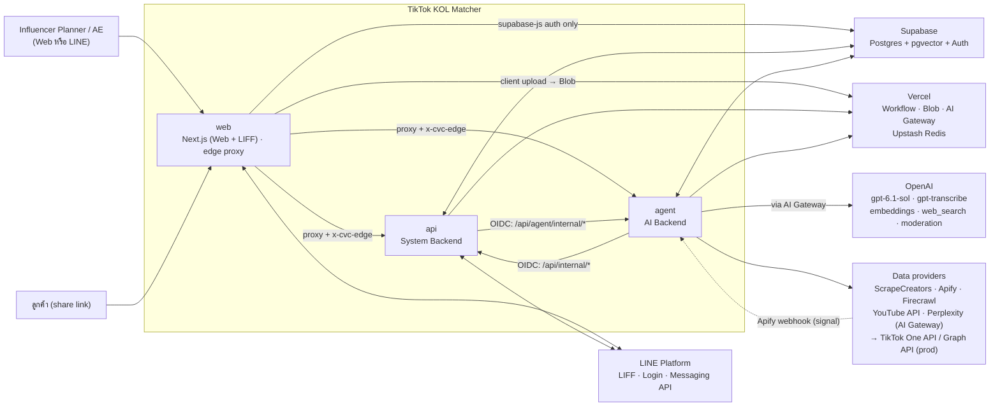
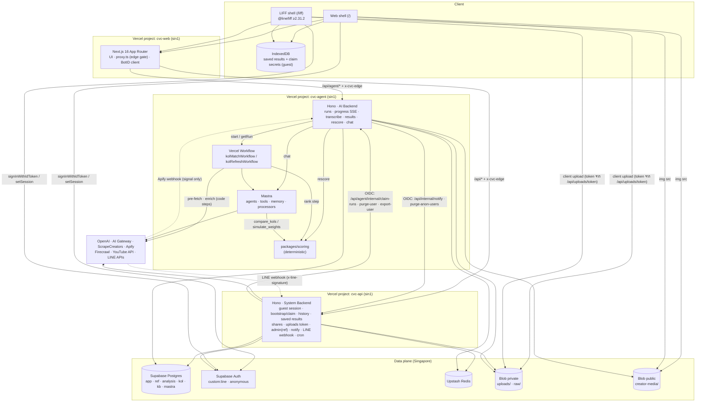
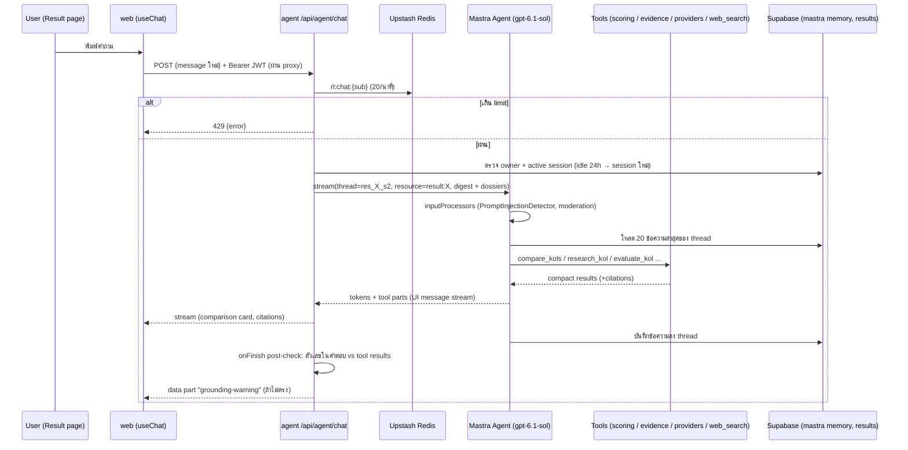
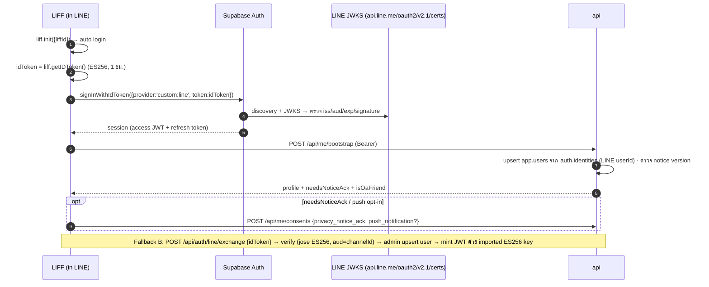
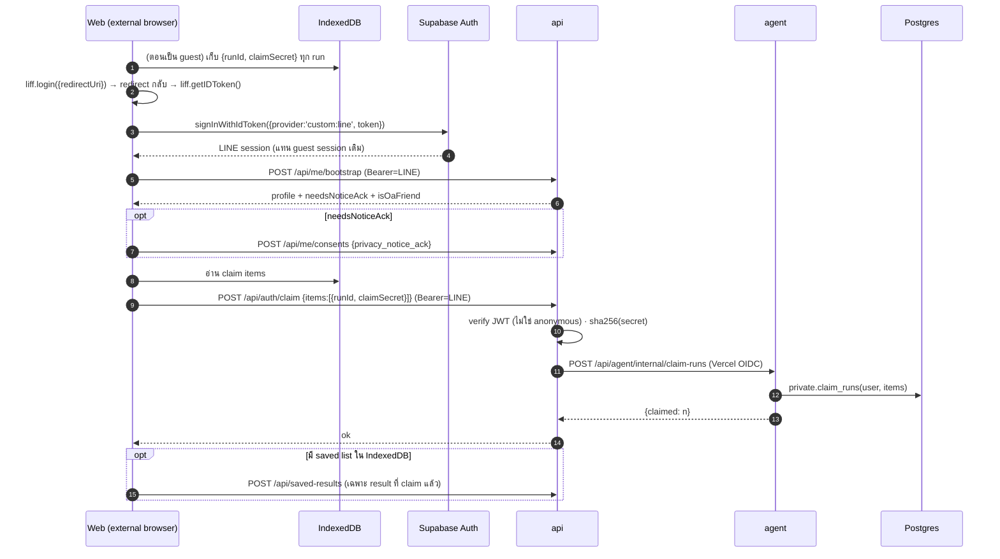
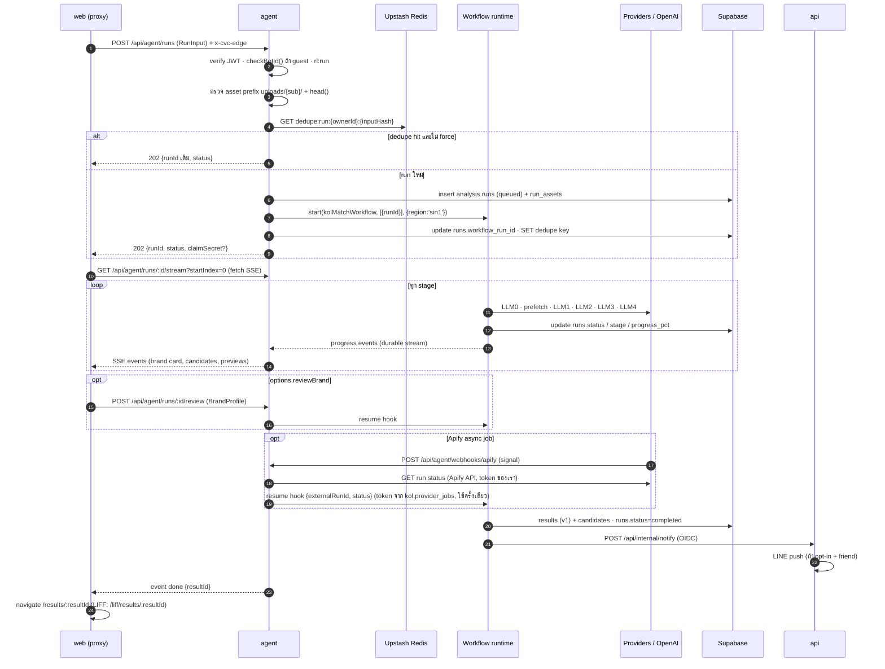

# TikTok KOL Matcher (Thai Market) — System Design & Architecture

> **Project:** Convert Cake · AI Engineer Assessment — "TikTok KOL Matcher for Thai Market"
> **Version:** 1.3 · **Date:** 2026-10-21 · **Status:** MVP สร้างแล้วใน repo นี้ (§17.5) · ส่วนที่เหลือเป็น production design ตาม roadmap (§17.3)
> **Companion doc:** [`DESIGN.md`](./DESIGN.md) — design system, UI/UX และหน้าจอทั้งหมด (โทนสี/ฟอนต์ตาม Convert Cake) · [`docs/UI_CONTRACT.md`](./docs/UI_CONTRACT.md) — กฎ UI ที่ใช้จริง (ชนะ DESIGN.md เมื่อขัดกัน) · [`docs/CONTRACTS.md`](./docs/CONTRACTS.md) — สัญญาของแต่ละ package/app · [`docs/DEPLOYMENT.md`](./docs/DEPLOYMENT.md) — ตั้งค่า Vercel 3 projects
>
> ข้อมูลทุกตัว (เวอร์ชัน, ราคา, limit) ตรวจกับแหล่งจริง ณ 2026-10-21 · รายการที่ยังยืนยันไม่ได้ติดป้าย **[UNVERIFIED]** และมี spike รองรับ (§17.4) · SQL ใน §8.3–8.4 = `supabase/migrations/*.sql` ทุกตัวอักษร และผ่านการรันจริงบน Postgres 17 (PGlite + pgvector) ตามลำดับที่เขียนด้วย `npm run db:test` · Mermaid ทุกแผนภาพ parse ผ่าน mermaid 11/12
>
> **v1.3 changelog (ตรงกับ MVP ที่สร้างแล้ว):** monorepo เป็น npm workspaces + Turborepo (TypeScript 5.9.3, Node ≥ 22.13) และรายชื่อ packages จริง · `api`/`agent` เป็น Next.js 16 app ที่ mount Hono ใน catch-all route handler (เพราะ Workflow SDK ผูกกับ Next ผ่าน `withWorkflow`) · ชื่อ env vars ตาม `.env.example` (`API_DATABASE_URL`/`AGENT_DATABASE_URL`, LINE, Blob 2 stores, Upstash, OIDC) + `.env` ไฟล์เดียวที่ root · consultant layer (§6.10: expected KPIs, playbook, portfolio plan, next actions — ตัวเลขจาก code, LLM4 เขียนเฉพาะข้อความ) · `FinalResult` เพิ่ม `isDemo`, `headlineTh`, `consultantSummaryTh`, `plan`, `nextActions` และต่อคน `playbook`/`expectedKpis`/`nextActions` · migrations `20261021001000_consultant_layer` + `20261021001100_reference_data` · cache รูปครีเอเตอร์ลง Blob public · demo mode (§17.6) · สถานะ MVP cut
> **v1.2 changelog (หลัง verification รอบ 2):** ข้อยกเว้น edge gate สำหรับ cron/internal/webhooks, bootstrap หลัง LINE login บน web + `ensureAppUser`, opt-out scrub ทันที (`private.scrub_creator`) + คำขอ 2 ขั้น, step/hook payload = IDs เท่านั้น + ลบ Apify dataset หลัง aggregate, ลบ uploads ที่ถูกทิ้ง, `DELETE /api/agent/results/:id`, `addedFromChat`/`redactedCreators`, relax 2 แบบ, เป้าต้นทุนตามจริง + budget guard 2 ขั้น, ประกาศผู้ประมวลผลต่างประเทศครบ, ตัวอย่างตัวเลขตรงสูตร
> **v1.1 changelog (หลัง adversarial review 5 มุมมอง):** แก้ RLS/GRANT ของ service roles, ลำดับ migration, guest→LINE ใช้ claim secret, chat memory ผูกกับ result, dedupe แยกตามเจ้าของ, edge gate + public creator-media store, แบ่ง hard gates เป็น 3 ช่วง, สูตร demographics ต่อ marginal + missing-feature renormalization, ต้นทุน/latency ตามจริง, เพิ่ม MVP cut, setup guide, worked example, business impact และ glossary

---

## สารบัญ

0. [TL;DR — การตัดสินใจหลัก](#0-tldr--การตัดสินใจหลัก)
1. [บริบท, Requirements และ Business Impact](#1-บริบท-requirements-และ-business-impact)
2. [Architecture Decisions (ADR)](#2-architecture-decisions-adr)
3. [ภาพรวมสถาปัตยกรรมและ Services](#3-ภาพรวมสถาปัตยกรรมและ-services)
4. [AI Agent Pipeline](#4-ai-agent-pipeline)
5. [Tools และแหล่งข้อมูล (Data Acquisition)](#5-tools-และแหล่งข้อมูล-data-acquisition)
6. [Matching & Ranking Algorithm](#6-matching--ranking-algorithm)
7. [RAG & Knowledge Layer](#7-rag--knowledge-layer)
8. [Database Design (Supabase Postgres) + Redis + Blob](#8-database-design-supabase-postgres--redis--blob)
9. [Result Chatbot](#9-result-chatbot)
10. [Frontend: Web + LINE LIFF, Auth และการบันทึกผลลัพธ์](#10-frontend-web--line-liff-auth-และการบันทึกผลลัพธ์)
11. [API Specification](#11-api-specification)
12. [Security](#12-security)
13. [Privacy, Ethics & Legal (PDPA)](#13-privacy-ethics--legal-pdpa)
14. [Observability, Evals & QA](#14-observability-evals--qa)
15. [Cost Model](#15-cost-model)
16. [Performance & Scalability](#16-performance--scalability)
17. [Monorepo, Tech Stack, Roadmap, Spikes & MVP Cut](#17-monorepo-tech-stack-roadmap-spikes--mvp-cut)
18. [Setup & Local Development](#18-setup--local-development)
19. [Risks & Mitigations](#19-risks--mitigations)
20. [Open Questions สำหรับ Convert Cake](#20-open-questions-สำหรับ-convert-cake)
21. [อภิธานศัพท์ (Glossary)](#21-อภิธานศัพท์-glossary)
22. [References](#22-references)

---

## 0. TL;DR — การตัดสินใจหลัก

| เรื่อง | การตัดสินใจ | เหตุผลสั้นๆ |
|---|---|---|
| **จำนวน service** | **3 deployable services**: `web` (Next.js: Web + LIFF), `api` (System Backend), `agent` (AI Backend) + shared packages | งาน AI ทำงานนาน (หลายนาที), ใช้ deps หนัก และถือ secret ของผู้ให้บริการ scrape ส่วน auth/CRUD ต้องเร็วและ cold start ต่ำ แยกกันเพื่อ deploy/scale/กำหนดสิทธิ์ได้อิสระ โดยไม่แตกย่อยเกินจำเป็น (§3.2) |
| **Agent framework** | **Mastra 1.x** (pin exact version) ไม่ใช้ LangChain.js | TS-native, สร้างบน AI SDK, เรียก **Responses API เป็นค่าเริ่มต้น** (gpt-6.1-sol บังคับใช้สำหรับ tools), memory แบบ thread-only, RAG/pgvector, guardrail processors, scorers, observability ครบ (ADR-002) |
| **Durable orchestration** | **Vercel Workflow SDK** (`'use workflow'`/`'use step'`) เป็นตัว orchestrate ส่วน Mastra ใช้เฉพาะ Agent/Memory/Tools/Processors (ไม่ใช้ Mastra workflows) | pipeline ยาวเกิน function limit ได้, retry ราย step, resumable progress stream, native บน Vercel ไม่ต้องเพิ่ม vendor |
| **LLM หลัก** | **`gpt-6.1-sol`** ผ่าน **Responses API** · option `gpt-6-luna` สำหรับ extraction/evaluation ปริมาณมาก | Sol ไม่มี tool calling บน Chat Completions · context 1.05M · $2 / $0.10 cached / $10 ต่อ 1M tokens |
| **ASR / Embeddings** | `gpt-transcribe` / `text-embedding-3-large` (`dimensions:1536`) | ใช้ของ OpenAI ทั้งหมดตามโจทย์ · 1536 dims อยู่ใน limit HNSW (≤2000) |
| **Web search** | **OpenAI `web_search`** (hosted tool) เป็นหลัก + **Perplexity Search ผ่าน Vercel AI Gateway** สำหรับ query ไทยที่ต้องกรองภาษา/โดเมน | reasoning model ค้น+เปิดหน้า+อ้างอิงเองได้ · Perplexity กรอง `country`/ภาษา ราคา $5/1k |
| **ข้อมูลลูกค้า** | Website: **Firecrawl** · Facebook: **Apify** (MVP) → **Graph API + PPCA** (prod) · Ads TH: **Apify Ads Library scraper** · YouTube: **Data API v3** | Graph `ads_archive` ไม่ครอบคลุมโฆษณาเชิงพาณิชย์ไทย · Facebook อ่านแบบไม่ login ไม่ได้ |
| **ข้อมูล KOL TikTok** | MVP: **ScrapeCreators** (search keyword/hashtag/users + profile/videos) · Phase 2: + **Apify** (comment sampling) → Prod: **TikTok One Creator Marketplace API** (สิทธิ์ของ CVC **[UNVERIFIED]**) + **KOL Connect** (creator opt-in ผ่าน Accounts API) | audience demographics ไม่มีในข้อมูลสาธารณะ ทางที่ถูกต้องคือ first-party/licensed |
| **Ranking** | **Hybrid**: deterministic scoring ในโค้ด + LLM rubric (0/1/2 พร้อม evidence) + pairwise เฉพาะคู่ที่คะแนนสูสีใน top-10 | ตัวเลขไม่ถูกแต่ง, อธิบายได้, ผลคงที่ (LLM-only ranking มี position bias) |
| **RAG** | Supabase **pgvector + Thai pre-segmentation (`Intl.Segmenter`)** → hybrid search (RRF ระดับ creator) · creator-store RAG เปิดเมื่อ DB ใหญ่พอ | Postgres FTS ตัดคำไทยไม่ได้ จึงตัดคำก่อนเก็บ `tsvector('simple')` |
| **Database** | **Supabase Postgres** (ap-southeast-1) แยก schema ตามเจ้าของ service + DB role ต่อ service + RLS policy ต่อ role | SQL ตามโจทย์ · least privilege · region เดียวกับ function (`sin1`) |
| **Cache / Files** | **Upstash Redis** (= "Vercel Redis" ปัจจุบัน ผ่าน Marketplace) · **Vercel Blob** 2 stores: private (`uploads/`, `raw/`) + public (`creator-media/`) | cache, rate limit, lock, budget guard / ไฟล์ผู้ใช้ไม่เปิดเผย ส่วนรูป creator สาธารณะแสดงใน ``/LINE Flex ได้ |
| **Auth** | LIFF ID token → **Supabase custom OIDC `custom:line`** · Web guest → **Supabase anonymous** (สร้างผ่าน `api` หลัง BotID) · guest → LINE ใช้ **per-run claim secret** | ทุก service ตรวจ Supabase JWT ด้วย JWKS ทางเดียว · claim secret รอด redirect และ token หมดอายุ |
| **Edge** | `web` เป็นประตูเดียว: Next.js proxy rewrite ไป `api`/`agent` พร้อม header ลับ `x-cvc-edge` + client IP | single origin (LIFF, ไม่มี CORS) · เรียก `*.vercel.app` ตรงจะถูกปฏิเสธ · preview ชี้ preview |
| **Region** | Vercel `sin1` + Supabase Singapore + Upstash Singapore **[UNVERIFIED: region บน Marketplace]** | ใกล้ไทยที่สุด (ไม่มี region ในไทย) |
| **Observability / Evals** | Langfuse (Mastra exporter / AI SDK telemetry) + Mastra scorers + Promptfoo ใน CI + golden set ภาษาไทย | trace ราย stage, regression รายสัปดาห์ |
| **MVP (1 สัปดาห์)** | ตัดฟีเจอร์ตาม §17.5 (ยังคง 3 services, LIFF+web, chat, save) + consultant layer (§6.10) · **สร้างแล้วใน repo นี้** · ไม่มี key ก็รันได้ด้วย demo mode (§17.6) | ส่งงาน assessment ได้จริง ไม่ over-engineer |

**ภาพรวม flow:** ผู้ใช้กรอก input หลายแบบ → `agent` เริ่ม durable workflow → **LLM0** normalize → ดึงข้อมูลลูกค้าแบบขนาน (code) → **LLM1** สร้าง BrandProfile JSON → **LLM2** ค้น + ประเมิน KOL ไทย → **LLM3** จัดอันดับ (code + pairwise judge) → code คำนวณ expected KPIs / playbook / แผนรวม / next actions (§6.10) → **LLM4** เขียน storyline/pitch/คำอธิบายแผน (narrative เท่านั้น) → โค้ดประกอบเป็น `FinalResult` → หน้า Result + Chatbot

---

## 1. บริบท, Requirements และ Business Impact

### 1.1 Problem statement (จากโจทย์)

Convert Cake ต้องการเครื่องมือช่วยทีม influencer marketing **หา TikTok KOL ในไทยที่เหมาะกับลูกค้าได้เร็ว** โดยเริ่มจาก Facebook presence และเว็บไซต์ของลูกค้า:

1. วิเคราะห์ Facebook Page + เว็บไซต์ → เข้าใจ brand, audience, content style
2. ค้นและประเมิน TikTok KOL ในไทยที่เหมาะสม
3. จัดอันดับตาม relevance, engagement metrics, audience demographics
4. แสดงรายชื่อ KOL ที่คัดแล้ว พร้อมข้อมูลโปรไฟล์และ **ลิงก์ TikTok** (ขั้นต่ำของโจทย์)

เกณฑ์ประเมิน: practicality, technical understanding (AI, data extraction, matching), creativity, clarity, business value, **ethics & privacy**

### 1.2 ผู้ใช้

| Persona | ใช้ทำอะไร | ช่องทาง |
|---|---|---|
| **Influencer Planner** (หลัก) | สร้าง shortlist, เปรียบเทียบ, ถามต่อ, บันทึก | Web (desktop) / LIFF |
| **Account Executive** | ดูผลเร็ว ส่งต่อลูกค้า/ทีม | LIFF (มือถือ), share link |
| **ลูกค้า (view only)** | ดูผลที่ถูกแชร์ | `/share/[token]` (อ่านอย่างเดียว ไม่ต้อง login) |
| **Admin** | ดูแล personas, rate cards, tier benchmarks, blocklist, KB | Web (role = admin) |
| **Creator (KOL)** | ขอ opt-out / (phase 3) เชื่อมบัญชีแบบยินยอม | หน้า opt-out สาธารณะ / LIFF KOL Connect |

### 1.3 Functional Requirements

| ID | Requirement | Section |
|---|---|---|
| FR-01 | Input หลายแบบ: ชื่อบริษัท (บังคับอย่างเดียว), Facebook, Website, TikTok/YouTube/IG ของลูกค้า, เลือก persona ลูกค้าเป้าหมายจากรายการ (หลายข้อ) + พิมพ์เพิ่ม, อัปโหลดรูป/screenshot (vision), อัดเสียง (ASR, แก้ transcript ได้ก่อนส่ง) | §4.2, §10.5 |
| FR-02 | Normalize input เป็น `InputBrief` (LLM0) | §4.3 |
| FR-03 | วิเคราะห์ brand/audience/content style ด้วย tools → `BrandProfile` JSON (LLM1) | §4.4, §5.2 |
| FR-04 | ค้นและประเมิน TikTok KOL ไทย (LLM2) | §4.5, §5.3 |
| FR-05 | จัดอันดับตาม relevance, engagement, demographics (LLM3) | §4.6, §6 |
| FR-06 | ผลลัพธ์สุดท้ายเป็น JSON (storyline, pitch angle, profile info, ลิงก์ TikTok) → render หน้า result (LLM4) | §4.7, DESIGN.md §8 |
| FR-07 | Chatbot ในหน้า result: 1 result = 1 chat (active), memory ภายใน session, ไม่มี memory ข้าม session, reset ได้ในหน้าเดิม, ค้นข้อมูลเพิ่ม/เปรียบเทียบ/ประเมิน KOL เพิ่มได้ · *ข้อยกเว้น: guest result ที่หมดอายุ (7 วัน) chat ใช้ไม่ได้* | §9 |
| FR-08 | บันทึกผล: ไม่ login → browser (IndexedDB) · LINE → DB ผูกกับ LINE identity · guest ที่ login LINE ภายหลังย้ายผลขึ้นบัญชีได้ | §10.4 |
| FR-09 | UI 2 แบบ: Web และ LINE LIFF (LINE Login) | §10 |
| FR-10 | Progress real-time และกลับมาดูต่อได้หลังปิดหน้า | §4.11 |
| FR-11 | Share (ลิงก์อ่านอย่างเดียว / LINE shareTargetPicker) และแจ้งเตือนผ่าน LINE OA เมื่อเสร็จ (opt-in) | §10.6 |
| FR-12 | ปรับ weight แบบ what-if (UI slider / chatbot) และบันทึกเป็นเวอร์ชันใหม่ได้ | §6.7, §9.3 |

### 1.4 Non-Functional Requirements

| ด้าน | เป้าหมาย |
|---|---|
| Latency | **Full design:** cold run p50 ≤ 9 นาที, p95 ≤ 12 นาที · warm run p50 ≤ 4 นาที · **MVP:** p50 ~4–6.5 นาที · progress event แรก ≤ 3 วินาที · chat first token ≤ 3 วินาที (ไม่รวมเวลารอ HITL) |
| Cost | **Full design (sol default):** cold p50 ≤ $3.5 / p90 ≤ $4.8 · warm p50 ≤ $2 · **luna tiering:** cold p50 ≤ $3 / p90 ≤ $4.3 · **MVP ≤ $2** · budget guard 2 ขั้น: **soft $4** (ข้าม pairwise/critic/web_search เพิ่ม) · **hard $6** (หยุด + partial) (§15) |
| Reliability | ทุก step retry ได้และ idempotent · source ใดล่ม → ได้ผลบางส่วนพร้อมแจ้งผู้ใช้ · **ไม่ทิ้ง KOL เพราะ narrative ล้มเหลว** (ขั้นต่ำ = รายชื่อ + ลิงก์ TikTok) |
| Explainability | ทุกตัวเลขมีแหล่งที่มา + วันที่ + ความมั่นใจ · KOL ทุกคนมีเหตุผล + evidence |
| Correctness | **ห้ามมีตัวเลข metric ที่ LLM แต่ง** · handle ทุกตัวต้องมาจาก tool result และอยู่ใน `kol.creators` |
| Language | Thai-first (UI, output) รองรับไทยปนอังกฤษ |
| Privacy | PDPA: minimization, retention, notice, consent เฉพาะเรื่องที่ไม่บังคับ, cross-border safeguards (§13) |
| Security | OWASP LLM01 mitigations, least privilege, SSRF guard, IDOR guard, edge gate, rate limit, BotID |
| Platform | Vercel **Pro** (Hobby ห้ามใช้เชิงพาณิชย์ + function 300s), Node.js runtime เท่านั้น (Edge runtime ไม่แนะนำแล้ว) |

### 1.5 Assumptions & Constraints

- Vercel Pro: function สูงสุด 800s (GA), request/response body ≤ 4.5 MB → **ไฟล์อัปโหลดตรงไป Blob** ([Vercel limits](https://vercel.com/docs/functions/limitations))
- `gpt-6.1-sol` มีอยู่จริง (เปิดตัว 2026-09-29) แต่มี snapshot เดียว ไม่มีวันที่กำกับ → behavior อาจเปลี่ยน → regression eval รายสัปดาห์ ([OpenAI model page](https://developers.openai.com/api/docs/models/gpt-6.1-sol))
- Convert Cake เป็น TikTok Agency Partner และ Meta Business Partner ([convertcake.com](https://convertcake.com/)) → **อาจ**ขอ TikTok One (TTO) Creator Marketplace API ผ่าน TikTok Partner Manager ได้ **[UNVERIFIED — §20 ข้อ 1]** · Meta PPCA ยังต้องผ่าน App Review + business verification (หลายสัปดาห์) ซึ่งสถานะ partner ไม่ได้รับประกัน **[UNVERIFIED — §20 ข้อ 2]**
- Prototype ใช้ public-data providers ไปก่อน แล้วย้ายไป official/licensed ใน production (§5.3.3)

### 1.6 Business Impact & Success Metrics

**บริบทตลาด:** TikTok มี ad reach ~56.6 ล้านคนในผู้ใหญ่ไทย (96.3% ของผู้ใหญ่, DataReportal Digital 2026) และถูกเลือกใช้ในแคมเปญ influencer ไทยมากกว่า 50% ในปี 2025 (AnyMind) → การหา creator ที่ "ขายได้จริง" ได้เร็วเป็นความได้เปรียบโดยตรงของ agency ([DataReportal](https://datareportal.com/reports/digital-2026-thailand), [AnyMind via Relevant Audience](https://www.relevantaudience.com/ecommerce-marketing/anymind-thailand-tiktok-shop-affiliate-60-40-report/))

| KPI | Baseline (ต้องวัดร่วมกับ CVC) | เป้าหมาย pilot |
|---|---|---|
| เวลาทำ shortlist ต่อ brief | ชั่วโมง–วัน (planner ทำมือ) | ≤ 10 นาที + เวลา review |
| ต้นทุนต่อ brief | ชั่วโมง planner × rate | MVP ≤ $2 · full design p50 ≤ $3.5 (AI + data) |
| คุณภาพการแนะนำ | – | P@5 เทียบตัวเลือกของ planner ≥ 0.6 · ≥ 40% ของ KOL ที่แนะนำถูก shortlist/ติดต่อ (`analysis.feedback`) |
| ผลแคมเปญ | CPV/CPA เฉลี่ยในอดีตของ CVC | CPV ของ KOL ที่ใช้ระบบเลือก ≤ ค่าเฉลี่ยเดิม |
| Adoption | – | briefs/สัปดาห์, LIFF MAU ของทีม |
| Strategic | – | KOL DB ไทยของ CVC เอง (โตทุก run), feedback loop → learning-to-rank, pitch ลูกค้าได้เร็วขึ้น (สอดคล้อง "Strategic Curation — we'll show you exactly who we recommend and why" ในหน้า KOL service ของ CVC) |

---

## 2. Architecture Decisions (ADR)

### ADR-001 — แบ่งเป็น 3 services
`web` + `api` (System Backend) + `agent` (AI Backend) + shared packages ใน Turborepo · วิเคราะห์ใน §3.2 · **Accepted**

### ADR-002 — Mastra แทน LangChain.js

| เกณฑ์ | Mastra 1.x | LangChain.js + LangGraph.js 1.x |
|---|---|---|
| สถานะ (2026-10-21) | `@mastra/core` 1.78.0, GA 2026-01-20 | `langchain` 1.5.18 / `@langchain/langgraph` 1.5.1, GA 2025-10-22, semver เข้ม (v1 LTS) |
| gpt-6.1-sol + tools | router ใช้ **Responses API เป็นค่าเริ่มต้น** | `ChatOpenAI` ค่าเริ่มต้นเป็น Chat Completions → **ต้องตั้ง `useResponsesApi: true` ทุก model** ไม่งั้น tool calling ใช้ไม่ได้ |
| Memory ตามโจทย์ chat | ค่าเริ่มต้น v1 = history ต่อ thread (`semanticRecall:false`, `workingMemory` ปิด) ตรง "ไม่มี memory ข้าม session" | checkpointer ต่อ `thread_id` |
| RAG / Postgres | `@mastra/pg` (`PgVector`, `PostgresStore`), `@mastra/rag` | `@langchain/community` Supabase vectorstore |
| Streaming → `useChat` | `@mastra/ai-sdk` (`handleChatStream`) | ผ่าน adapter `@ai-sdk/langchain` หรือ LangGraph Agent Server |
| Guardrails | processors: `PromptInjectionDetector`, `PIIDetector`, `ModerationProcessor`, `TokenCostControl` | สร้างเอง/middleware |
| Observability / Evals | exporters (Langfuse, LangSmith, OTel, Braintrust…), scorers แบบ sampling | LangSmith-first |
| Orchestration | มี workflow DSL แต่ **เราไม่ใช้** (ใช้ Vercel Workflow SDK เป็น durable shell; ยังไม่พบ integration ทางการระหว่าง Mastra ↔ Vercel Workflows **[UNVERIFIED]**) | StateGraph/interrupt (mature ที่สุด) |
| ข้อควรระวัง | ออก minor ถี่ (1.53.0 มี breaking), **supply-chain attack 2026-06-17** (~141 packages ถูกปล่อย patch อันตราย) | CVE-2025-68665 (แก้ใน `@langchain/core` ≥1.1.8) |

**Decision:** **Mastra** (ใช้เฉพาะ Agent, Memory, Tools, Processors, RAG helpers, Scorers, Observability) เพราะทั้งระบบเป็น TS บน Vercel, ใช้ OpenAI Responses API ถูกต้องโดยไม่ต้องตั้งค่าเพิ่ม และ memory model ตรง requirement chat
**Mitigation:** pin exact versions + lockfile, `npm ci --ignore-scripts`, `npm audit signatures`/provenance ใน CI, Renovate อัปเดตเฉพาะ release ที่ออกมาแล้ว > 7 วัน, ส่ง AI SDK provider instance เอง (`@ai-sdk/openai@4.x`) เพราะ router ฝัง `@ai-sdk/openai` 3.x ไว้, ห้ามใช้โค้ดใน `ee/`, ห่อ API ของ framework ไว้หลัง `packages/ai` (เปลี่ยน framework ได้)
**Runner-up:** LangGraph.js (ต้องการ cyclic graph + time-travel debugging หรือ semver guarantee)

### ADR-003 — Vercel Workflow SDK เป็น durable orchestrator
- **ปัญหา:** pipeline เต็ม 4–9 นาที + เวลารอ webhook/HITL · รันใน request เดียวเสี่ยงชน 800s และ crash = เริ่มใหม่ทั้งหมด
- **Decision:** `workflow` 5.2.3 (GA เม.ย. 2026) · **1 external effect ต่อ 1 `'use step'`** (retry อัตโนมัติ, run ไม่มีจำกัดเวลา, `getWritable()` stream ต่อได้หลัง refresh, hooks สำหรับ HITL/webhook) · เรียก Mastra agents ภายใน step โดยตั้ง `maxRetries: 0` ที่ model call ให้ Workflow เป็นเจ้าของ retry (กัน retry ซ้อน 3×2×2)
- **Integration (MVP):** Workflow SDK ผูกกับ Next.js ผ่าน `withWorkflow()` จาก `workflow/next` ใน `apps/agent/next.config.ts` (ไม่มี adapter สำหรับ Hono) → `agent` จึงเป็น Next.js app (§3.5) · `start(kolMatchWorkflow, [{ runId }], { region: 'sin1' })` · ถ้า runtime ยังไม่พร้อม (dev/test) รันขั้นตอนเดียวกันแบบ inline ด้วย `runPipelineInline(runId)` หลังตอบ response (`after()`)
- **Alternatives:** Mastra workflow + `@mastra/inngest`, Trigger.dev v4 (ถ้ามี headless browser กิน CPU นาน), Upstash Workflow
- **ข้อจำกัด:** step ≤ function max duration · payload ≤ 50 MB (ส่ง ID/blob ref) · run metadata ไม่เข้ารหัส (ห้าม PII) · > 2,000 events/run replay ช้า · payload อ่านได้ 7 วันบน Pro และลบ on-demand ไม่ได้ ([Workflow pricing & limits](https://vercel.com/docs/workflows/pricing), [retention](https://vercel.com/docs/workflows/retention))

### ADR-004 — Model access
- ทุก call ไป `gpt-6.1-sol` ใช้ **Responses API** · ผ่าน **Vercel AI Gateway** (`openai/gpt-6.1-sol`): budget (HTTP 402 เมื่อเกิน), failover `order: ['openai','azure']` (model เดิม), OIDC auth, ZDR ราย request ([AI Gateway](https://vercel.com/docs/ai-gateway/pricing))
- **[UNVERIFIED → SP5]** OpenAI provider-executed `web_search` ผ่าน Gateway ได้หรือไม่ · ถ้าไม่ได้ research agent เรียก `@ai-sdk/openai` ตรง (BYOK)
- ASR เรียก `openai` SDK ตรง (`gpt-transcribe` ยังไม่อยู่ใน type ของ AI SDK และ gateway audio ยัง beta)
- ทุก call ใส่ `store:false` และ `safety_identifier = sha256(owner_id)`

### ADR-005 — Data acquisition strategy
- **Tiered:** (a) MVP = public data ผ่าน vendor ที่ **ยืนยันเป็นลายลักษณ์อักษรว่าเก็บแบบ logged-out/ไม่ bypass** และ **ไม่ใช้ endpoint ที่มาจาก TikTok One/Creator Marketplace** (จึงตัด `creators/popular` ของ ScrapeCreators ออก เพราะคืน `tcm_id` ซึ่งบ่งว่ามาจากเครื่องมือของ partner) + kill-switch ต่อ provider → (b) Prod = official/licensed (TTO API, Accounts API แบบ consent, Graph API PPCA, vendor demographics แบบ modeled) → (c) KOL DB ของเราเอง
- ทุก adapter อยู่หลัง `KolDataProvider` / `ClientIntelProvider` (§5.4)

### ADR-006 — Hybrid ranking (code + LLM)
ตัวเลขคำนวณใน `packages/scoring` (deterministic, unit-tested) · LLM ให้คะแนนเชิงคุณภาพด้วย rubric 0/1/2 + evidence · pairwise เฉพาะคู่สูสี · เหตุผล: LLM judge มี position/verbosity bias (GPT-4 order-consistent ~65% ใน [Zheng et al.](https://arxiv.org/abs/2306.05685)) และ InfluMatch (KOL ไทย) พบว่าให้เหตุผลบน shortlist ที่กรองแล้วดีกว่า ([arXiv 2607.05968](https://arxiv.org/abs/2607.05968))

### ADR-007 — Auth
- LIFF: `liff.getIDToken()` (ES256) → `supabase.auth.signInWithIdToken({ provider: 'custom:line' })` (Supabase Custom OIDC GA 2026-04-08)
- Web guest: `api` เรียก `signInAnonymously()` หลังผ่าน BotID + rate limit ต่อ client IP (ต้อง **ปรับ Supabase anonymous sign-in rate limit** จากค่าเริ่มต้น 30/ชม./IP เพราะคำขอมาจาก egress IP ของ Vercel) · ทางเลือก: sign-in ฝั่ง browser + Supabase CAPTCHA (Turnstile)
- Guest → LINE: **claim secret ต่อ run** (เก็บใน IndexedDB) แทนการส่ง guest token (รอด full-page redirect ของ `liff.login` และ token หมดอายุ)
- **Fallback B:** `api` verify LINE ID token เอง (jose + LINE JWKS) แล้ว mint JWT ด้วย signing key ที่ import เข้า Supabase
- ทุก service verify JWT ด้วย Supabase JWKS (`/auth/v1/.well-known/jwks.json`)

### ADR-008 — Vercel topology: 3 projects (GA) + edge gate แทน Vercel Services (Beta)

| | **3 projects + edge proxy (เลือก)** | Vercel Services (1 project) |
|---|---|---|
| Maturity | GA | Beta (2026-06-30) |
| Deploy อิสระต่อ service | ได้ | ไม่ได้ (deploy พร้อมกัน) |
| Env vars least privilege | ได้ (แยกต่อ project) | ไม่ได้ (ใช้ร่วมกัน) |
| Single origin | ได้ (ผ่าน proxy ของ `web`) | ได้ (native) |
| กันเรียก backend ตรง | ได้ (header `x-cvc-edge`) | bindings ไม่ public แต่ไม่มี auth ในตัว |
| Full-stack preview | ได้ (`@vercel/related-projects` + protection bypass) | อัตโนมัติ |

**Decision:** 3 projects · ย้ายไป Services ได้เมื่อ GA (เปลี่ยน config + auth ภายใน)
**Runtime ภายในแต่ละ project (v1.3):** ทั้ง 3 project ใช้ framework preset **Next.js 16** · `api` และ `agent` เป็น Next.js app ที่ mount **Hono 4** ใน catch-all route handler (`handle()` จาก `hono/vercel`) แทน Hono แบบ standalone เพราะ Workflow SDK integrate กับ Next ผ่าน `withWorkflow` (`workflow/next`) และไม่มี Hono adapter · ใช้รูปแบบเดียวกันทั้ง `api` และ `agent` เพื่อให้ build/deploy/env loading เหมือนกัน (§3.5)

---

## 3. ภาพรวมสถาปัตยกรรมและ Services

### 3.1 System context



### 3.2 วิเคราะห์จำนวน service: ทำไม 3 ไม่ใช่ 1, 2 หรือ 5+

| Option | รายละเอียด | ข้อดี | ข้อเสีย | สรุป |
|---|---|---|---|---|
| A. Monolith | Next.js เดียวทำ UI + API + AI | ง่ายสุด | AI deps หนัก (Mastra JS ~20 MB) ปน UI, deploy prompt = deploy ทั้งระบบ, secret ทุกตัวที่เดียว, ไม่ตรงความต้องการ microservice | ไม่เลือก |
| B. 2 services | `web` + `backend` (auth + AI) | แยก FE/BE | auth/CRUD ต้องแบก cold start ของ AI stack, release cadence ต่างกันมาก (prompt รายวัน vs auth แทบไม่เปลี่ยน), secret ของ scraping vendor อยู่กับ user data | พอใช้ได้ |
| **C. 3 services** | **`web` + `api` (System) + `agent` (AI)** | **แยกตาม workload profile (fast/stateless CRUD vs long-running/costly AI), least privilege, deploy/rollback อิสระ, scale แยก** | service-to-service auth 1 จุด (api ↔ agent) | **เลือก** |
| D. 5+ services | แยก chat, scoring, KOL indexer, notification | ละเอียด | chat ใช้ tools/memory/model/scoring ชุดเดียวกับ pipeline, scoring เป็น pure function (package), notification งานน้อย → network hop + ops cost เพิ่มโดยไม่คุ้ม | ไม่เลือก (ตอนนี้) |

**ตัวบ่งชี้ว่าควรแยกเพิ่ม:** `kol-indexer` เมื่อ refresh volume แย่ง concurrency/quota กับ run ของผู้ใช้ หรือต้องรันบน runtime อื่น · `chat` เมื่อทราฟฟิก chat โตกว่า pipeline มาก — ระหว่างนี้ทั้งสองเป็น **module ภายใน `agent`** (folder + entry point แยก ยกออกได้ง่าย)

### 3.3 Container diagram



### 3.4 Service catalog

#### `web` — Frontend (Next.js 16.4, App Router)

| หัวข้อ | รายละเอียด |
|---|---|
| หน้าที่ | Web shell (`/`) + LIFF shell (`/liff`) ใช้ component ชุดเดียว (`apps/web/components`, กฎใน docs/UI_CONTRACT.md) · render `FinalResult` · chat UI (`useChat`) · client upload ไป Blob · IndexedDB (guest) · BotID client · **`proxy.ts` = edge gate** (rewrite ไป `api`/`agent` + header ลับ + client IP) · port 3000 |
| Secrets / config | `EDGE_SHARED_SECRET`, `PREVIEW_BYPASS_SECRET` (เฉพาะ proxy ฝั่ง server) · `API_ORIGIN`, `AGENT_ORIGIN` (+ `VERCEL_PROJECT_API`/`VERCEL_PROJECT_AGENT` สำหรับ related projects) · `NEXT_PUBLIC_APP_URL`, `NEXT_PUBLIC_SUPABASE_URL`, `NEXT_PUBLIC_SUPABASE_PUBLISHABLE_KEY`, `NEXT_PUBLIC_LIFF_ID`, `NEXT_PUBLIC_LINE_OA_BASIC_ID`, `NEXT_PUBLIC_NOTICE_VERSION` · **ไม่มี** DB/LLM secret |
| Data | ไม่เข้าถึง DB · ใช้ supabase-js เพื่อ **auth เท่านั้น** |

#### `api` — System Backend (Next.js 16 + Hono 4 บน Fluid compute)

| หัวข้อ | รายละเอียด |
|---|---|
| Runtime | Next.js 16 app · Hono app (`basePath('/api')`) mount ที่ `apps/api/app/api/[[...route]]/route.ts` ด้วย `handle()` จาก `hono/vercel` (export GET/POST/PATCH/DELETE, `runtime = 'nodejs'`) · port 3001 |
| หน้าที่ | guest session · LINE profile bootstrap/consent · claim runs (guest → LINE) · Fallback B exchange · history · saved results · share links · Blob upload token · personas/categories · admin ของ `ref` (personas, rate cards, tier benchmarks, blocklist) · LINE Messaging API (push, webhook) · cron ของ `app` · PDPA export/delete (ประสานกับ agent) |
| เป็นเจ้าของ schema | `app`, `ref` · อ่านข้อมูล agent ผ่าน view read-only (`app.v_user_history`, `app.v_results_public`) · การเปลี่ยนข้อมูลของ agent ทำผ่าน internal endpoint ของ agent เท่านั้น |
| Secrets | `SUPABASE_URL` (JWKS), `SUPABASE_SECRET_KEY`, `API_DATABASE_URL` (role `svc_api` ผ่าน Supavisor transaction pooler `:6543`), `LINE_LOGIN_CHANNEL_ID` / `LINE_LOGIN_CHANNEL_SECRET`, `LINE_MESSAGING_CHANNEL_SECRET`, `LINE_MESSAGING_CHANNEL_ACCESS_TOKEN`, `BLOB_PRIVATE_READ_WRITE_TOKEN` (private store), `UPSTASH_REDIS_REST_URL` / `UPSTASH_REDIS_REST_TOKEN` (หรือ `KV_REST_API_URL` / `KV_REST_API_TOKEN` ที่ Marketplace inject), `VERCEL_TEAM_SLUG` + `VERCEL_PROJECT_API` / `VERCEL_PROJECT_AGENT` (OIDC), `CRON_SECRET`, `EDGE_SHARED_SECRET`, `DEMO_MODE` · **ไม่ใช้** `POSTGRES_URL` ที่ Supabase integration inject (role `postgres`) |
| SLA | p95 < 300 ms |

#### `agent` — AI Backend (Next.js 16 + Hono 4 + Workflow SDK + Mastra)

| หัวข้อ | รายละเอียด |
|---|---|
| Runtime | Next.js 16 app · Hono app (`basePath('/api/agent')`) mount ที่ `apps/agent/app/api/agent/[[...route]]/route.ts` ด้วย `handle()` จาก `hono/vercel` (`runtime = 'nodejs'`, `maxDuration = 800`) · `next.config.ts` = `withWorkflow(...)` จาก `workflow/next` · หน้า UI มีแค่ status page · port 3002 |
| หน้าที่ | สร้าง/ติดตาม/ยกเลิก run · progress SSE · transcribe (ก่อนส่ง run) · result/rescore/relax/curate · chatbot · Apify webhook (signal → resume hook) · KOL refresh workflow · retention ของข้อมูล agent · KB ingest (admin) · creator opt-out |
| เป็นเจ้าของ schema | `analysis`, `kol`, `kb`, `mastra` (อ่าน `ref` + บาง column ของ `app.users`) |
| Secrets | `OPENAI_API_KEY` (BYOK/ASR) · `USE_AI_GATEWAY` + `AI_GATEWAY_API_KEY` (local; บน Vercel ใช้ OIDC) · `OPENAI_MODEL_MAIN`, `OPENAI_MODEL_FAST`, `OPENAI_TRANSCRIBE_MODEL`, `OPENAI_EMBEDDING_MODEL`, `OPENAI_EMBEDDING_DIMENSIONS` · `SCRAPECREATORS_API_KEY`, `APIFY_TOKEN`, `APIFY_WEBHOOK_SECRET`, `FIRECRAWL_API_KEY` (+ `YOUTUBE_API_KEY`, `SUPADATA_API_KEY` phase 2) · `SUPABASE_URL` (JWKS), `AGENT_DATABASE_URL` (role `svc_agent` ผ่าน Supavisor `:6543`) · Upstash (`UPSTASH_REDIS_REST_*` หรือ `KV_REST_API_*`) · `BLOB_PRIVATE_READ_WRITE_TOKEN` (private) + `CREATOR_MEDIA_BLOB_READ_WRITE_TOKEN` (public) · `VERCEL_TEAM_SLUG` + `VERCEL_PROJECT_*` (OIDC) · `BUDGET_SOFT_USD` / `BUDGET_HARD_USD` · `LANGFUSE_*` · `CRON_SECRET`, `EDGE_SHARED_SECRET`, `DEMO_MODE` |
| Function config | `maxDuration` 800 สำหรับทุก route ของ agent (ตั้งใน `route.ts` และ `vercel.json` → `functions["app/api/agent/**/*"]`) · แยก chat 300 s + memory 2–4 GB เมื่อวัดจริง (phase 2) · region `sin1` |

### 3.5 Deployment topology & edge gate

- **Monorepo:** npm workspaces + Turborepo (Git repo เดียว, `package-lock.json` ที่ root) → 3 Vercel projects (Root Directory = `apps/web`, `apps/api`, `apps/agent`, framework preset Next.js, Node.js 24.x) · เปิด "Skip deployments when there are no changes" ให้ project ที่ไม่เปลี่ยนข้าม build · ขั้นตอนตั้งค่าทั้งหมดอยู่ใน [docs/DEPLOYMENT.md](./docs/DEPLOYMENT.md)
- **Runtime ของ `api`/`agent`:** Next.js 16 app ที่ mount Hono ใน catch-all route handler — `api`: `app/api/[[...route]]/route.ts` (`basePath('/api')`) · `agent`: `app/api/agent/[[...route]]/route.ts` (`basePath('/api/agent')`) · ทั้งคู่ใช้ `handle()` จาก `hono/vercel` · เหตุผล: Workflow SDK integrate กับ Next ผ่าน `withWorkflow` (`workflow/next`) และไม่มี Hono adapter (ADR-003, ADR-008) · `web` ยังใช้ `proxy.ts` เป็น edge gate เหมือนเดิม
- **Env loading:** local ใช้ `.env` ไฟล์เดียวที่ root ซึ่ง `next.config.ts` ของทุก app โหลดด้วย `loadEnvConfig(repoRoot, …, forceReload=true)` (ค่าที่ตั้งใน process ก่อนหน้ายังชนะไฟล์) · บน Vercel ไม่มีไฟล์ ใช้ env ของแต่ละ project · packages เป็น TS source ที่ Next compile ผ่าน `transpilePackages` (รายชื่อใน `apps/*/.transpile.json`)
- **Region:** ทุก project `regions: ["sin1"]` ใน `apps/*/vercel.json` (ค่าเริ่มต้น `iad1` ต้องเปลี่ยน) · workflow `start(..., { region: 'sin1' })` · cron อยู่ใน `apps/api/vercel.json` และ `apps/agent/vercel.json`
- **Domain:** `kol.<convertcake-domain>` → `cvc-web` เท่านั้น · `api`/`agent` ไม่มี custom domain และใช้ middleware `requireEdge` (ตรวจ `x-cvc-edge` แบบ constant-time) กับ **route สาธารณะทั้งหมด** โดยมีข้อยกเว้นที่ตรวจ auth ของตัวเองแทน:

| Route | เรียกจาก | Auth แทน `x-cvc-edge` | เรียกที่ |
|---|---|---|---|
| `/api/cron/*`, `/api/agent/cron/*` | Vercel Cron (เรียก production deployment ของ project ตรง ใส่ header เองไม่ได้) | `Authorization: Bearer ${CRON_SECRET}` | URL ของ project |
| `/api/internal/*`, `/api/agent/internal/*` | service ↔ service | Vercel OIDC (`sub` = project พี่น้อง, environment เดียวกัน) | `API_ORIGIN` / `AGENT_ORIGIN` (preview ใช้ `withRelatedProject`) |
| `/api/webhooks/line`, `/api/agent/webhooks/apify` | LINE / Apify | `x-line-signature` / secret + ตรวจซ้ำผ่าน Apify API | ลงทะเบียน URL เป็น `https://kol.<domain>/api/...` (ผ่าน proxy) |

`proxy.ts` ตอบ **404** ให้ path `internal`/`cron` ที่มาจากอินเทอร์เน็ต (ไม่ forward) เพื่อไม่ให้ edge header ถูกแนบให้คำขอจากภายนอก
- **Edge proxy** (rewrite ใน `vercel.json` อ่าน env ไม่ได้ จึงทำใน `proxy.ts`):

```ts
// apps/web/proxy.ts — Next.js 16 (เดิม middleware.ts) [ตรวจ signature ตอน implement]
import { NextResponse, type NextRequest } from 'next/server';
import { withRelatedProject } from '@vercel/related-projects';
import { ipAddress } from '@vercel/functions';

const AGENT = withRelatedProject({ projectName: 'cvc-agent', defaultHost: process.env.AGENT_ORIGIN! });
const API   = withRelatedProject({ projectName: 'cvc-api',   defaultHost: process.env.API_ORIGIN! });

export function proxy(req: NextRequest) {
  const { pathname, search } = req.nextUrl;
  if (/^\/api\/(agent\/)?(internal|cron)\//.test(pathname)) return new NextResponse(null, { status: 404 }); // ไม่เปิดสู่ภายนอก
  const base = pathname.startsWith('/api/agent/') ? AGENT : API;
  const headers = new Headers(req.headers);
  headers.set('x-cvc-edge', process.env.EDGE_SHARED_SECRET!);          // เขียนทับค่าที่ client อาจปลอมมา
  headers.set('x-cvc-client-ip', ipAddress(req) ?? 'unknown');
  if (process.env.VERCEL_ENV === 'preview') headers.set('x-vercel-protection-bypass', process.env.PREVIEW_BYPASS_SECRET!);
  return NextResponse.rewrite(new URL(pathname + search, base), { request: { headers } });
}
export const config = { matcher: ['/api/:path*'] };
```

- **Preview:** preview ของ `web` ชี้ไป preview ของ `api`/`agent` (related projects) และใช้ **Supabase staging project/branch** → ข้อมูล preview ไม่แตะ production
- **LIFF Endpoint URL** = `https://kol.<domain>/liff` (HTTPS, ไม่มี fragment) · แยก LIFF app สำหรับ staging (LIFF ผ่าน Vercel Authentication ไม่ได้)
- **[SP2]** ต้องยืนยัน SSE ผ่าน proxy rewrite และใน LIFF WebView (fallback: polling)

### 3.6 Inter-service communication

| จาก → ถึง | ช่องทาง | Auth |
|---|---|---|
| Browser → `api`/`agent` | HTTPS ผ่าน `web` proxy (same origin) | `Authorization: Bearer <Supabase access JWT>` (JWKS, `aud=authenticated`) + `x-cvc-edge` · SSE อ่านด้วย `fetch()`+ReadableStream (ไม่ใช้ `EventSource` เพราะส่ง header ไม่ได้) |
| `agent` → `api` (`/api/internal/notify`, `/api/internal/purge-anon-users`) | HTTPS | **Vercel OIDC** (`getVercelOidcToken()`) ตรวจ `iss/aud/sub` = project `cvc-agent`, environment เดียวกัน |
| `api` → `agent` (`/api/agent/internal/claim-runs`, `purge-user`, `export-user`) | HTTPS | Vercel OIDC (`sub` = project `cvc-api`) |
| Apify → `agent` webhook | HTTPS (ผ่าน `https://kol.<domain>/api/agent/webhooks/apify`) | secret + **ใช้เป็นสัญญาณเท่านั้น**: ไม่เชื่อ body, ตรวจ **สถานะ** จาก Apify API ด้วย token ของเรา (`external_run_id` จาก `kol.provider_jobs`) แล้ว `resumeHook(token, { externalRunId, status })` แบบ idempotent (ไม่ส่ง dataset ผ่าน hook — step `aggregateComments` เป็นผู้ดึงและลบ) |
| LINE → `api` webhook | HTTPS | `x-line-signature` (HMAC-SHA256 ด้วย channel secret) |
| Services → Postgres | Supavisor transaction pooler `:6543` (`API_DATABASE_URL` / `AGENT_DATABASE_URL`) | DB role ต่อ service (`svc_api`, `svc_agent`) · `prepare:false`, `max:1` ต่อ instance |

---

## 4. AI Agent Pipeline

### 4.1 ภาพรวม: จาก LLM chain 5 ตัว → workflow ที่แยก LLM กับ code

ผัง LLM0→LLM4 ตามโจทย์ถูกต้องในเชิงแนวคิด เราคงชื่อ stage ไว้ แต่ปรับตาม best practice ([Anthropic: Building effective agents](https://www.anthropic.com/engineering/building-effective-agents), [OpenAI agents guide](https://cdn.openai.com/business-guides-and-resources/a-practical-guide-to-building-agents.pdf), [12-factor agents](https://github.com/humanlayer/12-factor-agents)):

1. **deterministic → code** (canonical URL, ดึงข้อมูลขนาน, metric, gates, คะแนน)
2. **LLM ทำเฉพาะที่ต้องเข้าใจ** (extract, research, evaluate, write)
3. **ทุก hand-off เป็น zod-validated JSON** (§4.8)
4. **fan-out ต่อ KOL** แทนยัด 40 คนใน prompt เดียว
5. **ข้อจำกัดด้าน untrusted content (พูดตรงๆ):** summarizer/evaluator ที่อ่านข้อความภายนอกไม่มี tools · แต่ LLM1 (มี `web_search`/`read_url`) และ chat (`research_kol`) **อ่าน untrusted text ได้** → ความเสี่ยงคือการบิดเบือนผล ไม่ใช่การขโมยข้อมูล (ไม่มี tool เขียน/ส่งออก) · คุมด้วย schema, URL allowlist, scout tools คืน typed fields เท่านั้น และ injection screen ก่อน LLM2b (§4.5, §12)

```mermaid
flowchart TD
  IN["Intake<br/>form · URLs · persona ids · images · voice(+transcript)"] --> MOD["Moderation + asset ownership check (code)"]
  MOD --> L0["LLM0 Normalize<br/>ASR (ถ้ายังไม่มี transcript) + Vision → InputBrief"]
  L0 --> PF["Pre-fetch client sources (code, 1 step ต่อ source)<br/>Website · FB page/posts · FB Ads TH · TikTok · YouTube · IG · Pantip"]
  PF --> MAP["Quarantined summarizers (map, no tools)<br/>→ Evidence cards"]
  MAP --> L1["LLM1 Brand Intelligence Agent<br/>web_search (≤8) เติมช่องว่าง → BrandProfile JSON"]
  L1 --> HITL{"options.reviewBrand?"}
  HITL -- "no" --> L2A
  HITL -- "yes" --> REV["Hook: รอผู้ใช้แก้ BrandProfile (timeout 24 ชม.)<br/>POST /api/agent/runs/:id/review → resume"]
  REV --> L2A["LLM2a Query Planner / Scout<br/>คีย์เวิร์ด/แฮชแท็กไทย-อังกฤษ → discovery tools (typed fields)"]
  L2A --> G0A["Gate 0a (profile-only)<br/>Thai · active · follower range · blocklist · opt-out"]
  G0A --> ENR["Pre-score → Enrich top-40<br/>profile + 20 videos + metrics · comments top-15×40"]
  ENR --> G0B["Gate 0b (หลัง enrich)<br/>≥8 วิดีโอ/90 วัน · competitor exclusivity · fee ≤ budget/คน"]
  G0B --> INJ["Injection screen (no tools)<br/>flag suspectedInjection"]
  INJ --> L2B["LLM2b Evaluator (fan-out per KOL)<br/>rubric 0/1/2 ×5 + suitability + tags + possibleMinor + evidence"]
  L2B --> G0C["Gate 0c (หลัง LLM2b)<br/>brand-safety floor · minors · BC policy"]
  G0C --> L3["LLM3 Ranking<br/>code: sub-scores + weighted total + stability + diversity<br/>LLM: pairwise เฉพาะคู่สูสีใน top-10"]
  L3 --> L4["LLM4 Curator (top-5 default)<br/>narrative only · code checks · critic เมื่อจำเป็น"]
  L4 --> ASM["Code: assembleFinalResult()<br/>metrics + narrative + evidence → FinalResult"]
  ASM --> OUT["Persist + version 1 · runs.status=completed<br/>notify (LINE push opt-in) · stream done"]
```



### 4.2 Stage: Intake (code)

| หัวข้อ | รายละเอียด |
|---|---|
| Input fields | `companyName` (**บังคับอย่างเดียว**), `facebookUrl?`, `websiteUrl?`, `tiktokUrl?`, `youtubeUrl?`, `instagramUrl?`, `personaIds[]` (`ref.audience_personas`), `audienceNotes?`, `assets[]` (Blob pathnames), `voiceTranscripts[]` {`assetPathname`, `text`, `userEdited`} (จาก `POST /api/agent/transcribe`; agent map pathname → `run_assets.id` ตอน insert), `campaign?` {`objective`, `budgetTHB`, `nCreators`, `preferredTiers[]`}, `exclusions?` {`competitors[]`, `handles[]`}, `options` {`reviewBrand`, `force`}, `noticeVersion` |
| Validation | zod `RunInput` · รูป ≤ 10 ไฟล์ (≤ 10 MB, png/jpeg/webp) · เสียง ≤ 3 นาที (≤ 25 MB, webm/mp4/m4a/mp3/wav) · ถ้าไม่มี URL เลย → เตือน "ผลลัพธ์อาจแม่นยำน้อยลง" แต่ยังรันได้ |
| Asset ownership (กัน IDOR) | ทุก pathname ต้องขึ้นต้นด้วย `uploads/{sub}/` · `head(pathname)` ตรวจ `contentType`/`size` · agent เป็นผู้ insert `analysis.run_assets` เอง |
| Safety | `omni-moderation-latest` (ฟรี, text + image) · BotID เฉพาะ JWT ที่ `is_anonymous=true` · rate limit: guest 3 runs/ชม. (key = client IP จาก edge) · LINE 10 runs/ชม. (key = `sub`) |
| Dedupe | `input_hash = sha256(owner_id ‖ canonical input ‖ PIPELINE_VERSION)` → Redis `dedupe:run:{ownerId}:{inputHash}` (24 ชม.) ตั้งเฉพาะ run ที่กำลังทำ/สำเร็จ · ลบเมื่อ failed/cancelled/partial · `options.force=true` (ปุ่ม "ลองใหม่") ข้าม dedupe · **การประหยัดข้ามผู้ใช้ทำที่ระดับ source/eval cache เท่านั้น** (§8.6) ไม่คืน run ของคนอื่น |
| Claim secret (guest) | สร้าง `claimSecret` 32 bytes → คืนให้ client (เก็บใน IndexedDB) · DB เก็บเฉพาะ `sha256` |

### 4.3 LLM0 — Normalize → `InputBrief`

| หัวข้อ | รายละเอียด |
|---|---|
| ทำอะไร | (1) ใช้ transcript ที่ผู้ใช้ยืนยันแล้ว หรือ ASR ถ้ายังไม่มี (2) vision อ่าน screenshot (FB page, TikTok profile, สินค้า, brief) → facts (3) canonicalize URL/handle ด้วย code (shared hosts เช่น shopee/lazada/linktr.ee/lin.ee/facebook.com ใช้ host + path segment แรก) (4) map persona ids → distributions (5) รวมเป็น `InputBrief` + `missingFields` |
| Model | ASR: `gpt-transcribe` (`languages:["th","en"]`, `keywords:[companyName,…]`) · vision+merge: `gpt-6.1-sol` effort `low` (option `gpt-6-luna`) · `detail:"high"` (ถ้า OCR ไม่มั่นใจ → `original`) |
| Failure | ASR ล้ม → ข้ามเสียง + warning · ไม่มี URL → LLM1 ใช้ web search จากชื่อบริษัท (confidence ต่ำ) |

```jsonc
// InputBrief v1 (strict structured output: ทุก field required, optional = nullable)
{
  "company": { "name": "…", "nameTh": "…", "aliases": ["…"] },
  "urls": { "website": "https://…", "facebook": "https://facebook.com/…", "tiktok": null, "youtube": null, "instagram": null, "others": [] },
  "targetAudience": { "personaIds": ["th_genz_beauty_bkk", "first_jobber"], "freeText": "ผู้หญิงทำงาน 25-34 ผิวแพ้ง่าย", "fromVoice": "…", "fromImages": "…" },
  "campaign": { "objective": "conversion", "budgetTHB": { "min": 100000, "max": 300000 }, "nCreators": 5, "preferredTiers": ["micro", "mid"] },
  "constraints": { "competitors": ["…"], "excludeHandles": [], "mustInclude": [] },
  "imageFindings": [{ "assetId": "…", "type": "fb_page|tiktok_profile|product|brief|other", "facts": ["…"] }],
  "voiceTranscript": "…",
  "missingFields": ["websiteUrl"],
  "confidence": 0.8
}
```

### 4.4 Pre-fetch + LLM1 — Brand Intelligence → `BrandProfile`

**ขั้น A — Pre-fetch (code; 1 step ต่อ source, retry + cache แยก; cutoff 120 s แล้วไปต่อด้วยข้อมูลที่มี):**

| Source | Tool/Provider | ดึงอะไร | Cache TTL |
|---|---|---|---|
| Website | Firecrawl `map` → `scrape` ≤ 8 หน้า, `formats:['markdown','links','branding']`, `location:{country:'TH', languages:['th','en']}`, `onlyMainContent` | สินค้า, USP, price tier, tone, social links, brand colors | 7 วัน |
| Facebook Page | Apify `facebook-pages-scraper` + `facebook-posts-scraper` (30 โพสต์/90 วัน) + comments (top 3 โพสต์ × 50 → **aggregate ใน memory แล้วทิ้ง**) | about, category, followers, posts, reactions/shares/views, ocrText | 24 ชม. |
| Facebook Ads (TH) | Apify `facebook-ads-scraper` ด้วย Ad Library URL `country=TH&view_all_page_id=…` **[UNVERIFIED: ตัวกรอง country=TH]** | ad themes, CTA, offer, formats | 24 ชม. |
| TikTok ของลูกค้า | ScrapeCreators profile + videos (20) | content style บน TikTok, KOL ที่เคยร่วมงาน | 24 ชม. |
| YouTube | Data API v3 (`channels.list?forHandle`, `playlistItems`, `videos.list` ≈ 3 units; **ไม่ใช้** `search.list`) + Supadata transcript top 3 | ธีม, ความยาว, transcript | 7 วัน |
| Instagram | Apify `instagram-profile-scraper` | 12 โพสต์ล่าสุด, paid partnership flag | 24 ชม. |
| Mentions | Perplexity Search (AI Gateway) จำกัดโดเมน `pantip.com` + อ่าน top 3–5 threads ด้วย Jina Reader | กระแส, pain points | 24 ชม. |

- **normalize ใน code ก่อน:** ER, median/p90 ต่อโพสต์, cadence, format mix, top hashtags, สัดส่วนไทย/อังกฤษ, top 5/bottom 3 โพสต์ (caption ≤ 300 ตัวอักษร) · **ลบชื่อ/ID ผู้คอมเมนต์ก่อนเข้า LLM และไม่เขียน comment payload ลง Blob**
- raw payload ระดับเพจ/โพสต์ → Blob private `raw/` (30 วัน) · evidence card → `analysis.client_snapshots` (แชร์ข้ามผู้ใช้ได้เพราะมาจากแหล่งสาธารณะ)

**ขั้น B — Quarantined summarizers (map, ไม่มี tools):** source → **Evidence card** (`products`, `usp`, `tone`, `priceTier`, `audienceCues`, `claims[]` แต่ละ claim มี `sourceRef`) · งบรวม ≤ 8k tokens (§5.5)

**ขั้น C — LLM1 Brand Intelligence Agent:**

| หัวข้อ | รายละเอียด |
|---|---|
| Model | `gpt-6.1-sol`, effort `medium` |
| Tools (read-only) | `web_search` (OpenAI; `user_location:{country:'TH', timezone:'Asia/Bangkok'}`, `search_context_size:'medium'`, `include:['web_search_call.action.sources']`) · `thai_web_search` (Perplexity) · `read_url` (allowlist = โดเมนลูกค้า + URL จากผลค้น) |
| Budget | `max_tool_calls` ≤ 8 · timeout 180 s · แยก step: `runBrandAgent` (มี external effect) กับ `validateBrand` (pure, ไม่ retry) |
| Output | `BrandProfile` + `evidence[]` (URL ต้องอยู่ใน set ที่ fetch/ค้นมา — zod `superRefine`) |
| HITL | `options.reviewBrand` → hook รอแก้ (timeout 24 ชม. แล้วใช้ profile เดิม) |
| Reuse | BrandProfile **ไม่ reuse ข้ามเจ้าของ** (มีข้อมูลแคมเปญ/คู่แข่ง) · ใช้ client_snapshots ร่วมได้ |

```jsonc
// BrandProfile v1 (ตัดย่อ; schema เต็มอยู่ใน packages/schemas)
{
  "schemaVersion": "1.0",
  "brand": {
    "name": "", "website": "", "facebookUrl": "", "tiktokHandle": null,
    "industryId": "beauty.skincare", "subCategories": ["sunscreen"],
    "products": [{ "name": "", "categoryId": "", "priceBandTHB": [0, 0], "keyBenefits": [], "usp": "" }],
    "pricePositioning": "mass|masstige|premium|luxury",
    "personality": { "toneKeywords": [], "formality": 0.3, "humor": 0.6, "energy": 0.7 },
    "languageStyle": { "primary": "th", "englishMix": true, "register": "casual|polite|formal" },
    "contentPillars": [], "visualStyle": [],
    "regulatedCategory": "none|cosmetics|supplement|alcohol|finance|medical"
  },
  "audience": {
    "segments": [{ "label": "", "ageDist": { "18-24": 0.3, "25-34": 0.5, "35-44": 0.2 }, "genderDist": { "female": 0.8, "male": 0.2 },
                   "regionDist": { "BKK": 0.5, "Central": 0.2, "North": 0.1, "Northeast": 0.1, "South": 0.1 },
                   "interests": [], "painPoints": [], "purchaseDrivers": [] }],
    "source": "user_selected|inferred|mixed", "confidence": 0.7
  },
  "contentStyle": { "formats": ["short_video", "carousel"], "hooks": [], "themes": [], "fbEngagement": { "medianER": 0.0, "postsPerWeek": 0 } },
  "campaign": { "objective": "awareness|conversion|tiktok_shop|brand_building|launch|ugc", "kpis": [], "budgetTHB": { "min": 0, "max": 0 }, "nCreators": 5, "preferredTiers": ["micro", "mid"], "formats": ["in_feed", "live", "affiliate"] },
  "creatorRequirements": {
    "mustCategories": [], "niceCategories": [], "desiredTone": [], "personaArchetypes": ["สายรีวิวสกินแคร์เชิงลึก"],
    "followers": { "min": 10000, "max": 500000 }, "minMedianViews": 20000, "languages": ["th"], "dialects": [],
    "excludeKeywords": [], "excludeHandles": [], "competitorBrands": [], "exclusivityWindowDays": 90,
    "brandSafetyLevel": "strict|standard|relaxed", "allowMinors": false
  },
  "matchingQueries": { "criteria": [{ "id": "c1", "textTh": "", "textEn": "", "weight": 0.4 }], "seedHashtags": [], "keywordsTh": [], "keywordsEn": [] },
  "scoringPreset": "conversion",
  "evidence": [{ "ref": "E1", "claim": "", "url": "", "retrievedAt": "" }],
  "sourcesUnavailable": ["facebook_ads"], "unknowns": [], "confidence": 0.0
}
```

> `matchingQueries.criteria` = หัวใจของการ match: แต่ละ criterion ถูก embed เป็น query vector แยก (multi-vector แบบ InfluMatch) และเป็นหัวข้อที่ UI อธิบาย

### 4.5 LLM2 — KOL Discovery & Evaluation

**LLM2a — Query Planner / Scout**

| หัวข้อ | รายละเอียด |
|---|---|
| Model | `gpt-6.1-sol` effort `medium`, ≤ 12 tool calls (MVP: LLM เขียน ≤ 8 queries แล้ว code เรียก provider เอง ไม่วน agent loop) |
| Tools | `search_creator_store` (RAG; เปิดเมื่อ `kol.creators` ≥ ~2,000 — feature flag) · `search_tiktok` (keyword/hashtag/users ไทย+อังกฤษ, ScrapeCreators; fallback Apify `tiktok-scraper` + `proxyCountryCode:'TH'`) · `expand_related` (following ของ seed) · `web_search` (เฉพาะหา "KOL ที่เคยรีวิวคู่แข่ง"/ข่าว) |
| Tool output | **typed fields เท่านั้น** `{handle, platformUserId, followers, region, videoCount, lastPostedAt, matchedQuery}` — ไม่ส่ง bio/caption เข้า scout |
| กฎ | handle ต้องมาจาก tool result (ตรวจกับ candidate set) · ห้ามแต่งจากความรู้ของ model |
| Output | 80–150 candidates + `discoveredVia[]` |

**Gate 0a → Pre-score → Enrich → Gate 0b (code)**
- **Gate 0a (profile-only):** Thai จาก `region`/`locationCreated`/อักษรใน bio · `last_posted_at` ≤ 30 วัน · follower range · `ref.blocklist` · `kol.creator_optouts` · `excludeHandles`
- **Pre-score** = semantic fit (embedding ของ bio + captions ที่ได้จาก search ต่อ criterion; cosine ใน code) + follower/views พื้นฐาน → **top 40**
- **Enrich** ต่อคน (step ละ 8 คน): profile + 20 วิดีโอ + metrics + collab history → upsert `kol.*` · avatar/cover → Blob public `creator-media/` · **comments เฉพาะ top-15 × 40 รายการ** (aggregate: สัดส่วนไทย, bot-like, สัญญาณถามซื้อ แล้วทิ้งข้อความดิบ)
- **Enrich (MVP, `enrichBatchStep`):** top-25 แบ่ง batch ละ 5 คน · profile + 20 วิดีโอ → `computeMetrics` → tier + `estimateFee` → upsert `kol.creators`/`creator_videos` → **cache รูปโปรไฟล์ + ปกคลิป top-3 (ตามยอดวิว)** จาก URL ของ provider ลง Blob public ด้วย `cacheCreatorImage()` (`@cvc/media`) แล้วเก็บ Blob URL (รายละเอียด §8.7) · cache ล้มเหลว = `null` (ไม่ทำให้ step ล้ม) แล้ว UI แสดงอักษรย่อแทน · gate 0b · ยังไม่มี comment sampling
- **Gate 0b:** ≥ 8 วิดีโอใน 90 วัน · ไม่มี sponsorship คู่แข่งใน `exclusivityWindowDays` · `estFee ≤ budgetPerCreator = campaign.budgetTHB.max / campaign.nCreators`

**Injection screen (no tools):** `gpt-6-luna` หรือ Mastra `PromptInjectionDetector` อ่าน bio/caption → ถ้า flag: `suspectedInjection=true` → sub-score ที่มาจาก LLM ถูกตรึงที่ median ของ pool + แสดง risk badge

**LLM2b — Evaluator (fan-out ต่อ KOL, isolated)**

| หัวข้อ | รายละเอียด |
|---|---|
| Model | `gpt-6.1-sol` effort `low` (option `gpt-6-luna` → escalate เมื่อไม่มั่นใจ) |
| Prompt layout | `[static rubric + anchors §6.6 + schema]` (≥1,024 tokens → prompt cache) → `[BrandProfile digest]` → `[KOL dossier (spotlighted)]` |
| Output | `KolEvaluation` (§4.8) |
| Validation | `evidenceVideoIds` ต้องอยู่ใน dossier ไม่งั้น repair (≤2) → ล้มเหลว = `not_evaluated` (เดินต่อถ้าสำเร็จ ≥ 10 คน) |
| Concurrency | batch 8 คน/step · `p-limit` 8–16 ตาม TPM |
| Cache | `kol:eval:{creatorId}:{brandProfileHash}:{rubricVersion}` 7 วัน |

**Gate 0c (หลัง LLM2b):** suitability ต่ำกว่า floor ของ `brandSafetyLevel` · `possibleMinor=true` (ตัดโดยปริยาย) · หมวดสินค้า prohibited ตาม TikTok Branded Content Policy (restricted → ต้องมีคน sign-off)

### 4.6 LLM3 — Ranking

1. **Code:** sub-scores + missing-feature renormalization + weighted total (§6.3–6.5)
2. **Code:** rank stability (Dirichlet perturbation) + TOPSIS cross-check + diversity re-rank (MMR + tier quota) (§6.7)
3. **LLM pairwise เฉพาะ "คู่สูสี":** คู่ติดกันใน top-10 ที่ |Δscore| < 3 คะแนน (≤ 9 คู่) เทียบ 2 ทิศ (A,B)/(B,A) ด้วย `gpt-6.1-sol` effort `medium` → สลับลำดับเฉพาะเมื่อผลสองทิศตรงกัน (คุม position bias) · ≤ 18 calls (~$0.10–0.50)
4. Output: `RankedCreator[]` (§4.8)

### 4.7 LLM4 — Curator → `FinalResult`

| หัวข้อ | รายละเอียด |
|---|---|
| Model | `gpt-6.1-sol` effort `medium` · **top-5 เป็นค่าเริ่มต้น** (`nCreators`, สูงสุด 10) · ขนานต่อ KOL + 1 call portfolio |
| Input จาก code | ก่อนเรียก LLM4 code คำนวณ `ExpectedKpis` + `PlaybookHints` (role, formats, collaboration model, posting window) ต่อคน แล้ว `PortfolioPlan` + `NextAction[]` (§6.10) — LLM4 ได้รับเป็น input อ่านอย่างเดียว |
| เขียน | `CuratorOutput` (§4.8) ต่อคน: `whyMatchTh[]` (อ้างอิง sub-score/evidence), `risksTh[]`, `storyline` {concept, hook 3 วินาที, format, CTA, sample caption, disclosure `#โฆษณา`}, `pitchAnglesTh[]`, `topVideoNotes[]`, `playbookText` (เหตุผลของ role, หมายเหตุรูปแบบความร่วมมือ, content angles, brief do/don't, การต่อรอง, risk → mitigation) · `PortfolioNarrative` 1 call: `headlineTh`, `consultantSummaryTh`, `mixTh`, `nextStepsTh[]` |
| ห้าม | เขียนตัวเลข metric (ใช้ placeholder `{{metric:er}}` แล้ว code เติม) · เปลี่ยน role/format/ตัวเลขคาดการณ์/งบ (มาจาก code เท่านั้น) |
| Checks | **code checks ก่อน** (ไม่มีตัวเลขดิบ, evidence refs มีจริง, disclosure ครบ, ความยาว) → critic LLM (luna) รันเฉพาะเมื่อ code checks ไม่ผ่าน หรือ sample 20% เพื่อ QA · revise ≤ 2 รอบ |
| ล้มเหลว | **ไม่ทิ้ง KOL:** assemble จาก `RankedCreator` (handle, profileUrl, metrics, scores) + `narrativeStatus:"failed"` + `isPartial=true` · expected KPIs/playbook hints/plan/next actions ยังครบเพราะมาจาก code · ข้อความใช้ template ภาษาไทยจาก code (budget hard stop ก็ใช้ทางนี้) |
| Assemble | `assembleFinalResult()` (MVP: `buildFinalResult()` ใน `apps/agent/src/pipeline/assemble.ts`) รวม metrics + narrative + benchmarks + evidence + methodology + consultant layer → `FinalResult` · group scores แปลงเป็น 0–100 คะแนน |

```jsonc
// FinalResult v1 — สัญญาระหว่าง agent ↔ web (zod: packages/schemas/src/result.ts · render ตาม docs/UI_CONTRACT.md §8)
{
  "schemaVersion": "1.0", "resultId": "uuid", "runId": "uuid", "version": 1, "generatedAt": "ISO", "locale": "th", "isPartial": false,
  "isDemo": false,                                   // true = สร้างจาก mock providers / AI stubs (§17.6) → UI แสดงแถบ "ข้อมูลตัวอย่าง"
  "redactedCreators": 0,
  "headlineTh": "แนะนำครีเอเตอร์ TikTok 5 คนสำหรับ <แบรนด์> เพื่อเพิ่มยอดขาย",   // ข้อสรุปหนึ่งประโยคใต้ชื่อหน้า (LLM4 หรือ template)
  "consultantSummaryTh": "",                         // สรุปแบบที่ปรึกษา (LLM4 จากตัวเลขที่ code คำนวณ)
  "brand": { "name": "", "logoUrl": null, "oneLinerTh": "", "industry": "", "positioning": "", "audienceSummaryTh": "", "toneKeywords": [], "contentPillars": [], "evidenceRefs": ["E1"] },
  "brief": { "objective": "conversion", "budgetTHB": { "min": 100000, "max": 300000 }, "nCreators": 5, "recommendedTiers": ["micro", "mid"], "budgetFitNoteTh": "", "keyMessagesTh": [] },
  "methodology": {
    "preset": "conversion", "weights": { "fit": 0.35, "audience": 0.25, "performance": 0.2, "trust": 0.1, "cost": 0.1 },
    "effectiveDemographicWeight": 0.08,
    "candidatesScanned": 132, "candidatesEvaluated": 34, "dataSources": ["scrapecreators", "apify", "firecrawl", "openai_web_search"],
    "dataAsOf": "ISO", "caveatsTh": ["ข้อมูลประชากรผู้ชมเป็นค่าประมาณความมั่นใจต่ำ จึงมีผลต่อคะแนนน้อย"]
  },
  "recommendations": [{
    "rank": 1, "creatorId": "uuid", "addedVia": "pipeline", "handle": "creator_a", "displayName": "", "profileUrl": "https://www.tiktok.com/@creator_a",
    "avatarUrl": "https://<public-blob>/creator-media/avatars/<uuid>.webp",
    "tier": "micro", "followers": 85000, "medianViews": 62000, "erViews": 0.071, "postsPerWeek": 4.2, "lastPostedAt": "ISO",
    "audience": { "thaiShare": 0.91, "ageTop": ["18-24", "25-34"], "ageDist": { "18-24": 0.45, "25-34": 0.4, "35-44": 0.15 }, "femaleShare": 0.78,
                  "sampleSize": 40, "ci95": [0.8, 0.97], "confidence": "medium", "source": "heuristic_comments" },
    "scores": {                                      // total + กลุ่ม (fit…cost) = คะแนน 0–100 · sub = [0,1] (RankedCreator.groups ยังเป็น [0,1])
      "total": 85, "fit": 92, "audience": 84, "performance": 79, "trust": 91, "cost": 72, "rankStability": 0.83,
      "sub": { "fit": { "semantic": 0.9, "category": 0.85, "relevance": 1.0, "style": 0.9 },
               "audience": { "demo": 0.7, "lang_region": 0.95, "interest": 1.0 },
               "performance": { "er": 0.82, "reach": 0.8, "consistency": 0.75, "growth": null, "sponsored_perf": 0.7 },
               "trust": { "authenticity": 0.9, "saturation": 0.85, "suitability": 1.0 }, "cost": { "cpv": 0.72 } },
      "missingFeatures": ["growth"]
    },
    "benchmarks": { "tierMedianViews": 30000, "tierMedianEr": 0.042, "tierMedianCPV": 0.55,
                    "poolMedianScores": { "fit": 70, "audience": 66, "performance": 60, "trust": 75, "cost": 55 } },   // median ของ pool ต่อกลุ่ม (0–100)
    "rubric": [{ "criterion": "audience_fit", "score": 2, "evidenceVideoIds": ["v1"] }],
    "suspectedInjection": false,
    "narrativeStatus": "ready|pending|failed",
    "whyMatchTh": [{ "text": "", "evidenceRefs": ["E3"] }], "risksTh": [""],
    "storyline": { "conceptTh": "", "hookTh": "", "format": "in_feed|live|affiliate|series", "ctaTh": "", "sampleCaptionTh": "", "disclosure": "#โฆษณา" },
    "pitchAnglesTh": [""],
    "estFeeTHB": { "min": 15000, "max": 30000 }, "estCPV": 0.36,
    "topVideos": [{ "url": "", "coverUrl": "https://<public-blob>/creator-media/covers/<uuid>/<videoId>.webp", "views": 0, "whyTh": "" }],
    "playbook": {                                    // role/formats/collaborationModel/postingWindow จาก code · ข้อความ *Th จาก LLM4 (§6.10)
      "role": "community_trust", "roleReasonTh": "",
      "recommendedFormats": ["series", "in_feed", "duet_stitch"],
      "postingWindow": { "bestDays": [2, 4], "bestHours": [19, 20, 21], "basisTh": "" },   // 0 = จันทร์ · เวลา Asia/Bangkok
      "collaborationModel": "hybrid", "collaborationNoteTh": "",
      "contentAnglesTh": [""], "briefDosTh": [""], "briefDontsTh": [""], "negotiationTh": [""],
      "riskMitigations": [{ "riskTh": "", "mitigationTh": "" }]
    },
    "expectedKpis": {                                // ต่อ 1 โพสต์ · คำนวณใน code เท่านั้น (§6.10)
      "perPost": { "views": { "p25": 32000, "p50": 49600, "p75": 76000 },
                   "engagements": { "p25": 2010, "p50": 3110, "p75": 4770 }, "erViews": 0.0627 },
      "cost": { "feeTHB": { "min": 15000, "max": 30000 }, "cpv": { "p25": 0.2, "p50": 0.45, "p75": 0.94 }, "cpe": 7.23 },
      "conversion": { "clicks": { "p25": 96, "p50": 298, "p75": 760 }, "orders": { "p25": 1, "p50": 6, "p75": 30 },
                      "assumptions": { "ctr": 0.006, "cvr": 0.02, "source": "assumption_to_calibrate" } },   // null ถ้า objective ไม่ใช่ conversion/tiktok_shop
      "basis": { "method": "creator_history", "videosAnalyzed": 20, "sponsoredVideosAnalyzed": 4,
                 "sponsoredFactor": 0.8, "sponsoredFactorSource": "creator_history", "windowDays": 90,
                 "benchmarkSources": ["socialinsider_2025", "assumption_to_calibrate"], "notesTh": [""] },
      "confidence": "high"
    },
    "nextActions": [{ "id": "brief-<uuid>", "titleTh": "ส่ง brief ให้ @creator_a", "detailTh": "", "owner": "planner", "category": "brief", "dueInDays": 5, "creatorId": "uuid" }],
    "evidenceRefs": ["E3", "V12"], "dataConfidence": 0.74
  }],
  "addedFromChat": [{ "...": "รูปแบบเดียวกับ recommendations[i]", "addedVia": "chat", "addedAt": "ISO", "narrativeStatus": "pending" }],
  "alternatives": [{ "creatorId": "uuid", "handle": "", "profileUrl": "", "avatarUrl": null, "reasonTh": "", "total": 0 }],
  "plan": {                                          // PortfolioPlan — ตัวเลขจาก code (§6.10) · mixTh อาจถูกแทนด้วยข้อความของ LLM4
    "selectedCreatorIds": ["uuid"],
    "budgetAllocation": [{ "creatorId": "uuid", "handle": "creator_a", "feeTHB": { "min": 15000, "max": 30000 }, "shareOfBudget": 0.113 }],
    "totals": { "feeTHB": { "min": 0, "max": 0 }, "views": { "p25": 0, "p50": 0, "p75": 0 }, "engagements": { "p25": 0, "p50": 0, "p75": 0 },
                "clicks": { "p25": 0, "p50": 0, "p75": 0 }, "orders": { "p25": 0, "p50": 0, "p75": 0 } },   // clicks/orders = null ถ้าไม่มี conversion
    "budgetFit": "within|over|under|no_budget", "budgetFitTh": "", "mixTh": "",
    "timeline": [{ "week": 1, "titleTh": "ติดต่อและยืนยัน", "tasksTh": [""] }],
    "measurementPlanTh": [""]
  },
  "nextActions": [{ "id": "client-confirm-shortlist", "titleTh": "ลูกค้ายืนยันรายชื่อและงบประมาณ", "detailTh": "", "owner": "client", "category": "outreach", "dueInDays": 3, "creatorId": null }],
  "evidence": [{ "ref": "E1", "title": "", "url": "", "sourceType": "website|facebook|facebook_ads|tiktok|youtube|instagram|web_search|pantip|kb", "retrievedAt": "ISO" }]
}
```

> ตัวอย่างสอดคล้องกับสูตร (§6.5 inner weights): fit = .30·.9 + .15·.85 + .25·1.0 + .30·.9 = .9175 → 92 · audience = .5·.7 + .25·.95 + .25·1.0 = .8375 → 84 · performance (growth = null → renormalize) = (.40·.82 + .28·.8 + .16·.75 + .08·.7)/.92 = .7913 → 79 · trust = .6·.9 + .2·.85 + .2·1.0 = .91 → 91 · total = 100 × (.35·.9175 + .25·.8375 + .20·.7913 + .10·.91 + .10·.72) = 85.2 → **85** · estCPV = fee_mid 22,500 ÷ median views 62,000 = **฿0.36** · `packages/scoring` มี unit test คำนวณตัวอย่างนี้ซ้ำ
> Expected KPIs ของตัวอย่าง (§6.10; 20 คลิป, p25/p75 views 40,000/95,000, คลิปสปอนเซอร์ 4 คลิป median 49,600 vs organic 62,000): sponsored factor = 49,600 ÷ 62,000 = **0.8** (จากครีเอเตอร์เอง) → views = 40,000/62,000/95,000 × 0.8 = **32,000 / 49,600 / 76,000** · erViews = (20·0.071 + 8·0.042)/28 = **0.0627** → engagements 2,010 / 3,110 / 4,770 · CPV p25 = 15,000 ÷ 76,000 = 0.20, p50 = 22,500 ÷ 49,600 = **0.45**, p75 = 30,000 ÷ 32,000 = 0.94 · CPE = 22,500 ÷ 3,110 = 7.23 · conversion (CTR/CVR สมมติฐาน 0.3/0.6/1.0% และ 1/2/4%): clicks 96 / 298 / 760, orders 1 / 6 / 30 · confidence `high` (≥ 15 คลิป + factor ของครีเอเตอร์เอง) · **`estCPV` (0.36) ≠ `expectedKpis.cost.cpv.p50` (0.45)** เพราะ estCPV ใช้ median views ของทุกคลิป (ใช้ในคะแนน cost) ส่วน expected KPIs ปรับด้วยยอดวิวของคลิปสปอนเซอร์ · `shareOfBudget` = 22,500 ÷ ค่ากลางงบ 200,000 = 0.113
> `redactedCreators` = จำนวน KOL ที่ถูกนำออกตามคำขอ opt-out (UI แสดง "1 KOL ถูกนำออกตามคำขอของเจ้าของ") · `addedFromChat` = KOL ที่ประเมินเพิ่มจากแชท (`evaluate_kol`)

### 4.8 Inter-stage contracts (LLM2 → LLM3 → LLM4)

```jsonc
// KolEvaluation v1 — output ของ LLM2b (ต่อ KOL)
{ "creatorId": "uuid", "handle": "",
  "rubric": [{ "criterion": "audience_fit|content_product_relevance|persuasion|credibility|format_execution",
               "score": 0, "evidenceVideoIds": [""], "noteTh": "" }],
  "suitabilityTier": "low|medium|high", "categoryTags": ["beauty.skincare"], "toneTags": [],
  "possibleMinor": false, "rationaleTh": "" }

// RankedCreator v1 — output ของ LLM3 (code + pairwise) · groups = [0,1] (FinalResult แปลงเป็นคะแนน 0–100)
{ "creatorId": "uuid", "handle": "", "rank": 1, "total": 85,
  "groups": { "fit": 0.9175, "audience": 0.8375, "performance": 0.7913, "trust": 0.91, "cost": 0.72 },
  "sub": { "...": "ตาม FinalResult.scores.sub" }, "missingFeatures": ["growth"],
  "rankStability": 0.83, "pairwiseAdjusted": false, "dataConfidence": 0.74,
  "gateFailures": [], "suspectedInjection": false, "dossierRef": "analysis.candidates.id" }

// PlaybookHints + ExpectedKpis — code (packages/scoring, §6.10) → input ของ LLM4 ต่อคน
{ "hints": { "role": "community_trust", "recommendedFormats": ["series", "in_feed", "duet_stitch"], "collaborationModel": "hybrid",
             "postingWindow": { "bestDays": [2, 4], "bestHours": [19, 20, 21], "basisTh": "" } },
  "kpis": { "...": "รูปแบบเดียวกับ FinalResult.recommendations[i].expectedKpis" } }

// CuratorOutput v1 — output ของ LLM4 (narrative เท่านั้น ไม่มีตัวเลขดิบ)
{ "creatorId": "uuid",
  "whyMatchTh": [{ "text": "ER {{metric:er}} สูงกว่า median ของ tier", "evidenceRefs": ["E3"] }],
  "risksTh": [""], "storyline": { "conceptTh": "", "hookTh": "", "format": "in_feed", "ctaTh": "", "sampleCaptionTh": "", "disclosure": "#โฆษณา" },
  "pitchAnglesTh": [""], "topVideoNotes": [{ "videoId": "", "whyTh": "" }],
  "playbookText": { "roleReasonTh": "", "collaborationNoteTh": "", "contentAnglesTh": [""], "briefDosTh": [""], "briefDontsTh": [""],
                    "negotiationTh": [""], "riskMitigations": [{ "riskTh": "", "mitigationTh": "" }] } }

// PortfolioNarrative v1 — output ของ LLM4 (1 call ต่อ result) จาก PortfolioPlan ที่ code คำนวณแล้ว
{ "headlineTh": "", "consultantSummaryTh": "", "mixTh": "", "nextStepsTh": [""] }
```

> Code รวม hints + `playbookText` เป็น `Recommendation.playbook` และเติม placeholder `{{metric:…}}` (เช่น `er`, `median_views`, `fee`, `cpv`, `expected_views`) ด้วยค่าที่จัดรูปแบบแล้ว · `PortfolioNarrative` ให้ `headlineTh`/`consultantSummaryTh` และ `plan.mixTh` (ถ้ามี) ส่วนตัวเลขใน `plan` ไม่เปลี่ยน

### 4.9 Workflow skeleton (Vercel Workflow + Mastra agents)

```ts
// apps/agent/src/workflows/kol-match.workflow.ts
// กฎ: step I/O = IDs / hashes / counts / flags เท่านั้น (Workflow เก็บ args + return ของทุก step ไว้ 7 วันบน Pro)
//     ข้อมูลจริง (InputBrief, transcript, evidence, BrandProfile, dossiers, FinalResult) อ่าน/เขียนที่ Postgres ภายใน step
import { sleep } from 'workflow';

export async function kolMatchWorkflow(input: { runId: string }) {
  'use workflow';                                                         // deterministic: ห้าม I/O ตรงนี้
  const { runId } = input;
  const { reviewBrand, sources } = await normalizeInput(runId);          // LLM0 → เขียน runs.normalized_input
  await Promise.all(sources.map(s => prefetchSource(runId, s)));         // 1 step ต่อ source → client_snapshots (ไม่มี return)
  await summarizeSources(runId);                                          // quarantined map → evidence cards ใน DB
  const { brandProfileId } = await runBrandAgent(runId);                 // LLM1 → brand_profiles
  await validateBrand(runId, brandProfileId);                             // pure, ไม่ retry
  if (reviewBrand) await Promise.race([awaitBrandReview(runId), sleep('24h')]); // HITL hook (payload = {edited: boolean})
  const { queryCount } = await planQueries(runId, brandProfileId);       // LLM2a → queries ใน run_steps
  await Promise.all(range(queryCount).map(i => fetchCandidates(runId, i)));
  const { batchCount } = await gateAndPreScore(runId);                   // gate 0a + pre-score → candidates
  await Promise.all(range(batchCount).map(b => enrichBatch(runId, b)));  // profile/videos + gate 0b
  await aggregateComments(runId);                                         // top-15: ดึง dataset → aggregate ใน memory → ลบ dataset
  await Promise.all(range(batchCount).map(b => evaluateBatch(runId, b))); // injection screen + LLM2b
  await rankCandidates(runId);                                            // gate 0c + code + pairwise
  const { resultId } = await curateAndAssemble(runId);                    // LLM4 + checks + assemble → results v1
  await persistAndNotify(runId, resultId);                                // status + LINE notify
  return { resultId };
}

async function runBrandAgent(runId: string): Promise<{ brandProfileId: string }> {
  'use step';
  await budgetGuard(runId);                                               // INCRBYFLOAT budget:run:{runId} → soft $4 ลดฟีเจอร์ · hard $6 ⇒ FatalError → partial
  await progress(runId, { stage: 'brand', status: 'started', pct: 30, messageTh: 'กำลังวิเคราะห์แบรนด์จากเว็บไซต์และ Facebook' });
  const cards = await loadEvidenceCards(runId);                           // อ่านจาก DB ภายใน step
  const res = await brandAgent.generate(brandPrompt(cards), {
    structuredOutput: { schema: BrandProfileSchema }, maxRetries: 0,      // Workflow เป็นเจ้าของ retry
    providerOptions: { openai: { reasoningEffort: 'medium', store: false, promptCacheKey: 'llm1-v1' } },
  });
  return { brandProfileId: await saveBrandProfile(runId, res.object) };   // คืนแค่ ID
}
runBrandAgent.maxRetries = 3;

async function aggregateComments(runId: string): Promise<{ sampled: number }> {
  'use step';
  const jobs = await loadCommentJobs(runId);                              // external run ids จาก kol.provider_jobs
  for (const j of jobs) {
    const items = await apify.dataset(j.datasetId).listItems();          // raw อยู่ใน memory ของ step เท่านั้น
    await saveAudienceStats(j.creatorId, aggregate(items.items));         // {n, thaiShare, botLikeShare, buyIntentShare, maleParticleShare}
    await apify.dataset(j.datasetId).delete();                            // ไม่เหลือ raw comments ที่ Apify
  }
  return { sampled: jobs.length };
}

async function progress(runId: string, e: ProgressEventInput) {          // เรียกจากใน step เท่านั้น
  const w = getWritable<ProgressEvent>({ namespace: 'progress' }).getWriter();
  try { await w.write({ ...e, at: new Date().toISOString() }); } finally { w.releaseLock(); }
  await db.update(runs).set({ status: STAGE_TO_STATUS[e.stage], stage: e.stage, progressPct: e.pct })
          .where(eq(runs.id, runId));                                     // polling fallback + requeue-stuck (updated_at ผ่าน trigger)
}
```

```ts
// packages/ai/src/agents.ts — Mastra agents (ส่ง provider instance เอง)
import { Agent } from '@mastra/core/agent';
import { models } from './models';   // models.sol = gateway('openai/gpt-6.1-sol') | openai('gpt-6.1-sol')

export const brandAgent = new Agent({
  id: 'llm1-brand', name: 'Brand Intelligence', model: models.sol,
  instructions: BRAND_SYSTEM_PROMPT,                       // static ≥1,024 tokens → cacheable
  tools: { web_search: tools.openaiWebSearch, thai_web_search: tools.perplexitySearch, read_url: tools.readUrl },
});
```

> **MVP (ใน repo):** workflow อยู่ที่ `apps/agent/src/pipeline/workflows/kol-match.ts` และ steps ที่ `apps/agent/src/pipeline/steps/*.ts` ตามลำดับ `normalizeStep` → `prefetchSourceStep` (website/facebook/tiktok ขนาน) → `collectEvidenceStep` → `brandStep` → `planQueriesStep` → `discoverStep` → `enrichBatchStep` ×n → `planEvaluationStep` → `evaluateBatchStep` ×n → `rankStep` → `curateStep` (consultant layer + LLM4) → `finalizeStep` (assemble + persist) · กฎเดียวกัน: step I/O = IDs/counts, ข้อมูลผ่าน `AgentStore` (`@cvc/db`), checkpoint ใน `analysis.run_steps` · ไม่มี HITL/pairwise/comment sampling (§17.5)

### 4.10 Model configuration & prompt rules

| Stage | Model (default) | Effort | Option ลดต้นทุน | หมายเหตุ |
|---|---|---|---|---|
| ASR | `gpt-transcribe` | – | – | $0.0045/นาที · Thai accuracy **[SP4]** |
| LLM0 vision + merge | `gpt-6.1-sol` | low | `gpt-6-luna` | strict JSON |
| Source summarizers | `gpt-6.1-sol` | low | `gpt-6-luna` | ไม่มี tools |
| LLM1 brand agent | `gpt-6.1-sol` | medium | – | web_search ≤ 8 |
| LLM2a planner/scout | `gpt-6.1-sol` | medium | – | ≤ 12 tool calls |
| Injection screen | `gpt-6-luna` | low | Mastra processor | ไม่มี tools |
| Comment classifier | `gpt-6-luna` | low | – | aggregate เท่านั้น |
| LLM2b evaluator | `gpt-6.1-sol` | low | `gpt-6-luna` → escalate | shared cached prefix |
| LLM3 pairwise | `gpt-6.1-sol` | medium | – | เฉพาะคู่สูสี |
| LLM4 curator | `gpt-6.1-sol` | medium | – | top-5 ขนาน |
| Critic (conditional) | `gpt-6-luna` | low | – | ≤ 2 รอบ |
| Profile card (top-N) | `gpt-6.1-sol` | low | `gpt-6-luna` | เขียนเฉพาะ KOL ที่ curated · video summary = caption+hashtags (ไม่ใช้ LLM) |
| Chat | `gpt-6.1-sol` | low | – | research tool ใช้ medium |
| Embeddings | `text-embedding-3-large` dims 1536 | – | `-3-small` | Thai retrieval eval ก่อน |

> OpenAI แนะนำเริ่มจาก model ที่เก่งที่สุดเพื่อตั้ง baseline แล้วลดเป็น luna เฉพาะจุดที่ eval ยังผ่าน

**Prompt & structured output rules**
- Structured Outputs `strict:true`: ทุก field `required`, `additionalProperties:false`, optional = nullable, root เป็น object (ห้าม union ที่ root), nesting ≤ 10, ตรวจ `refusal`/`status:"incomplete"` ก่อน parse ([guide](https://developers.openai.com/api/docs/guides/structured-outputs))
- **Prompt caching:** ส่วน static ไว้ต้น prompt ≥ 1,024 tokens + `prompt_cache_key` ต่อ stage · ห้ามเปลี่ยน `tools`/`text.format`/`reasoning.effort` ระหว่าง call ที่ต้องการ cache hit (read $0.10/M, write 1.25× input) ([Prompt caching](https://developers.openai.com/api/docs/guides/prompt-caching))
- **ไม่ส่ง `temperature`** ให้ GPT-6
- **Spotlighting:** เนื้อหาภายนอกห่อ `<untrusted_source id=… type=… boundary="{random}">…</untrusted_source>` + datamark ([Hines et al. 2024](https://arxiv.org/abs/2403.14720))
- **Versioning:** prompt เป็น pure function ใน `packages/ai/prompts` + `PROMPT_VERSION` + snapshot test → บันทึกใน `analysis.runs.prompt_version`

### 4.11 Progress streaming

```ts
type Stage = 'intake' | 'normalize' | 'prefetch' | 'brand' | 'review' | 'discover' | 'evaluate' | 'rank' | 'curate' | 'done';
type ProgressEvent = {
  seq: number; stage: Stage; status: 'started' | 'progress' | 'completed' | 'failed' | 'skipped' | 'waiting';
  pct: number; messageTh: string; at: string; etaSec?: number;
  partial?: { brand?: BrandCard; candidatesFound?: number; preview?: KolPreview[]; warnings?: string[] };
};
```

- **Primary:** SSE `GET /api/agent/runs/:id/stream?startIndex=n` → proxy `getRun(id).getReadable({ namespace:'progress', startIndex })` · client อ่านด้วย `fetch()`+ReadableStream (ส่ง Bearer ได้) และจำ `seq` เพื่อ reconnect · route ตั้ง `maxDuration=800` และปิดเองที่ ~290 s แล้วให้ client ต่อด้วย `startIndex`
- **Fallback:** polling `GET /api/agent/runs/:id` ทุก 2–3 วินาที (อ่าน `status/stage/progress_pct` ที่ step เขียนทุกครั้ง)
- **ETA:** คำนวณจาก `analysis.run_steps.latency_ms` ในอดีต
- **UX แบบ progressive:** timeline → brand card → จำนวน candidate → KOL preview → result · LINE user ปิดแอปได้และรับ push เมื่อเสร็จ

### 4.12 Error handling, idempotency, budget

| สถานการณ์ | การจัดการ |
|---|---|
| Provider 429/5xx | `RetryableError` + `retryAfter` → หลัง retry หมด สลับ fallback provider |
| Provider 4xx (URL ผิด, page private) | `FatalError` เฉพาะ source นั้น → `sourcesUnavailable[]` แล้วเดินต่อ |
| LLM schema fail | repair ≤ 2 (ส่ง error แบบ compact) → `FatalError` → item `not_evaluated`/`lowConfidence` |
| Retry ซ้อน | model call `maxRetries: 0`; Workflow retry 3 · repair แยกนับ |
| Step ซ้ำ (at-least-once) | step อ่าน checkpoint `analysis.run_steps(run_id, step_key)` ก่อน · side effect ใช้ idempotency key · Redis lock `lock:step:{runId}:{step}` |
| งบเกิน | `budget:run:{runId}` (INCRBYFLOAT ก่อน paid call): **soft $4** → ข้าม pairwise, critic, web_search เพิ่มเติม · **hard $6** → หยุด, ส่งผล partial จากข้อมูลที่มี |
| Privacy ของ payload | step args/returns และ hook payload = IDs/สถิติเท่านั้น · raw provider data (คอมเมนต์, โพสต์ดิบ) อยู่ใน memory ของ step แล้วทิ้ง · `ProgressEvent.partial` ห้ามมี transcript/ข้อความจากรูป |
| Candidate < 10 หลัง gates | ภายใน run: ผ่อน gate 0a อัตโนมัติ (follower ±50%, active 60 วัน ผ่าน `GateContext.activeDays`) ก่อน enrich และ gate 0b ใช้เงื่อนไขที่ผ่อนแล้วชุดเดียวกัน (ไม่ตัดซ้ำ) + `caveatsTh` · ภายหลัง: `/relax` (gate 0b/0c) หรือรันใหม่ด้วยเงื่อนไขกว้างขึ้น |
| LLM4 ล้มเหลว | ไม่ทิ้ง KOL (§4.7) |
| ผู้ใช้ยกเลิก | `POST /api/agent/runs/:id/cancel` → cancel run + `cancelled` + ลบ dedupe key |
| HITL ไม่ตอบ | timeout 24 ชม. → ใช้ profile เดิม (requeue-stuck ไม่แตะ `awaiting_review`) |
| Deploy ใหม่ระหว่างรัน | run ผูก deployment เดิมจนจบ · rollback ต้อง cancel run เก่าเอง |

### 4.13 ตัวอย่าง end-to-end (แบรนด์สมมติ) + โครง Loom

> ข้อมูลด้านล่างเป็น **ตัวอย่างสมมติเพื่ออธิบาย flow** (ชื่อแบรนด์/handle เป็น placeholder ไม่ใช่บุคคลจริง) · demo จริงใช้ผลจากระบบกับแบรนด์ที่ CVC อนุญาต

1. **Input:** ชื่อ "ซันนี่สกิน" · เว็บไซต์ + Facebook Page · personas: `th_genz_beauty_bkk`, `first_jobber` · เสียง 40 วินาที "อยากได้คนรีวิวกันแดดผิวแพ้ง่าย งบ 2 แสน 5 คน เน้นขาย TikTok Shop" · screenshot หน้า FB 1 รูป
2. **InputBrief:** objective `tiktok_shop`, budget ฿200,000 / 5 คน (≤ ฿40,000/คน), audience หญิง 18–34
3. **BrandProfile (ย่อ):** `industryId: beauty.skincare`, USP "กันแดดเนื้อบางเบา สำหรับผิวแพ้ง่าย", criteria: c1 "รีวิวสกินแคร์ผิวแพ้ง่ายเชิงลึก" (0.4), c2 "คอนเทนต์ขายของ TikTok Shop/ไลฟ์" (0.35), c3 "โทนเป็นกันเอง จริงใจ" (0.25)
4. **Funnel:** discovery 132 → gate 0a 78 → enrich 40 → gate 0b 34 → LLM2b 34 → gate 0c 31 → top-5 curated
5. **ผลลัพธ์ (ย่อ):**

| Rank | Handle | Tier | Median views | ER | Score | ลิงก์ |
|---|---|---|---|---|---|---|
| 1 | `@creator_a` | micro | 62K | 7.1% | 85 | `https://www.tiktok.com/@creator_a` |
| 2 | `@creator_b` | mid | 140K | 5.2% | 82 | `https://www.tiktok.com/@creator_b` |
| 3 | `@creator_c` | micro | 48K | 8.0% | 81 | `https://www.tiktok.com/@creator_c` |

6. **Chat:** "ฉันว่า C เหมาะกว่าเพราะคนดูถามซื้อเยอะ ลองดูคอมเมนต์เพิ่มแล้วเทียบกับ A" → `research_kol(C)` → `compare_kols([A,C])` → `simulate_weights({emphasize:'audience'})` → "ถ้าเน้น audience/persuasion อันดับเป็น C → A → B" พร้อม citation และป้ายค่าประมาณ

**Loom (≈ 9 นาที):** 0:00–1:00 ปัญหาและเป้าหมาย · 1:00–4:00 demo web (input หลายแบบ → progress → result) · 4:00–5:30 chat เปรียบเทียบ + reset · 5:30–6:30 LIFF login/บันทึก/ประวัติ (`/liff/history`) · 6:30–8:00 การตัดสินใจหลัก (ADR-002/005/006, hybrid ranking, ethics) · 8:00–9:00 business impact + roadmap

---

## 5. Tools และแหล่งข้อมูล (Data Acquisition)

### 5.1 Tool registry

| Tool | ใช้ใน | Backing | ราคา (2026-10-21) | Output (compact) |
|---|---|---|---|---|
| `transcribe_audio` | `/transcribe`, LLM0 | OpenAI `gpt-transcribe` | $0.0045/นาที | text |
| `extract_image` | LLM0 | gpt-6.1-sol vision | tokens | facts |
| `fetch_website` | Pre-fetch | Firecrawl (fallback Jina Reader → Browserbase Fetch) | ~1 credit/หน้า (Hobby ~$16–19/5k) | evidence card |
| `fetch_facebook_page` | Pre-fetch | Apify FB pages/posts/comments (fallback ScrapeCreators) → Graph API PPCA (prod) | pages ~$5.4–12/1k, posts ~$2–5/1k, comments ≥$1.4/1k | stats + top posts |
| `fetch_facebook_ads` | Pre-fetch | Apify `facebook-ads-scraper` | $3.4–5.8/1k ads | ad themes |
| `fetch_tiktok_profile` | Pre-fetch, enrich | ScrapeCreators (fallback Apify) | $1.88/1k req ($47 pack) → $0.99/1k | profile + videos + stats |
| `fetch_youtube_channel` | Pre-fetch | YouTube Data API v3 + Supadata | quota ฟรี / Supadata $17/3k | stats + transcripts |
| `fetch_instagram_profile` | Pre-fetch | Apify `instagram-profile-scraper` | ~$2.3–2.6/1k | 12 posts |
| `web_search` | LLM1, LLM2a, chat (`research_kol`) | OpenAI hosted (Responses) | $10/1k calls + content tokens | citations |
| `thai_web_search` | LLM1 | Perplexity Search ผ่าน AI Gateway (`country`, `searchLanguageFilter`) | $5/1k | snippets |
| `read_url` | LLM1 | Jina Reader / Firecrawl (allowlist + SSRF guard) | ต่ำมาก | markdown (ตัดแล้ว) |
| `search_creator_store` | LLM2a (flag) | `kol.match_creators` (RAG) | ~ฟรี | creator ids + similarity |
| `search_tiktok` | LLM2a | ScrapeCreators search keyword/hashtag/users (fallback Apify + TH proxy) | 1 credit/req | typed candidates |
| `expand_related` | LLM2a | ScrapeCreators `user/following` | 1 credit/req | typed candidates |
| `get_creator_dossier` | enrich, chat (`evaluate_kol`) | cache → ScrapeCreators profile + videos | 2–3 credits | dossier |
| `sample_comments` | enrich (top-15) | Apify `tiktok-comments-scraper` | $0.5–1.25/1k comments | **aggregate เท่านั้น** |
| `estimate_audience` | enrich | heuristic (§5.3.4) / vendor / first-party | – | dist + confidence |
| `cache_creator_media` | enrich (code, ไม่ใช่ LLM tool) | `@cvc/media` `cacheCreatorImage()` → Vercel Blob public store (`creator-media/`) | Blob storage/ops เท่านั้น | Blob URL หรือ `null` (§8.7) |
| chat tools | chat | ดู §9.3 | – | – |

> **ไม่ใช้:** ScrapeCreators `creators/popular` (ข้อมูลน่าจะมาจาก TikTok Creator Marketplace → เสี่ยงต่อสถานะ partner ของ CVC), Google Custom Search API (ปิดรับลูกค้าใหม่ หยุดบริการ 2027-01-01), การดาวน์โหลดเสียง YouTube/TikTok มาทำ ASR (ผิด ToS)

### 5.2 Client intelligence (Facebook, Website และอื่นๆ)

**ข้อเท็จจริงที่ใช้ตัดสินใจ:**
- Facebook **อ่านแบบไม่ login ไม่ได้** (ทดสอบผ่าน Jina Reader ได้หน้า login wall) และ robots.txt ของ Facebook/TikTok **บล็อก OAI-SearchBot/GPTBot** → OpenAI `web_search` **น่าจะ**เปิดหน้า FB/TikTok ตรงไม่ได้ **[UNVERIFIED — ยังไม่ทดสอบ API จริง]** ได้แค่ snippet/หน้า aggregator ที่ตัวเลขมักเก่า
- **Graph API v26.0:** อ่าน public Page ที่ไม่ใช่ของเราต้องใช้ **PPCA** (App Review + business verification) ([Meta PPCA](https://developers.facebook.com/documentation/development/features-reference/page-public-content-access))
- **`ads_archive` ไม่คืนโฆษณาเชิงพาณิชย์ไทย** (นอก EU คืนเฉพาะโฆษณาการเมือง/ประเด็นสังคม) ([ads_archive](https://developers.facebook.com/docs/graph-api/reference/ads_archive/))
- **Branded Content Search** ใช้ดู KOL ที่แบรนด์เคยร่วมงาน (paid partnership) · สิทธิ์และ coverage ไทย **[UNVERIFIED]**
- **YouTube:** `search.list` มีโควตาแยก 100 ครั้ง/วัน · `captions.download` ใช้กับวิดีโอคนอื่นไม่ได้ → Supadata ([quota](https://developers.google.com/youtube/v3/determine_quota_cost))

| Source | MVP | Fallback | Production |
|---|---|---|---|
| Website | Firecrawl map+scrape (+`branding`) | Jina → Browserbase Fetch | เหมือนเดิม |
| FB Page/posts | Apify official actors | ScrapeCreators | **Graph API + PPCA** หรือให้ลูกค้า login Facebook (`pages_read_engagement`) |
| FB Ads (TH) | (Phase 2) Apify ads scraper | ScrapeCreators ad library | ไม่มีทาง official สำหรับไทย |
| KOL ที่ลูกค้าเคยร่วมงาน | IG paid-partnership + caption mentions | – | `branded_content_search` |
| TikTok ลูกค้า | ScrapeCreators | Apify | Display API (ลูกค้า OAuth เอง) |
| YouTube / IG / Pantip | Phase 2 | – | – |
| Brand research | OpenAI `web_search` | Perplexity (AI Gateway) | ผู้ชนะ bake-off 50 queries ไทย **[SP5]** |

**ทำไม OpenAI `web_search` เป็นหลัก แทน AI Gateway search tools:** reasoning model ทำ `search → open_page → find_in_page` ใน loop เดียว, ได้ `url_citation` (OpenAI กำหนดให้แสดง citation คลิกได้), ตั้ง `user_location: TH` ได้ · ต้นทุนต่าง Perplexity ~$0.05/run · เก็บ Perplexity ไว้สำหรับ query ที่ต้องบังคับภาษาไทย/จำกัดโดเมน · ยังไม่มี benchmark สาธารณะด้าน Thai search → bake-off เอง

### 5.3 TikTok KOL data

#### 5.3.1 Official routes

| API | CVC ใช้ได้ไหม | กรอง TH | Audience demographics |
|---|---|---|---|
| Research API | ไม่ได้ (academic/non-profit ใน US/EEA/UK/CH/CA/BR เท่านั้น) | – | ไม่มี |
| Login Kit / Display API | ได้ | ไม่ได้ | ไม่มี (counts เท่านั้น) |
| **TikTok One Creator Marketplace API** (`/tto/tcm/creator/discover/`) | ผ่าน TikTok Partner Manager **[UNVERIFIED สำหรับ CVC]** | `country_codes=TH`, `languages=th`, `follower_country_codes=TH`, `follower_age`, ER/median views/price | public insights: median views, ER, price · creator ที่ authorize: top-3 ประเทศ, เพศ, อายุ, device |
| **Accounts API** (`/v1.3/business/get/`, `user.insights`) | ได้: ยื่น access form (ตั้งแต่ 2026-03-20) + creator OAuth | ต่อ creator | **age, gender, country, city (first-party)** · ≥100 followers |
| TikTok Shop Affiliate Seller API | เฉพาะลูกค้าที่เป็น seller · TH **[UNVERIFIED]** | – | follower age/gender/location + GMV |

#### 5.3.2 Public-data providers (MVP)

| Provider | หน่วย | ราคา | จุดเด่น |
|---|---|---|---|
| **ScrapeCreators** | request | $1.88/1k ($47) → $0.99/1k, credits ไม่หมดอายุ, cached = 0 | sync/latency ต่ำ เหมาะเป็น agent tool · search keyword/hashtag/users · `profile/region` · `user/audience` (26 credits, countries) |
| **Apify** `clockworks/tiktok-scraper` | result | Starter $3.00/1k (+TH proxy $1.00/1k), comments $1/1k | async + webhook, `authorMeta.region`, `locationCreated`, `textLanguage`, `isSponsored`, `ttSeller` · success 99.1% (snapshot) |
| EnsembleData | daily units | ตั้งแต่ $100/เดือน | volume สูง |
| Bright Data | record | $1.50/1k | datasets |

**ข้อมูลสาธารณะที่ได้:** followers, likes, video count, verified, bio/bio link · ต่อวิดีโอ views/likes/comments/shares/saves · creator country (`region`, `locationCreated`) · caption language · commerce/sponsored flags · **ไม่มี audience demographics** (ได้แค่ค่าประมาณ)

#### 5.3.3 Tiered strategy

| Tier | แหล่งข้อมูล | ต้นทุนข้อมูล KOL/รัน (cold) | ใช้เมื่อ |
|---|---|---|---|
| **(a) Public-data** | ScrapeCreators (search + profile/videos) + Apify (comments top-15) + cache ใน Supabase · *MVP cut (§17.5): ไม่มี comment sampling → ≈ $0.2–0.5* | ≈ $0.6–1.5 | pilot (MVP ใช้รุ่นตัด) |
| **(b) Production** | TTO API (discover + public insights) + vendor demographics แบบ modeled (Influencers.club ~$208/เดือน หรือ Modash Discovery $16.2k/ปี — ทดสอบ 50 handles ไทยก่อนเซ็น) | ตามสัญญา | หลังได้ access |
| **(c) Data moat** | KOL DB ของเรา refresh ด้วย cron (top-500 รายสัปดาห์, long tail รายเดือน) + **KOL Connect** (creator opt-in ผ่าน LIFF → Accounts API, `confidence=high`) | ลดลงตาม cache hit | ระยะยาว |

#### 5.3.4 Thai filter และการประมาณ audience

**Thai filter (gate 0a, profile-only):** ผ่านถ้า `region == "TH"` · หรือ ≥ 60% ของวิดีโอล่าสุด `locationCreated == "TH"` · หรือ bio/caption เป็นอักษรไทยเป็นหลัก (คนที่ผ่านด้วยเงื่อนไขสุดท้ายเป็น "provisional" จนกว่าจะมีข้อมูลคอมเมนต์/วิดีโอยืนยัน)

| ค่าที่ประมาณ | วิธี | ความมั่นใจ |
|---|---|---|
| ประเทศของ creator | majority vote `region` + `locationCreated` + อักษรใน bio | สูง (เมื่อตรงกัน) |
| สัดส่วนผู้ชมไทย (top-15) | สัดส่วน unique commenters ที่เขียนอักษรไทย (U+0E00–0E7F) แยก Lao/Khmer/Myanmar · "555" นับเป็นไทย · n=40 → ±11pp @95% | กลาง (ผู้คอมเมนต์ไม่ใช่ตัวแทนผู้ชมทั้งหมด) |
| สัดส่วนผู้ชมไทย (16–40) | ภาษา caption + `textLanguage` + region | ต่ำ |
| เพศ (aggregate) | สัดส่วน particle ครับ vs ค่ะ/คะ ในคอมเมนต์ | ต่ำ–กลาง |
| อายุ | LLM จัดหมวด slang/สัญญาณช่วงชีวิต + prior จาก TikTok Ads Thailand (25–34 ใหญ่สุด) | ต่ำ |
| ภูมิภาค | สัญญาณภาษาถิ่น (อีสาน/เหนือ/ใต้) ใน caption/คอมเมนต์ → ใช้ใน `lang_region` เท่านั้น | ต่ำ |
| **ห้าม** | อนุมานอายุ/เพศจากใบหน้า/avatar (biometric, PDPA ม.26) — รูปที่ cache (§8.7) ใช้แสดงผลเท่านั้น | – |

ทุกค่าเก็บ `source` + `confidence` + `sampleSize` + `ci95` และ UI ติดป้าย "ค่าประมาณ" เสมอ

### 5.4 Provider abstraction

```ts
// packages/providers/src/kol.ts
export interface KolDataProvider {
  readonly id: 'scrapecreators' | 'apify' | 'tto' | 'modash' | 'influencers_club';
  readonly capabilities: { discovery: boolean; demographics: 'none' | 'modeled' | 'first_party'; sync: boolean };
  discover(q: DiscoveryQuery): Promise<CandidateRef[]>;            // keyword / hashtag / users / related (typed fields)
  getProfile(platformUserIdOrHandle: string): Promise<CreatorProfile>;
  getRecentVideos(platformUserId: string, n: number): Promise<CreatorVideo[]>;
  getAudience?(platformUserId: string): Promise<AudienceEstimate>;
}
export interface ClientIntelProvider {
  fetchWebsite(url: string, o?: { maxPages?: number }): Promise<WebsiteSnapshot>;
  fetchFacebookPage(url: string): Promise<FacebookSnapshot>;
  fetchFacebookAds(pageRef: string, country: 'TH'): Promise<AdsSnapshot>;
}
// ProviderRouter: เลือกตาม capability + health + budget + kill-switch (Global Config) · fallback อัตโนมัติ · บันทึกต้นทุนลง kol.provider_jobs
```

> **MVP:** interface ที่ใช้จริงเล็กกว่านี้ (`searchCreators` / `getProfile` / `getVideos` + flag `mock`; `crawlWebsite` / `facebookPage` / `tiktokProfile`) ตาม docs/CONTRACTS.md · ไม่มี key → `createMockKolProvider(seed)` คืนครีเอเตอร์สมมติ ~40 คน และ client intel คืนเอกสารตัวอย่างที่บอกชัดว่าไม่ใช่ข้อมูลจริง (§17.6) · ProviderRouter = phase 2 · โปรไฟล์จาก provider มี `avatarSourceUrl` และวิดีโอมี `coverSourceUrl` (URL ของ CDN ที่หมดอายุได้) ซึ่ง enrich นำไป cache ต่อ (§8.7)

### 5.5 Context budgeting

- Evidence cards รวม ≤ 8k tokens: website 2.5k, FB 1.5k, ads 0.8k, IG/TikTok/YT 1.4k, mentions 0.8k, search 1k
- KOL dossier ≤ 3k tokens/คน (metrics ที่คำนวณแล้ว + 10 captions ตัดแล้ว + comment stats; transcript = phase 2)
- Tool output มี `responseFormat: 'concise' | 'detailed'`, ใช้ชื่อ/handle แทน UUID, แบ่งหน้า ([Writing tools for agents](https://www.anthropic.com/engineering/writing-tools-for-agents))
- นับ token ด้วย tokenizer ก่อนส่ง · ข้อความไทยใช้ token ~2× ของอังกฤษ (วัดด้วย tiktoken o200k; tokenizer ของ Sol **[UNVERIFIED]**)

---

## 6. Matching & Ranking Algorithm

### 6.1 การ map เกณฑ์ของโจทย์ → กลุ่มคะแนน

| เกณฑ์ในโจทย์ | กลุ่ม | Sub-scores |
|---|---|---|
| Relevance | **Fit (F)** | semantic, category, relevance, style |
| Engagement metrics | **Performance (P)** | er, reach, consistency, growth, sponsored_perf |
| Audience demographics | **Audience (A)** | demo, lang_region, interest |
| (เพิ่มเพื่อการใช้งานของ agency) | **Trust (T)**, **Cost (C)** | authenticity, saturation, suitability / cpv |

### 6.2 Hard gates (3 ช่วงตามข้อมูลที่มีจริง)

| ช่วง | เมื่อ | Gates |
|---|---|---|
| **0a** | ก่อน enrich (profile-only) | Thai (§5.3.4) · `last_posted_at` ≤ 30 วัน · follower range · ไม่อยู่ใน `ref.blocklist`/`kol.creator_optouts` · ไม่อยู่ใน `excludeHandles` |
| **0b** | หลัง enrich ก่อน LLM2b | ≥ 8 วิดีโอใน 90 วัน · ไม่มี sponsorship คู่แข่งใน `exclusivityWindowDays` · `estFee ≤ budgetPerCreator` |
| **0c** | หลัง LLM2b | `suitabilityTier` ผ่าน floor ของ `brandSafetyLevel` · `possibleMinor=false` (ไม่งั้นต้องคน review) · หมวดไม่ prohibited ตาม [TikTok BC policy](https://www.tiktok.com/legal/page/global/bc-policy/en) (restricted → sign-off) |

คนที่ไม่ผ่าน → `status='excluded'` + `gate_failures` (แสดงใน UI ว่าตัดเพราะอะไรมากที่สุด)

### 6.3 Sub-scores ([0,1]; `null` = ไม่มีข้อมูล)

| Group | Sub-score | วิธีคำนวณ | ประเภท |
|---|---|---|---|
| **F** | `semantic` | สำหรับแต่ละ criterion qⱼ: max cosine กับ vector ใดๆ ของ creator → เฉลี่ยถ่วง `weightⱼ` → percentile ใน pool | Code |
| | `category` | weighted Jaccard ระหว่างหมวดแบรนด์กับ `categoryTags` | Code (tags จาก LLM) |
| | `relevance` | rubric `content_product_relevance` / 2 | LLM2b |
| | `style` | rubric (persuasion, credibility, format_execution) เฉลี่ย / 2 | LLM2b |
| **A** | `demo` | ต่อ marginal (อายุ, เพศ): `demo = (Σ_d c_d·(1−JSD(p_d‖q_d)) / Σ_d c_d)·c̄ + (1−c̄)·0.5` (สมมติ marginal อิสระ; ไม่มีภูมิภาค) | Code |
| | `lang_region` | สัดส่วนผู้ชมไทย + ตรงภาษาถิ่นที่ต้องการ | Code (+LLM tag) |
| | `interest` | rubric `audience_fit` / 2 | LLM2b |
| **P** | `er` | ER = median ของ `(likes+comments+shares)/views` (20 วิดีโออายุ > 48 ชม.; **saves เก็บแยก ไม่ใส่ในคะแนน**) · shrinkage `ER* = (n·ER + k·ER_ref)/(n+k)`, k=8 | Code |
| | `reach` | `0.5·pct(median_views/followers) + 0.5·pct(log10 median_views)` | Code |
| | `consistency` | `1 − pct(CV ของ log views)` ผสม `min(1, posts_per_week/3)` | Code |
| | `growth` | `ln(F_t/F_{t−30})` (ต้องมี snapshot ≥ 30 วัน ไม่งั้น `null`) | Code |
| | `sponsored_perf` | `min(1.2, ER_sponsored/ER_organic)/1.2` (sponsored < 3 → `null`) | Code |
| **T** | `authenticity` | เริ่ม 1 แล้วหัก: ER z-score > ±2.5 (pool ≥ 9 คน; pool เล็กกว่านั้นเทียบ tier benchmark: ER > 2.5×p75 หรือ < 0.25×p25), view spread แบนผิดปกติ, follower spike > 5× ไม่มีวิดีโอ viral, คอมเมนต์ bot-like สูง (top-15), comment/like ratio นอก p5–p95 | Code + LLM |
| | `saturation` | สัดส่วนโพสต์ sponsored ใน 30 ล่าสุด: 1 ที่ ≤20% → 0 ที่ 60% (ปรับได้) | Code |
| | `suitability` | low/med/high → 1/0.5/0 เทียบ `brandSafetyLevel` | LLM2b |
| **C** | `cpv` | `estCPV = fee_mid(ref.rate_cards: tier × niche multiplier; ลำดับความสำคัญ cvc_internal > อื่นๆ) / median_views` → `1 − pct` | Code |

### 6.4 Normalization & missing data

- **Reference distribution:** metric ฐาน views ใช้ percentile ทั้ง pool · ใช้ percentile ภายใน tier เฉพาะเมื่อ tier นั้นมี n ≥ 20 ใน `kol.creators` · ไม่งั้นใช้ `ref.tier_benchmarks` (seed จาก Clisk + Socialinsider) · log-transform count metrics, winsorize p5/p95
- **Missing features:** renormalize น้ำหนักภายในกลุ่ม `w'_gi = w_gi·a_gi / Σ_j w_gj·a_gj` (a=1 ถ้ามีข้อมูล) → ส่ง `missingFeatures[]` และลด `dataConfidence`
- **Demographics ความมั่นใจต่ำ:** ถ้า c̄ < 0.3 ย้ายน้ำหนัก `demo` ไปให้ `lang_region` + `interest` และเพิ่ม caveat · แสดง `effectiveDemographicWeight` ใน UI
- **suspectedInjection:** sub-score จาก LLM (relevance, style, interest, suitability) ถูกตรึงที่ median ของ pool

### 6.5 Aggregation & presets

```
score = 100 × Σ_g W_g · Σ_i w'_gi · s_gi        (Σ_i w'_gi = 1 ต่อกลุ่ม, Σ_g W_g = 1)
```

| Preset (`campaign.objective`) | F | A | P | T | C |
|---|---|---|---|---|---|
| `awareness` / `launch` | .30 | .25 | .30 | .10 | .05 |
| `conversion` / `tiktok_shop` | .35 | .25 | .20 | .10 | .10 |
| `brand_building` | .45 | .25 | .15 | .15 | .00 |
| `ugc` | .40 | .15 | .15 | .10 | .20 |

**Inner weights:** F: semantic .30, category .15, relevance .25, style .30 (style ≤ .30 เพื่อจำกัดผลของข้อความที่ creator ควบคุมได้) · A: demo .50, lang_region .25, interest .25 · P: er .40, reach .28, consistency .16, growth .08, sponsored_perf .08 · T: authenticity .6, saturation .2, suitability .2

> Fit หนักสุด: influencer–brand fit ส่งผลต่อ persuasion ผ่าน credibility ([Breves et al., JAR 2019](https://thearf.org/access-knowledge-2/publications/journal-of-advertising-research/jar-dec-2019-the-perceived-fit-between-instagram-influencers-and-the-endorsed-brand/)) และ engagement บน sponsored content เป็น inverted-U กับจำนวน follower ([Wies et al., JM](https://www.ama.org/2022/10/11/press-release-from-the-journal-of-marketing-goldilocks-influencers-why-high-follower-count-may-not-be-the-best-driver-of-engagement-on-social-media/)) · follower-based ER ลดชันตาม tier (nano ~7.8% → mega ~1.8%; [Favikon อ้าง SociaVault](https://www.favikon.com/blog/how-to-check-if-a-tiktok-influencer-has-fake-followers-or-a-bot-audience)) แต่ views-based ER ค่อนข้างคงที่ข้าม tier (~3.75–4.4%, [Socialinsider](https://www.socialinsider.io/tiktok-benchmarks-2024))

### 6.6 Rubric anchors & judge protocol

| Criterion | 0 | 1 | 2 |
|---|---|---|---|
| `audience_fit` | ผู้ชม/คอมเมนต์ไม่ตรงกลุ่มเป้าหมาย | ตรงบางส่วน | ผู้ชมตรง persona ชัดเจน (เช่น ถามเรื่องผิวแพ้ง่าย) |
| `content_product_relevance` | ไม่เคยทำคอนเทนต์หมวดนี้ | เคยแตะหมวดใกล้เคียง | ทำหมวดสินค้านี้สม่ำเสมอ (≥ 3 จาก 20 คลิปล่าสุด) |
| `persuasion` | ไม่มีการแนะนำ/ขาย | แนะนำแต่ไม่ชวนซื้อ | ขายเก่ง: demo, เปรียบเทียบ, CTA/ตะกร้า ชัด |
| `credibility` | ดูโฆษณาจัด/ไม่น่าเชื่อ | กลางๆ | ให้ข้อมูลจริงจัง มีข้อดีข้อเสีย ผู้ชมเชื่อถือ |
| `format_execution` | คุณภาพต่ำ ไม่เข้ากับแบรนด์ | ใช้ได้ | hook ดี ตัดต่อดี เข้ากับ visual style ของแบรนด์ |

- anchor examples ภาษาไทยใน prompt · evidence บังคับ (video id ต้องอยู่ใน dossier) · ไม่จัดอันดับ 40 คนใน prompt เดียว · pairwise เฉพาะคู่สูสี 2 ทิศ · บันทึก prompt version + model + คะแนนลง `analysis.candidates`

### 6.7 Robustness, diversity, what-if

- **Rank stability:** Dirichlet 200 ครั้ง (concentration 50·w) → P(top-5) → badge "อันดับมั่นคง" (≥ 0.8)
- **Method check:** TOPSIS ควบคู่ · Kendall τ < 0.6 → flag "ผลอ่อนไหวต่อวิธีคำนวณ"
- **Diversity:** greedy MMR บน content-cluster embeddings + tier quota (≥30% nano/micro ถ้าไม่ override) ([Abdollahpouri et al.](https://www.arxiv.org/abs/1907.13286))
- **What-if:** `POST /api/agent/results/:id/rescore {weights|preset}` คำนวณใหม่จาก sub-scores เดิม + MMR/quota ใหม่ (ไม่เรียก LLM, < 100 ms) → **view-only** ติดป้าย "จัดอันดับใหม่ด้วยสูตร" · กด "บันทึกเป็นเวอร์ชันใหม่" (`save:true`) → `analysis.result_versions` + `results.version+1` · KOL ที่ขึ้นมาโดยไม่มี narrative แสดงเหตุผลจาก template ของ sub-scores + ปุ่ม "สร้าง storyline" (`POST /api/agent/results/:id/curate {creatorId}`)
- **Relax (ทันที):** `POST /api/agent/results/:id/relax {feeCapPct, minVideos90d, brandSafetyLevel}` ผ่อนเฉพาะ gate หลัง enrich (0b/0c) บน candidates ที่ประเมินแล้ว → scoring ใหม่ → เวอร์ชันใหม่ (ไม่ scrape/ไม่เรียก LLM) · **ผ่อน follower range / activity (gate 0a)** ต้องรันใหม่ด้วยเงื่อนไขใหม่ (`POST /api/agent/runs` + `force`, ใช้ cache ของ source/eval ที่มีอยู่) เพราะคนที่ตกรอบ 0a ยังไม่มี metrics และ rubric

### 6.8 Pseudocode (core)

```ts
// packages/scoring/src/score.ts — deterministic, unit-tested
export function scoreCandidates(pool: EvaluatedCandidate[], brand: BrandProfile, W = PRESETS[brand.campaign.objective], ref: RefDist): RankedCreator[] {
  const passing = pool.filter(c => (c.gateFailures = gate0c(c, brand)).length === 0);
  for (const c of passing) {
    const s: SubScores = {
      fit: { semantic: pct(weightedMaxCos(brand.matchingQueries.criteria, c.vectors), ref.pool.semantic),
             category: wJaccard(brand.brand.subCategories, c.eval.categoryTags),
             relevance: c.llmPinned ? ref.pool.median.relevance : rub(c, 'content_product_relevance'),
             style: c.llmPinned ? ref.pool.median.style : avg(rub(c, 'persuasion'), rub(c, 'credibility'), rub(c, 'format_execution')) },
      audience: { demo: demoScore(brand.audience, c.audience), lang_region: langRegion(c), interest: c.llmPinned ? ref.pool.median.interest : rub(c, 'audience_fit') },
      performance: { er: pctRef(shrink(medianER(c.videos20), c.videos20.length, ref.erFor(c.tier), 8), 'er_views', c.tier, ref),
                     reach: 0.5 * pct(c.medianViews / c.followers, ref.pool.vpf) + 0.5 * pct(Math.log10(c.medianViews), ref.pool.logViews),
                     consistency: consistency(c.videos20, c.postsPerWeek),
                     growth: c.snapshots30d ? pct(Math.log(c.followers / c.followers30dAgo), ref.pool.growth) : null,
                     sponsored_perf: c.sponsoredCount >= 3 ? Math.min(1.2, c.erSponsored / c.erOrganic) / 1.2 : null },
      trust: { authenticity: authenticity(c, ref), saturation: saturation(c.sponsoredShare30),
               suitability: c.llmPinned ? ref.pool.median.suitability : SUIT[c.eval.suitabilityTier] },
      cost: { cpv: 1 - pct(feeMid(c, ref.rateCards) / c.medianViews, ref.pool.cpv) },
    };
    const { groups, missing } = renormalizedGroups(s, INNER_WEIGHTS, demoConfidence(c.audience));
    c.total = 100 * Object.entries(W).reduce((acc, [g, w]) => acc + w * groups[g], 0);
    c.sub = s; c.missingFeatures = missing; c.dataConfidence = dataConfidence(c, missing);
  }
  let ranked = mmrDiversify(passing.sort((a, b) => b.total - a.total), { tierQuota: tierQuota(brand) });
  for (const c of ranked.slice(0, 10)) c.rankStability = dirichletTop5(c, ranked, W, 200);
  return ranked.map((c, i) => ({ ...c, rank: i + 1 }));
}
```

### 6.9 Explainability ที่ UI ต้องแสดง

5 กลุ่มคะแนน + sub-scores (กดดูได้) · เหตุผล 3 ข้อพร้อม evidence · `dataConfidence` (เฉลี่ยของ วิดีโอที่ใช้/20, ความมั่นใจ demographics, ความสดของข้อมูล) · `missingFeatures` · วันที่และแหล่งข้อมูล · benchmark ของ tier (▲▼)

### 6.10 Consultant layer: expected KPIs, playbook, plan, next actions

ชั้นนี้เปลี่ยน "รายชื่อที่จัดอันดับแล้ว" ให้เป็นคำแนะนำแบบที่ปรึกษา: แต่ละคนน่าจะได้ผลเท่าไรต่อโพสต์ ควรใช้อย่างไร แผนรวมเข้ากับงบไหม และต้องทำอะไรต่อ · **ตัวเลขทุกตัวคำนวณใน `packages/scoring`** (pure, deterministic, มี vitest: `kpis.ts`, `playbook.ts`, `portfolio.ts`, `actions.ts`) ในขั้น curate ก่อนเรียก LLM4 · **LLM4 เขียนเฉพาะข้อความ** (`CuratorOutput.playbookText`, `PortfolioNarrative`) และอ้างตัวเลขผ่าน `{{metric:…}}` ที่ code เติม · ถ้า LLM4 ล้มเหลวหรือ budget ถึง hard stop จะใช้ข้อความ template ภาษาไทยจาก code แทน โดยตัวเลขไม่เปลี่ยน

**A. `computeExpectedKpis()` → `ExpectedKpis` (ต่อคน ต่อ 1 โพสต์ที่มีสปอนเซอร์)**

| ส่วน | วิธีคำนวณ |
|---|---|
| ฐานข้อมูล | วิดีโอของครีเอเตอร์เองไม่เกิน 20 คลิปล่าสุดที่โพสต์มาแล้ว > 48 ชม. (`windowDays` = 90) · แยกคลิป sponsored (flag `isSponsored`/`isAd` หรือแฮชแท็ก `#ad`, `#sponsored`, `#โฆษณา` …) ออกจาก organic |
| Organic views | p25 / p50 / p75 ของยอดวิว ปรับสเกลให้ p50 = median ของคลิป organic (เมื่อมี) |
| `basis.method` | `creator_history` เมื่อมี ≥ 5 คลิป · `mixed` เมื่อมี 1–4 คลิป: geometric blend กับ `median_views` ของ tier (`ref.tier_benchmarks`) โดยน้ำหนักฝั่งครีเอเตอร์ = n/5 · `tier_benchmark` เมื่อไม่มีคลิป → ใช้ p25/p50/p75 ของ tier ตรงๆ |
| Sponsored factor | ครีเอเตอร์มีคลิป sponsored ≥ 3 คลิป → median views (sponsored) ÷ median views (organic) ของ**ครีเอเตอร์เอง** จำกัดในช่วง 0.3–1.5 (`sponsoredFactorSource: "creator_history"`) · ไม่ถึง 3 คลิป → p50 ของ `ref.kpi_benchmarks` metric `sponsored_view_factor` (seed 0.8, `assumption_to_calibrate`; `sponsoredFactorSource: "benchmark"`) |
| Views | organic p25/p50/p75 × sponsored factor แล้วปัดเลข (หลักสิบ/ร้อย/พัน) ไม่ให้ดูแม่นเกินจริง |
| ER / engagements | `erViews` = ER ต่อวิวของครีเอเตอร์ (ไม่นับ saves) shrink เข้าหา `er_views` p50 ของ tier: `(n·ER + 8·ER_tier) / (n + 8)` · engagements = views × `erViews` |
| CPV / CPE | fee = `estimateFee()` (rate card ของ tier, `cvc_internal` ก่อน × niche multiplier ของหมวด, ปัด ฿500) · `cpv.p25 = fee.min ÷ views.p75` (กรณีดีสุด) · `cpv.p50 = fee_mid ÷ views.p50` · `cpv.p75 = fee.max ÷ views.p25` (กรณีแย่สุด) · `cpe = fee_mid ÷ engagements.p50` |
| Conversion | **เฉพาะ objective `conversion` / `tiktok_shop`:** clicks = views × CTR (p25/p50/p75) · orders = clicks × CVR · CTR/CVR มาจาก `ref.kpi_benchmarks` (`ctr`, `cvr`; เลือกแถวที่เฉพาะเจาะจงที่สุดตาม objective → category → tier) · ทุกแถวใน seed เป็น `assumption_to_calibrate` → UI ติดป้าย "สมมติฐาน" · objective อื่น `conversion = null` |
| `confidence` | `high` = `creator_history` + ≥ 15 คลิป + factor จากครีเอเตอร์เอง · `medium` = ≥ 8 คลิป · นอกนั้น `low` (`tier_benchmark` = `low` เสมอ) |
| `basis.notesTh[]` / `benchmarkSources[]` | อธิบายทุกสมมติฐานเป็นภาษาไทย (จำนวนคลิป, ที่มาของ factor, ค่ามาตรฐานที่ใช้ และป้าย "สมมติฐาน รอปรับเทียบ") · รายชื่อ source ของ benchmark ที่ใช้จริง → แสดงในแท็บ "คาดการณ์" ของ creator sheet |

> `Recommendation.estCPV` (fee_mid ÷ median views ของทุกคลิป) ใช้ในคะแนน cost (§6.3) ส่วน `expectedKpis.cost.cpv` ใช้ยอดวิวที่ปรับด้วย sponsored factor แล้ว — สองค่านี้จึงต่างกันได้ (ตัวอย่าง §4.7: 0.36 vs 0.45)

**B. `playbookHints()` → role, formats, collaboration model, posting window (code)** — LLM4 เขียน `roleReasonTh`, `collaborationNoteTh`, content angles, brief do/don't, การต่อรอง และ risk → mitigation รอบ hints เหล่านี้

| Hint | กฎ |
|---|---|
| `role` | `tiktok_shop` + สัญญาณร้านค้าชัด (shop seller หรือ ≥ 30% ของคลิปติดสินค้า) → `live_seller` · objective ขาย (`conversion`/`tiktok_shop`) + มีสัญญาณร้านค้า → `conversion_driver` · `ugc` หรือ tier nano → `ugc_content` · awareness/launch + tier mid ขึ้นไป + reach ≥ 0.6 → `hero_awareness` · ER ≥ 0.6 + authenticity ≥ 0.8 + style ≥ 0.6 → `community_trust` · ที่เหลือตาม objective |
| `recommendedFormats` | ตาม role: `live_seller` → live, affiliate, in_feed · `conversion_driver` → in_feed, (affiliate), spark_ads · `hero_awareness` → in_feed, spark_ads, duet_stitch/series · `community_trust` → series, in_feed, duet_stitch · `ugc_content` → in_feed, spark_ads |
| `collaborationModel` | objective ขาย: nano/micro ที่มีสัญญาณร้านค้า → `affiliate_commission` ไม่งั้น `hybrid` · `ugc`: nano → `gifting` ไม่งั้น `fixed_fee` · อื่นๆ → `fixed_fee` |
| `postingWindow` | จากประวัติโพสต์ของครีเอเตอร์ในเวลา **Asia/Bangkok**: วัน (สูงสุด 2) และชั่วโมง (สูงสุด 3) ที่ median views ≥ median รวม โดยนับเฉพาะช่องที่มี **≥ 2 คลิป** · `null` เมื่อมีคลิปน้อยกว่า 6 คลิป |

**C. `buildPortfolioPlan()` → `FinalResult.plan`**

- **Totals:** ค่าจ้างรวม (min/max) และ views/engagements/clicks/orders รวม **โดยบวกแต่ละ percentile เข้าด้วยกัน** (p25 รวม = Σ p25) — เป็นการประมาณอย่างง่ายที่ทำให้ช่วงของทั้งชุดกว้างกว่าความจริง และ `mixTh` เขียนหมายเหตุนี้ให้ผู้ใช้เห็น
- **Budget fit (ตัดสินที่ค่ากลางของค่าจ้าง เพราะ rate card กว้าง):** ไม่ระบุงบ → `no_budget` · Σ fee_mid > งบสูงสุด → `over` (แนะนำต่อรอง/ใช้ค่าคอมมิชชัน/ลดจำนวนหรือ tier) · Σ fee.max < 60% ของงบต่ำสุด → `under` · นอกนั้น `within` และ**ถ้าช่วงบนของค่าจ้างรวมเกินงบ `budgetFitTh` จะเตือนให้ยืนยันเรทจริงก่อนตกลง** · `shareOfBudget` = fee_mid ÷ ค่ากลางของงบ
- **ข้อความ template:** `mixTh` (สัดส่วน role), `timeline` 4 สัปดาห์ (ติดต่อและยืนยัน → brief และสัญญา → ผลิตและอนุมัติ → เผยแพร่และวัดผล; มีงานเฉพาะ objective เช่น UTM, affiliate, ไลฟ์), `measurementPlanTh` (UTM/โค้ดแยกรายคน, รหัส Spark Ads, insight 7 วัน, เทียบผลจริงกับช่วง p25–p75 และบันทึกผลลง `analysis.campaign_outcomes`)

**D. Next actions → `FinalResult.nextActions` (ระดับแคมเปญ) + `Recommendation.nextActions` (รายคน)**

`NextAction = { id, titleTh, detailTh, owner: planner|client|creator, category: outreach|brief|contract|tracking|launch|report, dueInDays, creatorId|null }` · `dueInDays` นับจากวันที่ยืนยัน shortlist · `id` คงที่ (`<kind>-<creatorId>`) เพื่อให้ UI ทำ checklist ได้
- `baseNextActions()`: ติดต่อครีเอเตอร์แต่ละคน (วันที่ 2) · ลูกค้ายืนยันรายชื่อ/งบ (3) · brief กลาง (4) · ลูกค้าอนุมัติ brief (6) · สัญญา (9) · tracking ตาม objective (UTM / affiliate ของ TikTok Shop / บัญชี Spark Ads; 7–10) · ตารางโพสต์ (14) · รายงาน 7 วัน (28) · บันทึกผลจริงเพื่อปรับเทียบ (30)
- `creatorNextActions()`: ส่งสินค้า (ถ้า `gifting`) · ส่ง brief พร้อมรูปแบบที่แนะนำ (5) · ตกลงค่าคอมมิชชัน (ถ้า `hybrid`/`affiliate_commission`) · ลิงก์/โค้ดติดตามผล · นัดไลฟ์ (ถ้ามี `live`) · draft (15) · รหัส Spark Ads (ถ้ามี `spark_ads`) · โพสต์ตาม posting window (21) · ส่ง insight 7 วัน (28)

**E. Calibration:** ค่า `assumption_to_calibrate` ใน `ref.kpi_benchmarks` (และ `median_views` ของ tier) เป็นจุดเริ่มต้นเท่านั้น · planner บันทึกผลจริงหลังแคมเปญ (fee, views, engagements, clicks, orders ตาม objective × category × tier) ลง `analysis.campaign_outcomes` (§8.3 block 10) → เมื่อข้อมูลพอ คำนวณ p25/p50/p75 ใหม่ของ `sponsored_view_factor` / `ctr` / `cvr` แล้วแทนแถวสมมติฐาน (หรือเพิ่มแถวที่เฉพาะเจาะจงกว่าตาม category/tier ซึ่ง lookup จะเลือกก่อน) · MVP ยังไม่มีหน้าจอบันทึกผล (เขียนด้วย SQL; admin UI = phase 2)

- **ตัวเลือกอื่น (`alternatives`):** อันดับถัดจาก top-N ที่ยัง "เข้ากับแบรนด์" เท่านั้น — Fit group ≥ 60% ของ Fit ต่ำสุดในกลุ่มที่แนะนำ และ rubric `content_product_relevance` ≥ 1/2 (เคยทำหมวดใกล้เคียง) · ถ้าไม่มีใครผ่านจะไม่แสดงส่วนนี้ (ดีกว่าเสนอครีเอเตอร์คนละหมวดที่คะแนนรวมสูงเพราะ trust/cost)
- **ครีเอเตอร์ที่ LLM2b ประเมินไม่สำเร็จหรือถูกข้ามเพราะงบ** ไม่ถูกแนะนำ (`gate_failures: not_evaluated`) เพราะยังไม่ผ่าน brand-safety gate 0c + `caveatsTh`

---

## 7. RAG & Knowledge Layer

### 7.1 RAG/DB ช่วยตรงไหน

| # | Store | ช่วยอะไร | Retrieval | สถานะ |
|---|---|---|---|---|
| 1 | **Creator store** (`kol.*` + `kb.chunks` kind=`creator_profile`/`video_summary`) | ค้น KOL เชิงความหมายจากฐานสะสม **ก่อน** scrape ใหม่ · ทำ tier normalization ได้ · DB โตทุก run | SQL gates → hybrid (FTS ไทย + vector) → RRF ระดับ creator + คืน max cosine สำหรับ `semantic` | เปิดเมื่อ ≥ ~2,000 creators (flag) · ก่อนหน้านั้นคำนวณ embedding ต่อ run แล้ว cosine ใน code |
| 2 | **Agency KB** (`kb.documents/chunks`: case_study, playbook, policy) | case study ของ CVC เป็นตัวอย่างให้ LLM4/LLM1 | hybrid + filter industry/objective | Phase 2 |
| 3 | **Client snapshots** (`analysis.client_snapshots`) | ลูกค้าเดิมกลับมาเร็ว (แหล่งสาธารณะ แชร์ข้ามผู้ใช้ได้) · "ลูกค้าที่คล้ายกัน" เฉพาะ role planner/admin | exact key (canonical site / FB page id) | MVP |
| 4 | **Per-result chat context** | MVP: pin dossiers top-N (~5 × 3k tokens, cache ได้) + `analysis.evidence` · Phase 2: `analysis.result_chunks` (transcripts) | filter `result_id` | MVP/Phase 2 |
| 5 | **Few-shot match examples** (`kb.chunks` kind=`match_example`) | brief → shortlist ที่ planner อนุมัติ → 2–3 ตัวอย่างใน prompt | embedding ของ brand summary | Phase 3 |

**ไม่ใช้ RAG กับ:** rate cards, tier benchmarks, blocklist, opt-out, metrics (structured → SQL) · ประวัติ chat (ห้าม memory ข้าม session) · งานวิจัย MMInfluencer พบว่า plain RAG บนข้อความดิบให้ผลจัดอันดับแย่ → **RAG ใช้ทำ recall ส่วนการจัดอันดับใช้ structured features** ([CityU](https://scholars.cityu.edu.hk/en/publications/mminfluencer-a-multimodal-ai-framework-for-influencer-marketing-t/))

### 7.2 Thai text handling

- Postgres FTS **ตัดคำไทยไม่ได้** และ template hybrid search ของ Supabase hardcode `english`
- **วิธีที่เลือก:** ตัดคำใน app ด้วย `Intl.Segmenter('th', { granularity: 'word' })` (ทดสอบ Node 24: "รีวิวครีมกันแดดสำหรับผิวแพ้ง่าย" → รีวิว|ครีม|กันแดด|สำหรับ|ผิว|แพ้|ง่าย) → `fts_text` → `to_tsvector('simple', fts_text)` + GIN
- ตัดคำด้วย runtime เดียวกันทั้ง index และ query (ผลขึ้นกับ ICU) + normalize NFC
- **ทางเลือก:** PGroonga 3.2.5 (มีบน Supabase, bigram) · `pg_trgm` สำหรับ fuzzy ชื่อ/handle · `pg_bigm` ไม่พบบน Supabase **[UNVERIFIED ใน dashboard]**

```ts
// packages/thai/src/segment.ts
const seg = new Intl.Segmenter('th', { granularity: 'word' });
export const toFtsText = (t: string) =>
  [...seg.segment(t.normalize('NFC'))].filter(s => s.isWordLike).map(s => s.segment.toLowerCase()).join(' ');
export const toTsQuery = (q: string) =>
  toFtsText(q).split(' ').filter(Boolean).map(t => `'${t.replace(/'/g, "''")}'`).join(' | '); // to_tsquery('simple', $1)
```

### 7.3 Chunking & embeddings

- **Creator profile card** (ไทย 300–600 tokens) เขียนเฉพาะ KOL ที่ curated (top-N) · **video summary** = caption + hashtags (deterministic ไม่ใช้ LLM) · **transcript** (phase 2: Apify transcript add-on ~$0.027–0.048/นาที เฉพาะ top-10 × 3 คลิป) chunk 300 tokens overlap 15%
- **Case study** แบ่งตาม section (brief/creators/results) 300–800 tokens + metadata
- Embedding: `text-embedding-3-large` `dimensions:1536` → `vector(1536)` + HNSW (`vector_cosine_ops`) · embed แบบ batch ใน request เดียว · re-embed รายคืนใช้ Batch API (ลด 50%)

### 7.4 Hybrid search (RRF ระดับ creator)

ฟังก์ชัน `kol.match_creators` (DDL ใน §8.3 block 07) ทำ:
1. `eligible`: TH, ไม่ opt-out/blocked/minor, follower range, active, ไม่อยู่ใน `ref.blocklist`/`kol.creator_optouts`, `exclude_ids`
2. **full-text:** group ต่อ creator ก่อน limit (กัน creator ที่มี chunk เยอะกินโควตา) · กรอง kind + `valid_until`
3. **semantic:** ดึง chunk ใกล้สุด `match_count × 40` → group ต่อ creator (best chunk) · คืน `max_similarity` สำหรับ sub-score `semantic`
4. RRF (k=50) → `score`
5. ตั้ง `hnsw.iterative_scan = relaxed_order` + `hnsw.ef_search = 200` **ที่ระดับ function** (transaction pooler ไม่รักษา session GUC)

App เรียก 1 ครั้งต่อ criterion แล้วรวมแบบถ่วงน้ำหนัก (multi-vector) · `find_similar_kols` ใช้ profile embedding ของ seed + `exclude_ids` = seed + KOL ใน result

### 7.5 Indexing pipelines

| Pipeline | Trigger | ขั้นตอน |
|---|---|---|
| Inline enrichment | ทุก run | upsert `kol.creators` (key = `platform_user_id`; handle เปลี่ยนได้) / videos / snapshots → video summaries (deterministic) → segment + embed (batch) → `kb.chunks` (dedupe ต่อเจ้าของ chunk) |
| `kolRefreshWorkflow` | Vercel Cron 02:00 เวลาไทย | ตาม `refresh_priority` → Apify async + webhook (signal) → upsert snapshots → re-embed เฉพาะที่เปลี่ยน (Batch API) |
| KB ingestion | admin (`/api/agent/admin/kb/documents`) | parse → chunk → embed → `kb.chunks` |

---

## 8. Database Design (Supabase Postgres) + Redis + Blob

### 8.1 Schema layout, ownership & migration order

| Schema | Owner (เขียน) | อ่านได้โดย | เนื้อหา |
|---|---|---|---|
| `ref` | `api` (admin) | agent | categories, personas, tier bands, tier benchmarks, rate cards, KPI benchmarks, blocklist |
| `analysis` | `agent` | api ผ่าน views | clients, runs, assets, steps, snapshots, brand profiles, evidence, candidates, results, result versions, result chunks, chat sessions, feedback, campaign outcomes |
| `kol` | `agent` | – | creators, snapshots, videos, audience, collabs, opt-outs, provider jobs |
| `kb` | `agent` | – | documents, chunks |
| `app` | `api` | agent (บาง column ของ users) | users, consents, saved results, shares, notifications, audit |
| `mastra` | `agent` (framework-managed) | – | chat threads/messages, scores (ห้ามแก้มือ; purge ผ่าน `memory.deleteThread()`) |
| `private` | – | agent (execute) | security-definer functions |

- **DB roles:** `svc_api`, `svc_agent` (login, noinherit) · **RLS เปิดทุกตาราง** และมี policy ต่อ service role (`svc_*_rw`) — ถ้าไม่มี policy นี้ service จะอ่าน 0 แถวและเขียนไม่ได้ · policy `to authenticated` เป็น defense-in-depth สำหรับ PostgREST เท่านั้น (frontend ไม่เรียก)
- FK ข้าม schema อนุญาต (DB เดียว, cascade ตอนลบ) แต่ **เขียนโดย service เจ้าของเท่านั้น**
- **ลำดับ migration (= ลำดับ block ใน §8.3–8.4 = ไฟล์ `supabase/migrations/20261021000000_foundation.sql` … `20261021001100_reference_data.sql`):** `00 foundation` → `01 ref` → `02 analysis core (clients, runs)` → `03 kol` → `04 analysis rest` → `05 kb` → `06 app` → `07 functions` → `08 views` → `09 grants & RLS` → `10 consultant layer` (`20261021001000_consultant_layer.sql`: `ref.kpi_benchmarks` + RLS/grants, `analysis.campaign_outcomes`, `kol.creators.avatar_source_url` / `avatar_cached_at`, `kol.creator_videos.cover_source_url`) → `11 reference data` (`20261021001100_reference_data.sql` = seed §8.4)
- ตารางที่เพิ่มหลัง block 09 ต้องเปิด RLS + สร้าง policy/grant ใน migration ของตัวเอง (loop ใน block 09 ครอบเฉพาะตารางที่มีอยู่ตอนนั้น) · ตรวจทุก migration ด้วย `npm run db:test` (PGlite + pgvector: รันตามลำดับ + ตรวจ seed, RLS ทุกตาราง, สิทธิ์ของ `svc_api`/`svc_agent`)
- Extensions: `vector` (pgvector 0.8.x), `pg_trgm` · (option) `pgroonga`

### 8.2 ER diagram

```mermaid
erDiagram
  AUTH_USERS ||--o| APP_USERS : "1:1 (LINE)"
  APP_USERS ||--o{ APP_USER_CONSENTS : gives
  APP_USERS ||--o{ APP_SAVED_RESULTS : saves
  APP_USERS ||--o{ APP_RESULT_SHARES : creates
  APP_USERS ||--o{ APP_NOTIFICATIONS : receives
  AUTH_USERS ||--o{ ANALYSIS_RUNS : owns
  AUTH_USERS ||--o{ ANALYSIS_RESULTS : owns
  AUTH_USERS ||--o{ ANALYSIS_CHAT_SESSIONS : owns
  AUTH_USERS ||--o{ ANALYSIS_FEEDBACK : gives
  ANALYSIS_RUNS |o--o{ ANALYSIS_RUNS : "retry of"
  ANALYSIS_RUNS ||--o{ ANALYSIS_RUN_ASSETS : has
  ANALYSIS_RUNS ||--o{ ANALYSIS_RUN_STEPS : checkpoints
  ANALYSIS_RUNS ||--o| ANALYSIS_BRAND_PROFILES : produces
  ANALYSIS_RUNS ||--o{ ANALYSIS_CANDIDATES : evaluates
  ANALYSIS_RUNS ||--o| ANALYSIS_RESULTS : yields
  ANALYSIS_RUNS ||--o{ ANALYSIS_EVIDENCE : cites
  ANALYSIS_RUNS |o--o{ KOL_PROVIDER_JOBS : spawns
  REF_CATEGORIES |o--o{ ANALYSIS_CLIENTS : industry
  REF_TIER_BANDS ||--o{ REF_RATE_CARDS : prices
  REF_TIER_BANDS ||--o{ REF_TIER_BENCHMARKS : benchmarks
  ANALYSIS_CLIENTS ||--o{ ANALYSIS_CLIENT_SNAPSHOTS : cached
  ANALYSIS_CLIENTS |o--o{ ANALYSIS_BRAND_PROFILES : describes
  ANALYSIS_CLIENTS |o--o{ KOL_CREATOR_COLLABS : "brand of"
  ANALYSIS_CLIENTS |o--o{ KB_DOCUMENTS : "case study of"
  ANALYSIS_CLIENT_SNAPSHOTS |o--o{ ANALYSIS_EVIDENCE : backs
  ANALYSIS_RESULTS ||--o{ ANALYSIS_RESULT_VERSIONS : versions
  ANALYSIS_RESULTS ||--o{ ANALYSIS_RESULT_CHUNKS : indexed
  ANALYSIS_RESULTS ||--o{ ANALYSIS_CHAT_SESSIONS : chats
  ANALYSIS_RESULTS ||--o{ APP_SAVED_RESULTS : bookmarked
  ANALYSIS_RESULTS ||--o{ APP_RESULT_SHARES : shared
  ANALYSIS_RESULTS ||--o{ ANALYSIS_FEEDBACK : rated
  KOL_CREATORS ||--o{ ANALYSIS_CANDIDATES : "is candidate"
  KOL_CREATORS |o--o{ ANALYSIS_RESULT_CHUNKS : about
  KOL_CREATORS |o--o{ ANALYSIS_FEEDBACK : about
  KOL_CREATORS ||--o{ KOL_CREATOR_SNAPSHOTS : history
  KOL_CREATORS ||--o{ KOL_CREATOR_VIDEOS : posts
  KOL_CREATORS ||--o{ KOL_CREATOR_AUDIENCE : audience
  KOL_CREATORS ||--o{ KOL_CREATOR_COLLABS : collaborated
  KOL_CREATOR_VIDEOS |o--o{ KOL_CREATOR_COLLABS : "evidence video"
  KOL_CREATORS |o--o{ KB_CHUNKS : embedded
  KB_DOCUMENTS |o--o{ KB_CHUNKS : chunked
  REF_TIER_BANDS |o--o{ REF_KPI_BENCHMARKS : scopes
  ANALYSIS_RESULTS |o--o{ ANALYSIS_CAMPAIGN_OUTCOMES : "measured by"
  KOL_CREATORS |o--o{ ANALYSIS_CAMPAIGN_OUTCOMES : outcome
```



### 8.3 DDL (ตามลำดับ migration — ทดสอบรันจริงแล้ว)

> แต่ละ block = เนื้อหาของไฟล์ใน `supabase/migrations/` (ตัดเฉพาะบรรทัดแรกที่เป็น comment หัวไฟล์) · แก้ schema ที่ migration ก่อน แล้วค่อยแก้ block ให้ตรง
>
> Convention: `uuid` PK (`gen_random_uuid()`), `timestamptz` ทุกคอลัมน์เวลา, enum = `text + check`, jsonb validate ด้วย zod ตาม schema version

#### Block 00 — Foundation

```sql
create extension if not exists vector  with schema extensions;
create extension if not exists pg_trgm with schema extensions;

create schema if not exists ref;
create schema if not exists analysis;
create schema if not exists kol;
create schema if not exists kb;
create schema if not exists app;
create schema if not exists private;
create schema if not exists mastra;

do $$ begin
  if not exists (select 1 from pg_roles where rolname = 'svc_api')   then create role svc_api   login noinherit; end if;
  if not exists (select 1 from pg_roles where rolname = 'svc_agent') then create role svc_agent login noinherit; end if;
end $$;
-- ตั้งรหัสผ่านนอก migration: alter role svc_agent password '<secret>';  (เก็บใน Vercel env ของ service นั้นเท่านั้น)

create or replace function private.touch_updated_at() returns trigger
language plpgsql as $$ begin new.updated_at := now(); return new; end $$;
```

#### Block 01 — `ref` (owner: api)

```sql
create table ref.categories (
  id                text primary key,                       -- 'beauty.skincare'
  parent_id         text references ref.categories(id),
  label_th          text not null,
  label_en          text not null,
  tiktok_bc_policy  text not null default 'allowed' check (tiktok_bc_policy in ('allowed','restricted','prohibited')),
  niche_multiplier  numeric(4,2) not null default 1.00
);

create table ref.audience_personas (                       -- รายการ "ลูกค้าที่อยากได้" ให้ผู้ใช้เลือก
  id              text primary key,                         -- 'th_genz_beauty_bkk'
  label_th        text not null,
  label_en        text not null,
  description_th  text,
  icon            text,
  age_dist        jsonb not null,                           -- {"18-24":0.7,"25-34":0.3}
  gender_dist     jsonb not null,                           -- {"female":0.85,"male":0.15}
  region_dist     jsonb,
  interests       text[] not null default '{}',
  category_hints  text[] not null default '{}',
  sort_order      int not null default 0,
  is_active       boolean not null default true,
  updated_at      timestamptz not null default now()
);

create table ref.tier_bands (                              -- ปรับได้ (CVC ใช้ช่วงต่างจาก Clisk)
  tier            text primary key check (tier in ('nano','micro','mid','macro','mega')),
  min_followers   bigint not null,
  max_followers   bigint,                                   -- null = ไม่จำกัด
  sort_order      smallint not null,
  source          text not null default 'clisk_2026'
);

create table ref.tier_benchmarks (                         -- reference distribution เมื่อ DB ยังเล็ก
  id           uuid primary key default gen_random_uuid(),
  tier         text not null references ref.tier_bands(tier),
  category_id  text references ref.categories(id),
  metric       text not null check (metric in ('er_views','median_views','views_per_follower','posts_per_week','cpv_thb')),
  p25          numeric not null,
  p50          numeric not null,
  p75          numeric not null,
  source       text not null,
  updated_at   timestamptz not null default now()
);
create unique index tier_benchmarks_uq on ref.tier_benchmarks (tier, coalesce(category_id, '*'), metric);

create table ref.rate_cards (
  id           uuid primary key default gen_random_uuid(),
  tier         text not null references ref.tier_bands(tier),
  category_id  text references ref.categories(id),          -- null = ทุกหมวด
  format       text not null default 'in_feed' check (format in ('in_feed','live','affiliate','series')),
  fee_min_thb  int not null,
  fee_max_thb  int not null,
  source       text not null,                               -- 'cvc_internal' มีลำดับความสำคัญสูงสุด
  valid_from   date not null default current_date,
  valid_to     date,
  updated_by   uuid,
  updated_at   timestamptz not null default now(),
  constraint rate_cards_fee_ck check (fee_min_thb > 0 and fee_min_thb <= fee_max_thb),
  constraint rate_cards_validity_ck check (valid_to is null or valid_to >= valid_from)
);
create unique index rate_cards_one_open_card on ref.rate_cards (tier, coalesce(category_id, '*'), format, source) where valid_to is null;

create table ref.blocklist (
  id           uuid primary key default gen_random_uuid(),
  entity_type  text not null check (entity_type in ('creator','keyword','brand')),
  value        text not null,                               -- creator: platform_user_id หรือ handle (lowercase)
  reason       text not null,
  created_by   uuid,
  created_at   timestamptz not null default now(),
  expires_at   timestamptz,
  unique (entity_type, value)
);
```

#### Block 02 — `analysis` core (owner: agent)

```sql
create table analysis.clients (
  id                uuid primary key default gen_random_uuid(),
  name              text not null,
  name_th           text,
  canonical_site    text,                                   -- host หรือ host + path segment แรก (shared hosts)
  facebook_page_id  text unique,
  tiktok_handle     text,
  industry_id       text references ref.categories(id),
  created_at        timestamptz not null default now(),
  updated_at        timestamptz not null default now()
);
create unique index clients_site_uq on analysis.clients (canonical_site) where canonical_site is not null;

create table analysis.runs (
  id                 uuid primary key default gen_random_uuid(),
  owner_id           uuid not null references auth.users(id) on delete cascade,
  owner_type         text not null check (owner_type in ('guest','line')),
  channel            text not null check (channel in ('web','liff')),
  parent_run_id      uuid references analysis.runs(id) on delete set null,     -- "ลองใหม่"
  status             text not null default 'queued' check (status in
                     ('queued','normalizing','prefetching','researching_brand','awaiting_review','discovering',
                      'evaluating','ranking','curating','completed','partial','failed','cancelled')),
  stage              text,
  progress_pct       smallint not null default 0 check (progress_pct between 0 and 100),
  workflow_run_id    text unique,
  input_hash         text not null,                         -- sha256(owner ‖ canonical input ‖ pipeline version)
  claim_secret_hash  text,                                  -- guest เท่านั้น: sha256(claimSecret)
  notice_version     text not null,                         -- privacy notice ที่ผู้ใช้รับทราบ
  raw_input          jsonb not null,                        -- RunInput (ไม่มี binary)
  normalized_input   jsonb,                                 -- InputBrief
  objective          text,
  pipeline_version   text not null,
  prompt_version     text not null,
  model_config       jsonb not null default '{}',
  warnings           text[] not null default '{}',
  error_code         text,
  error_message      text,
  tokens_in          int not null default 0,
  tokens_out         int not null default 0,
  tool_calls         int not null default 0,
  cost_usd           numeric(10,4) not null default 0,
  created_at         timestamptz not null default now(),
  updated_at         timestamptz not null default now(),
  started_at         timestamptz,
  completed_at       timestamptz,
  expires_at         timestamptz                            -- guest: now()+7d · line: null
);
create index on analysis.runs (owner_id, created_at desc);
create index on analysis.runs (owner_id, input_hash, created_at desc);
create index on analysis.runs (expires_at) where expires_at is not null;
create index runs_inflight_idx on analysis.runs (updated_at) where status not in ('completed','partial','failed','cancelled');
create trigger runs_touch before update on analysis.runs for each row execute function private.touch_updated_at();
```

#### Block 03 — `kol` (owner: agent)

```sql
create table kol.creators (
  id                   uuid primary key default gen_random_uuid(),
  platform             text not null default 'tiktok' check (platform in ('tiktok')),
  platform_user_id     text not null,                       -- key หลัก (handle เปลี่ยน/ถูกใช้ซ้ำได้)
  handle               text not null,                       -- ไม่มี '@'
  display_name         text,
  bio                  text,
  bio_link             text,
  avatar_url           text,                                -- public blob: creator-media/avatars/{id}.webp
  is_verified          boolean,
  country_code         text,
  country_confidence   numeric(3,2),
  primary_language     text,
  is_shop_seller       boolean,
  is_commerce_user     boolean,
  tcm_id               text,                                -- จาก TTO API อย่างเป็นทางการเท่านั้น
  follower_count       bigint,
  following_count      bigint,
  likes_count          bigint,
  video_count          int,
  tier                 text references ref.tier_bands(tier),-- app คำนวณจาก ref.tier_bands ตอน upsert
  categories           text[] not null default '{}',
  tone_tags            text[] not null default '{}',
  profile_card_th      text,
  median_views_20      bigint,
  er_views_median_20   numeric(6,4),
  posts_per_week       numeric(5,2),
  last_posted_at       timestamptz,
  sponsored_share_30   numeric(4,3),
  authenticity_score   numeric(4,3),
  suitability_tier     text check (suitability_tier in ('low','medium','high')),
  data_sources         text[] not null default '{}',
  refresh_priority     smallint not null default 5,
  first_seen_at        timestamptz not null default now(),
  last_refreshed_at    timestamptz,
  opted_out            boolean not null default false,
  possible_minor       boolean not null default false,
  is_blocked           boolean not null default false,
  unique (platform, platform_user_id),
  unique (platform, handle)                                 -- ถ้า handle ย้ายเจ้าของ: เปลี่ยน handle แถวเก่าเป็น '__released_' || id ก่อน upsert
);
create index on kol.creators (country_code, tier, last_posted_at desc);
create index on kol.creators using gin (categories);
create index on kol.creators using gin (handle extensions.gin_trgm_ops);

create table kol.creator_snapshots (
  id                  bigint generated always as identity primary key,
  creator_id          uuid not null references kol.creators(id) on delete cascade,
  captured_at         timestamptz not null default now(),
  follower_count      bigint,
  likes_count         bigint,
  video_count         int,
  median_views_20     bigint,
  er_views_median_20  numeric(6,4),
  source              text not null
);
create index on kol.creator_snapshots (creator_id, captured_at desc);

create table kol.creator_videos (
  id                  uuid primary key default gen_random_uuid(),
  creator_id          uuid not null references kol.creators(id) on delete cascade,
  platform_video_id   text not null unique,
  url                 text not null,
  posted_at           timestamptz,
  caption             text,
  hashtags            text[] not null default '{}',
  duration_s          int,
  views bigint, likes bigint, comments bigint, shares bigint, saves bigint,
  is_sponsored        boolean,
  is_ad               boolean,
  has_shop_product    boolean,
  location_created    text,
  text_language       text,
  transcript_summary  text,                                 -- phase 2
  cover_url           text,                                 -- public blob: creator-media/covers/{id}.webp
  captured_at         timestamptz not null default now()
);
create index on kol.creator_videos (creator_id, posted_at desc);

create table kol.creator_audience (
  id                  uuid primary key default gen_random_uuid(),
  creator_id          uuid not null references kol.creators(id) on delete cascade,
  source              text not null check (source in ('heuristic_comments','heuristic_content','vendor_modeled','tto_authorized','accounts_api','media_kit')),
  country_dist        jsonb,
  age_dist            jsonb,
  gender_dist         jsonb,
  region_dist         jsonb,
  thai_comment_share  numeric(4,3),
  sample_size         int,
  ci95_low            numeric(4,3),
  ci95_high           numeric(4,3),
  confidence          text not null check (confidence in ('low','medium','high')),
  captured_at         timestamptz not null default now()
);
create index on kol.creator_audience (creator_id, captured_at desc);

create table kol.creator_collabs (
  id            uuid primary key default gen_random_uuid(),
  creator_id    uuid not null references kol.creators(id) on delete cascade,
  brand_name    text not null,
  client_id     uuid references analysis.clients(id) on delete set null,
  video_id      uuid references kol.creator_videos(id) on delete set null,
  detected_via  text not null check (detected_via in ('paid_label','hashtag','caption_mention','agency_record')),
  detected_at   timestamptz not null default now()
);
create index on kol.creator_collabs (creator_id, detected_at desc);

create table kol.creator_optouts (                         -- suppression list ถาวร (hash เท่านั้น)
  id                     uuid primary key default gen_random_uuid(),
  platform               text not null default 'tiktok',
  handle_hash            text not null unique,              -- sha256(lower(handle))
  platform_user_id_hash  text unique,                       -- sha256(platform_user_id)
  reason                 text,
  verified_via           text check (verified_via in ('bio_code','admin_manual','creator_oauth')),
  requested_at           timestamptz not null default now()
);

create table kol.optout_requests (                         -- คำขอที่รอยืนยัน (ข้อมูลติดต่อลบ 30 วันหลังปิดเรื่อง)
  id            uuid primary key default gen_random_uuid(),
  handle        text not null,
  code_hash     text not null,                            -- sha256 ของรหัสที่ให้ใส่ใน bio
  contact_enc   text,                                     -- เข้ารหัสฝั่ง app (option)
  reason        text,
  status        text not null default 'pending' check (status in ('pending','verified','rejected','expired')),
  expires_at    timestamptz not null default now() + interval '7 days',
  created_at    timestamptz not null default now(),
  closed_at     timestamptz
);
create index on kol.optout_requests (status, created_at desc);

create table kol.provider_jobs (                           -- ledger ของ job ภายนอก (webhook lookup + ต้นทุน)
  id               uuid primary key default gen_random_uuid(),
  provider         text not null,
  job_type         text not null,                           -- 'tiktok_search' | 'comments' | 'refresh_batch' | 'fb_page'
  run_id           uuid references analysis.runs(id) on delete set null,
  external_run_id  text,
  hook_token       text,                                    -- workflow hook token (ห้าม PII; ใช้ครั้งเดียว)
  status           text not null check (status in ('started','succeeded','failed','timeout')),
  items            int,
  cost_usd         numeric(10,4),
  started_at       timestamptz not null default now(),
  finished_at      timestamptz,
  error            text
);
create unique index provider_jobs_ext_uq on kol.provider_jobs (provider, external_run_id) where external_run_id is not null;
create index on kol.provider_jobs (run_id);
```

#### Block 04 — `analysis` rest (owner: agent)

```sql
create table analysis.run_assets (
  id             uuid primary key default gen_random_uuid(),
  run_id         uuid not null references analysis.runs(id) on delete cascade,
  kind           text not null check (kind in ('screenshot','image','voice','document')),
  blob_pathname  text not null unique,                      -- uploads/{sub}/{uploadId}.{ext} (private store)
  content_type   text not null,
  size_bytes     int not null,
  sha256         text,
  duration_s     numeric(6,1),
  moderation     jsonb,
  extraction     jsonb,                                     -- transcript / vision facts
  status         text not null default 'uploaded' check (status in ('uploaded','processed','rejected','deleted')),
  created_at     timestamptz not null default now(),
  deleted_at     timestamptz
);
create index on analysis.run_assets (run_id);

create table analysis.run_steps (                          -- checkpoint + cost ledger (idempotency)
  id             uuid primary key default gen_random_uuid(),
  run_id         uuid not null references analysis.runs(id) on delete cascade,
  step_key       text not null,                             -- 'llm1.brand' | 'prefetch.facebook' | 'llm2b.batch.3'
  attempt        smallint not null default 1,
  status         text not null check (status in ('running','succeeded','failed','skipped')),
  model          text,
  input_hash     text,
  output         jsonb,
  tokens_in      int,
  tokens_out     int,
  cached_tokens  int,
  cost_usd       numeric(10,4),
  latency_ms     int,
  error          text,
  started_at     timestamptz not null default now(),
  finished_at    timestamptz,
  unique (run_id, step_key, attempt)
);

create table analysis.client_snapshots (                   -- evidence cards จากแหล่งสาธารณะ (แชร์ข้ามผู้ใช้ได้)
  id                 uuid primary key default gen_random_uuid(),
  client_id          uuid not null references analysis.clients(id) on delete cascade,
  source             text not null check (source in ('website','facebook_page','facebook_posts','facebook_ads',
                     'instagram','tiktok','youtube','web_search','pantip')),
  source_url         text,
  provider           text not null,
  raw_blob_pathname  text,                                  -- raw/ (ไม่มี comment payload)
  stats              jsonb not null default '{}',
  evidence_card      jsonb not null,
  content_hash       text not null,
  fetched_at         timestamptz not null default now(),
  expires_at         timestamptz not null
);
create index on analysis.client_snapshots (client_id, source, fetched_at desc);

create table analysis.brand_profiles (
  id                uuid primary key default gen_random_uuid(),
  run_id            uuid not null unique references analysis.runs(id) on delete cascade,
  client_id         uuid references analysis.clients(id) on delete set null,
  schema_version    text not null,
  profile           jsonb not null,
  profile_hash      text not null,
  confidence        numeric(3,2),
  reviewed_by_user  boolean not null default false,
  edited_fields     text[] not null default '{}',
  embedding         extensions.vector(1536),
  created_at        timestamptz not null default now()
);
create index on analysis.brand_profiles (client_id, created_at desc);

create table analysis.evidence (
  id            uuid primary key default gen_random_uuid(),
  run_id        uuid not null references analysis.runs(id) on delete cascade,
  ref           text not null,                              -- 'E1', 'V12'
  source_type   text not null check (source_type in ('website','facebook','facebook_ads','tiktok','youtube','instagram','web_search','pantip','kb')),
  url           text,
  title         text,
  snippet       text,
  snapshot_id   uuid references analysis.client_snapshots(id) on delete set null,
  retrieved_at  timestamptz not null,
  unique (run_id, ref)
);

create table analysis.candidates (
  id                   uuid primary key default gen_random_uuid(),
  run_id               uuid not null references analysis.runs(id) on delete cascade,
  creator_id           uuid not null references kol.creators(id) on delete cascade,
  added_via            text not null default 'pipeline' check (added_via in ('pipeline','chat')),
  discovered_via       text[] not null,
  pre_score            numeric(6,4),
  gate_failures        text[] not null default '{}',
  dossier_snapshot     jsonb,                               -- metrics ณ เวลาประเมิน (reproducible)
  evaluation           jsonb,                               -- KolEvaluation
  suspected_injection  boolean not null default false,
  sub_scores           jsonb,
  missing_features     text[] not null default '{}',
  final_score          numeric(5,2),
  rank                 int,
  rank_stability       numeric(4,3),
  data_confidence      numeric(4,3),
  status               text not null default 'candidate' check (status in ('candidate','excluded','enriched','evaluated','not_evaluated','ranked')),
  created_at           timestamptz not null default now(),
  unique (run_id, creator_id)
);
create index on analysis.candidates (run_id, rank);
create index on analysis.candidates (creator_id);

create table analysis.results (
  id               uuid primary key default gen_random_uuid(),
  run_id           uuid not null unique references analysis.runs(id) on delete cascade,
  owner_id         uuid not null references auth.users(id) on delete cascade,
  schema_version   text not null,
  version          int not null default 1,
  result           jsonb not null,                          -- FinalResult (เวอร์ชันปัจจุบัน)
  brand_name       text not null,
  top_creator_ids  uuid[] not null,
  weights          jsonb not null,
  is_partial       boolean not null default false,
  created_at       timestamptz not null default now(),
  expires_at       timestamptz,                             -- guest: +7d
  constraint results_id_owner_uq unique (id, owner_id)
);
create index on analysis.results (owner_id, created_at desc);
create index on analysis.results (expires_at) where expires_at is not null;

create table analysis.result_versions (
  id          uuid primary key default gen_random_uuid(),
  result_id   uuid not null references analysis.results(id) on delete cascade,
  version     int not null,
  reason      text not null check (reason in ('initial','rescore','relax','curate','chat_add','redaction')),
  weights     jsonb not null,
  result      jsonb not null,
  created_by  uuid references auth.users(id) on delete set null,
  created_at  timestamptz not null default now(),
  unique (result_id, version)
);

create table analysis.result_chunks (                      -- Phase 2: RAG ของ chat (transcripts)
  id          bigint generated always as identity primary key,
  result_id   uuid not null references analysis.results(id) on delete cascade,
  creator_id  uuid references kol.creators(id) on delete cascade,
  kind        text not null check (kind in ('dossier','transcript','evidence','brand')),
  content     text not null,
  fts_text    text not null,
  fts         tsvector generated always as (to_tsvector('simple', fts_text)) stored,
  embedding   extensions.vector(1536),
  metadata    jsonb not null default '{}'
);
create index on analysis.result_chunks (result_id);
create index on analysis.result_chunks (creator_id) where creator_id is not null;
create index on analysis.result_chunks using gin (fts);
create index on analysis.result_chunks using hnsw (embedding extensions.vector_cosine_ops);

create table analysis.chat_sessions (                      -- 1 result = 1 active chat; reset/idle = session ใหม่
  id                  uuid primary key default gen_random_uuid(),
  result_id           uuid not null references analysis.results(id) on delete cascade,
  owner_id            uuid not null references auth.users(id) on delete cascade,
  session_no          int not null,
  mastra_thread_id    text not null unique,                 -- 'res_{resultId}_s{sessionNo}'
  mastra_resource_id  text not null,                        -- 'result:{resultId}' (ไม่ผูกกับ user → claim ไม่กระทบ)
  status              text not null default 'active' check (status in ('active','reset','expired')),
  message_count       int not null default 0,
  research_calls      int not null default 0,
  evaluate_calls      int not null default 0,
  created_at          timestamptz not null default now(),
  last_message_at     timestamptz,
  ended_at            timestamptz,
  unique (result_id, session_no)
);
create unique index chat_one_active_per_result on analysis.chat_sessions (result_id) where status = 'active';
create index on analysis.chat_sessions (owner_id);

create table analysis.feedback (
  id          uuid primary key default gen_random_uuid(),
  result_id   uuid not null references analysis.results(id) on delete cascade,
  creator_id  uuid references kol.creators(id) on delete set null,
  user_id     uuid not null references auth.users(id) on delete cascade,
  kind        text not null check (kind in ('thumbs_up','thumbs_down','shortlisted','rejected','contacted','booked')),
  reason      text,
  created_at  timestamptz not null default now()
);
create index on analysis.feedback (result_id);
create index on analysis.feedback (user_id);
```

#### Block 05 — `kb` (owner: agent)

```sql
create table kb.documents (
  id           uuid primary key default gen_random_uuid(),
  kind         text not null check (kind in ('case_study','playbook','policy','match_example')),
  title        text not null,
  source_url   text,
  client_id    uuid references analysis.clients(id) on delete set null,
  metadata     jsonb not null default '{}',                 -- industry, objective, year, outcome
  created_by   uuid,
  created_at   timestamptz not null default now(),
  updated_at   timestamptz not null default now(),
  valid_until  timestamptz
);

create table kb.chunks (
  id            bigint generated always as identity primary key,
  document_id   uuid references kb.documents(id) on delete cascade,
  creator_id    uuid references kol.creators(id) on delete cascade,
  kind          text not null check (kind in ('creator_profile','video_summary','transcript','case_study','playbook','policy','match_example')),
  content       text not null,
  fts_text      text not null,                              -- ตัดคำไทยแล้ว
  fts           tsvector generated always as (to_tsvector('simple', fts_text)) stored,
  embedding     extensions.vector(1536),
  metadata      jsonb not null default '{}',
  content_hash  text not null,
  valid_until   timestamptz,
  created_at    timestamptz not null default now(),
  check (document_id is not null or creator_id is not null),
  constraint chunks_owner_hash_uq unique nulls not distinct (creator_id, document_id, kind, content_hash)
);
create index on kb.chunks using gin (fts);
create index on kb.chunks using hnsw (embedding extensions.vector_cosine_ops);
create index on kb.chunks (creator_id, kind);
create index on kb.chunks (document_id) where document_id is not null;
create index on kb.chunks using gin (metadata jsonb_path_ops);
```

#### Block 06 — `app` (owner: api)

```sql
create table app.users (                                   -- LINE users (guest ไม่มีแถวนี้)
  id            uuid primary key references auth.users(id) on delete cascade,
  line_user_id  text unique check (line_user_id ~ '^U[0-9a-f]{32}$'),
  display_name  text,
  picture_url   text,
  locale        text not null default 'th',
  role          text not null default 'member' check (role in ('member','planner','admin')),
  is_oa_friend  boolean not null default false,
  push_opt_in   boolean not null default false,
  created_at    timestamptz not null default now(),
  updated_at    timestamptz not null default now(),
  last_seen_at  timestamptz,
  deleted_at    timestamptz
);
create trigger users_touch before update on app.users for each row execute function private.touch_updated_at();

create table app.user_consents (                           -- consent เฉพาะเรื่องที่ไม่บังคับ + การรับทราบ notice
  id            uuid primary key default gen_random_uuid(),
  user_id       uuid not null references app.users(id) on delete cascade,
  consent_type  text not null check (consent_type in ('privacy_notice_ack','push_notification','marketing')),
  version       text not null,
  granted       boolean not null,
  granted_at    timestamptz not null default now(),
  revoked_at    timestamptz,
  ua_hash       text,
  unique (user_id, consent_type, version)
);

create table app.saved_results (
  id          uuid primary key default gen_random_uuid(),
  user_id     uuid not null references app.users(id) on delete cascade,
  result_id   uuid not null,
  title       text not null,
  note        text,
  tags        text[] not null default '{}',
  is_pinned   boolean not null default false,
  created_at  timestamptz not null default now(),
  updated_at  timestamptz not null default now(),
  unique (user_id, result_id),
  constraint saved_results_owner_fk foreign key (result_id, user_id)
    references analysis.results (id, owner_id) on update cascade on delete cascade   -- bookmark ได้เฉพาะ result ของตัวเอง
);
create index on app.saved_results (user_id, is_pinned desc, created_at desc);
create index on app.saved_results (result_id);
create trigger saved_results_touch before update on app.saved_results for each row execute function private.touch_updated_at();

create table app.result_shares (                           -- guest แชร์ไม่ได้
  id          uuid primary key default gen_random_uuid(),
  result_id   uuid not null references analysis.results(id) on delete cascade,
  created_by  uuid not null references app.users(id) on delete cascade,
  token_hash  text not null unique,                         -- sha256(token); token อยู่ในลิงก์เท่านั้น
  expires_at  timestamptz not null,                         -- 7 หรือ 30 วัน
  revoked_at  timestamptz,
  view_count  int not null default 0,
  created_at  timestamptz not null default now()
);
create index on app.result_shares (result_id);
create index on app.result_shares (created_by);

create table app.notifications (
  id           uuid primary key default gen_random_uuid(),
  user_id      uuid not null references app.users(id) on delete cascade,
  channel      text not null default 'line_push' check (channel in ('line_push')),
  template     text not null,                               -- 'run_completed' | 'run_failed'
  run_id       uuid,
  status       text not null default 'queued' check (status in ('queued','sent','skipped','failed')),
  skip_reason  text,                                        -- 'not_friend' | 'no_opt_in' | 'quota'
  retry_key    uuid not null default gen_random_uuid(),     -- X-Line-Retry-Key
  error        text,
  created_at   timestamptz not null default now(),
  sent_at      timestamptz
);
create index on app.notifications (user_id, created_at desc);

create table app.audit_log (
  id           bigint generated always as identity primary key,
  actor_id     uuid,
  actor_type   text not null check (actor_type in ('user','service','admin','cron')),
  action       text not null,
  target_type  text,
  target_id    text,
  metadata     jsonb not null default '{}',
  created_at   timestamptz not null default now()
);
```

#### Block 07 — Functions

```sql
create or replace function kol.match_creators(
  query_tsquery text, query_embedding extensions.vector(1536), match_count int default 100,
  min_followers bigint default null, max_followers bigint default null, active_days int default 30,
  full_text_weight float default 1.0, semantic_weight float default 1.0, rrf_k int default 50,
  exclude_ids uuid[] default '{}'
) returns table (creator_id uuid, score float, max_similarity float)
language sql stable set search_path = ''
set hnsw.iterative_scan = 'relaxed_order' set hnsw.ef_search = '200' as $$
  with eligible as (
    select c.id from kol.creators c
    where c.country_code = 'TH' and not c.opted_out and not c.is_blocked and not c.possible_minor
      and (min_followers is null or c.follower_count >= min_followers)
      and (max_followers is null or c.follower_count <= max_followers)
      and c.last_posted_at >= now() - make_interval(days => active_days)
      and c.id <> all (exclude_ids)
      and not exists (select 1 from ref.blocklist b
                      where b.entity_type = 'creator' and b.value in (c.platform_user_id, lower(c.handle))
                        and (b.expires_at is null or b.expires_at > now()))
      and not exists (select 1 from kol.creator_optouts o
                      where o.handle_hash = encode(sha256(convert_to(lower(c.handle), 'UTF8')), 'hex')
                         or o.platform_user_id_hash = encode(sha256(convert_to(c.platform_user_id, 'UTF8')), 'hex'))),
  ft as (
    select k.creator_id, row_number() over (order by max(ts_rank_cd(k.fts, to_tsquery('simple', query_tsquery))) desc) as r
    from kb.chunks k join eligible e on e.id = k.creator_id
    where k.kind in ('creator_profile','video_summary','transcript')
      and (k.valid_until is null or k.valid_until > now())
      and k.fts @@ to_tsquery('simple', query_tsquery)
    group by k.creator_id order by r limit match_count * 2),
  sem_chunks as materialized (
    select k.creator_id, k.embedding operator(extensions.<=>) query_embedding as dist
    from kb.chunks k join eligible e on e.id = k.creator_id
    where k.kind in ('creator_profile','video_summary','transcript')
      and (k.valid_until is null or k.valid_until > now())
    order by dist limit match_count * 40),
  sem as (
    select s.creator_id, min(s.dist) as dist, row_number() over (order by min(s.dist)) as r
    from sem_chunks s group by s.creator_id order by r limit match_count * 2)
  select coalesce(ft.creator_id, sem.creator_id),
         coalesce(1.0 / (rrf_k + ft.r), 0) * full_text_weight + coalesce(1.0 / (rrf_k + sem.r), 0) * semantic_weight,
         1 - sem.dist
  from ft full outer join sem on ft.creator_id = sem.creator_id
  order by 2 desc, 1 limit match_count;
$$;

-- guest → LINE: ย้ายเฉพาะ run ที่เจ้าของเป็น anonymous และ claim secret ตรง
create or replace function private.claim_runs(p_user uuid, p_items jsonb) returns int
language plpgsql security definer set search_path = '' as $$
declare n int;
begin
  if not exists (select 1 from auth.users where id = p_user and not is_anonymous) then
    raise exception 'claim target must be a non-anonymous user' using errcode = '22023';
  end if;
  with c as (
    select r.id from analysis.runs r
    join jsonb_to_recordset(p_items) as x(run_id uuid, secret_hash text)
      on r.id = x.run_id and r.claim_secret_hash = x.secret_hash
    join auth.users u on u.id = r.owner_id and u.is_anonymous
  ), ur as (
    update analysis.runs r set owner_id = p_user, owner_type = 'line', expires_at = null, claim_secret_hash = null
    from c where r.id = c.id returning r.id
  ), us as (
    update analysis.results s set owner_id = p_user, expires_at = null from ur where s.run_id = ur.id returning s.id
  ), uc as (
    update analysis.chat_sessions cs set owner_id = p_user from us where cs.result_id = us.id returning 1
  ), uf as (
    update analysis.feedback f set user_id = p_user from us where f.result_id = us.id returning 1
  )
  select count(*) into n from ur;
  return n;
end $$;
revoke all on function private.claim_runs(uuid, jsonb) from public;

-- creator opt-out: ตัด KOL ออกจากทุก FinalResult (recommendations / addedFromChat / alternatives)
create or replace function private.strip_creator(p_doc jsonb, p_cid text, p_handle text) returns jsonb
language sql immutable set search_path = '' as $$
  select p_doc
    || jsonb_build_object('recommendations', coalesce((select jsonb_agg(x order by i)
         from jsonb_array_elements(coalesce(p_doc->'recommendations', '[]'::jsonb)) with ordinality t(x, i)
         where x->>'creatorId' is distinct from p_cid), '[]'::jsonb))
    || jsonb_build_object('addedFromChat', coalesce((select jsonb_agg(x order by i)
         from jsonb_array_elements(coalesce(p_doc->'addedFromChat', '[]'::jsonb)) with ordinality t(x, i)
         where x->>'creatorId' is distinct from p_cid), '[]'::jsonb))
    || jsonb_build_object('alternatives', coalesce((select jsonb_agg(x order by i)
         from jsonb_array_elements(coalesce(p_doc->'alternatives', '[]'::jsonb)) with ordinality t(x, i)
         where x->>'creatorId' is distinct from p_cid and x->>'handle' is distinct from p_handle), '[]'::jsonb))
    || jsonb_build_object('redactedCreators', coalesce((p_doc->>'redactedCreators')::int, 0) + 1)
$$;

-- opt-out scrub (ทันที, ใน transaction เดียว): hash suppression → ลบจาก result ทุกเวอร์ชัน → ลบแถว creator (cascade)
create or replace function private.scrub_creator(p_creator uuid, p_verified_via text) returns int
language plpgsql security definer set search_path = '' as $$
declare v_handle text; v_uid text; n int;
begin
  select handle, platform_user_id into v_handle, v_uid from kol.creators where id = p_creator;
  if v_uid is null then return 0; end if;
  insert into kol.creator_optouts (handle_hash, platform_user_id_hash, verified_via)
    values (encode(sha256(convert_to(lower(v_handle), 'UTF8')), 'hex'),
            encode(sha256(convert_to(v_uid, 'UTF8')), 'hex'), p_verified_via)
    on conflict do nothing;
  update analysis.results r
     set result = private.strip_creator(r.result, p_creator::text, v_handle),
         top_creator_ids = array_remove(r.top_creator_ids, p_creator)
   where p_creator = any (r.top_creator_ids) or strpos(r.result::text, p_creator::text) > 0;
  get diagnostics n = row_count;
  update analysis.result_versions v
     set result = private.strip_creator(v.result, p_creator::text, v_handle)
   where strpos(v.result::text, p_creator::text) > 0;
  delete from kol.creators where id = p_creator;   -- cascade: videos, snapshots, audience, collabs, kb.chunks, candidates, result_chunks
  return n;
end $$;
revoke all on function private.scrub_creator(uuid, text) from public;
revoke all on function private.strip_creator(jsonb, text, text) from public;
```

#### Block 08 — Views (read-only สำหรับ api)

```sql
create or replace view app.v_user_history with (security_barrier) as
  select r.id as run_id, r.owner_id, r.status, r.channel, r.created_at, r.completed_at,
         res.id as result_id, res.brand_name, res.is_partial, res.expires_at, res.version,
         res.result #>> '{brand,logoUrl}' as brand_logo_url,
         (select jsonb_agg(jsonb_build_object('handle', e.x->>'handle', 'avatarUrl', e.x->>'avatarUrl',
                                              'score', e.x #> '{scores,total}') order by e.i)
            from jsonb_array_elements(res.result->'recommendations') with ordinality as e(x, i)
           where e.i <= 3) as top3
  from analysis.runs r left join analysis.results res on res.run_id = r.id;

create or replace view app.v_results_public with (security_barrier) as
  select id as result_id, owner_id, brand_name, schema_version, version, result, created_at, expires_at
  from analysis.results;
```

#### Block 09 — Grants & RLS

```sql
grant usage on schema extensions to svc_api, svc_agent;
grant usage on schema app, ref to svc_api;
grant usage on schema analysis, kol, kb, ref, private, app to svc_agent;
grant usage, create on schema mastra to svc_agent;                      -- PostgresStore สร้างตารางเอง

grant select, insert, update, delete on all tables in schema app, ref to svc_api;
grant select, insert, update, delete on all tables in schema analysis, kol, kb to svc_agent;
grant select on all tables in schema ref to svc_agent;
grant select (id, role, line_user_id, is_oa_friend, push_opt_in, deleted_at) on app.users to svc_agent;
grant select on app.v_user_history, app.v_results_public to svc_api;
grant execute on function kol.match_creators(text, extensions.vector, int, bigint, bigint, int, float, float, int, uuid[]) to svc_agent;
grant execute on function private.claim_runs(uuid, jsonb) to svc_agent;
grant execute on function private.scrub_creator(uuid, text), private.strip_creator(jsonb, text, text) to svc_agent;
alter default privileges in schema app, ref grant select, insert, update, delete on tables to svc_api;
alter default privileges in schema analysis, kol, kb grant select, insert, update, delete on tables to svc_agent;

do $$ declare t record; begin
  for t in select schemaname, tablename from pg_tables where schemaname in ('app','ref','analysis','kol','kb') loop
    execute format('alter table %I.%I enable row level security', t.schemaname, t.tablename);
    if t.schemaname in ('app','ref') then
      execute format('create policy svc_api_rw on %I.%I for all to svc_api using (true) with check (true)', t.schemaname, t.tablename);
    end if;
    if t.schemaname = 'ref' then
      execute format('create policy svc_agent_read on %I.%I for select to svc_agent using (true)', t.schemaname, t.tablename);
    end if;
    if t.schemaname in ('analysis','kol','kb') then
      execute format('create policy svc_agent_rw on %I.%I for all to svc_agent using (true) with check (true)', t.schemaname, t.tablename);
    end if;
  end loop;
end $$;
create policy svc_agent_read on app.users for select to svc_agent using (true);

-- defense-in-depth สำหรับ PostgREST (frontend ไม่ได้ใช้)
grant usage on schema app, analysis to authenticated;
grant select on app.saved_results, analysis.results to authenticated;
create policy own_saved_read  on app.saved_results for select to authenticated using ((select auth.uid()) = user_id);
create policy own_result_read on analysis.results  for select to authenticated using ((select auth.uid()) = owner_id);
```

#### Block 10 — Consultant layer (owner: agent · `ref.kpi_benchmarks` เขียนโดย api)

`ref.kpi_benchmarks` = ค่ามาตรฐานที่ใช้เมื่อประวัติของครีเอเตอร์ไม่พอ + สมมติฐาน CTR/CVR (§6.10) · `analysis.campaign_outcomes` = ผลจริงหลังแคมเปญสำหรับปรับเทียบ · คอลัมน์ `*_source_url` / `avatar_cached_at` = metadata ของรูปที่ cache ลง Blob (§8.7)

```sql
-- New tables get their RLS policies and grants here (the loop in grants_rls only covered tables that existed then).

alter table kol.creators add column if not exists avatar_source_url text;
alter table kol.creators add column if not exists avatar_cached_at timestamptz;
alter table kol.creator_videos add column if not exists cover_source_url text;

-- Benchmarks used when a creator's own history is too thin, and the conversion assumptions (CTR/CVR).
-- Every row names its source; 'assumption_to_calibrate' rows must be replaced with Convert Cake's own campaign data.
create table ref.kpi_benchmarks (
  id           uuid primary key default gen_random_uuid(),
  objective    text check (objective in ('awareness','launch','conversion','tiktok_shop','brand_building','ugc')),  -- null = all objectives
  category_id  text references ref.categories(id),                                                                   -- null = all categories
  tier         text references ref.tier_bands(tier),                                                                 -- null = all tiers
  metric       text not null check (metric in ('sponsored_view_factor','ctr','cvr','er_views')),
  p25          numeric not null,
  p50          numeric not null,
  p75          numeric not null,
  source       text not null,
  note_th      text,
  updated_at   timestamptz not null default now(),
  constraint kpi_benchmarks_order_ck check (p25 <= p50 and p50 <= p75)
);
create unique index kpi_benchmarks_uq
  on ref.kpi_benchmarks (coalesce(objective, '*'), coalesce(category_id, '*'), coalesce(tier, '*'), metric, source);

alter table ref.kpi_benchmarks enable row level security;
create policy svc_api_rw on ref.kpi_benchmarks for all to svc_api using (true) with check (true);
create policy svc_agent_read on ref.kpi_benchmarks for select to svc_agent using (true);
grant select, insert, update, delete on ref.kpi_benchmarks to svc_api;
grant select on ref.kpi_benchmarks to svc_agent;

-- What actually happened after a campaign (entered by planners) — the data that calibrates expected KPIs over time.
create table analysis.campaign_outcomes (
  id           uuid primary key default gen_random_uuid(),
  result_id    uuid references analysis.results(id) on delete set null,
  creator_id   uuid references kol.creators(id) on delete set null,
  objective    text not null check (objective in ('awareness','launch','conversion','tiktok_shop','brand_building','ugc')),
  category_id  text references ref.categories(id),
  tier         text references ref.tier_bands(tier),
  fee_thb      int check (fee_thb is null or fee_thb >= 0),
  views        bigint,
  engagements  bigint,
  clicks       bigint,
  orders       bigint,
  posted_at    timestamptz,
  recorded_by  uuid references auth.users(id) on delete set null,
  created_at   timestamptz not null default now()
);
create index on analysis.campaign_outcomes (objective, category_id, tier);
create index on analysis.campaign_outcomes (creator_id) where creator_id is not null;

alter table analysis.campaign_outcomes enable row level security;
create policy svc_agent_rw on analysis.campaign_outcomes for all to svc_agent using (true) with check (true);
grant select, insert, update, delete on analysis.campaign_outcomes to svc_agent;
```

### 8.4 Seed

Seed จริง = block 11 `20261021001100_reference_data.sql`: tier bands 5 ระดับ (Clisk 2026) · **21 categories** พร้อม `niche_multiplier` (TikTok BC policy `restricted` = อาหารเสริม `health.supplement`, การเงิน `finance`, แอลกอฮอล์ `alcohol` → ต้องมีคน sign-off) · **14 personas** · rate cards ต่อคลิปของ Clisk (in_feed, ทุกหมวด) · tier benchmarks (`er_views` จาก Socialinsider 2025, `median_views` เป็นสมมติฐาน) · **KPI benchmarks** (`sponsored_view_factor`, `ctr`/`cvr` ของ conversion และ tiktok_shop — ทั้งหมดเป็น `assumption_to_calibrate`) · สำเนา static อยู่ใน `@cvc/schemas` (`REF_SEED`, `PERSONAS_SEED`) สำหรับ demo mode/unit test — แก้ต้องแก้ทั้งสองที่

```sql
-- Values marked 'assumption_to_calibrate' are starting points for the MVP; replace them with Convert Cake's own data
-- (admin screens write ref.* through the api service).

insert into ref.tier_bands (tier, min_followers, max_followers, sort_order, source) values
  ('nano',  1000,    9999,    1, 'clisk_2026'),
  ('micro', 10000,   99999,   2, 'clisk_2026'),
  ('mid',   100000,  499999,  3, 'clisk_2026'),
  ('macro', 500000,  999999,  4, 'clisk_2026'),
  ('mega',  1000000, null,    5, 'clisk_2026')
on conflict (tier) do nothing;

insert into ref.categories (id, parent_id, label_th, label_en, tiktok_bc_policy, niche_multiplier) values
  ('beauty',             null,       'ความงาม',              'Beauty',            'allowed',    1.10),
  ('beauty.skincare',    'beauty',   'สกินแคร์',              'Skincare',          'allowed',    1.15),
  ('beauty.makeup',      'beauty',   'เมคอัพ',                'Makeup',            'allowed',    1.10),
  ('fashion',            null,       'แฟชั่น',                'Fashion',           'allowed',    1.05),
  ('food',               null,       'อาหาร',                 'Food',              'allowed',    1.00),
  ('food.restaurant',    'food',     'ร้านอาหาร/คาเฟ่',        'Restaurants',       'allowed',    1.00),
  ('health',             null,       'สุขภาพ',                'Health',            'allowed',    1.10),
  ('health.fitness',     'health',   'ฟิตเนส',                'Fitness',           'allowed',    1.05),
  ('health.supplement',  'health',   'อาหารเสริม',             'Supplements',       'restricted', 1.20),
  ('mom_baby',           null,       'แม่และเด็ก',             'Mom & baby',        'allowed',    1.10),
  ('gaming',             null,       'เกม',                   'Gaming',            'allowed',    1.00),
  ('tech',               null,       'ไอที/แกดเจ็ต',           'Tech',              'allowed',    1.10),
  ('travel',             null,       'ท่องเที่ยว',             'Travel',            'allowed',    1.05),
  ('home',               null,       'บ้านและของแต่งบ้าน',      'Home',              'allowed',    1.00),
  ('pets',               null,       'สัตว์เลี้ยง',            'Pets',              'allowed',    1.00),
  ('finance',            null,       'การเงิน',               'Finance',           'restricted', 1.25),
  ('education',          null,       'การศึกษา',              'Education',         'allowed',    1.00),
  ('lifestyle',          null,       'ไลฟ์สไตล์',             'Lifestyle',         'allowed',    1.00),
  ('business',           null,       'ธุรกิจ/SME',            'Business',          'allowed',    1.05),
  ('family',             null,       'ครอบครัว',              'Family',            'allowed',    1.00),
  ('alcohol',            null,       'เครื่องดื่มแอลกอฮอล์',     'Alcohol',           'restricted', 1.20)
on conflict (id) do nothing;

insert into ref.audience_personas (id, label_th, label_en, description_th, age_dist, gender_dist, region_dist, interests, category_hints, sort_order) values
  ('th_genz_beauty_bkk', 'สาว Gen Z สายบิวตี้ กทม.', 'Gen Z beauty lovers (BKK)', 'อายุ 18–24 ในกรุงเทพฯ ตามเทรนด์สกินแคร์และเมคอัพ', '{"18-24":0.75,"25-34":0.25}', '{"female":0.85,"male":0.15}', '{"BKK":0.7,"Central":0.2,"Other":0.1}', '{skincare,makeup,trends}', '{beauty}', 1),
  ('first_jobber', 'First jobber วัยเริ่มทำงาน', 'First jobbers', 'เพิ่งเริ่มทำงาน รายได้เริ่มต้น สนใจของคุ้มค่า', '{"18-24":0.4,"25-34":0.6}', '{"female":0.55,"male":0.45}', '{"BKK":0.5,"Central":0.25,"Other":0.25}', '{career,value,lifestyle}', '{lifestyle,finance}', 2),
  ('new_mom', 'คุณแม่มือใหม่', 'New moms', 'แม่ลูกเล็ก หาข้อมูลก่อนซื้อ เชื่อรีวิวจากแม่ด้วยกัน', '{"25-34":0.65,"35-44":0.35}', '{"female":0.95,"male":0.05}', null, '{parenting,baby,health}', '{mom_baby}', 3),
  ('foodie', 'สายกิน/รีวิวร้าน', 'Foodies', 'ตามรีวิวร้านอาหารและคาเฟ่', '{"18-24":0.35,"25-34":0.45,"35-44":0.2}', '{"female":0.55,"male":0.45}', null, '{food,cafe,travel}', '{food}', 4),
  ('fitness_health', 'สายสุขภาพ/ฟิตเนส', 'Health & fitness', 'ออกกำลังกาย ดูแลรูปร่าง อ่านฉลาก', '{"18-24":0.3,"25-34":0.45,"35-44":0.25}', '{"female":0.5,"male":0.5}', null, '{fitness,nutrition}', '{health}', 5),
  ('gamer', 'เกมเมอร์', 'Gamers', 'เล่นเกมมือถือ/คอนโซล ดูสตรีม', '{"18-24":0.6,"25-34":0.4}', '{"female":0.25,"male":0.75}', null, '{gaming,tech}', '{gaming}', 6),
  ('sme_owner', 'เจ้าของธุรกิจ SME', 'SME owners', 'เจ้าของกิจการเล็ก-กลาง สนใจเครื่องมือทำธุรกิจ', '{"25-34":0.45,"35-44":0.4,"45-54":0.15}', '{"female":0.45,"male":0.55}', null, '{business,marketing}', '{business}', 7),
  ('uni_upcountry', 'นักศึกษาต่างจังหวัด', 'Upcountry students', 'นักศึกษามหาวิทยาลัยต่างจังหวัด งบจำกัด', '{"18-24":1.0}', '{"female":0.55,"male":0.45}', '{"North":0.3,"Northeast":0.35,"South":0.2,"Central":0.15}', '{education,value,entertainment}', '{education,lifestyle}', 8),
  ('traveler', 'สายเที่ยว', 'Travelers', 'เที่ยวในประเทศ วางแผนจากคลิปรีวิว', '{"18-24":0.3,"25-34":0.45,"35-44":0.25}', '{"female":0.55,"male":0.45}', null, '{travel,food}', '{travel}', 9),
  ('tech_early', 'สายไอที/แกดเจ็ต', 'Tech early adopters', 'ซื้อแกดเจ็ตก่อนคนอื่น อ่านสเปก', '{"18-24":0.4,"25-34":0.45,"35-44":0.15}', '{"female":0.25,"male":0.75}', null, '{tech,gaming}', '{tech}', 10),
  ('pet_lover', 'ทาสหมาแมว', 'Pet lovers', 'เลี้ยงสัตว์ ซื้ออาหารและของใช้สัตว์', '{"18-24":0.3,"25-34":0.5,"35-44":0.2}', '{"female":0.65,"male":0.35}', null, '{pets}', '{pets}', 11),
  ('home_decor', 'สายแต่งบ้าน/คอนโด', 'Home & condo', 'แต่งห้อง คอนโด ของใช้ในบ้าน', '{"25-34":0.55,"35-44":0.45}', '{"female":0.65,"male":0.35}', null, '{home,lifestyle}', '{home}', 12),
  ('isan_mass', 'กลุ่มแมส ภาคอีสาน', 'Northeast mass market', 'ผู้ชมภาคอีสาน ชอบคอนเทนต์ภาษาถิ่น', '{"18-24":0.35,"25-34":0.4,"35-44":0.25}', '{"female":0.55,"male":0.45}', '{"Northeast":1.0}', '{entertainment,value}', '{lifestyle}', 13),
  ('silver_age', 'วัยเกษียณ/50+', 'Silver age', 'อายุ 50 ขึ้นไป ดูแลสุขภาพและครอบครัว', '{"45-54":0.4,"55+":0.6}', '{"female":0.55,"male":0.45}', null, '{health,family}', '{health,family}', 14)
on conflict (id) do nothing;

-- Thai TikTok rate card per clip (30–60 s, excluding usage rights) — Clisk, Sep 2026. Mega's upper bound is an assumption.
insert into ref.rate_cards (tier, category_id, format, fee_min_thb, fee_max_thb, source) values
  ('nano',  null, 'in_feed', 1500,   5000,   'clisk_2026'),
  ('micro', null, 'in_feed', 5000,   30000,  'clisk_2026'),
  ('mid',   null, 'in_feed', 30000,  100000, 'clisk_2026'),
  ('macro', null, 'in_feed', 100000, 300000, 'clisk_2026'),
  ('mega',  null, 'in_feed', 300000, 800000, 'clisk_2026');

-- Views-based engagement rate by tier (Socialinsider 2025 medians ~3.75–4.4%); p25/p75 are assumptions.
insert into ref.tier_benchmarks (tier, category_id, metric, p25, p50, p75, source) values
  ('nano',  null, 'er_views', 0.025, 0.044, 0.070, 'socialinsider_2025'),
  ('micro', null, 'er_views', 0.022, 0.039, 0.065, 'socialinsider_2025'),
  ('mid',   null, 'er_views', 0.020, 0.0375, 0.060, 'socialinsider_2025'),
  ('macro', null, 'er_views', 0.020, 0.0395, 0.060, 'socialinsider_2025'),
  ('mega',  null, 'er_views', 0.018, 0.035, 0.055, 'socialinsider_2025'),
  ('nano',  null, 'median_views', 800,    2500,   6000,    'assumption_to_calibrate'),
  ('micro', null, 'median_views', 5000,   15000,  40000,   'assumption_to_calibrate'),
  ('mid',   null, 'median_views', 25000,  60000,  150000,  'assumption_to_calibrate'),
  ('macro', null, 'median_views', 80000,  200000, 450000,  'assumption_to_calibrate'),
  ('mega',  null, 'median_views', 250000, 600000, 1500000, 'assumption_to_calibrate');

insert into ref.kpi_benchmarks (objective, category_id, tier, metric, p25, p50, p75, source, note_th) values
  (null,          null, null, 'sponsored_view_factor', 0.60,  0.80,  1.00, 'assumption_to_calibrate', 'สัดส่วนยอดวิวคลิปที่มีสปอนเซอร์ต่อคลิปทั่วไป ใช้เมื่อครีเอเตอร์มีคลิปสปอนเซอร์ไม่ถึง 3 คลิป'),
  ('conversion',  null, null, 'ctr',                   0.003, 0.006, 0.010, 'assumption_to_calibrate', 'อัตราคลิกลิงก์ต่อยอดวิว ต้องปรับเทียบกับผลแคมเปญของ CVC'),
  ('conversion',  null, null, 'cvr',                   0.010, 0.020, 0.040, 'assumption_to_calibrate', 'อัตราการซื้อต่อคลิก ต้องปรับเทียบกับผลแคมเปญของ CVC'),
  ('tiktok_shop', null, null, 'ctr',                   0.005, 0.010, 0.018, 'assumption_to_calibrate', 'อัตรากดตะกร้าต่อยอดวิว (TikTok Shop) ต้องปรับเทียบ'),
  ('tiktok_shop', null, null, 'cvr',                   0.020, 0.035, 0.060, 'assumption_to_calibrate', 'อัตราการซื้อต่อการกดตะกร้า ต้องปรับเทียบ');
```

> **หมายเหตุ tier:** ค่าเริ่มต้นใช้ 5 tier ของ Clisk 2026 · หน้า KOL service ของ CVC ใช้ช่วงต่างออกไป (เช่น Nano 1K–10K, Micro 201K–600K, Mega 601K+) → ปรับใน `ref.tier_bands` ได้ (§20 ข้อ 8)

**Persona seed (ทั้งชุดเริ่มต้น 14 รายการ):**

| id | label_th | age หลัก | เพศ (หญิง) | category_hints |
|---|---|---|---|---|
| `th_genz_beauty_bkk` | สาว Gen Z สายบิวตี้ กทม. | 18–24 | 85% | beauty |
| `first_jobber` | First jobber วัยเริ่มทำงาน | 22–30 | 55% | lifestyle, finance |
| `new_mom` | คุณแม่มือใหม่ | 25–39 | 95% | mom_baby |
| `foodie` | สายกิน/รีวิวร้าน | 18–44 | 55% | food |
| `fitness_health` | สายสุขภาพ/ฟิตเนส | 22–44 | 50% | health |
| `gamer` | เกมเมอร์ | 15–29 | 25% | gaming |
| `sme_owner` | เจ้าของธุรกิจ SME | 28–50 | 45% | business |
| `uni_upcountry` | นักศึกษาต่างจังหวัด | 18–24 | 55% | education, lifestyle |
| `traveler` | สายเที่ยว | 22–44 | 55% | travel |
| `tech_early` | สายไอที/แกดเจ็ต | 18–40 | 25% | tech |
| `pet_lover` | ทาสหมาแมว | 20–44 | 65% | pets |
| `home_decor` | สายแต่งบ้าน/คอนโด | 25–44 | 65% | home |
| `isan_mass` | กลุ่มแมส ภาคอีสาน | 18–44 | 55% | lifestyle |
| `silver_age` | วัยเกษียณ/50+ | 50+ | 55% | health, family |

### 8.5 Scheduled jobs (Vercel Cron — เจ้าของคือ service ที่เป็นเจ้าของข้อมูล)

| Job | Owner | Schedule (เวลาไทย) | ทำอะไร |
|---|---|---|---|
| `retention` | agent (`/api/agent/cron/retention`) | ทุกวัน 03:00 | guest runs/results หมดอายุ: `memory.deleteThread()` ทุก session ก่อน → ลบ runs/results · ลบ `raw/` > 30 วัน · ลบ **ทุก blob ใต้ `uploads/` ที่ `uploadedAt` > 24 ชม.** (`list({prefix:'uploads/'})` ไม่ว่าจะผูกกับ run หรือไม่ — รวมไฟล์จากฟอร์มที่ถูกทิ้ง) แล้ว mark `run_assets.status='deleted'` · purge creator ไม่ได้ refresh 12 เดือน (เก็บ opt-out hash) · session idle > 24 ชม. → `expired` + deleteThread · จากนั้นเรียก api `/api/internal/purge-anon-users` |
| `requeue-stuck` | agent | ทุก 5 นาที | run ที่ `updated_at` เกิน 15 นาที **และ status ≠ `awaiting_review`** → ตรวจ workflow → `failed`/`partial` |
| `kol-refresh` | agent (`/api/agent/cron/kol-refresh`) | ทุกวัน 02:00 | `kolRefreshWorkflow` |
| `app-purge` | api (`/api/cron/purge`) | ทุกวัน 03:30 | shares หมดอายุ, notifications/audit เก่า > 180 วัน |
| `purge-anon-users` | api (internal, OIDC) | หลัง retention | ลบ anonymous auth users ที่ไม่มี run เหลือ (`SUPABASE_SECRET_KEY` อยู่ที่ api) |

### 8.6 Redis key design (Upstash)

| Key | TTL | ใช้ทำ |
|---|---|---|
| `rl:guest:{clientIp}` | 1 ชม. | จำกัดการสร้าง guest session |
| `rl:run:{sub}` / `rl:run:ip:{clientIp}` | sliding 1 ชม. | LINE 10/ชม. · guest 3/ชม. |
| `rl:chat:{sub}` | 1 นาที | 20 ข้อความ/นาที |
| `budget:run:{runId}` | 48 ชม. | budget guard (soft $4 / hard $6) |
| `budget:research:{chatSessionId}` / `budget:evaluate:{chatSessionId}` | 24 ชม. | research ≤ 5, evaluate ≤ 3 ต่อ session |
| `dedupe:run:{ownerId}:{inputHash}` | 24 ชม. | run เดิมของเจ้าของเดิมเท่านั้น |
| `lock:step:{runId}:{stepKey}` | 15 นาที | idempotency lock |
| `cache:web:{sha(url)}` | 7 วัน | Firecrawl |
| `cache:fb:{pageId}:{kind}` | 24 ชม. | Apify FB |
| `cache:tt:profile:{platformUserId}` / `cache:tt:videos:{platformUserId}` | 24 ชม. | ScrapeCreators |
| `cache:search:{provider}:{sha(q+loc)}` | 24 ชม. | web search |
| `kol:eval:{creatorId}:{brandHash}:{rubricVer}` | 7 วัน | LLM2b |
| `sem:provider:{provider}` | – | global semaphore ต่อ provider |

### 8.7 Vercel Blob layout (2 stores; access mode ตั้งต่อ store เปลี่ยนไม่ได้)

| Store / Path | ที่มา | Retention |
|---|---|---|
| **private** `uploads/{sub}/{uploadId}.{ext}` | client upload (`handleUpload` + token จาก `api`, ตรวจ prefix) | ลบหลัง extract ≤ 24 ชม. |
| **private** `raw/{source}/{yyyy}/{mm}/{sha}.json.gz` | raw payload ระดับเพจ/โพสต์ (**ไม่มี** comment payload) | 30 วัน |
| **private** `exports/{resultId}/{version}.pdf` | export (phase 2) | ตามอายุ result |
| **public** `creator-media/avatars/{creatorId}.{ext}`, `creator-media/covers/{creatorId}/{videoId}.{ext}` | cache รูปโปรไฟล์ + ปกคลิป top-3 ของ creator (URL ของ TikTok CDN หมดอายุ) — ข้อมูลสาธารณะ ใช้ใน ``/`next/image` และ LINE Flex ได้ | เขียนทับทุกครั้งที่ enrich · `cacheControlMaxAge` 30 วัน · ลบทันทีเมื่อ opt-out |

- **Stores และ env:** private = store `cvc-private` → `BLOB_PRIVATE_READ_WRITE_TOKEN` (api + agent) · public = store `cvc-creator-media` → `CREATOR_MEDIA_BLOB_READ_WRITE_TOKEN` (agent เท่านั้น) · ตั้ง env prefix ตอน connect store (`BLOB_PRIVATE`, `CREATOR_MEDIA_BLOB`) และส่ง token ให้ SDK ตรงๆ ทุกครั้ง (ไม่ใช้ `BLOB_READ_WRITE_TOKEN` ค่าเริ่มต้น)
- **รูปครีเอเตอร์ (`@cvc/media` `cacheCreatorImage()`, เรียกใน enrich):** agent ดึงรูปจาก URL ของ provider (`avatarSourceUrl`, `coverSourceUrl`) ด้วย timeout 10 s · รับเฉพาะ `image/*` (jpeg/png/webp → `.jpg`/`.png`/`.webp`) ขนาด ≤ 5 MB · กัน SSRF (http/https เท่านั้น, บล็อก loopback/private/link-local, redirect ≤ 3 ครั้งและตรวจซ้ำทุก hop) → `put()` แบบ `access: 'public'`, `addRandomSuffix: false`, `allowOverwrite: true`, `cacheControlMaxAge` 30 วัน → เก็บ Blob URL ใน `kol.creators.avatar_url` (+ `avatar_source_url`, `avatar_cached_at`) และ `kol.creator_videos.cover_url` (+ `cover_source_url`) แล้วใส่ใน `FinalResult` เป็น `recommendations[].avatarUrl`, `alternatives[].avatarUrl`, `topVideos[].coverUrl`
- **ล้มเหลว/ไม่ได้ตั้งค่า:** คืน `null` (log 1 บรรทัด ไม่ throw) → UI แสดงอักษรย่อ 2 ตัวจาก handle (`initialsFor`) บน `--accent-soft` แทนรูป · ไม่ใช้รูป stock/รูปที่ generate · demo mode ไม่มีรูปเลย
- **Opt-out / retention:** `deleteCreatorMedia(creatorId)` ลบ avatar (ทุกนามสกุล) และ covers ทั้งโฟลเดอร์ของ creator · `next.config.ts` ของ web อนุญาตเฉพาะ `*.public.blob.vercel-storage.com` (และ `profile.line-scdn.net` สำหรับรูป LINE ของผู้ใช้)

> Blob ไม่มี lifecycle policy → cron ลบตาม prefix/วันที่ · ไฟล์ private อ่านผ่าน server เท่านั้น (ฝั่ง client แสดง preview จาก object URL ของไฟล์ที่เพิ่งเลือก)

---

## 9. Result Chatbot

### 9.1 Requirement mapping & นิยาม session

| Requirement | Design |
|---|---|
| 1 result = 1 chat | unique partial index: active ได้ 1 session ต่อ result |
| **Session คืออะไร** | thread ของ result นั้นที่ active **จนกด reset หรือไม่มีข้อความ 24 ชม.** · คงอยู่แม้ reload/ปิดเปิดหน้า (และข้ามอุปกรณ์สำหรับ LINE) · idle 24 ชม. → `expired` แล้วเปิด session ใหม่อัตโนมัติ |
| memory ภายใน session | Mastra `Memory` + `threadId = res_{resultId}_s{sessionNo}` · `lastMessages: 20` (ข้อความเก่ากว่าถูกตัด; context ของผลลัพธ์อยู่ใน pinned digest เสมอ · phase 2: summary processor) |
| ไม่มี memory ข้าม session | `semanticRecall:false`, `workingMemory:{enabled:false}` (ตั้งชัดเสมอ) · `resourceId = result:{resultId}` (ไม่มี resource-scoped memory) · ไม่ใช้ OpenAI Conversations API · `store:false` |
| reset ในหน้าเดิม | `POST /api/agent/chat/:resultId/reset` → session เดิม `reset` + `deleteThread()` → session ใหม่ `session_no+1` |
| ค้นข้อมูลเพิ่ม/เปรียบเทียบ/เพิ่ม KOL | tools §9.3 |
| guest → LINE | `resourceId` ผูก result ไม่ใช่ user → claim ไม่กระทบ thread · ownership บังคับด้วย `loadResultForOwner()` + `chat_sessions.owner_id` |

### 9.2 Context assembly (stable → dynamic เพื่อ prompt cache)

1. **Static instructions** (บทบาท, grounding, citation, ห้ามแต่งตัวเลข, รูปแบบคำตอบไทย) ≥ 1,024 tokens
2. **Pinned result digest** (≤ 6k tokens): brand summary + ตาราง top-N (handle, groups, sub-scores หลัก, ER, median views, tier, fee) + weights + caveats
3. **Pinned dossiers** ของ top-N (~3k/คน; cache ได้) — MVP แทน per-result RAG
4. **Windowed history** (20 ข้อความล่าสุด โหลดจาก memory ฝั่ง server)
5. **Tool results**

> client ส่ง **เฉพาะข้อความใหม่** (`prepareSendMessagesRequest: ({ messages }) => ({ body: { message: messages.at(-1) } })`) · server โหลดประวัติเอง → client ปลอม assistant/tool message ย้อนหลังไม่ได้

### 9.3 Chat tools

| Tool | ทำอะไร | Backing | Budget |
|---|---|---|---|
| `get_kol_dossier({handle, fields[], responseFormat})` | ข้อมูลเต็มของ KOL ใน result | `analysis.candidates.dossier_snapshot` | ไม่จำกัด |
| `compare_kols({handles[2..5], dimensions[]})` | ตารางเปรียบเทียบ **คำนวณใน code** → CompareTable | `packages/scoring` | ไม่จำกัด |
| `simulate_weights({weights\|preset, emphasize?})` | จัดอันดับใหม่ (view-only) | `scoreCandidates()` | ไม่จำกัด |
| `search_result_evidence({query, handle?})` | ค้น evidence ของ result (MVP: filter `analysis.evidence` · phase 2: hybrid บน `result_chunks`) | SQL | ไม่จำกัด |
| `research_kol({handle, question})` | ข้อมูลสด (วิดีโอใหม่ผ่าน ScrapeCreators) + `web_search` → สรุปพร้อม citation · **sync sources เท่านั้น timeout 60 s** | providers + OpenAI web_search (sol medium) | ≤ 5/session (MVP 3), ≤ 3 web_search/turn |
| `evaluate_kol({handle})` | KOL ที่ผู้ใช้เอ่ยถึงแต่ไม่อยู่ใน result: dossier → gates → injection screen → LLM2b (BrandProfile/rubric เดิม) → `scoreCandidates` เทียบ reference เดิม → insert `analysis.candidates` (`added_via='chat'`) → append ลง `FinalResult.addedFromChat` + บันทึกเวอร์ชันใหม่ (reason `chat_add`) → client refetch result เมื่อได้ tool part นี้ → ใช้กับ compare/simulate ได้ | pipeline functions | ≤ 3/session |
| `find_similar_kols({handle, k})` (phase 2) | KOL ที่คล้าย seed จาก creator store | `kol.match_creators(profile embedding ของ seed, exclude_ids)` | ≤ 3/session |

**ตัวอย่างตามโจทย์:** "ฉันคิดว่า C เหมาะกว่าเพราะคนดูเป็นสายสกินแคร์จริง แต่ไม่ชัวร์ ลองหาข้อมูลเพิ่มเรื่องคอมเมนต์ แล้วเทียบ C กับ A เรื่องคุณภาพ audience กับยอดขาย" → `research_kol(C, …)` → `compare_kols([A,C], ['audience','persuasion','sponsored_perf','cost'])` → `simulate_weights({emphasize:'audience'})` → ตอบพร้อมตาราง + citation + ป้ายค่าประมาณ + "ถ้าเน้น audience อันดับเป็น C → A → B"

### 9.4 Implementation

```ts
// packages/ai/src/chat-agent.ts
export const resultChatAgent = new Agent({
  id: 'result-chat', name: 'KOL Result Assistant', model: models.sol,
  instructions: ({ requestContext }) => [CHAT_SYSTEM_PROMPT, renderResultDigest(requestContext.get('result')),
                                         renderDossiers(requestContext.get('dossiers'))].join('\n\n'),
  tools: { get_kol_dossier, compare_kols, simulate_weights, search_result_evidence, research_kol, evaluate_kol },
  memory: new Memory({
    storage,                                             // PostgresStore (schema mastra) [ตรวจ option schemaName]
    options: { lastMessages: 20, semanticRecall: false, workingMemory: { enabled: false }, generateTitle: false },
  }),
  inputProcessors: [promptInjectionDetector, moderation],
});

// apps/agent/src/routes/chat.ts (Hono)
app.post('/api/agent/chat/:resultId', requireEdge, requireUser, async (c) => {
  await rateLimit(`rl:chat:${c.var.user.sub}`);                         // ก่อนแตะ DB
  const { resultId } = c.req.param();
  const result  = await loadResultForOwner(resultId, c.var.user.sub);    // 404 ถ้าไม่ใช่เจ้าของ / หมดอายุ
  const session = await getOrCreateActiveSession(resultId, c.var.user.sub); // idle 24h → expired + session ใหม่
  const { message } = await c.req.json();                                // ข้อความใหม่เท่านั้น
  const stream = await handleChatStream({
    mastra, agentId: 'result-chat', version: 'v7',
    params: { messages: [message],
              requestContext: new RequestContext([['result', result], ['dossiers', await loadDossiers(result)], ['sessionId', session.id]]),
              memory: { thread: session.mastra_thread_id, resource: `result:${resultId}` } },
  });
  waitUntil(mastra.observability.flush());                              // import { waitUntil } from '@vercel/functions'
  return createUIMessageStreamResponse({ stream });
});
```

> **[ตรวจตอน implement]** signature ของ `handleChatStream`/`RequestContext` อ้างอิงจาก docs ของ `@mastra/ai-sdk` 1.11 และ `@mastra/core` 1.78

### 9.5 Chat turn sequence



### 9.6 Guardrails

- ตัวเลขต้องมาจาก tool output (system rule + post-check ตอนจบ stream ซึ่ง **flag ได้แต่ block ไม่ได้** เพราะ token ถูกส่งไปแล้ว → แสดง warning ใต้คำตอบ)
- ข้อมูลภายนอกต้องมี citation คลิกได้ (ข้อกำหนดของ OpenAI web search)
- markdown sanitized + **ไม่โหลดรูปจาก URL ภายนอก** (กัน exfiltration)
- ปฏิเสธคำถามนอกขอบเขต (ที่อยู่/เบอร์โทร/ข้อมูลส่วนตัวของ KOL)

---

## 10. Frontend: Web + LINE LIFF, Auth และการบันทึกผลลัพธ์

### 10.1 One Next.js app, two shells

| Route | Shell | หมายเหตุ |
|---|---|---|
| `/`, `/new`, `/runs/[runId]`, `/results/[resultId]`, `/saved`, `/account` | Web | guest เป็นค่าเริ่มต้น · login LINE ได้ (optional) · `/saved` เป็น dual-mode (guest = IndexedDB, LINE = DB + history) |
| `/liff`, `/liff/new`, `/liff/runs/[runId]`, `/liff/results/[resultId]`, `/liff/history`, `/liff/account` | LIFF | `liff.init` ก่อน render · Full size · ปุ่มหลักที่ bottom bar · `/liff` = home (ประวัติล่าสุด + วิเคราะห์ใหม่) |
| `/share/[token]` | Public | อ่านอย่างเดียว ไม่มี chat ไม่ต้อง login (เปิดใน LINE in-app browser ได้โดยไม่ผ่าน LIFF login) |
| `/privacy`, `/creator-opt-out`, `/admin/*` | Public / Admin | privacy notice · ฟอร์ม opt-out ของ creator · admin (role=admin) |

ใช้ component เดียวกัน (`apps/web/components`; แยกเป็น `packages/ui` ใน phase 2 เมื่อมี app ที่สองใช้ร่วม) · shell ต่างกันเฉพาะ auth provider, layout (bottom sheet บนมือถือ) และฟีเจอร์ LINE (share, add friend) · หน้า LIFF ตั้ง supabase-js `detectSessionInUrl: false` (กันชนกับ query ของ LIFF)

### 10.2 LIFF setup

- **Channel:** LIFF app บน **LINE Login channel** · Full size · scopes `openid profile` **ไม่ขอ email** (LINE ไม่ส่ง `email_verified` ทำให้ Supabase signup ติด) · Add friend option = aggressive (OA ใน provider เดียวกัน) · เปิด shareTargetPicker · channel = Published
- **SDK:** `@line/liff` **≥ 2.31.2** (v2.20.0–2.31.0 deprecated จากช่องโหว่ XSS และจะถูกจำกัดราว 2026-11-24)
- **LINE MINI App readiness:** ประกาศ (2025-02-12) ว่า LIFF จะรวมเข้า LINE MINI App แต่ยังไม่มีกำหนดวัน · ตั้งแต่ 2026-03-11 สร้าง Thailand MINI App channel ได้ (publish แบบ unverified) → เขียนให้พร้อมย้าย (Full size, ไม่ใช้ Module mode, `acceptable_client_ids` รองรับ MINI App channel)
- แยก LIFF app สำหรับ staging (1 channel มีได้ 30 LIFF apps)

### 10.3 Auth flows





| Flow | ขั้นตอน |
|---|---|
| **Web guest** | เมื่อเปิด P2 (หรือก่อนอัปโหลด/อัดเสียงครั้งแรก): ผู้ใช้กด "รับทราบ" ประกาศความเป็นส่วนตัวแบบย่อ → `POST /api/auth/guest {noticeVersion}` (BotID + `rl:guest:{clientIp}`) → `api` `signInAnonymously()` → session → client `setSession()` · ปุ่ม CTA แค่ส่ง run · run/result ผูก anonymous uid, `expires_at=+7 วัน`, ได้ `claimSecret` |
| **Web → LINE (optional)** | ตามแผนภาพ (รวม bootstrap + notice) · claim ได้เฉพาะ run ที่ยังอยู่บน server (หมดอายุแล้ว = ดูได้แค่ใน browser) · api ลบ guest user ที่ว่างแล้วผ่าน retention |
| **ทุก LINE login (LIFF/web)** | ต้องเรียก `/api/me/bootstrap` ก่อน endpoint อื่น · กันพลาดด้วย middleware `ensureAppUser` ใน `api` ที่ upsert `app.users` แบบ idempotent ในทุก route ที่เขียน `app.*` (claim, saved-results, shares, consents) → ไม่มี FK fail |
| **Token ทุก service** | `Authorization: Bearer <access JWT>` → JWKS (`aud=authenticated`) · claim `is_anonymous` แยก guest/LINE |

> **[SP1]** ยังไม่มีตัวอย่างสาธารณะยืนยัน `custom:line` + LIFF ID token ครบ end-to-end (nonce, alg ใน external browser) → spike 1 วัน ไม่ผ่านใช้ Fallback B · **ห้ามใช้ ID token จาก LINE web-login code flow** (HS256 ไม่มี `kid`) · `skip_nonce_check` เปิดเฉพาะเมื่อพิสูจน์ว่าจำเป็น

### 10.4 การบันทึกผลลัพธ์

| ผู้ใช้ | "บันทึก" ทำอะไร | ที่เก็บ | ดูย้อนหลัง |
|---|---|---|---|
| **Guest (web)** | เก็บ `FinalResult` เต็ม + title + savedAt + resultId + **claimSecret** ลง IndexedDB (Dexie/`idb-keyval`) · server copy หมดอายุใน 7 วัน (หลังจากนั้นดูได้ใน browser แต่ chat/rescore/share ใช้ไม่ได้) | Browser | `/saved` + ป้าย "บันทึกในเบราว์เซอร์นี้เท่านั้น — เข้าสู่ระบบด้วย LINE เพื่อเก็บถาวร" |
| **LINE (LIFF หรือ web)** | ทุก run เป็น **history** อัตโนมัติ (`analysis.runs` + `results`) · ปุ่ม "บันทึก" → `app.saved_results` (ชื่อ, note, tag, pin) | Supabase | `/liff/history` · `/saved` (web, dual-mode) — แท็บ "ที่บันทึกไว้ / ทั้งหมด" |

- IndexedDB อาจหายใน private mode/ล้างข้อมูล → ห่อ read/write ด้วย try/catch
- **ลบผลวิเคราะห์ถาวร** = `DELETE /api/agent/results/:id` (ลบ chat threads + run + cascade ทุกอย่าง รวม saved/share) · guest กดลบ = ลบ IndexedDB + เรียก endpoint เดียวกันถ้า server copy ยังไม่หมดอายุ · **`DELETE /api/saved-results/:id`** = เอาออกจากรายการที่บันทึกเท่านั้น

### 10.5 Uploads & voice input

- **Client upload:** `upload()` จาก `@vercel/blob/client` → `POST /api/uploads/token` (`handleUpload`; `onBeforeGenerateToken(pathname)` ตรวจ session + BotID(guest) + **pathname ต้องขึ้นต้น `uploads/{sub}/`** + `allowedContentTypes` + `maximumSizeInBytes` + `addRandomSuffix`) → pathname ส่งใน `RunInput.assets` → agent ตรวจซ้ำตอนสร้าง run (§4.2)
- **Voice:** `MediaRecorder` (`audio/webm;codecs=opus` หรือ `audio/mp4` บน iOS) ≤ 3 นาที → อัปโหลด → `POST /api/agent/transcribe` → แสดง transcript ให้แก้ก่อนส่ง · fallback `<input type="file" accept="audio/*" capture>` · ไมโครโฟนใน LIFF WebView **ไม่มีเอกสารยืนยัน [SP3]** → ใช้ไม่ได้ให้ `liff.openWindow({ url, external: true })`
- **รูป:** paste/drag บน desktop, เลือก/ถ่ายบนมือถือ · resize ฝั่ง client ด้านยาว ≤ 2048px

### 10.6 LINE features & sharing

- **Share (LINE users เท่านั้น):** `POST /api/results/:id/share {expiresInDays: 7|30}` (หมดอายุไม่เกินอายุ result) → ลิงก์ `https://kol.<domain>/share/<token>` · LIFF: `liff.shareTargetPicker([flex])` โดยปุ่มใน Flex ชี้ URL นี้โดยตรง (ผู้รับเปิดใน in-app browser ไม่ต้อง login) · รูปใน Flex ใช้ public `creator-media` URL
- **Notify เมื่อเสร็จ:** step สุดท้าย → agent เรียก `api /api/internal/notify` (OIDC) → ถ้า `push_opt_in && is_oa_friend` → Messaging API push (Flex) + `X-Line-Retry-Key` · push นับ quota ของ OA (Free 300/เดือน, Basic ฿1,280/15,000) → หมด quota = skip + in-app
- **Friendship:** webhook `follow`/`unfollow` → `is_oa_friend` · onboarding ใช้ `liff.requestFriendship()` หรือ `bot_prompt=aggressive`
- **LINE Login button บน web:** ตาม LINE guideline (#06C755) (DESIGN.md §6.2)

### 10.7 Rendering `FinalResult`

`packages/ui` มี component registry แบบ schema-driven (`ResultView` → `BrandSummaryCard`, `MethodologyBar`, `KolRankList` → `KolCard`, `KolDetailSheet`, `CompareTable`, `PortfolioSummary`, `EvidenceDrawer`, `ShareDialog`) · props มาจาก zod types ใน `packages/schemas` · รองรับหลาย `schemaVersion` ผ่าน adapter · visual อยู่ใน DESIGN.md §8–9

**MVP:** component อยู่ใน `apps/web/components` ตาม docs/UI_CONTRACT.md (ชนะ DESIGN.md) — `results/*`: KPI strip (`plan.totals`, `budgetFit`), creators table (avatar จาก `avatarUrl` หรืออักษรย่อ, fit strip เทียบ `poolMedianScores`, expected-views bullet p25–p75 จาก `expectedKpis`), creator sheet (แท็บ ภาพรวม / คาดการณ์ / วิธีใช้งาน / ขั้นตอนถัดไป / วิดีโอ), plan panel (`consultantSummaryTh`, `plan`, `nextActions` แบบ checklist ตาม owner), methodology, alternatives, weights sheet (rescore) · `chat/*` · `ui/*` primitives รวม `DemoBanner` (แสดงเมื่อ `isDemo`) · ป้าย confidence ทุกตัวเลขคาดการณ์ และป้าย "สมมติฐาน" เมื่อใช้ `assumption_to_calibrate`

---

## 11. API Specification

> คำขอจาก browser ผ่าน `web` proxy (`x-cvc-edge` บังคับ) · ยกเว้น cron / internal / webhooks ที่ตรวจ auth ของตัวเองตาม §3.5 · ทุก endpoint (ยกเว้นที่ระบุ) ต้องมี `Authorization: Bearer <Supabase JWT>` · error: `{ error: { code, messageTh, details? } }` · zod ทั้ง request/response (`packages/schemas/api`)

### 11.1 `api` (System Backend)

| Method | Path | Auth | Description |
|---|---|---|---|
| POST | `/api/auth/guest` | BotID + `rl:guest:{ip}` | สร้าง anonymous session `{noticeVersion}` (เรียกเมื่อเปิด P2 / ก่อนอัปโหลดแรก) |
| POST | `/api/auth/line/exchange` | LINE idToken ใน body | **Fallback B** |
| POST | `/api/auth/claim` | Bearer (LINE) | ย้าย guest runs ด้วย claim secrets → agent internal (`ensureAppUser` ก่อน) |
| POST | `/api/me/bootstrap` | Bearer (LINE) | upsert profile, flags (needsNoticeAck, isOaFriend) |
| GET | `/api/me` | Bearer | profile + preferences |
| POST | `/api/me/consents` | Bearer (LINE) | บันทึก notice ack / push consent |
| GET | `/api/me/export` | Bearer (LINE) | PDPA export (app data + agent `export-user`) |
| DELETE | `/api/me` | Bearer | PDPA ลบบัญชี + agent `purge-user` (ยกเว้นประวัติ Workflow ที่หมดอายุเองตาม retention ของ Vercel) |
| POST | `/api/uploads/token` | Bearer | Blob `handleUpload` (ตรวจ prefix `uploads/{sub}/`) |
| GET | `/api/personas`, `/api/categories` | – | รายการ (cache 1 ชม.) |
| GET | `/api/history?cursor=` | Bearer (LINE) | ผ่าน `app.v_user_history` |
| GET/POST | `/api/saved-results` | Bearer (LINE) | list / save `{resultId, title, note, tags}` (composite FK กัน bookmark ของคนอื่น) |
| PATCH/DELETE | `/api/saved-results/:id` | Bearer (LINE) | แก้ไข / ลบ |
| POST | `/api/results/:id/share` | Bearer (LINE owner) | สร้าง share token `{expiresInDays}` |
| GET | `/api/results/:id/shares` · DELETE `/api/shares/:id` | Bearer (owner) | ดู / revoke |
| GET | `/api/share/:token` | – | result แบบ read-only (`app.v_results_public`) |
| POST | `/api/internal/notify` | Vercel OIDC (agent) | LINE push `{userId, runId, template}` |
| POST | `/api/internal/purge-anon-users` | Vercel OIDC (agent) | ลบ anonymous users ที่ว่าง |
| POST | `/api/webhooks/line` | `x-line-signature` | follow/unfollow |
| GET | `/api/cron/purge` | Vercel Cron secret | retention ของ `app` |
| — | `/api/admin/{personas,categories,rate-cards,tier-benchmarks,blocklist}` | Bearer (role=admin) | CRUD `ref.*` |

### 11.2 `agent` (AI Backend)

| Method | Path | Auth | Description |
|---|---|---|---|
| POST | `/api/agent/transcribe` | Bearer (+BotID guest) | `{assetPathname}` → `{transcript, durationS}` (ตรวจ prefix, ≤ 3 นาที, rate-limited) |
| POST | `/api/agent/runs` | Bearer (+BotID guest) | `{RunInput}` → `202 {runId, status, claimSecret?}` · dedupe เฉพาะ run ของเจ้าของเดิม · `force` ข้าม dedupe |
| GET | `/api/agent/runs/:id` | Bearer (owner) | status, stage, progress_pct, warnings, resultId, etaSec |
| GET | `/api/agent/runs/:id/stream?startIndex=` | Bearer (owner) | SSE progress (`ProgressEvent`) — อ่านด้วย fetch |
| POST | `/api/agent/runs/:id/review` | Bearer (owner) | HITL: BrandProfile ที่แก้ → resume hook |
| POST | `/api/agent/runs/:id/cancel` | Bearer (owner) | ยกเลิก |
| GET | `/api/agent/results/:id` | Bearer (owner) | `FinalResult` (version ปัจจุบัน) |
| POST | `/api/agent/results/:id/rescore` | Bearer (owner) | `{weights\|preset, save?}` → ranking ใหม่ (ไม่ใช้ LLM) · `save` → เวอร์ชันใหม่ |
| POST | `/api/agent/results/:id/relax` | Bearer (owner) | `{feeCapPct, minVideos90d, brandSafetyLevel}` → gate 0b/0c + scoring ใหม่บน candidates ที่ประเมินแล้ว → เวอร์ชันใหม่ (follower/activity = รันใหม่, §6.7) |
| POST | `/api/agent/results/:id/curate` | Bearer (owner) | `{creatorId}` → LLM4 เดี่ยวสำหรับ KOL ที่ไม่มี narrative |
| POST | `/api/agent/results/:id/feedback` | Bearer (owner) | `thumbs_up` / `thumbs_down` / `shortlisted` / `rejected` / `contacted` / `booked` ต่อ KOL |
| POST | `/api/agent/chat/:resultId` | Bearer (owner) | chat stream (ข้อความใหม่เท่านั้น) |
| GET | `/api/agent/chat/:resultId/session` | Bearer (owner) | ข้อความของ active session |
| POST | `/api/agent/chat/:resultId/reset` | Bearer (owner) | session ใหม่ |
| POST | `/api/agent/creators/opt-out` | BotID (public) | `{handle, reason?, contact?}` → `kol.optout_requests` → `{requestId, code}` (ให้ใส่รหัสใน bio) |
| POST | `/api/agent/creators/opt-out/:id/verify` | BotID (public) | ตรวจรหัสใน bio ผ่าน provider → `private.scrub_creator()` + ลบ `creator-media/` |
| GET/POST | `/api/agent/admin/optouts` | Bearer (role=admin) | คิวคำขอที่ต้องตรวจเอง → อนุมัติ = scrub |
| DELETE | `/api/agent/results/:id` | Bearer (owner) | ลบผลวิเคราะห์ถาวร: `memory.deleteThread()` ทุก chat session → ลบ run (cascade: results, versions, candidates, evidence, chat_sessions, `app.saved_results`, `app.result_shares`) → ลบ dedupe key |
| POST | `/api/agent/admin/kb/documents` | Bearer (role=admin) | KB ingest |
| POST | `/api/agent/webhooks/apify` | secret + verify ผ่าน Apify API | สัญญาณ → resume hook (idempotent) |
| POST | `/api/agent/internal/claim-runs` | Vercel OIDC (api) | `ClaimRunsInternalRequest` — api ส่ง sha256 ของ claim secret เท่านั้น agent ไม่ hash ซ้ำ → `private.claim_runs` |
| POST | `/api/agent/internal/purge-user` | Vercel OIDC (api) | `PurgeUserRequest` → ลบ runs ของ user (cascade: results, versions, candidates, evidence, chat_sessions, saved_results, shares) + ลืม Mastra threads → `PurgeUserResponse` · api ลบ auth user เฉพาะเมื่อ purge สำเร็จ (non-2xx รวม 404 = ล้มเหลว) |
| POST | `/api/agent/internal/export-user` | Vercel OIDC (api) | export runs/results/chat/feedback |
| GET | `/api/agent/cron/retention` · `/api/agent/cron/kol-refresh` · `/api/agent/cron/requeue-stuck` | Vercel Cron secret | jobs §8.5 |

### 11.3 Run lifecycle sequence



---

## 12. Security

| ภัย | มาตรการ |
|---|---|
| **Prompt injection** (OWASP LLM01) | spotlighting + datamark · summarizer/evaluator ที่อ่าน untrusted text ไม่มี tools · scout tools คืน typed fields เท่านั้น · injection screen ก่อน LLM2b (flag → ตรึง LLM sub-scores ที่ median + badge) · style ≤ 30% ของ Fit · tools ทั้งหมด read-only · zod post-validation (URL จาก set ที่ fetch, handle มีจริง, metric จาก code) · eval fixture: คำสั่งแฝงใน bio ต้องเปลี่ยนอันดับ ≤ 1 ([OWASP](https://genai.owasp.org/llmrisk/llm01-prompt-injection/), [Beurer-Kellner et al.](https://arxiv.org/html/2506.08837v3)) |
| Lethal trifecta | ไม่มี tool เขียน/ส่งออกนอกระบบ · markdown sanitized ไม่โหลดรูปภายนอก · chat เข้าถึงเฉพาะ result ของเจ้าของ ([Willison](https://simonwillison.net/2025/Jun/16/the-lethal-trifecta/)) |
| Direct backend access / WAF bypass | `x-cvc-edge` (constant-time) ทุก route สาธารณะ · cron = `CRON_SECRET`, internal = Vercel OIDC, webhooks = signature (§3.5) · proxy ตอบ 404 กับ `internal`/`cron` จากภายนอก · rate limit ด้วย `sub`/`x-cvc-client-ip` จาก edge · preview ใช้ protection bypass |
| IDOR | uploads ตรวจ prefix `uploads/{sub}/` 2 ชั้น · ทุก run/result/chat ตรวจ owner · composite FK `saved_results → results(id, owner_id)` · share อ่านผ่าน token hash เท่านั้น · ไม่มี media proxy (รูป creator อยู่ public store, ไฟล์ผู้ใช้ไม่ถูกเสิร์ฟกลับ) |
| SSRF (`read_url`/`fetch_website`) | allowlist (โดเมนลูกค้า + URL จากผลค้น) · บล็อก private/metadata IP และ non-http(s) · ≤ 5 MB, timeout 15 s |
| Cost abuse | BotID (guest; Deep Analysis $1/1k บน Pro) + Upstash rate limit + AI Gateway project budget + `budget:run` (soft $4 / hard $6) + `maxTotalChargeUsd` ต่อ Apify run · **[SP7]** BotID ใน LIFF/ผ่าน rewrite — LINE users ใช้ rate limit ต่อ `sub` แทน |
| Auth | JWKS ทุกคำขอ · ไม่เชื่อ userId จาก client · LINE token ตรวจฝั่ง server · ห้ามใช้ `getDecodedIDToken()`/`getProfile()` เป็นหลักฐาน |
| DB | role ต่อ service + RLS policy ต่อ role · views read-only · security definer เฉพาะ `private.*` (revoke จาก public) |
| Secrets | แยกต่อ Vercel project · `web` ไม่มี DB/LLM secret · AI Gateway ใช้ OIDC · rotate 90 วัน (รวม `EDGE_SHARED_SECRET`) |
| Webhooks | LINE signature · Apify = สัญญาณ (ดึงข้อมูลจริงด้วย token ของเรา, hook token ใช้ครั้งเดียว, dedupe external run id) |
| Supply chain | pin exact, lockfile, `--ignore-scripts`, provenance, Renovate delay 7 วัน |
| Browser | CSP (LIFF SDK/Supabase/Vercel/public blob) · `frame-ancestors` ตาม LINE |

---

## 13. Privacy, Ethics & Legal (PDPA)

### 13.1 ข้อมูลส่วนบุคคลในระบบ

| ข้อมูล | เจ้าของข้อมูล | ฐานทางกฎหมาย | Minimization | Retention |
|---|---|---|---|---|
| LINE userId, display name, รูป | ผู้ใช้ | สัญญา/ให้บริการ · push = consent | ไม่ขอ email · ไม่ส่งชื่อให้ OpenAI | จนลบบัญชี |
| Voice/screenshot | ผู้ใช้ (อาจมีบุคคลที่สาม) | ให้บริการ | ลบ blob ≤ 24 ชม. หลัง extract · เตือนไม่ให้อัปโหลดข้อมูลของผู้อื่น | ≤ 24 ชม. (transcript อยู่ใน run ตามอายุ run) |
| ข้อมูลสาธารณะของ KOL | creator | **Legitimate interest** (มี LIA) + แจ้งเมื่อติดต่อ (ม.25 ภายใน 30 วัน) | ข้อมูลเชิงธุรกิจเท่านั้น · ไม่เก็บอีเมล/เบอร์ยกเว้นที่อยู่ใน bio | refresh/purge 12 เดือน · **opt-out ทันที**: `private.scrub_creator()` ลบแถว creator (cascade) + ตัดออกจากทุก FinalResult/เวอร์ชัน + ลบรูป + hash suppression ถาวร · ข้อมูลติดต่อในคำขอลบ 30 วันหลังปิดเรื่อง |
| คอมเมนต์ของผู้ชม | บุคคลที่สาม | Legitimate interest (aggregate) | **ไม่เก็บ uniqueId/avatar/ข้อความ** (aggregate ใน memory ของ step แล้วทิ้ง · ไม่อยู่ใน Blob, step/hook payload ของ Workflow) · ลบ Apify dataset ทันทีหลัง aggregate · ไม่อนุมานรายบุคคล | ไม่เก็บ (เฉพาะสถิติ) |
| ไฟล์ที่อัปโหลดแต่ไม่ได้ส่ง run | ผู้ใช้ | ให้บริการ | – | ลบภายใน 24 ชม. (retention ลบทุก blob ใต้ `uploads/` ที่อายุ > 24 ชม.) |
| Guest runs/chat | ผู้ใช้นิรนาม | ให้บริการ | ไม่มีตัวตน | 7 วัน (thread ลบด้วย retention job) |
| Workflow run data (Vercel) | ผสม | ให้บริการ | step args/returns + hook payload = IDs, stage, counts, flags เท่านั้น (ไม่มี transcript/ข้อความจากรูป/raw provider data) · ตั้ง `experimental_retention: 0` **[UNVERIFIED ใน 5.2.3 → SP6]** | payload ≤ 7 วัน (Pro) · metadata ≤ 1 ปี · ลบ on-demand ไม่ได้ (เปิดเผยใน privacy notice) |
| Traces (Langfuse) | ผสม | Legitimate interest (QA) | `SensitiveDataFilter`, `recordInputs:false` สำหรับ voice/PII | 30 วัน |
| `raw/` (Blob) | ผสม | ให้บริการ | ไม่มีข้อมูลระบุตัวบุคคลที่สาม | 30 วัน |

### 13.2 Cross-border transfer

- **ผู้ประมวลผลต่างประเทศ:** OpenAI (สหรัฐฯ; residency ฝั่งเอเชียครอบคลุมแค่ storage และไม่มีไทย) · Supabase + Vercel (สิงคโปร์) · Upstash (ตั้งเป็นสิงคโปร์ — **[UNVERIFIED: region บน Marketplace]**) · Langfuse Cloud (เลือก region **JP**) · Apify/ScrapeCreators/Firecrawl (ข้อมูลสาธารณะเท่านั้น) → การส่งข้อมูลข้ามแดนตาม PDPA ม.28/29 (หลักเกณฑ์มีผล 24 มี.ค. 2024)
- **ฐาน:** ม.29 appropriate safeguards (DPA/SCC ของผู้ให้บริการ — **ความเพียงพอตาม PDPA ต้องยืนยันกับที่ปรึกษากฎหมาย [UNVERIFIED]**) + **แจ้งใน privacy notice ก่อนอัปโหลด/ส่งข้อมูลครั้งแรก ทั้ง web (P2) และ LIFF (onboarding)** โดยระบุรายชื่อผู้ประมวลผลข้างต้นและ retention ของ Workflow · บันทึก `analysis.runs.notice_version` · consent ใช้เฉพาะเรื่องไม่บังคับ (push, marketing) เพื่อให้ consent "ให้โดยอิสระ"
- ส่งให้ OpenAI เฉพาะข้อมูลสาธารณะของ creator + brief ของแบรนด์ · `store:false` · พิจารณาขอ ZDR ([OpenAI your data](https://developers.openai.com/api/docs/guides/your-data))
- ร่าง guideline ฐานทางกฎหมายของ PDPC (2026-07-07) ให้ทำ LIA และมีมาตรการเพิ่มสำหรับ profiling/AI ([Tilleke](https://www.tilleke.com/insights/thailand-releases-new-draft-pdpa-guidance-on-lawful-bases-and-marketing/))

### 13.3 Platform ToS & legal risk

- **TikTok ToS** ห้าม "automated scripts to collect information" · Research API ห้ามเชิงพาณิชย์ · **Meta Automated Data Collection Terms** ต้องได้รับอนุญาตเป็นลายลักษณ์อักษร
- คดีสหรัฐฯ (แนวทาง ไม่ใช่กฎหมายไทย): *Meta v. Bright Data* (2024) logged-out scraping ข้อมูลสาธารณะไม่ผิดข้อตกลง · *hiQ v. LinkedIn* จบด้วย consent judgment + ลบข้อมูล → **ห้าม scrape แบบ login, ห้าม bypass CAPTCHA/การป้องกัน** (พ.ร.บ.คอมพิวเตอร์ ม.5)
- **ความเสี่ยงต่อสถานะ partner ของ CVC (TikTok/Meta)** → ไม่ใช้ endpoint ที่มาจากเครื่องมือ partner, vendor ยืนยันวิธีเก็บเป็นลายลักษณ์อักษร, kill-switch, ยื่นขอ TTO API ในสัปดาห์แรก, ลูกค้าจริงใช้ Facebook Login/Display API ของตัวเอง (R13)

### 13.4 Responsible AI

| ประเด็น | มาตรการ |
|---|---|
| Follower-count bias | pool percentiles สำหรับ views-based metrics · tier-conditional เมื่อข้อมูลพอ · shrinkage · tier quota · diversity re-rank |
| Bangkok bias | ภาษาถิ่นเป็น feature ไม่ใช่ filter |
| Sensitive attributes | ห้ามอนุมาน/จัดอันดับด้วยศาสนา, ชาติพันธุ์, เพศวิถี, สุขภาพ (ม.26) · ห้าม face/avatar inference |
| ผู้เยาว์ | ตัดผู้ที่อาจ < 18 โดยปริยาย (`possibleMinor`) |
| Transparency | sub-scores, evidence, วันที่, missing features, ป้าย "ค่าประมาณ" / "สร้างโดย AI" |
| Human-in-the-loop | ผลลัพธ์เป็นคำแนะนำ planner อนุมัติก่อนติดต่อเสมอ · feedback ต่อ KOL |
| Ad disclosure | storyline ใส่ `#โฆษณา` + commercial content toggle · ติดตามร่างแก้ไข พ.ร.บ.คุ้มครองผู้บริโภค ("ผู้รับจ้างโฆษณา") และ MOU ของ สคบ. (10 ก.ย. 2026) · ภาพ AI ต้องติดป้าย ([Tilleke](https://www.tilleke.com/insights/thai-consumer-protection-overhaul-to-address-digital-commerce-and-influencer-marketing)) |
| Data-subject rights | export/delete ในแอป · หน้า opt-out ของ creator (ยืนยันด้วยรหัสใน bio หรือ admin) |

---

## 14. Observability, Evals & QA

### 14.1 Observability
- **Tracing:** Mastra Observability → `LangfuseExporter` (`@mastra/langfuse` 1.6.1 ใช้ Langfuse SDK v5 — pin คู่กัน ห้ามผสม v6) หรือ AI SDK 7 `telemetry` + `@ai-sdk/otel` · `functionId` ต่อ stage · `sessionId = runId` / `chatSessionId` · serverless ต้อง `flush()`
- **Metrics:** success rate, p50/p95 ต่อ stage, cost/run (`analysis.run_steps`), cache hit, provider error, schema-repair rate, % `not_evaluated`, `suspectedInjection` rate, chat tool usage
- **Alerts:** AI Gateway budget 80%, provider failure > 10%/15 นาที, run failed > 5%/ชม., budget guard trips

### 14.2 Evals

| Layer | Dataset | Metric | Grader |
|---|---|---|---|
| LLM0 | 30 inputs (เสียงไทย 20 + screenshot 20) | field accuracy, Thai WER | code |
| LLM1 | 20 แบรนด์ไทย | groundedness ต่อ claim, coverage | LLM judge (calibrated) |
| LLM2/3 | **golden set ~15 briefs × 50 candidates** (planner ของ CVC label) | **P@5, NDCG@10**, judge–human κ ≥ 0.6 | code + human |
| LLM4 | 20 results | schema 100%, **0 fabricated metrics**, disclosure ครบ, Thai fluency | code + judge |
| Security | red-team fixtures (คำสั่งแฝงในเว็บ/bio) | attack success = 0, rank delta ≤ 1 | code |
| Chat | 30 multi-turn (compare/research/evaluate/reset/claim แล้วแชทต่อ) | tool correctness, citation rate, ไม่มี memory ข้าม session | code + judge |

- CI: **Promptfoo** (OpenAI ประกาศซื้อกิจการแล้ว) หรือ Mastra `runEvals` + pass-rate gate · nightly pass^3 · regression รายสัปดาห์ · **ไม่ใช้ OpenAI Evals platform** (read-only 31 ต.ค. 2026, ปิด 30 พ.ย. 2026)
- Production: Mastra scorers sampling 20% + feedback (`thumbs_up`/`thumbs_down`) → dataset · ผลแคมเปญจริง (`analysis.campaign_outcomes`) → ปรับเทียบ expected KPIs (§6.10)

### 14.3 Testing
- Unit: `packages/scoring` (สูตร, missing features, n น้อย, views=0), `packages/thai`, schema adapters
- Contract: zod ของ API + `FinalResult` snapshot (fixture ตัวเลขต้องตรงสูตร)
- Integration: provider adapters ด้วย recorded fixtures · SQL migrations + smoke tests บน PGlite/Supabase local ใน CI
- E2E: Playwright (web) + `@line/liff-mock` (LIFF) · BotID bypass header สำหรับ test

---

## 15. Cost Model

> ประมาณการจากราคา 2026-10-21 (ยังไม่วัดจริง; reasoning tokens คิดเป็น output) · สมมติ: FB 30 โพสต์, ~130 candidates, enrich 40, comments top-15×40, ประเมิน ~34, curate 5 · ตัวเลขจริงวัดจาก `analysis.run_steps.cost_usd` ใน spike

| รายการ | Cold run | Warm run (cache 60–70%) |
|---|---|---|
| Client intel data (Firecrawl, Apify FB/Ads, TikTok/YT/IG) | $0.45–0.90 | ~$0.05 |
| Brand research: web_search ≤ 8 + content tokens | $0.20–0.30 | $0.15–0.30 |
| LLM0 + summarizers + LLM1 (sol) | $0.10–0.20 | $0.10 |
| LLM2a planner/scout (sol medium, ≤ 12 tool turns) | $0.15–0.40 | $0.15–0.40 |
| KOL discovery + enrich (ScrapeCreators ~250–400 req) | $0.30–0.75 | $0.10–0.25 |
| Comment sampling (Apify, top-15 × 40 = 600) | $0.30–0.75 | $0.10–0.25 |
| Injection screen + comment classifier (luna) | ~$0.02 | ~$0.02 |
| LLM2b evaluator ~34–40 × (3k in / 0.5k out) บน sol | $0.35–0.45 | $0.15–0.30 |
| LLM3 pairwise (≤ 18 calls, ตามจำนวนคู่สูสี) | $0.10–0.50 | $0.10–0.50 |
| LLM4 curator top-5 + portfolio + critic (conditional) | $0.30–0.45 | $0.30–0.45 |
| Profile cards (top-5) + embeddings | ~$0.04 | ~$0.04 |
| ASR (2 นาที) + vision (3 รูป) | ~$0.03 | ~$0.03 |
| Vercel (Workflow events, functions), Redis, Blob | ~$0.02 | ~$0.02 |
| **รวม (sol ทุก stage)** | **≈ $2.4–4.8** | **≈ $1.3–2.8** |
| **รวม (luna กับ LLM0/summarizer/LLM2b/critic)** | **≈ $2.0–4.3** | **≈ $1.0–2.4** |
| **MVP cut (§17.5)** | **≈ $1.0–2.0** | ≈ $0.6–1.2 |

- **Chat:** ~$0.01–0.03/turn (sol low + cached digest) · research turn ~$0.05–0.15 · evaluate_kol ~$0.03–0.05
- **Budget guard:** soft $4 (ลดฟีเจอร์: ข้าม pairwise, critic, web_search เพิ่ม) · hard $6 (หยุด + partial) · ตัวขับหลัก: web search content tokens, comment scraping, จำนวน candidate ที่ประเมิน, pairwise
- **คันโยกลดต้นทุนถ้าต้องการให้ full design ≤ $3 ที่ p90:** luna เป็นค่าเริ่มต้นของ LLM0/summarizer/LLM2b/critic · comments top-10 × 30 · pairwise ≤ 6 calls · web_search ≤ 5 · ประเมิน ≤ 25 คน
- **ค่าใช้จ่ายคงที่/เดือนเริ่มต้น:** Vercel Pro $20/seat · Supabase Pro $25 · Upstash PAYG ~$0–10 · Apify Starter $19 · ScrapeCreators $47 (credits ไม่หมดอายุ) · Firecrawl Hobby ~$19 · Langfuse Hobby $0 → Core $29 · LINE OA Free → Basic ฿1,280

---

## 16. Performance & Scalability

### 16.1 Latency budget (full design, cold)

| Stage | p50 | หมายเหตุ |
|---|---|---|
| Intake + moderation | 2 s | |
| LLM0 (ASR ∥ vision → merge) | 15 s | ข้าม ASR ถ้ามี transcript แล้ว |
| Pre-fetch (parallel) | 45–90 s | cutoff 120 s · Apify async + hook |
| Summarizers + LLM1 | 40–80 s | |
| LLM2a planner/scout | 40–90 s | |
| Enrich + comments (parallel batches) | 45–90 s | |
| Injection screen + LLM2b | 30–60 s | prompt cache |
| LLM3 (code + pairwise) | 10–40 s | |
| LLM4 + checks | 30–60 s | ขนานต่อ KOL |
| Persist | 5 s | |
| **รวม** | **≈ 4.4–8.9 นาที** | เป้า p50 ≤ 9 นาที (ต้องวัดจริง) · MVP ≈ 4–6.5 นาที · UI: "ประมาณ 5–9 นาที · ปิดหน้านี้ได้" + ETA จริงจาก `run_steps.latency_ms` |

### 16.2 Scaling
- Fluid compute auto-scale (สูงสุด 30k concurrency) · คิดเงินตาม active CPU (รอ LLM ไม่คิด CPU)
- คอขวดจริง: **OpenAI TPM** (Build tier 1M TPM สำหรับ sol) และ **rate limit ของ provider** → semaphore ใน Redis ต่อ provider + `p-limit` + backoff
- DB: transaction pooler + `max:1` · HNSW · partition `kol.creator_snapshots` รายเดือนเมื่อโต
- Workflow: ≤ 2,000 events/run (batch 8 KOL/step) · payload = IDs

---

## 17. Monorepo, Tech Stack, Roadmap, Spikes & MVP Cut

### 17.1 Monorepo

```
cvc-kol-matcher/
├─ apps/
│  ├─ web/            # cvc-web :3000 — Next.js 16.4 App Router: Web (/) + LIFF (/liff) + share + proxy.ts (edge gate)
│  │                  #   components/ (results, chat, ui primitives ตาม docs/UI_CONTRACT.md) · lib/ (api client, session, IndexedDB)
│  ├─ api/            # cvc-api :3001 — Next.js 16 + Hono 4 ที่ app/api/[[...route]]/route.ts — System Backend
│  └─ agent/          # cvc-agent :3002 — Next.js 16 (withWorkflow) + Hono 4 ที่ app/api/agent/[[...route]]/route.ts
│                     #   + Workflow SDK + Mastra — AI Backend (src/pipeline: workflow + steps, src/routes)
├─ packages/          # TS source (ไม่มี build step) → Next transpilePackages (apps/*/.transpile.json)
│  ├─ schemas/        # zod: RunInput … BrandProfile, KolEvaluation, RankedCreator, CuratorOutput, ExpectedKpis, Playbook,
│  │                  #   PortfolioPlan, NextAction, FinalResult, ProgressEvent, API DTOs, ref rows + REF_SEED / PERSONAS_SEED
│  ├─ scoring/        # deterministic metrics, gates, ranking + consultant layer (expected KPIs, playbook, plan, next actions)
│  ├─ ai/             # model registry, prompts (versioned), LLM0–LLM4, spotlight, Mastra chat agent + deterministic demo stubs
│  ├─ providers/      # ScrapeCreators / Apify / Firecrawl adapters + mock providers (ครีเอเตอร์สมมติ)
│  ├─ db/             # repositories บน postgres.js (prepare:false) ต่อ role svc_api / svc_agent + in-memory fallback
│  ├─ cache/          # Upstash helpers: rate limit, dedupe, budget guard, locks + in-memory fallback
│  ├─ auth/           # Supabase JWKS verify, Vercel OIDC verify/fetch, Hono guards (edge, user, cron, oidc)
│  ├─ media/          # รูปโปรไฟล์/ปกคลิปของครีเอเตอร์ → Blob public (§8.7) + อ่าน private blob
│  └─ thai/           # Intl.Segmenter, script detection, number/date format
│                     # phase 2: ui/ (แยก components เมื่อมี app ที่สอง), observability/, evals/
├─ supabase/migrations/   # 20261021000000_foundation.sql … 20261021001100_reference_data.sql (= §8.3–8.4)
├─ scripts/test-migrations.mjs   # npm run db:test (PGlite + pgvector)
├─ docs/              # CONTRACTS.md · UI_CONTRACT.md · DEPLOYMENT.md
├─ package.json (npm workspaces) · package-lock.json · turbo.json · tsconfig.base.json · .env.example (ไฟล์เดียวที่ root)
└─ SYSTEM_DESIGN.md · DESIGN.md · README.md
```

- **Tooling:** npm workspaces (`packageManager` npm@11.12.1) + Turborepo 2.11 (`turbo run dev --parallel` / `build` / `typecheck` / `test`) · TypeScript 5.9.3 (`strict`, `noUncheckedIndexedAccess`, `moduleResolution: Bundler`) · Node ≥ 22.13 (Vercel ใช้ 24.x) · ESM ทั้งหมด
- **สัญญาของแต่ละ package/app** (signature, routes, demo behaviour) อยู่ใน [docs/CONTRACTS.md](./docs/CONTRACTS.md) · ทุก integration มี `isXConfigured()` และ fallback แบบ mock/in-memory (§17.6)

### 17.2 Tech stack (npm 2026-10-21; pin exact)

| Area | Packages |
|---|---|
| Runtime | **Node ≥ 22.13** (Mastra v1) / 24 · ESM only (AI SDK 7) · **npm workspaces** (npm 11.12.1) · `turbo` 2.11.10 · `typescript` 5.9.3 |
| Frontend | `next` 16.4.2, `react` 19.3.1, Tailwind v4 (`tailwindcss` 4.3.3), `@ai-sdk/react` 4.0.152, `@line/liff` 2.31.2, `@supabase/supabase-js` 2.118.0, `botid` 1.5.11, `@vercel/blob` 2.8.2, `@vercel/related-projects` 1.1.1, `@vercel/functions` 3.10.2, `idb-keyval` 6.3.0, `lucide-react` 1.61.0 |
| Backends | `next` 16.4.2 (api + agent) + `hono` 4.13.13 (`hono/vercel` `handle()`), `workflow` 5.2.3 (`workflow/next` `withWorkflow`), `@vercel/oidc` 4.0.2, `@vercel/functions` 3.10.2, `@vercel/blob` 2.8.2 · phase 2: `@ai-sdk/workflow` 2.0.80 |
| AI | `@mastra/core` 1.78.0, `@mastra/memory` 1.38.0, `@mastra/pg` 1.31.2, `@mastra/ai-sdk` 1.11.1 · `ai` 7.0.148, `@ai-sdk/openai` 4.0.99, `@ai-sdk/gateway` 4.0.121 · `openai` 7.39.0 · `zod` 4.6.7 · phase 2: `@mastra/rag` 2.6.7, `@mastra/evals` 1.10.7, `@mastra/observability` 1.20.1, `@mastra/langfuse` 1.6.1, `@ai-sdk/otel` 1.0.148 |
| Data providers | `apify-client` 2.25.0, `@mendable/firecrawl-js` 4.50.0, ScrapeCreators (REST) · phase 2: `googleapis` 187 |
| Data | `postgres` 3.4.9 (postgres.js; MVP ไม่ใช้ ORM — repository เขียน SQL ตรงตาม migrations), `@upstash/redis` 1.39.0, `@upstash/ratelimit` 2.2.0, `jose` 6.2.13 |
| LINE | `@line/bot-sdk` 11.3.0 · phase 2: `@line/liff-mock` 1.0.4 |
| Quality | Vitest 5.0.5, `@electric-sql/pglite` 0.5.10 + `@electric-sql/pglite-pgvector` 0.0.11 (`npm run db:test`) · phase 2: `promptfoo` 0.124.1, Playwright |

### 17.3 Roadmap

| Phase | ระยะเวลา | Scope |
|---|---|---|
| **0. Spikes** | วัน 1–2 | SP1–SP7 |
| **1. MVP (assessment)** | วัน 3–7 | ตาม §17.5 |
| **2. Production hardening** | สัปดาห์ 2–6 | FB Ads/IG/YT/Pantip, comment heuristics เต็ม, pairwise + critic + TOPSIS/Monte Carlo/MMR, creator-store RAG + cron refresh, HITL, share + LINE push, admin, Langfuse + evals ใน CI, ยื่น Graph API PPCA + TTO API, เอกสาร PDPA (LIA, privacy notice, RoPA) |
| **3. Data moat** | เดือน 2–3 | KOL Connect (Accounts API), vendor demographics (หลังทดสอบ 50 handles), transcripts, learning-to-rank จาก feedback, planner workspace, LINE MINI App |

### 17.4 Spikes (ก่อน build)

| ID | คำถาม | Exit criteria | Fallback |
|---|---|---|---|
| SP1 | `custom:line` + LIFF ID token (nonce, ES256 ใน external browser) | login สำเร็จทั้งใน LINE และ external browser | Fallback B |
| SP2 | SSE ผ่าน `proxy.ts` rewrite + LIFF WebView (iOS/Android) | event ครบ + reconnect ได้ | polling 2–3 s |
| SP3 | ไมโครโฟนใน LIFF browser | อัดเสียงได้ทั้ง iOS/Android | file capture / external browser |
| SP4 | `gpt-transcribe` ภาษาไทย (+อังกฤษปน) | WER ยอมรับได้ 20 ไฟล์ | `keywords`/`prompt` เพิ่ม |
| SP5 | `web_search` ผ่าน AI Gateway + bake-off Thai search (OpenAI vs Perplexity vs Parallel, 50 queries) | เลือก primary ด้วยข้อมูล | OpenAI ตรง (BYOK) |
| SP6 | Workflow SDK ใน `agent` (`sin1`) + Mastra cold start + hook resume จาก Apify · **ผล:** SDK ต้องใช้ Next (`withWorkflow`) ไม่มี Hono adapter → agent เป็น Next.js 16 + Hono ใน route handler (§3.5) | run จบพร้อม resume | Mastra workflow + `@mastra/inngest` · dev/test: `runPipelineInline` |
| SP7 | BotID ใน LIFF WebView + ผ่าน rewrite web→agent | ไม่มี false positive | ใช้ BotID เฉพาะ guest + rate limit ต่อ `sub` |

### 17.5 MVP cut (สร้างได้ใน 5 วัน)

**สถานะ (v1.3, 2026-10-21): IN ทุกข้อด้านล่างสร้างแล้วใน repo นี้** (3 apps + 9 packages, migrations 12 ไฟล์ผ่าน `npm run db:test`) และเพิ่มจากแผนเดิม: **consultant layer** (§6.10: expected KPIs ต่อโพสต์, playbook, portfolio plan เทียบงบ, next actions — ใน `FinalResult` และหน้า result/creator sheet), **รูปครีเอเตอร์** ที่ cache ลง Blob public (§8.7) และ **demo mode** (§17.6) · รายละเอียดที่ต่างจากแผน: enrich top-25 เป็น batch ละ 5 คน · progress ใช้ polling `GET /api/agent/runs/:id/events?after=` ทุก 2 s (`/stream` SSE มีให้แต่ยังเป็น stretch) · cron `retention` ยังเป็น no-op (`mode: 'mvp_noop'`) และ `GET /api/me/export` ตอบ 501 (phase 2) — ต้องทำก่อนเปิด production

**IN (ยังคงทุก fixed choice: TS, Vercel 3 projects, Supabase, Redis, Blob, OpenAI ASR/embeddings, gpt-6.1-sol, LIFF + web, Mastra):**
1. Auth: LIFF → `custom:line` (Fallback B พร้อม) · web guest + claim secret
2. Inputs: ชื่อบริษัท, website, FB URL, TikTok ลูกค้า, persona chips + ข้อความ, screenshot 1–3, เสียง ≤ 3 นาที (transcribe + แก้ได้)
3. Workflow ~9 steps: normalize → Firecrawl ≤ 5 หน้า ∥ Apify FB page + 30 posts (cutoff 120 s) → BrandProfile (web_search ≤ 4) → LLM เขียน ≤ 8 queries → ScrapeCreators search + gate 0a → enrich top-25 + gate 0b → LLM2b 25 คน (gate 0c) → `scoreCandidates` (weighted sum, `ref.tier_benchmarks`, missing-feature renormalization, embedding ต่อ run + cosine ใน code) → curate top-5 (code checks) → persist · *สร้างจริง: curate = consultant layer ใน code (§6.10) + LLM4 narrative ต่อคน + portfolio narrative 1 call*
4. UI: input, progress (polling ทุก 2 s; SSE เป็น stretch), result, KolDetailSheet, CompareTable, WeightsSheet (view-only) · *สร้างจริงตาม docs/UI_CONTRACT.md: creators table + creator sheet 5 แท็บ + rail แผนงาน/ถาม-ตอบ · การเปรียบเทียบแสดงในคำตอบของ chat (`compare_kols`) · weights sheet ดูตัวอย่างแล้วบันทึกเป็นเวอร์ชันใหม่ได้*
5. Chat: Mastra agent `lastMessages: 20`, tools `get_kol_dossier`, `compare_kols`, `simulate_weights`, `research_kol` (≤ 3), dossiers pinned
6. Save: IndexedDB (guest) / `saved_results` + history (LINE)
7. Golden set 5 briefs + 1 red-team fixture · cost ledger ใน `run_steps` · Mastra Studio แทน Langfuse

**OUT (Phase 2):** FB Ads, IG, YouTube, Pantip, Perplexity · comment heuristics · TOPSIS/Monte Carlo/MMR/pairwise · critic loop · creator-store/KB/result_chunks RAG · HITL · LINE push + share links · admin UI (seed ด้วย SQL) · cron refresh · `evaluate_kol`

**DB ที่ใช้ใน MVP:** `ref.*` (รวม `ref.kpi_benchmarks`), `analysis.{clients,runs,run_assets,run_steps,client_snapshots,brand_profiles,evidence,candidates,results,result_versions,chat_sessions,feedback}`, `kol.{creators,creator_videos,creator_snapshots,creator_optouts,provider_jobs}`, `app.{users,user_consents,saved_results}`, `mastra` · `analysis.campaign_outcomes` มี schema + สิทธิ์แล้ว แต่ยังไม่มีหน้าจอบันทึก (§6.10 E)

**เป้า:** p50 ≈ 4–6.5 นาที · ≈ $1.0–2.0/run

### 17.6 Demo mode (รันได้โดยไม่มี key)

ระบบทั้งชุดรันได้ด้วย `.env` ว่าง (`cp .env.example .env` → `npm install` → `npm run dev`) เพื่อ demo/พัฒนา UI โดยไม่เสียเงินและไม่แตะข้อมูลจริง · ทุก package มี `isXConfigured()` และเลือก implementation ตอน request (ไม่ใช่ตอน build)

| ส่วน | เมื่อไม่มี key / URL |
|---|---|
| KOL provider (`SCRAPECREATORS_API_KEY`) | `createMockKolProvider(seed)` คืน**ครีเอเตอร์ไทยสมมติ ~40 คน** (handle ขึ้นต้น `cvcdemo_`, ชื่อลงท้าย "(ตัวอย่าง)", **ไม่มีรูป** `avatarSourceUrl = null`) คนละ 20 คลิปใน ~90 วัน มีคลิปสปอนเซอร์บางส่วน ตัวเลขอยู่ในช่วง tier benchmark · deterministic ต่อ seed (`DEMO_SEED`, default `cvc-demo`) |
| Client intel (Firecrawl / Apify / TikTok) | เอกสารตัวอย่างที่สร้างจาก URL ที่กรอกเท่านั้น และระบุชัดว่า "ไม่ใช่ข้อมูลจริงของแบรนด์" (ไม่แต่งสินค้า/ราคา/กลุ่มลูกค้า) |
| AI (`OPENAI_API_KEY` / AI Gateway) | LLM0–LLM4, injection screen และ embeddings ใช้ **deterministic stubs** · chat ตอบจากตัวเลขใน result และบอกว่าเป็นคำตอบสาธิต · ถอดเสียงคืนข้อความว่าง (ผู้ใช้พิมพ์ข้อความแทน) |
| Postgres (`API_DATABASE_URL` / `AGENT_DATABASE_URL`) | `@cvc/db` ใช้ store **in-memory** (cache บน `globalThis` ให้รอด HMR) + `REF_SEED`/`PERSONAS_SEED` · ข้อมูลหายเมื่อ restart |
| Redis (`UPSTASH_*` / `KV_REST_API_*`) | `@cvc/cache` in-memory (process เดียว) สำหรับ rate limit, dedupe, budget, lock |
| Supabase Auth | ผู้ใช้ local ระบุด้วย header `x-cvc-guest-id` (uuid) · `POST /api/auth/guest` และ LINE login ตอบ 501 พร้อมข้อความไทย |
| Blob | ไม่ cache รูป (`avatarUrl = null` → อักษรย่อ) · อัปโหลดไฟล์ตอบ 501 |

- **`isDemo`:** run ถูกตั้งเป็น demo เมื่อ AI หรือ KOL provider เป็น stub/mock (หรือ `DEMO_MODE=on`) → `FinalResult.isDemo = true` + caveat ใน `methodology.caveatsTh` → UI แสดงแถบ "ข้อมูลตัวอย่าง: ยังไม่ได้ตั้งค่า API keys ผลลัพธ์นี้สร้างจากข้อมูลสมมติ" บนหน้า run และ result (docs/UI_CONTRACT.md §9) · `GET /api/health`, `/api/agent/health` คืน `demo` + รายการ integration ที่ตั้งค่าแล้ว (ไม่คืนค่า secret)
- **`DEMO_MODE`:** `auto` (default) = ใช้ mock/stub เฉพาะส่วนที่ไม่มี key · `on` = บังคับ AI stubs และทำทุก run เป็น demo แม้มี key · `off` = ไม่มี fallback: ขาด key แล้ว error ทันที (ใช้ใน production เพื่อไม่ให้ข้อมูลสมมติหลุดไปถึงลูกค้า)
- demo run หน่วงแต่ละ step เล็กน้อย (`DEMO_STEP_DELAY_MS`, default 700 ms) ให้เห็น timeline ของ progress · ตัวเลขทั้งหมดยังผ่าน `packages/scoring` จริง จึงใช้ทดสอบ consultant layer ได้

---

## 18. Setup & Local Development

**1. Prerequisites:** Node ≥ 22.13 (แนะนำ 24 ให้ตรงกับ Vercel), npm 11 (`packageManager` npm@11.12.1) · ไม่บังคับ: Supabase CLI (`npx supabase`), Vercel CLI, LINE Login channel + LIFF app (staging), LINE OA, keys: OpenAI, ScrapeCreators, Apify, Firecrawl (YouTube/Supadata สำหรับ phase 2), HTTPS tunnel (เช่น cloudflared/ngrok) สำหรับ LIFF · **ไม่มี key เลยก็รันได้ในโหมด demo (§17.6)**

**2. Install & environment** — `.env` **ไฟล์เดียวที่ root** ใช้ร่วมทั้ง 3 app: `next.config.ts` ของทุก app เรียก `loadEnvConfig(repoRoot, dev, …, true)` (`forceReload` เพราะ Next cache ผลของ `apps/*` ไว้ก่อน) แล้วคืนค่าที่ตั้งใน process ก่อนหน้า (ค่าจาก shell/CI ชนะไฟล์) · บน Vercel ไม่มีไฟล์นี้ ใช้ env ของแต่ละ project

```bash
cp .env.example .env
```

```bash
npm install
```

**3. Database (option)** — ตรวจ migrations โดยไม่ต้องมี Supabase (PGlite + pgvector, รัน `supabase/migrations/*.sql` ตามลำดับ + ตรวจ seed, RLS, สิทธิ์ของ role):

```bash
npm run db:test
```

ใช้ Supabase จริง: `npx supabase link --project-ref <ref>` → `npx supabase db push` (หรือ `supabase start` + `supabase db reset` สำหรับ local) → ตั้งรหัสผ่าน role: `alter role svc_api password '…'; alter role svc_agent password '…';` → `API_DATABASE_URL` / `AGENT_DATABASE_URL` = Supavisor transaction pooler `:6543` ด้วย user `svc_api.<project-ref>` / `svc_agent.<project-ref>` (local: `postgres://svc_api:<password>@127.0.0.1:54322/postgres`) · **ไม่ใช้** `POSTGRES_URL` ที่ Supabase integration inject (role `postgres`)

**4. Environment variables** (ชื่อตาม `.env.example`; local ใส่ทั้งหมดใน `.env` เดียว · บน Vercel ใส่เฉพาะ project ที่ใช้ ตามตารางใน docs/DEPLOYMENT.md §3 · ว่าง = ส่วนนั้นเข้า demo mode)

| App | ตัวแปรหลัก |
|---|---|
| ทุก app | `EDGE_SHARED_SECRET` (ค่าเดียวกันทั้ง 3), `NEXT_PUBLIC_APP_URL`, `DEMO_MODE` (`auto` / `on` / `off`; api + agent) |
| `apps/web` | `API_ORIGIN=http://localhost:3001`, `AGENT_ORIGIN=http://localhost:3002`, `PREVIEW_BYPASS_SECRET`, `NEXT_PUBLIC_SUPABASE_URL`, `NEXT_PUBLIC_SUPABASE_PUBLISHABLE_KEY`, `NEXT_PUBLIC_LIFF_ID`, `NEXT_PUBLIC_LINE_OA_BASIC_ID` (option), `NEXT_PUBLIC_NOTICE_VERSION` · (option) `VERCEL_PROJECT_API` / `VERCEL_PROJECT_AGENT` สำหรับ related projects |
| `apps/api` | `AGENT_ORIGIN` (internal OIDC calls), `NEXT_PUBLIC_SUPABASE_URL`, `NEXT_PUBLIC_SUPABASE_PUBLISHABLE_KEY`, `NEXT_PUBLIC_NOTICE_VERSION`, `SUPABASE_URL`, `SUPABASE_SECRET_KEY`, `API_DATABASE_URL` (svc_api), `LINE_LOGIN_CHANNEL_ID`, `LINE_LOGIN_CHANNEL_SECRET`, `LINE_MESSAGING_CHANNEL_SECRET`, `LINE_MESSAGING_CHANNEL_ACCESS_TOKEN`, `UPSTASH_REDIS_REST_URL` / `UPSTASH_REDIS_REST_TOKEN` (หรือ `KV_REST_API_URL` / `KV_REST_API_TOKEN`), `BLOB_PRIVATE_READ_WRITE_TOKEN`, `VERCEL_TEAM_SLUG`, `VERCEL_PROJECT_API` / `VERCEL_PROJECT_AGENT`, `CRON_SECRET` |
| `apps/agent` | `API_ORIGIN` (internal OIDC calls), `SUPABASE_URL` (JWKS), `AGENT_DATABASE_URL` (svc_agent), Upstash (ชุดเดียวกับ api), `BLOB_PRIVATE_READ_WRITE_TOKEN` (private), `CREATOR_MEDIA_BLOB_READ_WRITE_TOKEN` (public), `VERCEL_TEAM_SLUG`, `VERCEL_PROJECT_API` / `VERCEL_PROJECT_AGENT`, `CRON_SECRET`, `OPENAI_API_KEY`, `USE_AI_GATEWAY` / `AI_GATEWAY_API_KEY` (local; บน Vercel ใช้ OIDC), `OPENAI_MODEL_MAIN` / `OPENAI_MODEL_FAST` / `OPENAI_TRANSCRIBE_MODEL` / `OPENAI_EMBEDDING_MODEL` / `OPENAI_EMBEDDING_DIMENSIONS`, `SCRAPECREATORS_API_KEY`, `APIFY_TOKEN` / `APIFY_WEBHOOK_SECRET`, `FIRECRAWL_API_KEY`, `BUDGET_SOFT_USD` / `BUDGET_HARD_USD`, `LANGFUSE_*` (option) · phase 2: `YOUTUBE_API_KEY`, `SUPADATA_API_KEY` |
| local เท่านั้น | `VERCEL_OIDC_TOKEN` (จาก `vercel env pull`; บน Vercel ถูก inject ต่อ request) |

**5. Run** (turbo รัน 3 app ขนาน: web :3000, api :3001, agent :3002; `proxy.ts` ส่ง `/api/agent/*` → `AGENT_ORIGIN` และ `/api/*` → `API_ORIGIN`)

```bash
npm run dev
```

**6. LIFF:** เปิด tunnel ไปที่ `localhost:3000` แล้วตั้ง Endpoint URL ของ LIFF app (staging) เป็น `https://<tunnel>/liff` · (phase 2) ทดสอบ UI ด้วย `@line/liff-mock` โดยไม่ต้องเปิด LINE

**7. Tests**

```bash
npm run test
```

```bash
npm run typecheck
```

```bash
npm run db:test
```

(`test` = vitest ของ scoring, providers, ai, thai · golden set/Promptfoo evals = phase 2)

**8. Deploy:** 3 Vercel projects จาก repo เดียว (Root Directory `apps/web`, `apps/api`, `apps/agent`; preset Next.js; Node 24.x; region `sin1` และ cron มาจาก `apps/*/vercel.json`) → เชื่อม Upstash (Marketplace) กับ api + agent → Blob store `cvc-private` (prefix `BLOB_PRIVATE`, api + agent) และ `cvc-creator-media` แบบ public (prefix `CREATOR_MEDIA_BLOB`, agent) → OIDC federation (Issuer mode Team) → `EDGE_SHARED_SECRET` / `PREVIEW_BYPASS_SECRET` / `CRON_SECRET` → related projects ใน `apps/web/vercel.json` → domain ที่ `cvc-web` เท่านั้น → อัปเดต LIFF Endpoint URL · ขั้นตอนเต็ม + ตาราง env ต่อ project + checklist: [docs/DEPLOYMENT.md](./docs/DEPLOYMENT.md)

**9. Demo brief:** เปิด `/new` → กรอกชื่อแบรนด์ + เว็บไซต์ + Facebook → เลือก persona → (option) แนบ screenshot/เสียง → เริ่มวิเคราะห์ → ดูผล (expected KPIs, แผนงาน, ขั้นตอนถัดไป) → ถาม chat "เทียบอันดับ 1 กับ 3" · ไม่มี key = ผลเป็นข้อมูลตัวอย่างพร้อมแถบแจ้ง (§17.6)

---

## 19. Risks & Mitigations

| # | Risk | L / I | Mitigation |
|---|---|---|---|
| R1 | TikTok/Meta เปลี่ยน markup/บล็อก → scraper พัง | สูง / สูง | 2 providers + router + alert schema drift · cache · roadmap ไป official API |
| R2 | ToS / กฎหมาย (scraping) | กลาง / สูง | logged-out เท่านั้น · ไม่ bypass · vendor ยืนยันวิธีเก็บ · PPCA/TTO/consent ใน prod · LIA |
| R3 | ไม่มี audience demographics จริง | สูง / กลาง | estimate + confidence + renormalization + ป้าย · KOL Connect · vendor หลังทดสอบ |
| R4 | LLM แต่ง KOL/ตัวเลข | กลาง / สูง | handle จาก tool result · ตัวเลขจาก code · zod · code checks + critic |
| R5 | `gpt-6.1-sol` drift | กลาง / กลาง | regression รายสัปดาห์ · prompt version · เปลี่ยน model ผ่าน Gateway |
| R6 | Mastra churn / supply chain | กลาง / สูง | pin, provenance, delay 7 วัน, ห่อหลัง `packages/ai` |
| R7 | Beta features (Services, gateway audio, 1800s) | กลาง / กลาง | ใช้เฉพาะ GA ใน critical path |
| R8 | LIFF → MINI App / SDK deprecation | กลาง / กลาง | SDK ≥ 2.31.2 · โค้ดพร้อม MINI App |
| R9 | Thai quality (ASR, OCR, search, embeddings) ยังไม่วัด | กลาง / กลาง | SP4/SP5 + Thai retrieval eval 50 คู่ |
| R10 | Cost blow-up จาก guest/บอท | กลาง / กลาง | edge gate + BotID + rate limit + budgets + budget guard + dedupe |
| R11 | Rate card ไทยต่างกัน ~2× | สูง / ต่ำ | config ของ agency · แสดงเป็นช่วง |
| R12 | LINE OA push quota | กลาง / ต่ำ | skip + in-app · อัปเกรดแผน |
| R13 | **สถานะ partner ของ CVC (TikTok/Meta)** จากการ scrape | กลาง / สูง | ไม่ใช้ endpoint ที่มาจากเครื่องมือ partner · kill-switch · ยื่น TTO API สัปดาห์แรก · ลูกค้าจริงใช้ Facebook Login/Display API ของตัวเอง · demo ด้วยแบรนด์ที่ได้รับอนุญาต |
| R14 | Latency เกินเป้าใน cold run | กลาง / กลาง | cutoffs, ขนาน, MVP cut, ETA จริง, ปิดหน้าได้ + push |

---

## 20. Open Questions สำหรับ Convert Cake

1. มี **TikTok Partner Manager** ที่ขอ TikTok One (TTO) Creator Marketplace API ให้ได้หรือไม่?
2. พร้อมทำ **Meta business verification + App Review (PPCA)** หรือให้ลูกค้า login Facebook อนุญาตเอง?
3. มี **rate card ภายใน / case study / blacklist / ผลแคมเปญเดิม** ที่นำเข้าได้ไหม?
4. ผู้ใช้เป็นทีมภายในอย่างเดียว หรือเปิดให้ลูกค้า (มีผลต่อ auth, quota, branding)?
5. มี **LINE OA** อยู่แล้วหรือไม่?
6. งบต่อ brief และ SLA ที่ต้องการ (เร็ว vs ละเอียด)?
7. ขอ **logo SVG / brand guideline** ทางการได้ไหม?
8. ใช้ **ช่วง tier** แบบไหน (Clisk 5 tier หรือช่วงในหน้า KOL service ของ CVC)?
9. แบรนด์ใดที่อนุญาตให้ใช้เป็นตัวอย่างใน demo/Loom?

---

## 21. อภิธานศัพท์ (Glossary)

| คำ | ความหมาย |
|---|---|
| **KOL** | Key Opinion Leader / influencer |
| **ER (views-based)** | (likes + comments + shares) ÷ views — มาตรฐานของ TikTok |
| **CPV** | ค่าใช้จ่ายต่อการดู 1 ครั้ง = ค่าตัว ÷ median views |
| **Tier** | ระดับตามจำนวน follower (nano/micro/mid/macro/mega) |
| **RRF** | Reciprocal Rank Fusion — รวมอันดับจากการค้นแบบคำ + แบบความหมาย |
| **HNSW** | index สำหรับค้น vector ใกล้เคียงอย่างรวดเร็ว |
| **JSD** | Jensen–Shannon divergence — วัดความต่างของการกระจาย (เช่น อายุผู้ชม vs เป้าหมาย) |
| **MMR** | Maximal Marginal Relevance — จัดอันดับให้หลากหลาย ไม่ซ้ำแนว |
| **TOPSIS** | วิธีตัดสินใจหลายเกณฑ์ ใช้เป็นตัวตรวจความอ่อนไหวของอันดับ |
| **Shrinkage** | ดึงค่าที่มีข้อมูลน้อยเข้าหาค่ากลางของกลุ่ม ลดความผันผวน |
| **HITL** | Human-in-the-loop — ให้คนตรวจ/แก้ระหว่างกระบวนการ |
| **PPCA** | Page Public Content Access ของ Meta Graph API |
| **TTO** | TikTok One (Creator Marketplace) |
| **LIA** | Legitimate Interest Assessment ตาม PDPA |
| **RoPA** | Record of Processing Activities |
| **GARM** | กรอบ brand safety/suitability ของอุตสาหกรรมโฆษณา (ยุติองค์กร 2024 แต่ยังใช้ taxonomy) |
| **ZDR** | Zero Data Retention ของ OpenAI |
| **Spotlighting** | การห่อ/ทำเครื่องหมายข้อความภายนอกเพื่อกัน prompt injection |
| **Claim secret** | รหัสลับต่อ run ที่ใช้ย้ายผลของ guest ขึ้นบัญชี LINE |
| **Edge gate** | proxy ใน `web` ที่เป็นทางเข้าเดียวสู่ `api`/`agent` |

---

## 22. References

**Assessment & company**
- Convert Cake — https://convertcake.com/ · KOL service — https://convertcake.com/service/kol-inflencer-marketing/

**OpenAI** (ตรวจ 2026-10-21)
- Models / gpt-6.1-sol / gpt-6-luna — https://developers.openai.com/api/docs/models · https://developers.openai.com/api/docs/models/gpt-6.1-sol · https://developers.openai.com/api/docs/models/gpt-6-luna
- Pricing — https://developers.openai.com/api/docs/pricing · Changelog — https://developers.openai.com/api/docs/changelog
- Web search — https://developers.openai.com/api/docs/guides/tools-web-search · Structured outputs — https://developers.openai.com/api/docs/guides/structured-outputs · Prompt caching — https://developers.openai.com/api/docs/guides/prompt-caching
- Speech-to-text / gpt-transcribe — https://developers.openai.com/api/docs/guides/speech-to-text · https://developers.openai.com/api/docs/models/gpt-transcribe
- Embeddings — https://developers.openai.com/api/docs/guides/embeddings · Moderation — https://developers.openai.com/api/docs/guides/moderation · Your data — https://developers.openai.com/api/docs/guides/your-data
- Migrate to Responses — https://developers.openai.com/api/docs/guides/migrate-to-responses · Evaluation best practices — https://developers.openai.com/api/docs/guides/evaluation-best-practices
- A practical guide to building agents — https://cdn.openai.com/business-guides-and-resources/a-practical-guide-to-building-agents.pdf

**Frameworks**
- Mastra — https://mastra.ai/blog/announcing-mastra-1 · https://mastra.ai/docs/memory/overview · https://mastra.ai/docs/memory/working-memory · https://mastra.ai/docs/agents/structured-output · https://mastra.ai/docs/agents/guardrails · https://mastra.ai/docs/observability/overview · https://mastra.ai/docs/evals/overview · https://mastra.ai/docs/frameworks/web-frameworks/next-js
- Mastra supply-chain incident — https://www.socket.dev/blog/mastra-npm-packages-compromised
- LangChain/LangGraph 1.0 — https://blog.langchain.com/langchain-langgraph-1dot0 · ChatOpenAI — https://docs.langchain.com/oss/javascript/integrations/chat/openai
- AI SDK 7 — https://vercel.com/blog/ai-sdk-7 · https://ai-sdk.dev/docs/migration-guides/migration-guide-7-0 · Telemetry — https://ai-sdk.dev/docs/ai-sdk-core/telemetry

**Vercel**
- Functions limits — https://vercel.com/docs/functions/limitations · Workflows — https://vercel.com/docs/workflows · https://vercel.com/docs/workflows/pricing · https://vercel.com/docs/workflows/retention · Streaming — https://workflow-sdk.dev/docs/foundations/streaming · Errors & retries — https://workflow-sdk.dev/docs/foundations/errors-and-retries
- Services — https://vercel.com/docs/services · Monorepos / related projects — https://vercel.com/docs/monorepos · OIDC — https://vercel.com/docs/oidc · Protection bypass — https://vercel.com/docs/deployment-protection/methods-to-bypass-deployment-protection/protection-bypass-automation
- AI Gateway — https://vercel.com/docs/ai-gateway/pricing · Web search tools — https://vercel.com/docs/ai-gateway/capabilities/web-search · gpt-6.1-sol on Gateway — https://vercel.com/changelog/gpt-6-1-sol-now-available-on-ai-gateway
- Blob — https://vercel.com/docs/vercel-blob · Client upload — https://vercel.com/docs/vercel-blob/client-upload · Redis — https://vercel.com/docs/redis · BotID — https://vercel.com/docs/botid · Cron — https://vercel.com/docs/cron-jobs/usage-and-pricing · Regions — https://vercel.com/docs/regions

**Supabase & LINE**
- Custom OAuth/OIDC providers — https://supabase.com/docs/guides/auth/custom-oauth-providers · Anonymous sign-ins — https://supabase.com/docs/guides/auth/auth-anonymous · Signing keys — https://supabase.com/docs/guides/auth/signing-keys · RLS — https://supabase.com/docs/guides/database/postgres/row-level-security
- Hybrid search — https://supabase.com/docs/guides/ai/hybrid-search · HNSW — https://supabase.com/docs/guides/ai/vector-indexes/hnsw-indexes · PGroonga — https://supabase.com/docs/guides/database/extensions/pgroonga · Connecting (pooler) — https://supabase.com/docs/guides/database/connecting-to-postgres · pgvector — https://github.com/pgvector/pgvector
- LIFF reference — https://developers.line.biz/en/reference/liff/ · Release notes — https://developers.line.biz/en/docs/liff/release-notes/ · Verify ID token — https://developers.line.biz/en/docs/line-login/verify-id-token/ · LINE Login reference — https://developers.line.biz/en/reference/line-login/ · Link a bot — https://developers.line.biz/en/docs/line-login/link-a-bot/ · LINE news — https://developers.line.biz/en/news/2025/ · https://developers.line.biz/en/news/2026/ · Messaging API pricing — https://developers.line.biz/en/docs/messaging-api/pricing/ · Login button guideline — https://developers.line.biz/en/docs/line-login/login-button/

**Data sources**
- Meta PPCA — https://developers.facebook.com/documentation/development/features-reference/page-public-content-access · Page reference — https://developers.facebook.com/docs/graph-api/reference/page/ · ads_archive — https://developers.facebook.com/docs/graph-api/reference/ads_archive/ · Branded content search — https://developers.facebook.com/docs/graph-api/reference/branded-content-search/
- Apify — https://apify.com/pricing · https://apify.com/apify/facebook-pages-scraper · https://apify.com/apify/facebook-posts-scraper · https://apify.com/apify/facebook-ads-scraper · https://apify.com/clockworks/tiktok-scraper
- ScrapeCreators — https://scrapecreators.com/ · https://docs.scrapecreators.com/v1/tiktok/creators/popular
- Firecrawl — https://www.firecrawl.dev/pricing · https://docs.firecrawl.dev/api-reference/endpoint/scrape · Jina Reader — https://jina.ai/reader/
- Perplexity / Parallel / Exa / Tavily — https://docs.perplexity.ai/guides/pricing.md · https://parallel.ai/pricing · https://exa.ai/pricing · https://docs.tavily.com/documentation/api-credits
- YouTube quota — https://developers.google.com/youtube/v3/determine_quota_cost · Google CSE closure — https://developers.google.com/custom-search/v1/overview
- TikTok Research API — https://developers.tiktok.com/products/research-api/ · Display API — https://developers.tiktok.com/doc/tiktok-api-v2-get-user-info · TTO API — https://business-api.tiktok.com/portal/docs?id=1825017307843585 · Accounts API — https://business-api.tiktok.com/portal/docs?id=1762228399168514 · TikTok ToS — https://www.tiktok.com/legal/page/row/terms-of-service/en · Branded Content Policy — https://www.tiktok.com/legal/page/global/bc-policy/en
- Modash API — https://www.modash.io/influencer-marketing-api/pricing · Influencers.club — https://docs.influencers.club/guides/usage-limits · HypeAuditor demographics — https://help.hypeauditor.com/en/articles/4096771-how-do-you-detect-audience-age-and-gender

**Matching research & market**
- InfluMatch (Thai KOLs) — https://arxiv.org/abs/2607.05968 · Pairwise ranking prompting — https://arxiv.org/abs/2306.17563 · RankGPT — https://arxiv.org/abs/2304.09542 · LLM-as-a-judge bias — https://arxiv.org/abs/2306.05685 · Fairness of exposure — https://arxiv.org/pdf/1802.07281 · Popularity bias — https://www.arxiv.org/abs/1907.13286
- Gan et al. (ACM MM 2019) — https://scholar.hit.edu.cn/en/publications/seeking-micro-influencers-for-brand-promotion/ · MMInfluencer — https://scholars.cityu.edu.hk/en/publications/mminfluencer-a-multimodal-ai-framework-for-influencer-marketing-t/
- DataReportal Digital 2026 Thailand — https://datareportal.com/reports/digital-2026-thailand · AnyMind TikTok Shop report — https://www.relevantaudience.com/ecommerce-marketing/anymind-thailand-tiktok-shop-affiliate-60-40-report/ · TikTok Ads audience TH — https://affectgroup.com/blog/tiktok-ads-audience-in-thailand-2026-breakdown/ · iCreator 2025 — https://www.brandbuffet.in.th/2025/11/icreator-reports-social-media-users-in-thailand-2025/ · Rate card (Clisk) — https://www.clisk.co.th/article/tiktok-influencer-rate-card
- HypeAuditor ER — https://hypeauditor.com/free-tools/tiktok-engagement-calculator · Socialinsider benchmarks — https://www.socialinsider.io/tiktok-benchmarks-2024 · Favikon (SociaVault data) — https://www.favikon.com/blog/how-to-check-if-a-tiktok-influencer-has-fake-followers-or-a-bot-audience · Wies et al. — https://www.ama.org/2022/10/11/press-release-from-the-journal-of-marketing-goldilocks-influencers-why-high-follower-count-may-not-be-the-best-driver-of-engagement-on-social-media/ · Breves et al. — https://thearf.org/access-knowledge-2/publications/journal-of-advertising-research/jar-dec-2019-the-perceived-fit-between-instagram-influencers-and-the-endorsed-brand/

**Agent engineering & security**
- Building effective agents — https://www.anthropic.com/engineering/building-effective-agents · Context engineering — https://www.anthropic.com/engineering/effective-context-engineering-for-ai-agents · Writing tools for agents — https://www.anthropic.com/engineering/writing-tools-for-agents · Multi-agent research system — https://www.anthropic.com/engineering/multi-agent-research-system · Demystifying evals — https://www.anthropic.com/engineering/demystifying-evals-for-ai-agents
- 12-factor agents — https://github.com/humanlayer/12-factor-agents · Don't build multi-agents — https://cognition.com/blog/dont-build-multi-agents
- OWASP LLM01 — https://genai.owasp.org/llmrisk/llm01-prompt-injection/ · Spotlighting — https://arxiv.org/abs/2403.14720 · Design patterns vs prompt injection — https://arxiv.org/html/2506.08837v3 · Lethal trifecta — https://simonwillison.net/2025/Jun/16/the-lethal-trifecta/

**Legal**
- PDPA lawful-basis draft guidance (2026) — https://www.tilleke.com/insights/thailand-releases-new-draft-pdpa-guidance-on-lawful-bases-and-marketing/ · Cross-border transfer — https://www.tilleke.com/insights/thailand-unveils-regulations-for-cross-border-personal-data-transfer · Consumer protection & influencers — https://www.tilleke.com/insights/thai-consumer-protection-overhaul-to-address-digital-commerce-and-influencer-marketing · AI-generated ad labels — https://www.tilleke.com/insights/thailands-advertising-guidelines-targeting-ai-generated-content/
- Meta v. Bright Data — https://www.fbm.com/post/102kqw7/ · hiQ v. LinkedIn — https://www.zwillgen.com/alternative-data/hiq-v-linkedin-wrapped-up-web-scraping-lessons-learned/ · Meta Automated Data Collection Terms — https://www.facebook.com/legal/automated_data_collection_terms
